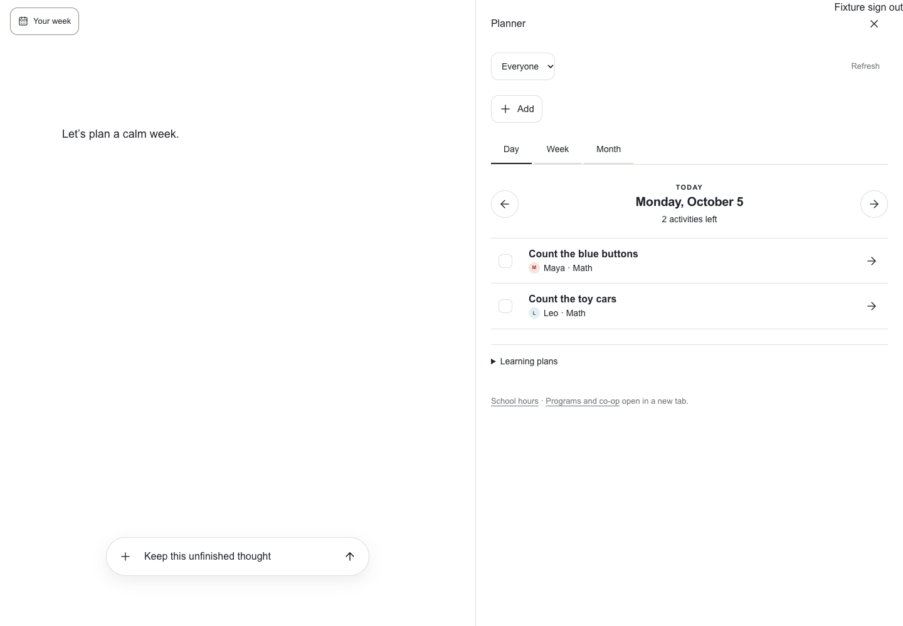
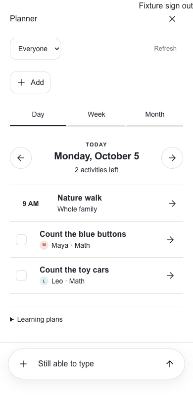
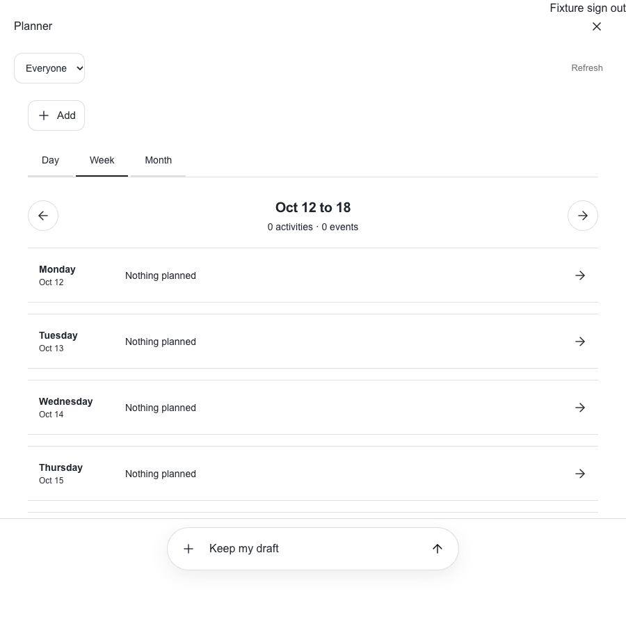
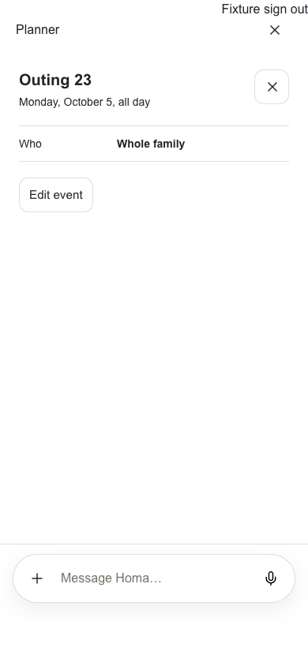

# App2 calendar beside the conversation

Owner: [#1223](https://github.com/sidneyswift/homa/issues/1223), within
[#1219](https://github.com/sidneyswift/homa/issues/1219). This extends the
[first workspace slice](../2026-10-05-app2-workspace/README.md).

## Implemented

The adjacent white workspace now embeds the existing calendar's day, week and
month views. Date, view and child selection live in the App2 URL and restore after
refresh or browser history navigation without remounting the conversation.
Event details, event editing and recurrence controls stay inside the panel.
Existing authenticated server actions own writes; a failed calendar transport
keeps the form and entered values available for recovery.

The read endpoint uses the same paid admission and caller-RLS readers as the
existing planner. Only authenticated AppData supplies family identity. Reads are
bounded to a week or month grid in the family's timezone, never cached publicly,
and fail together rather than displaying a false empty calendar.

Activity help prepares child, date and activity text in the existing composer,
appending to an existing draft without sending. Unscheduled learning plans remain
available in the Learning plans disclosure. School hours and Programs and co-op
remain explicit new-tab links pending their own workspace tickets.

## Verification

- Full mounted conversation suite: 24 passed. Final workspace rerun after visual
  and label corrections: 14 passed, including desktop and phone layouts, history,
  access loss, unknown child, failed loads, completion, event save failure/retry,
  single-occurrence deletion, contextual draft append, Add menu dismissal, and
  scrolled detail opening and restoration.
- Focused data, URL, calendar and recurrence tests: 53 passed.
- Web typecheck and changed-file ESLint passed.
- Tenant isolation guard passed. Its existing rollout-aware table coverage now
  includes conversation_rebuild_settings; no table or rollout flag was changed.
- Unauthenticated HTTP request to the actual endpoint returned 403.
- Read-only signed-in App2 verification loaded day and month views, opened Add
  event, and cancelled. No actual family event or completion was written.
- Independent UX/accessibility review identified clipped menus, lost activity
  context and hidden detail headers; these were corrected. A final screenshot
  caught background Add chrome painting above the detail, now covered by the
  focused regression and final phone evidence.

Commands:

```sh
corepack pnpm --filter web typecheck
corepack pnpm --filter web exec playwright test --config playwright.conversation-controls.config.ts
TSX_TSCONFIG_PATH=apps/web/tsconfig.json corepack pnpm exec node --import tsx --test apps/web/lib/workspace-planner-data.test.ts apps/web/app/app2/workspace-location.test.ts apps/web/lib/unified-planner.test.ts apps/web/lib/family-events.test.ts
corepack pnpm check:isolation
corepack pnpm check:brand-surfaces
corepack pnpm check:legacy-removal
```

## Evidence limits and remaining work

Browser writes use disposable synthetic backend fixtures. They are not proof of
production writes, physical-phone keyboard behavior or active voice continuity.
The actual signed-in check was read-only. Full recurring-series move/edit journeys,
unsaved-edit protection, structured selected-object context, proposed-plan review,
bulk rescheduling and remaining planner parity are still open on #1223/#1221.
This is not completion of the epic or permission to activate the conversation
rollout. No production deployment, schema change or flag enablement occurred.

## Synthetic fixture screenshots

The harness uses the real conversation and planner components with synthetic
family data. It omits the 3D character and adds a test-only sign-out control.








