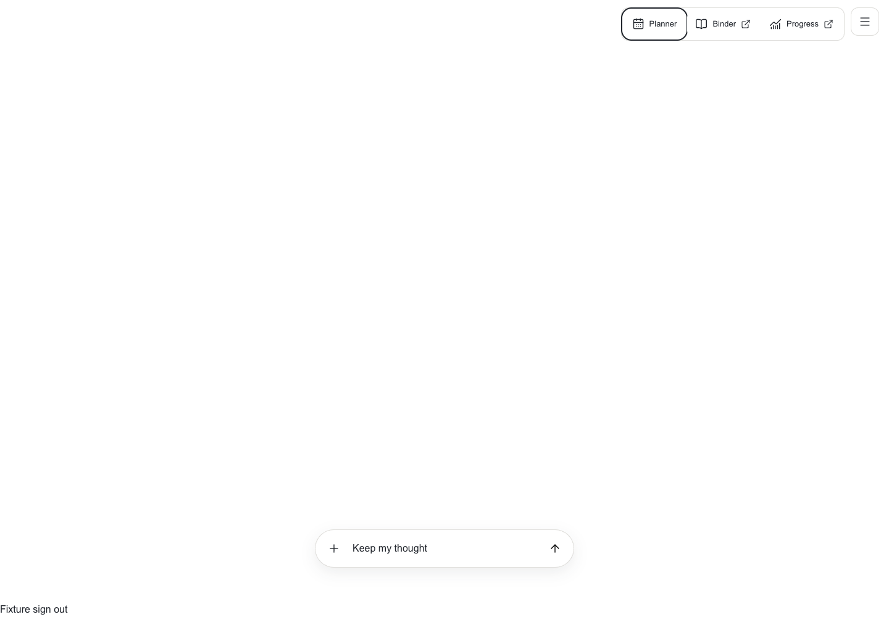
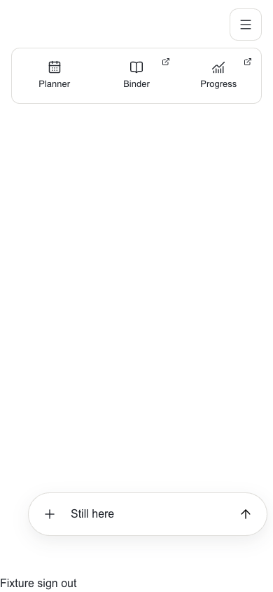

# App2 compact navigation

Owner: #1220 and #1221, under epic #1219. Sidney approved replacing Your week
with a top-right menu, three primary destinations and the existing white styling.

The disclosure reveals Planner, Binder and Progress with semantic icons and
short labels. Desktop expansion stays left of the toggle; narrow screens use
a three-column tray below it. Planner opens the existing adjacent workspace.
Binder and Progress explicitly open their existing routes in new tabs until
their domain workspaces are implemented. This preserves conversation and voice
state rather than navigating away, and does not claim embedded domain parity.

The menu closes after selection, outside pointer interaction or focus leaving
the navigation. Escape dismisses it and restores toggle focus without closing
the planner. Current Planner selection has a text and semantic indicator. The
toggle remains reachable while the phone planner is open; its Close control
has a separate target. Access loss closes the tray and disables its toggle.

## Verification

- All 26 mounted conversation/browser cases passed, including keyboard reveal,
  destination links, active selection, nested Escape, draft preservation, phone
  reflow, forced colors, reduced motion and sign-out cleanup.
- Web typecheck, changed-file ESLint and whitespace checks passed.
- Actual signed-in local App2 revealed the menu and its three labeled controls.
  No message, voice call or family write was initiated.
- Independent UX/accessibility review of source and desktop/phone screenshots
  found no blockers. Menu and planner Close have separate 44px targets.
- Screenshots below use the real components and disposable synthetic backend
  fixtures. The character is omitted; the sign-out control is harness-only.

No production activation, schema or conversation persistence changes.

