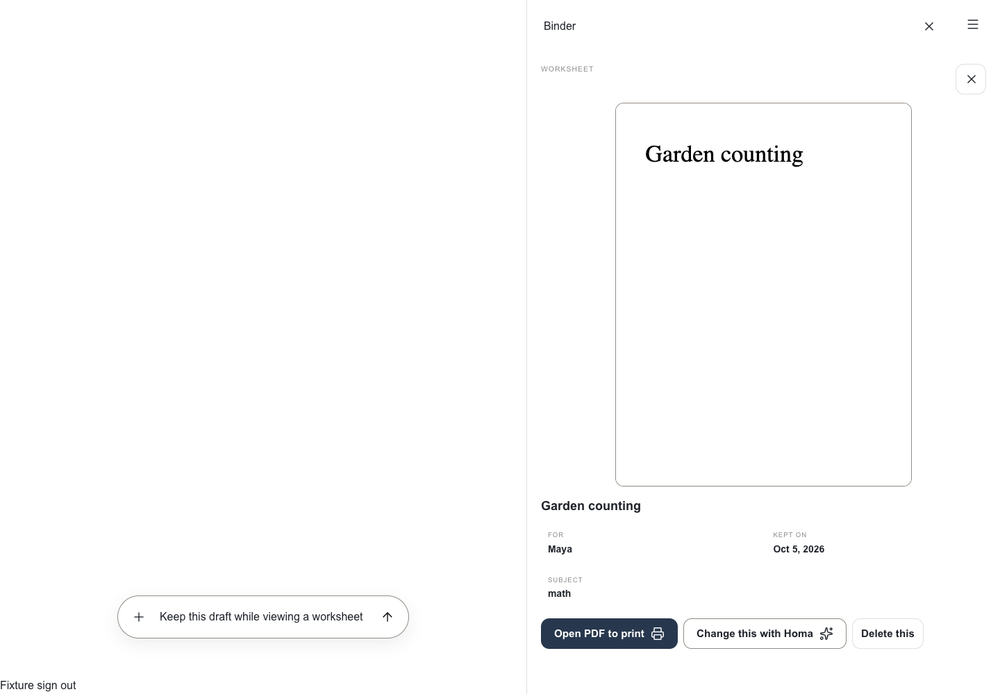
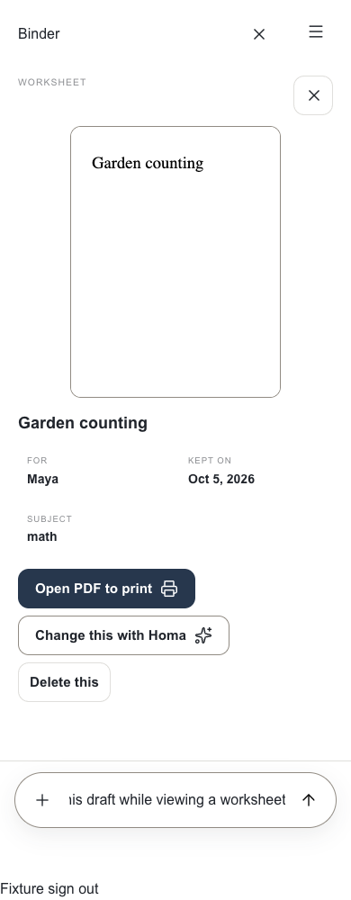
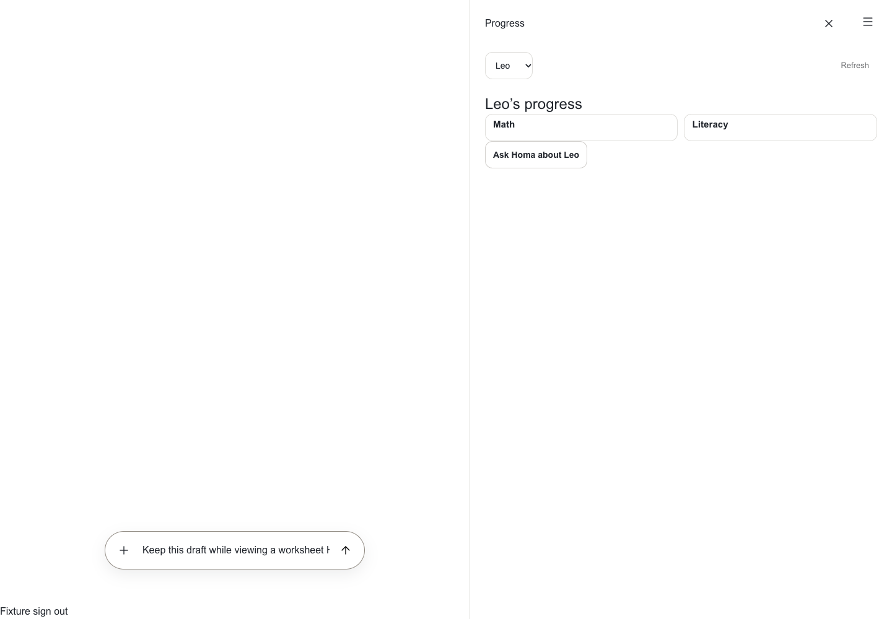
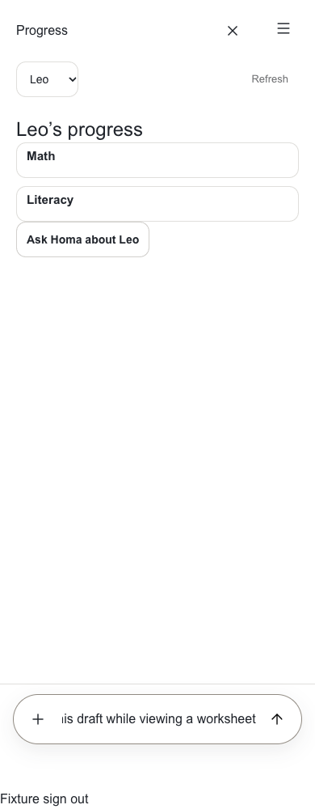

# App2 Binder and Progress workspace pages

Owner: #1221, #1226 and #1229, under epic #1219. Sidney requested Binder and
Progress pages matching Planner, while preserving the white, minimal App2 design.

All three primary destinations now open in the same workspace beside chat on
desktop and in the existing phone sheet. Binder and Progress reuse their existing
authenticated server content, including child scoping, feature gates, finalized
materials and evidence calculations. Their detail views stay inside the workspace,
leaving the composer available. Child-specific questions establish the authenticated
child context and prepare a named draft without sending it.

The persistent App2 layout owns the conversation. Navigating or retrying a workspace
page does not recreate the chat, draft or voice component. Page-level failures stay
inside the workspace. Navigation, child selection and browser history use the URL.

## Verification

- All 28 mounted conversation/browser checks passed. The two Binder and Progress
  journeys were rerun after final changes and passed at 1440px and 390px.
- Actual Binder material detail and Progress subject detail components were exercised
  with synthetic records, including composer access, child switching, draft retention,
  returning to chat, browser Back and absence of extra primary navigation tabs.
- All 422 Progress UI regression tests passed. Isolation, workspace URL tests,
  web typecheck, changed-file ESLint and whitespace checks passed.
- Independent UX/accessibility source and screenshot review found no remaining major
  blockers after fixes to child-specific questions, restore feedback and action spacing.
- Actual signed-in local Binder content loaded. Signed-in Progress could not receive
  final visual verification because browser automation became unresponsive. An earlier
  transient child lookup failure motivated moving conversation ownership into the
  persistent layout and isolating workspace page errors.
- Screenshots use real components with disposable synthetic backend fixtures. The
  character is omitted and the sign-out button is harness-only.

## Remaining domain scope

This establishes the primary pages, not full completion of #1226 or #1229. Secondary
legacy workflows, including certain assessments, account settings and historical
reports, still open in a separate tab to preserve chat. Library/Binder consolidation
remains #1227. No production activation, schema or conversation recording changes.

