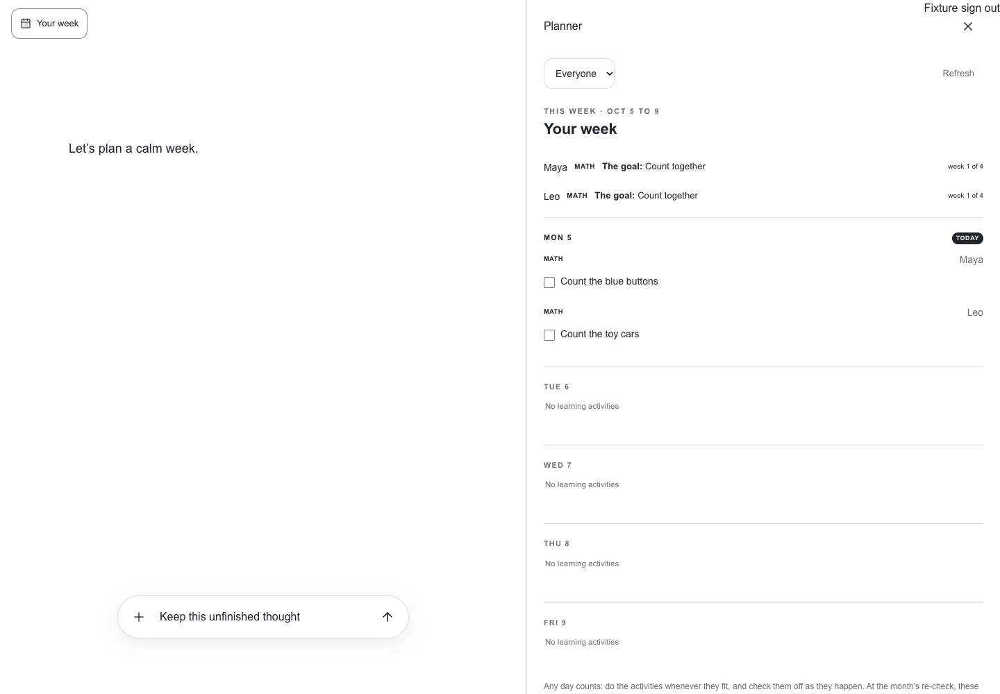
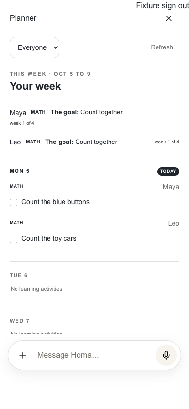
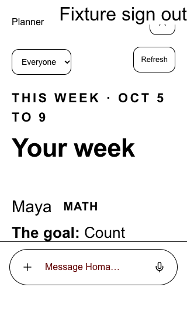

# App2 adjacent workspace, first connected slice

Owner: [#1221](https://github.com/sidneyswift/homa/issues/1221), within
[#1219](https://github.com/sidneyswift/homa/issues/1219).

The founder selected desktop work beside the conversation and explicitly retained
the white, minimal app2 design. See `app2-adjacent-white-workspace` in the founder
ruling index. This slice reuses the authenticated learning-plan board and atomic
completion endpoint. No new database, agent tool, model, or retention policy.

## Evidence scope

- The 18-test real React browser suite passes, including the existing conversation
  regression cases and eight workspace journeys. Backend and auth responses use
  disposable synthetic fixture data; no family records are written by the suite.
- Desktop: planner and conversation are both visible. Opening, child switching,
  browser Back/Forward and closing preserve the same input DOM node and draft.
- Phone: the covered transcript and launcher are inert. The composer, voice
  launcher and failed-message recovery remain visible and operable.
- Deep links restore after refresh. A child absent from the authenticated board
  produces an unavailable state instead of silently showing everyone.
- A failed board load offers retry without claiming the family has no activities.
- Completion calls the existing authenticated atomic endpoint with child, subject,
  revision and activity identity; the checked result survives reopening.
- Signing out closes the panel, clears its view URL and disables the launcher.
- 320px by 568px with 200% root text size, forced colors and reduced motion passes
  the overflow and composer reachability checks. This is browser-fixture evidence,
  not a physical-phone keyboard or voice-call test.
- The final presentation-only adjustment also passes all eight workspace browser cases.
- Web typecheck and changed-file ESLint pass. Twenty focused URL, planner-render
  and atomic completion-controller tests pass. Design projection parity, the 47-test
  brand inventory check and the 15-test removal-ledger check also pass.
- A read-only check in the running authenticated app2 confirmed the actual empty
  board response, white phone presentation, and Plan with Homa focusing the input
  while the planner stays open. No real completion write was performed.

Commands:

```sh
corepack pnpm --filter web typecheck
corepack pnpm --filter web exec playwright test --config playwright.conversation-controls.config.ts
TSX_TSCONFIG_PATH=apps/web/tsconfig.json corepack pnpm exec node --import tsx --test apps/web/app/app2/workspace-location.test.ts apps/web/app/app/planner/planner-view.test.tsx apps/web/lib/use-authenticated-plan-checks.test.ts
```

## Independent review

An independent UX/accessibility critic found four issues: a covered phone header,
recovery controls behind the sheet, same-tab planner links interrupting chat, and
ambiguous child initials. All four were corrected. Source re-review found no
remaining blocker; the final rendered evidence below includes the phone header,
full child labels and reachable composer. An additional browser regression caught
the empty-chat recovery overlap and now covers the repaired path.

## Remaining scope

This is not completion of #1221 or planner parity. The second object type,
authenticated selected-object context for Homa, restore after an authentication
redirect, domain date/version scope, full calendar and event editing, and the
remaining epic surfaces are still open. Calendar/events and report/source links
use explicit new-tab handoffs until their domain tickets replace them. Active
voice continuity, actual mobile keyboard behavior and multi-adult revocation need
their runtime acceptance evidence. Nothing in this record claims production
deployment or activates the gated conversation rollout.

## Synthetic fixture screenshots

The fixture uses the real shell, composer and planner. The 3D character is omitted
from this deterministic harness; it remains in the actual app.






