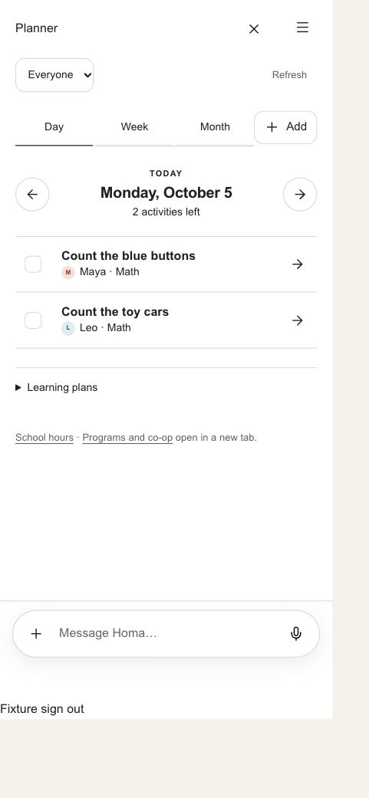
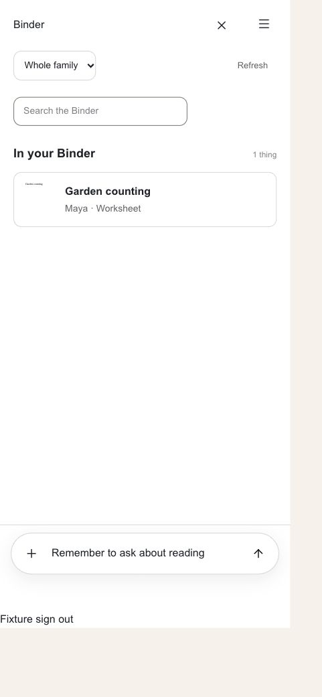
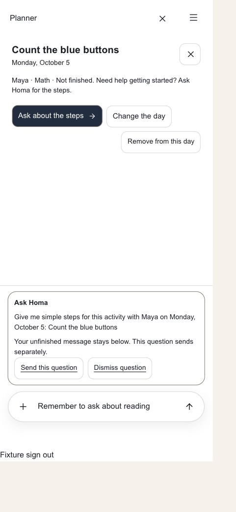
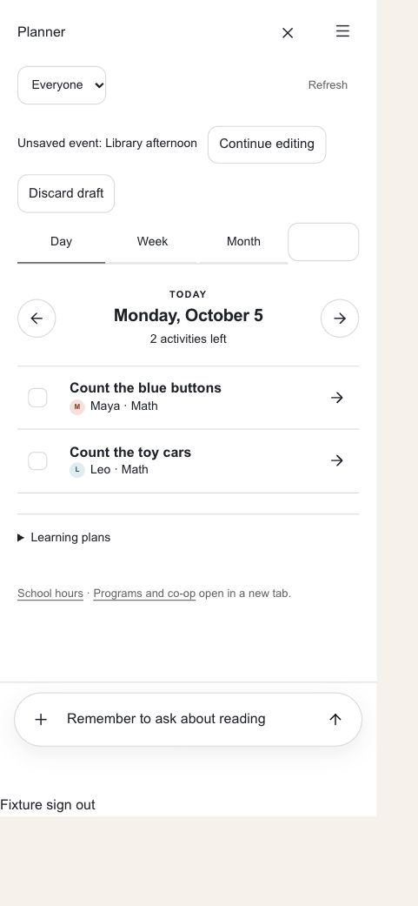

# App 2 parent usability improvements

Owner: #1219, implemented in the existing #1158 / PR #1215 lane. Related surfaces: #1221, #1222, #1223, #1226, #1227, #1229.

## Behavior

- Contextual help opens a separate question with explicit Send and Dismiss actions. It never silently combines with an unfinished message. Sending preserves draft text, staged files, and reply context. On phones, Send reveals the conversation; on desktop, the workspace stays beside it.
- Activity details prioritize the activity, child, subject, and next action. Dates in help questions use readable words. Newly checked activities remain visible in the expanded Finished section.
- Event drafts survive closing the editor and switching workspace sections. Continue editing restores the draft; successful save clears it. Discard requires confirmation, sign-out clears it, and page unload warns. Drafts are session-only: they do not survive a confirmed page reload or a browser crash.
- Planner view tabs and Add share a compact row. Week summaries include an activity title.
- Binder uses compact rows with child and material labels, without the duplicate cover introduction. Discuss changes prepares an in-App2 conversation about the named worksheet. This is not exact selected-material revision parity: the durable transport still needs the typed material identity handoff tracked under #1226.
- Progress keeps the saved answer visible and collapses provenance under Where this answer came from in App2 only. App1 retains its existing source presentation.
- Workspace primary buttons retain the contract's paper-on-midnight contrast.

## Evidence and limits

Screenshots use the real shared components in the existing conversation-controls fixture at a 390px phone viewport with synthetic family data. The fixture substitutes fonts, omits the mascot, and simplifies the Progress page wrapper. No real family records were written. This is local component evidence, not production or live-model proof. App2 remains development-only under the existing route gate.

## Validation

- `pnpm exec playwright test --config playwright.conversation-controls.config.ts --workers=1 --reporter=line` in apps/web: 32 passed, including durable queue, file preservation, phone handoff, event save failures, section changes, and sign-out.
- `pnpm --filter web typecheck`: passed.
- Scoped ESLint on the eight changed TypeScript UI components: passed.
- `pnpm check:progress-ui`: 422 passed.
- `pnpm build:brand-surfaces` and `pnpm check:brand-surfaces`: passed.
- `pnpm check:design-parity`: passed.
- `git diff --check`: passed.
- Next dev App2 route on port 3002 returned HTTP 200. This unauthenticated probe proves route compilation, not authenticated functionality.

## Independent review

Reader gate flagged ambiguous prepare terminology and duplicate drafts. Revised to one explicit separate question, Send, and Dismiss. Copy editor returned no must-fix notes; its error-preservation suggestion was applied.

Independent screenshot reviewer found no blocking hierarchy issue in Planner or Binder. Largest remaining usability gap is the low prominence of School hours and Programs compatibility links (#1223). Binder thumbnail recognition with representative materials remains a follow-up under #1227. Existing browser tests cover narrow reflow, large text, forced colors, keyboard navigation, and reduced-motion conditions; screenshots alone do not establish device or screen-reader acceptance.
