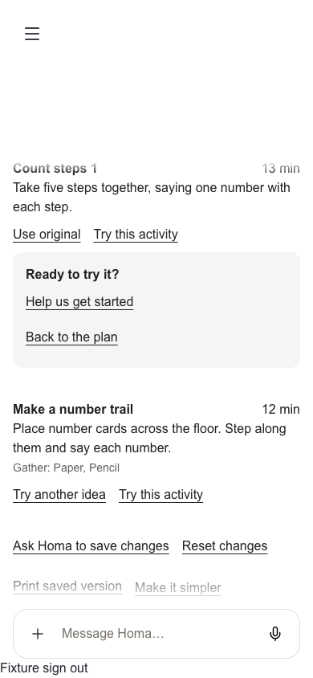

# App 2 saved activity plans

Owner: #1226, under #1219. Delivery lane: PR #1215.

## Capability

A parent asks for a short activity plan. The materials-studio fleet skill chooses
activities and alternatives; create_printable validates the typed payload and
renders its PDF. The same payload is retained in generation.input.activityPlan
and re-scoped through the existing material, history and Binder reads.

App 2 renders a white, sans-serif activity card with a 10 to 60 minute control,
local alternatives, help starting an activity, and an explicit request to save
changes. Code allocates positive whole minutes that add up exactly to the selected
total. Unsaved choices are not described as saved. Sending the prepared request
uses the existing revision flow. Approval remains separate. Trying an activity
writes no completion, progress or Hours record.

App 1 retains the printable material card. No migration or new storage table is
required. Arbitrary generated HTML remains confined to the development lab.

## Verification

- All 552 material-guard tests pass, including the new activity-plan contract.
- 50 focused contract, Binder, material-message and history tests pass.
- Seven existing App 1 MaterialCard rendering tests pass.
- All 34 conversation browser tests pass; the new phone test uses the real
  conversation feed, checks that the save control scrolls above the composer,
  waits for an explicit send, and restores the stored selections on reload.
- The final activity browser test passes after moving its scoped styles to the
  App 2 workspace boundary.
- Positive and negative model evals pass against disposable Postgres and artifact
  storage: create a typed plan, successfully save it, reopen its typed content,
  and avoid creating a plan when the parent only asks to reopen a workbook.
- The full three-turn model journey also passes all eight gates: create, reopen,
  then save a linked revision with 25 minutes and the selected alternative. It
  completed in 1 minute 51 seconds without approving or recording learning.
- TypeScript, scoped ESLint, fleet-skill package hygiene, tenant isolation,
  Eve build, Eve stream-duration and brand-surface checks pass.

The screenshot is synthetic browser evidence, not a production family record or
an installed-device test. No production activation or merge is claimed.

## Independent review

The independent reviewer found three issues: a premature promise of save success,
simplification dropping unsaved choices, and missing child/source context. All
three were corrected. No component visual blockers remained. The follow-up
conversation browser test verifies the requested composer clearance.

