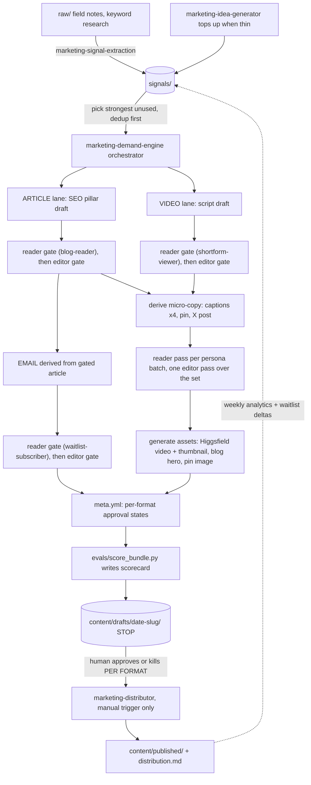

# 14 · Marketing demand engine

> **Status:** Approved dated DM1 through DM7 specification from the 2026-07-05
> design session. The implementation now exists in the repository. Current
> operational status belongs in `marketing/AGENTS.md` and
> `marketing/workflows/demand-engine.md`; this file remains the decision and
> acceptance-criteria source. Repository presence does not prove provider auth,
> publication, delivery, or production behavior. Owner: Sidney (founder/PM).
> **Provenance:** adapted from the founder's B2B consulting content engine (report:
> "How the content pipeline works"). Every load-bearing principle is restated here,
> so this doc stands alone.
> **Relationship to the PRD:** marketing tooling around the product, not product.
> It ships no product features and touches `apps/web` only to add the public blog
> (§9). All PRD non-goals stay intact. No schema or product-query changes.

## 1. What this is

One pipeline that turns raw marketing material into a staged bundle per run: an SEO
blog article, a shortform video, per-channel captions, a Pinterest pin, and a
waitlist email. Every format passes AI review gates before a human sees it, lands
staged with per-format approval state, and is never auto-published.

The B2C adaptation: for homeschool moms, shortform video is a pillar output beside
the article, not a derivative of it. Two lanes share one signal reservoir and one
set of gates.

## 2. Founder decisions baked in (2026-07-05, do not relitigate)

- **DM1 Location:** inside the homa repo. Content and state in `marketing/`,
  pipeline skills in `.agents/skills/marketing-*`. Not a separate repo.
- **DM2 Blog:** built in `apps/web` as part of this project (routes, MDX, SEO
  plumbing). Git is the CMS.
- **DM3 Channels at launch:** blog, TikTok, Instagram (Reels + feed), Pinterest,
  Facebook page, YouTube Shorts, X, waitlist email.
- **DM4 Cadence:** manual trigger first ("run tonight's content" in chat). Routines
  ship written but disabled. Publishing is a manual, per-format human action,
  forever, regardless of any future scheduling.
- **DM5 Scope:** the full engine now (skills, routines, distribution wiring,
  engagement loop, janitor), built so blocked steps fail loudly with a list of
  what is missing, instead of silently doing less.
- **DM6 Email lane:** day one. The bundle includes a waitlist nurture email.
- **DM7 (OPEN, founder ruling needed):** email consent scope, see §10. Until ruled,
  emails are staged, never sent.

## 3. The three-layer law

Three concerns, three kinds of files, never blurred:

| Layer | Lives in | Answers |
|---|---|---|
| Logic | `.agents/skills/marketing-*/SKILL.md` | How does this one step work, exactly? |
| Schedule/config | `marketing/routines/*.md` | When does it run, with what access, with what literal prompt? |
| Map | `marketing/workflows/demand-engine.md` | How do steps chain end to end, and what is built vs blocked? |

A workflow file names the skills it chains, never re-explains their steps. A routine
names the skill it runs, never re-documents the schedule elsewhere. Folders store
things; the workflow file explains flow.

## 4. Folder layout

```
marketing/
  AGENTS.md          # the laws of this folder (§15), read first by every skill
  raw/               # source material as it arrived: field notes, keyword exports
  signals/           # the reservoir: one atomic sourced idea per file
  content/
    drafts/          # staged bundles awaiting human approval, one dir per bundle
    published/       # bundles after publish, each with distribution.md of URLs
  personas/          # reader personas the reviewer gate role-plays (§7)
  voice/             # house-style.md: anti-slop banlist + Homa voice rules
  workflows/         # demand-engine.md: mermaid map + step/status table
  routines/          # SPEC.md, nightly-content.md, weekly-engagement.md, runner.md
  evals/             # score_bundle.py + scorecards/
```

Raw and signals are a reservoir (long-lived, topped up, drawn from many times).
Drafts and published are outputs (point-in-time artifacts moving through approval).
That lifecycle difference is why they are siblings, not nested.

**Growth map (documented here, created only when the first real file arrives, no
empty folders ever):** `reports/` (engagement loop output), `assets/` (reusable
b-roll, thumbnail templates, audio beds, Higgsfield references), `seo/` (keyword
map, content clusters), `swipe/` (saved hooks and posts worth studying),
`campaigns/` (time-boxed pushes: back-to-school, New Year), `experiments/`
(hook/thumbnail A/B results), `creators/` (collab tracking).

**Never in `marketing/`:** positioning and persona source material (lives in
`docs/homa-planning/`, referenced, one copy), design tokens (`docs/homa-design/`),
anything from `homa-macmini/`, `homa-research/`, or `homa-template/`.

## 5. The pipeline, per bundle



Step by step:

1. **Capture.** Raw material lands in `raw/` as it arrived. `marketing-signal-extraction`
   reads it and writes one atomic file per idea into `signals/`, with frontmatter:

```yaml
id: 2026-07-08-moms-fear-gaps-not-curriculum
type: insight            # insight | content-idea | seo-keyword | market-signal | engagement
hook: "Moms don't fear the curriculum, they fear invisible gaps."
formats: [article, video]
source:
  type: field-note       # field-note | planning-doc | keyword-research | engagement-report
  ref: marketing/raw/2026-07-06-conference-prep-notes.md
  locator: "L41-52"      # verbatim quote or line range, never a paraphrase
status: new              # new -> queued -> used -> archived (or evergreen)
used_by: null
```

   The load-bearing rule: **every claim traces to a real, quotable source, or it does
   not get written down.** A signal without a resolvable `source` cannot exist
   (the scorer asserts this mechanically).

2. **Pick and draft.** `marketing-demand-engine` picks the single strongest unused
   signal (dedup against everything drafted and published), then drafts the two
   pillars: the SEO article (`marketing-article-writer`) and the video script
   (`marketing-video-producer`).

3. **Gates on the pillars (§7).** Reader gate then editor gate, in that order, on
   the article and on the script, each with its own persona. The article gets a
   second fresh blog-reader cold-read after editor fixes. Any new comprehension
   failure returns to the main agent for revision and another editor check on
   changed copy. Completion means no unresolved reader failure and zero editor
   must-fixes, not merely that the gates were invoked.

4. **Derive, gate again.** The email derives from the gated article and gets the
   full two-gate treatment with the waitlist-subscriber persona (it lands in real
   inboxes of exactly the people we are wooing). Micro-copy (four video captions,
   pin title + description, X post) derives from the gated pillars and gets a
   reader pass per persona batch plus one editor pass across the whole set. Full
   double-gating on nine tiny formats would triple run cost for marginal gain;
   this is a deliberate, documented deviation from the B2B system.

5. **Generate assets.** `marketing-video-producer` renders the 9:16 video via the
   installed `higgsfield-generate` skill plus a thumbnail. `marketing-illustrator`
   makes the blog hero and the 2:3 pin image against the design system.

6. **Manifest.** `meta.yml`, the approval state machine (§6).

7. **Score.** `evals/score_bundle.py` grades the bundle and writes a scorecard.
   The floor, not the gate (§14).

8. **Stop.** The run ends with the bundle staged in `content/drafts/` and committed.
   **Never auto-publish.** A human approves or kills per format.

9. **Publish (manual).** `marketing-distributor` publishes only formats marked
   `approved`, only when the founder explicitly says publish (§11).

10. **Loop.** `marketing-engagement-loop` files what resonated back into `signals/`
    as aggregate insights (§12).

## 6. Bundle anatomy

`marketing/content/drafts/<date>-<slug>/`:

```
article.mdx            # SEO pillar, frontmatter per the blog contract (§9)
video/
  script.md            # hook (first 2 seconds), beats, CTA, shot plan
  video.mp4            # Higgsfield output, 9:16
  thumbnail.png        # YouTube Shorts cover / general thumbnail
captions/
  tiktok.md            # caption + hashtags, within platform limits
  instagram.md         # reels caption + feed variant
  youtube.md           # title + description
  facebook.md
x.md                   # standalone X post derived from the article
pin/
  pin.png              # 2:3 Pinterest image
  pin.md               # pin title + description + link to the article
email/
  email.md             # subject + preview + body, waitlist nurture
images/
  hero.png             # blog hero (+ optional inline figures)
meta.yml
```

`meta.yml`, the approval state machine:

```yaml
id: 2026-07-08-invisible-gaps
source: marketing/signals/2026-07-08-moms-fear-gaps-not-curriculum.md
lanes: [article, video, email]
formats:
  - {file: article.mdx,        channel: blog,      status: draft}
  - {file: video/video.mp4,    channel: tiktok+instagram+youtube+facebook, status: draft}
  - {file: captions/tiktok.md, channel: tiktok,    status: draft}
  - {file: captions/instagram.md, channel: instagram, status: draft}
  - {file: captions/youtube.md,   channel: youtube,   status: draft}
  - {file: captions/facebook.md,  channel: facebook,  status: draft}
  - {file: x.md,               channel: x,         status: draft}
  - {file: pin/pin.md,         channel: pinterest, status: draft}
  - {file: email/email.md,     channel: email,     status: draft}
gates:
  article: "reviewer(blog-reader) -> editor, ran 2026-07-08"
  script: "reviewer(shortform-viewer) -> editor, ran 2026-07-08"
  email: "reviewer(waitlist-subscriber) -> editor, ran 2026-07-08"
  micro-copy: "reviewer per batch -> one editor pass, ran 2026-07-08"
scorecard: marketing/evals/scorecards/2026-07-08.json
```

Statuses: `draft -> approved | killed`, set only by a human, per format. The article
may ship while the email dies; that is the point.

## 7. The gates

The quality mechanism, ported unchanged from the B2B system:

- **The reviewer** (`marketing-copy-reviewer`) is a fresh-context, read-only
  subagent that role-plays the actual reader. The persona file is pasted verbatim
  into its prompt. It reacts line by line, in character, in reading order ("I'm
  skimming now", "no idea what this means", "I'd stop scrolling here"). It never
  edits, it only returns reactions.
- **The editor** (`marketing-copy-editor`) is a second fresh-context, read-only
  subagent that role-plays a professional copy editor against
  `marketing/voice/house-style.md` (anti-slop banlist + voice principles). Notes
  only, never rewrites.
- **Order is a hard rule: reader first, editor second.** An editor pass alone can
  polish jargon into something readable without asking whether a distracted mom
  actually understands or cares. Fixing craft before checking comprehension hides
  the comprehension problem.
- **Both subagents are read-only.** The main agent decides which notes to accept
  and alone rewrites, so voice and judgment stay in one hand.

Personas (in `marketing/personas/`, grounded in `docs/homa-planning/journeys/01-personas-jtbd.md`,
synthetic composites, never real families):

| File | Who | Gates |
|---|---|---|
| `blog-reader.md` | The searching mom: typed a worry into Google at 10pm | article |
| `shortform-viewer.md` | The scrolling mom: thumb hovering, 2 seconds to earn the next 2 | video script + captions |
| `pinner.md` | The planner: saving ideas for next semester's board | pin |
| `waitlist-subscriber.md` | Already signed up, deciding whether Homa deserves her inbox | email |

## 8. The skills (12, single responsibility, named boundaries)

All in `.agents/skills/`, prefix `marketing-`. Every SKILL.md description states
what the skill does NOT do and which sibling owns it.

| Skill | Does | Does not |
|---|---|---|
| `marketing-signal-extraction` | Raw file in, atomic sourced signals out | Generate ideas from nothing (idea-generator) |
| `marketing-idea-generator` | Tops up the reservoir from positioning docs + keyword angles; generated ideas cite the planning doc as source | Draft content (demand-engine) |
| `marketing-demand-engine` | The orchestrator: pick signal, run lanes, call gates, stage, score, commit, stop | Publish anything (distributor) |
| `marketing-copy-reviewer` | Role-play the persona, reactions only, read-only | Edit or check style (copy-editor) |
| `marketing-copy-editor` | House-style notes, read-only | Define the voice (voice/house-style.md is the source) |
| `marketing-article-writer` | SEO pillar drafting rules + MDX frontmatter contract | Derive social formats (demand-engine orchestrates) |
| `marketing-video-producer` | Script structure + Higgsfield generation (chains to `higgsfield-generate`) + thumbnail | Pick the topic (demand-engine) |
| `marketing-email-writer` | One nurture email derived from the gated article | Send anything (distributor, gated on DM7) |
| `marketing-illustrator` | Blog hero, figures, pin image, against `docs/homa-design/` | Video (video-producer) |
| `marketing-distributor` | Publish approved formats, write distribution.md, move bundle to published/ | Decide what is approved (human, via meta.yml) |
| `marketing-engagement-loop` | Postiz analytics + waitlist deltas into reports + engagement signals | Draft content from those signals (demand-engine) |
| `marketing-janitor` | Archive used signals, expire stale ones, dedup the reservoir, scorecard trends | Touch content/drafts or published |

## 9. The blog (`apps/web`)

Git is the CMS. Published articles are MDX files in `apps/web/content/blog/`;
the staged drafts folder never touches the production build.

- **Routes:** `app/blog/page.tsx` (index: title, description, date, hero) and
  `app/blog/[slug]/page.tsx` (article, statically generated via
  `generateStaticParams`).
- **Rendering:** `next-mdx-remote` (RSC) + `gray-matter`. Typography,
  components, and generated assets consume semantic `@homa/design` exports
  and the real Logo adapter. Marketing routes cannot copy exact values or
  invent local colors, type, geometry, motion, or identity.
- **Frontmatter contract** (what `marketing-article-writer` must emit and the
  routes consume): `title`, `description`, `date`, `tags`, `hero` (path under
  `/blog/<slug>/`), `ogImage` (defaults to hero).
- **SEO plumbing:** per-article `generateMetadata` (title, description, OG),
  JSON-LD Article schema, sitemap coverage (extend `app/sitemap.ts`, or create it
  if absent, including existing routes).
- **Conversion:** every article ends with one verified current Homa CTA,
  normally `/onboarding`. Blog copy never mentions or links to a waitlist.
- **Publishing an article** = distributor copies `article.mdx` to
  `apps/web/content/blog/<slug>.mdx`, copies `images/` to
  `apps/web/public/blog/<slug>/`, commits. CI (typecheck + build) must stay green;
  no schema or query changes, so tenant isolation is untouched.
- RSS feed: growth map, not day one.

## 10. The email lane and the consent gate (DM7, open)

The pipeline stages `email/email.md` (subject, preview, body) day one, gated like
a pillar (§5.4).

**Sending is blocked on a founder ruling.** The live waitlist form promises "we'll
only use your email to send your invite." A marketing nurture email may exceed that
promise. Options for the ruling:

- **(a)** Keep pipeline emails scoped to invite/launch/conference updates, which
  arguably fits the existing promise, or
- **(b)** Update the waitlist form copy to ask for ongoing content consent going
  forward, and send nurture only to signups under the new copy.

Until DM7 is ruled: emails are staged, never sent, and `marketing-distributor`
says exactly that when asked to publish the email format.

Mechanics once unblocked: the distributor may send through Resend only after the
credential, audience scope, and production configuration are re-verified without
recording secrets in documentation. Recipient selection must use a family-safe,
auditable waitlist path. The public write-only RLS boundary stays untouched.

## 11. Distribution: what works day one vs what is blocked

`marketing-distributor` publishes only `approved` formats, only on explicit human
trigger, and writes `distribution.md` (canonical URLs, publish times) before moving
the bundle to `content/published/`.

| Channel | Repository or policy status | Still requires |
|---|---|---|
| Blog | Route and git publishing design exist; no approved article is present in `apps/web/content/blog/` | Approved bundle, CI result, deployment, and live article probe |
| Email | Staged only by policy | DM7 ruling, recipient-scope review, credential and delivery verification |
| TikTok, Instagram, Pinterest, Facebook, YouTube, X | Postiz procedure exists; provider auth and account connections are unverified | Verified handles, connected accounts, auth, and a bounded publish test |

Postiz wiring per its skill: `auth:status` check first, `postiz upload` every
media file, then `posts:create` per channel with platform settings. If auth or an
integration is missing, the distributor stops and reports the exact missing human
steps. It never half-publishes a format.

## 12. Engagement loop

Weekly (`routines/weekly-engagement.md`, manual until enabled):
`postiz analytics:platform` and `analytics:post` for published posts, plus
waitlist-signup deltas as aggregate counts via the Supabase MCP. Output: a report
in `marketing/reports/` (folder born with its first report) and new `signals/`
entries typed `engagement` for what resonated. **Aggregates only, never
individual parents' data, never PII in signals or reports.**

## 13. Routines and scheduling

`routines/SPEC.md` defines the format: schedule, required access, and the literal
prompt. Day one:

- `nightly-content.md`: daily 04:00 ET, runs `marketing-demand-engine`, stages one
  bundle, commits, stops. **Ships disabled.**
- `weekly-engagement.md`: Mondays, runs `marketing-engagement-loop`. **Ships
  disabled.**
- `runner.md`: how to enable unattended runs later (launchd template + agent CLI
  invocation). Enabling is a deliberate one-line human action, never an agent
  default. Publishing stays manual regardless (DM4).

## 14. The scorer: floor, not gate

`marketing/evals/score_bundle.py`, stdlib Python only, runs on every staged bundle,
writes `evals/scorecards/<date>.json` + `.md`. The AI gates are the bar; the script
catches regressions mechanically, and every slop phrase that slips through becomes
a new permanent assertion. Checks:

1. **Grounding:** `meta.yml` source resolves to a real signal file whose own
   `source.ref` resolves; banned source paths (`homa-macmini/`, `homa-research/`,
   `homa-template/`) appear nowhere.
2. **Voice:** no em dash anywhere; banlist phrases from `voice/house-style.md`;
   "HOMA" all-caps in prose; sibling-comparison and "behind"-framing terms.
3. **Non-duplication:** title/slug/body similarity against `content/drafts/`,
   `content/published/`, and `apps/web/content/blog/`.
4. **Completeness:** every `meta.yml` format's file exists; captions within
   platform character limits; `video.mp4` present when the video lane ran.

## 15. Safety rails (redundant on purpose)

Stated in `marketing/AGENTS.md`, in every skill, and in every routine, so no single
edit can remove a rail:

1. **Never auto-publish.** Unattended runs end at staged + committed. Publishing is
   a human-triggered, per-format action.
2. **Grounding is structural.** No source, no signal, no draft.
3. **Family data is banned.** `homa-macmini/`, `homa-research/`, `homa-template/`
   are never signal sources. Conference notes are anonymized at extraction (no
   real names of moms or kids in `raw/` or `signals/`). Engagement data is
   aggregate only.
4. **Voice laws** (from repo AGENTS.md + `docs/homa-design/`): no em dash, ever;
   the name is always "Homa"; brand marks use the real Logo component or a
   generated identity asset, never typed substitute lettering; sentence case;
   reassure-before-inform; offers never commands; no "behind" framing; never
   compare siblings.
5. **Secrets:** no keys in `marketing/` or in any bundle; Resend/Postiz/Higgsfield
   credentials live in env/local config only.

## 16. Historical acceptance criteria

These criteria define the approved v1 target. They are not a current completion
claim. The operational workflow owns step status, and production-dependent items
require direct evidence. As of the 2026-07-11 reconciliation, criterion 4 is not
met because no approved article is present in `apps/web/content/blog/`.

1. `marketing/` exists per §4 with real content in AGENTS.md, all four personas,
   house-style.md, the workflow map, all three routine files, and the scorer.
2. All 12 skills installed in `.agents/skills/` with boundary-stating descriptions.
3. One real bundle staged end to end: gated article, gated script, generated
   Higgsfield video + thumbnail, four captions, X post, pin (image + text), gated
   email, hero image, complete `meta.yml`, scorecard written and passing.
4. `/blog` live on thankshoma.com with the first approved article: index + article
   pages render with design tokens, metadata, JSON-LD, sitemap entries; CI green.
5. Distributor: blog publish works end to end; social and email paths stop with
   an exact, correct list of missing human steps; nothing auto-publishes.
6. README repo map lists `marketing/`; GitHub Issues carry the Postiz (#183) + DM7 (#182) items;
   build-log entry records this spec's decisions.

## 17. Explicitly not day one

Growth-map folders (§4) until their first file · RSS feed · scheduled/unattended
runs (built, disabled) · paid ads · influencer outreach · A/B testing machinery ·
any second pillar format (e.g. long-form YouTube).

## 18. Human dependencies (tracked as `founder-action`/`founder-decision` GitHub Issues since 2026-07-25)

1. Register @thankshoma on Instagram, TikTok, Pinterest, Facebook, X (already
   listed) plus a YouTube channel.
2. Connect each account inside Postiz, then `postiz auth:login`.
3. Rule DM7 (email consent scope, §10).
4. Later, optional: flip routines from manual to scheduled (§13).
