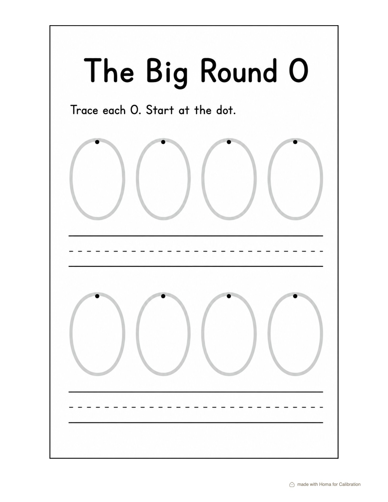
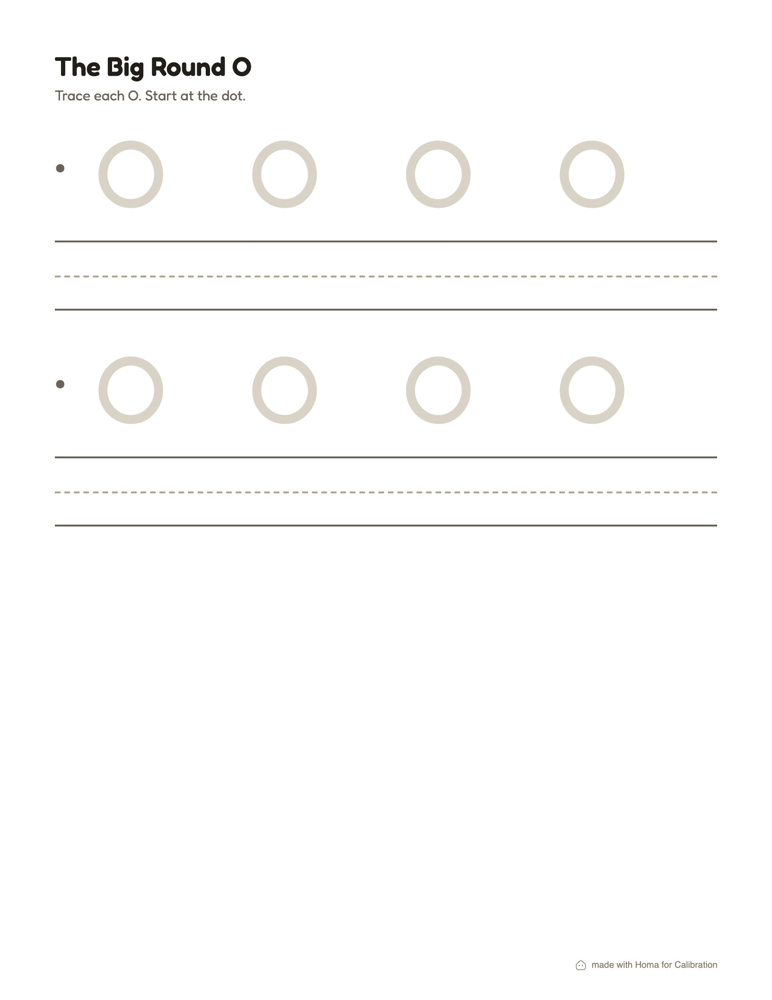
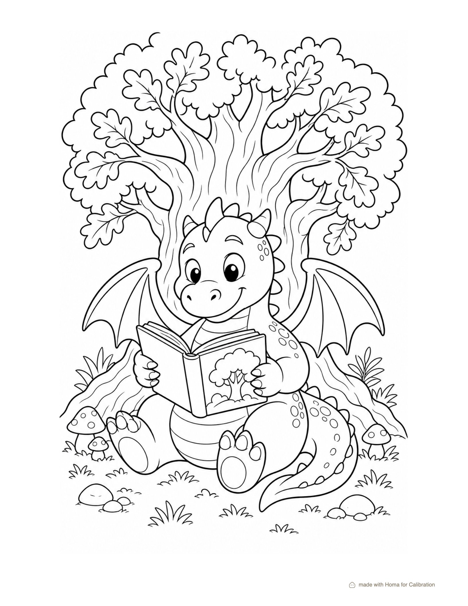
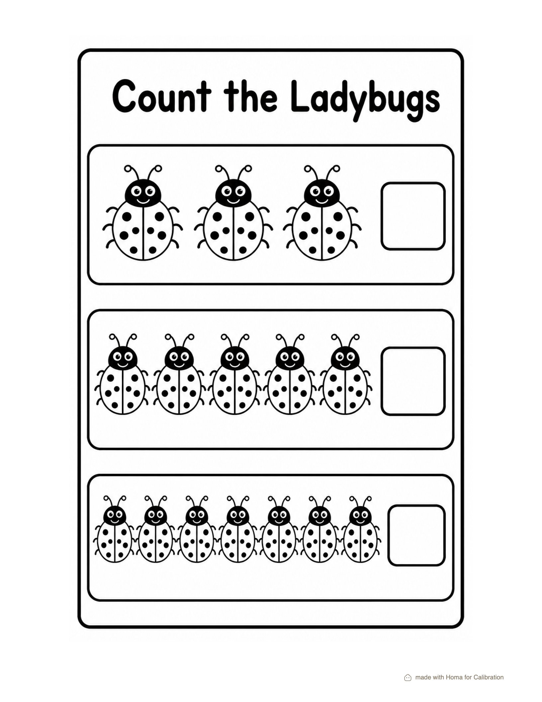
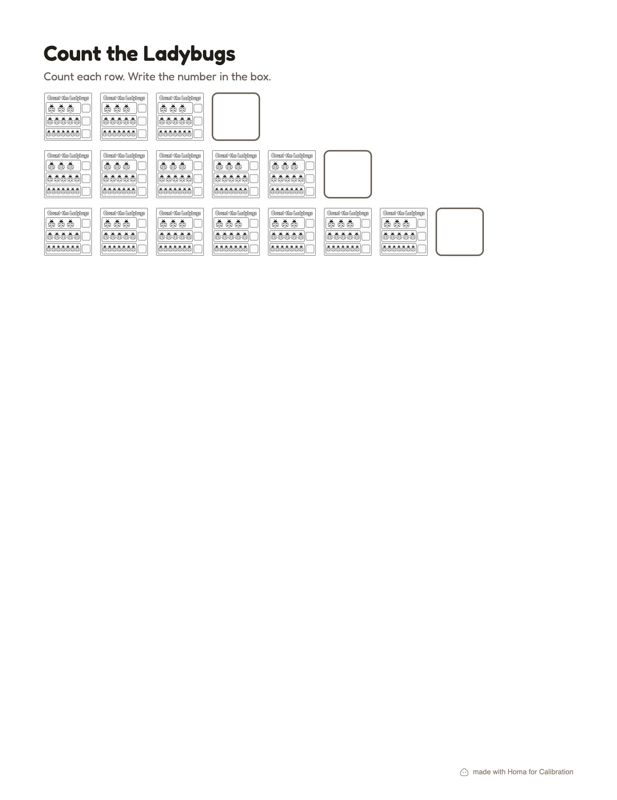
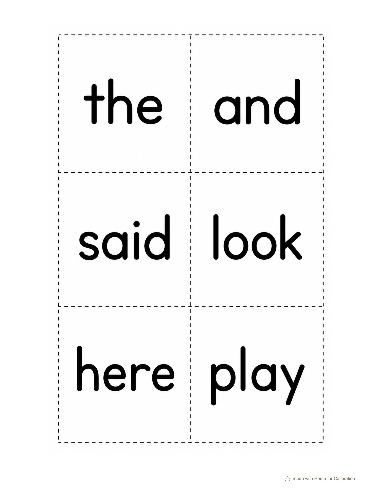
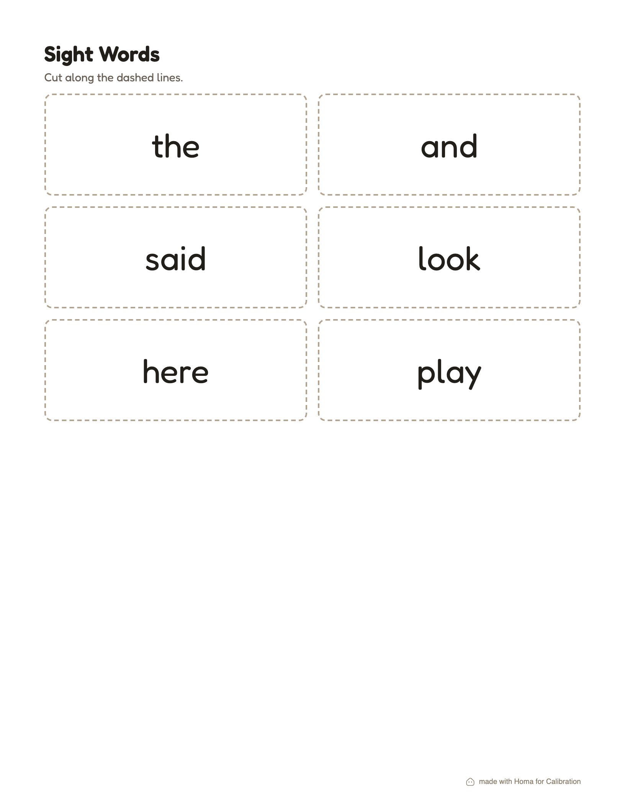
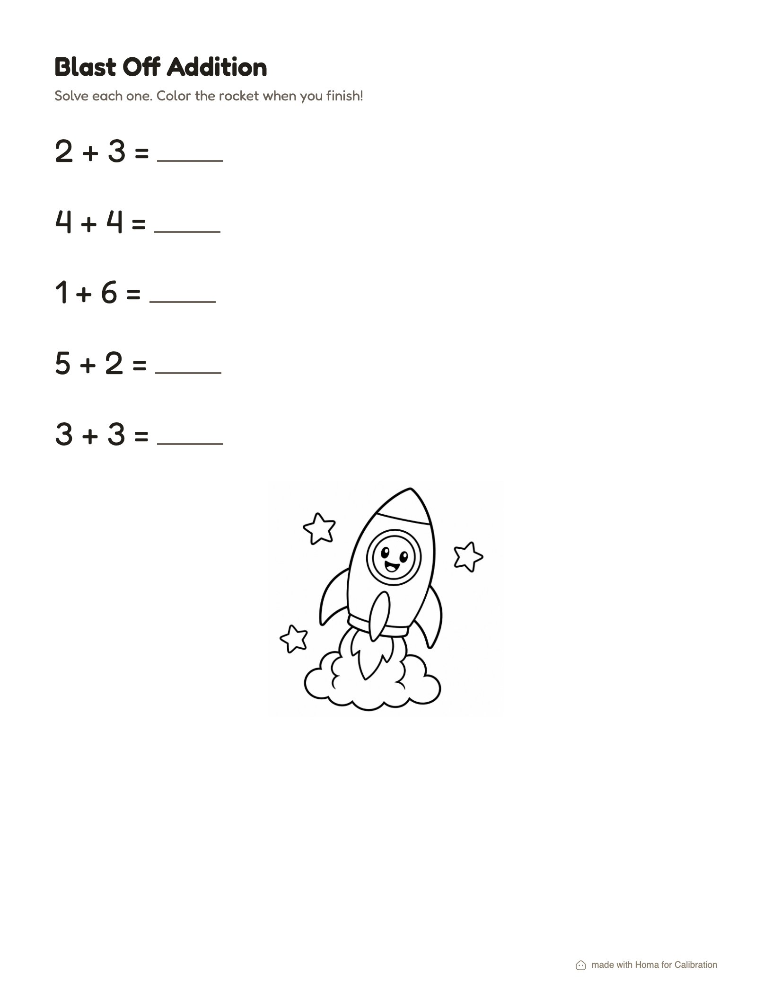
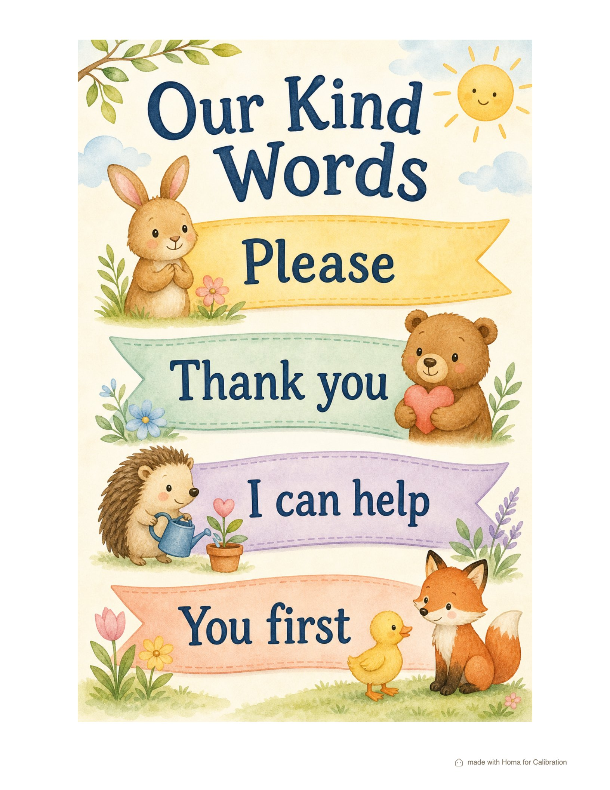
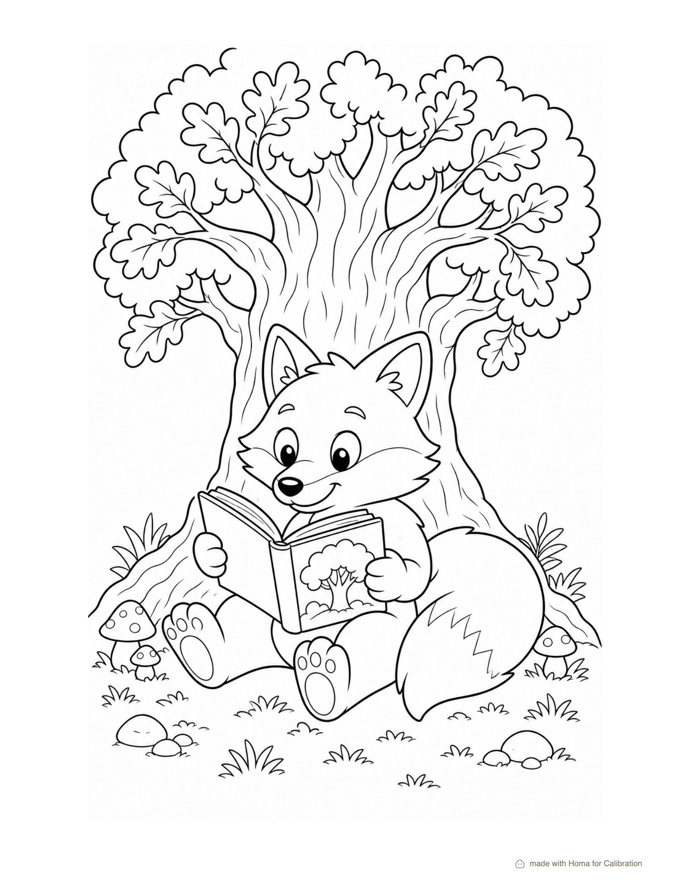

# Materials calibration · 2026-07-10

Image model: `openai/gpt-image-2` · reviewer: `openai/gpt-5.4-mini` (auto-score on).
Generated by scripts/materials-calibration.mts. Findings feed the
materials-studio skill's path-selection table; re-run on model swaps
and monthly.

## Findings (human-read against the outputs below)

1. **Image-direct is far stronger than assumed.** GPT Image 2 produced a
   correct tracing page (pale O's, start dots, 3-line guides, exact
   title and instruction text), EXACT counts (3/5/7 ladybugs), six
   correctly spelled flash cards, and a poster with the exact requested
   title and phrases. The old "never trust the image model with counts
   or text" rule is stale for this model at this density.
2. **Reference-driven restyle works.** The fox output kept the dragon
   original's line weight, composition, and background while swapping
   the character: the library reuse loop is real.
3. **Where html still wins:** speed and cost (2-3s and free vs 40-60s
   and a paid generation), surgical revisions ("make the O rounder" is
   one CSS edit; an image regen re-rolls the whole page), text-dense
   pages (word lists, paragraphs), and exact curriculum geometry (guide
   proportions).
4. **Hybrid law:** generate SINGLE-OBJECT assets for repetition. The
   failed hybrid run repeated a full-page image as if it were one
   ladybug; the auto-reviewer caught it (a true positive for MS-5). A
   hybrid image prompt must describe one object on white, nothing else.
5. **Reviewer calibration:** 9/10 verdicts matched human judgment; the
   one failure it flagged was genuinely broken. Wording of issues was
   actionable.

| Brief | Path | Outcome | Auto-review | Time |
|---|---|---|---|---|
| handwriting-dense | image | rendered | pass | 39s |
| handwriting-dense | html | rendered | pass | 3s |
| coloring-page | image | rendered | pass | 48s |
| counting-exact | image | rendered | pass | 45s |
| counting-exact | hybrid | rendered | issues: The worksheet shows repeated mini-activities and empty boxes, but the answer boxes are not filled and the page does not clearly present one answer box per ladyb | 58s |
| flashcards-text | image | rendered | pass | 37s |
| flashcards-text | html | rendered | pass | 2s |
| themed-hybrid | hybrid | rendered | pass | 24s |
| poster-title | image | rendered | pass | 59s |
| reference-restyle | image | rendered | pass | 58s |

## Outputs

### handwriting-dense · image

### handwriting-dense · html

### coloring-page · image

### counting-exact · image

### counting-exact · hybrid

### flashcards-text · image

### flashcards-text · html

### themed-hybrid · hybrid

### poster-title · image

### reference-restyle · image

## Blob urls created (delete with --cleanup)

- https://pkvvudjdhxk33dig.public.blob.vercel-storage.com/families/ce040043-81bd-472b-a0ab-f7c10d416ca0/images/4d929b96-a617-462c-ae9e-00a6e6284202-oLOWTv1h6g876xe1CwrBD2S6EBGMPR.png
- https://pkvvudjdhxk33dig.public.blob.vercel-storage.com/families/ce040043-81bd-472b-a0ab-f7c10d416ca0/images/31c993f1-3324-48fa-9a00-d3e2aab4be0e-RSHN5q31wlWnNo2eXaikjn27h9aYVJ.png
- https://pkvvudjdhxk33dig.public.blob.vercel-storage.com/families/ce040043-81bd-472b-a0ab-f7c10d416ca0/images/303b0d25-312c-483d-804f-e3649b8ceeaa-Hve8c2yONGc3aPNjgIRg2oQ776IS2H.png
- https://pkvvudjdhxk33dig.public.blob.vercel-storage.com/families/ce040043-81bd-472b-a0ab-f7c10d416ca0/images/1c03b5fb-40a8-42a3-9d6a-12e2b1c43900-R1gxhfCOOe0WF38kdKODooIK7EgCKF.png
- https://pkvvudjdhxk33dig.public.blob.vercel-storage.com/families/ce040043-81bd-472b-a0ab-f7c10d416ca0/images/5fdf1c80-ecd8-4a15-965c-dcb57c999cef-342TcJUuQ7EPuL5Osnju0YuBN1LOnH.png
- https://pkvvudjdhxk33dig.public.blob.vercel-storage.com/families/ce040043-81bd-472b-a0ab-f7c10d416ca0/images/85e9d52a-d48b-475b-a218-7c682a5ca011-r5U5Ii8GTBmpXg6vSfXDjn6HHIHbDe.png
- https://pkvvudjdhxk33dig.public.blob.vercel-storage.com/families/ce040043-81bd-472b-a0ab-f7c10d416ca0/images/05c09a47-2ff9-446c-abe0-3f5249b2360a-XeAmFWppaOEWdAOQ6Nk1yIzx7CQ7FN.png
- https://pkvvudjdhxk33dig.public.blob.vercel-storage.com/families/ce040043-81bd-472b-a0ab-f7c10d416ca0/images/89ac9fd6-0b1a-41e5-8fa6-c7e33722232e-FhFBt4kyQICncz00LFz14nH0ZIuMzd.png
