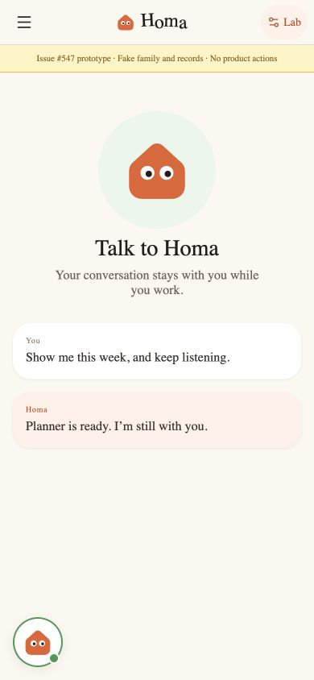
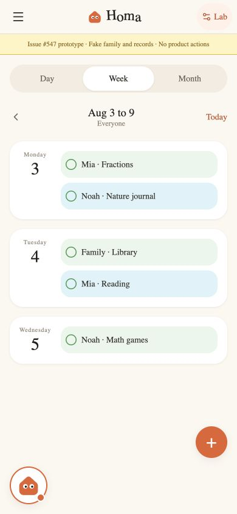
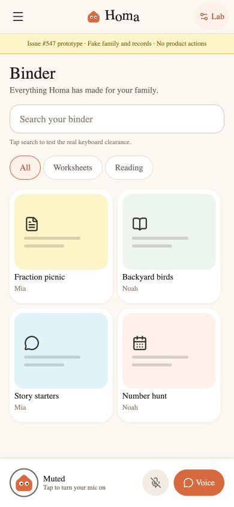
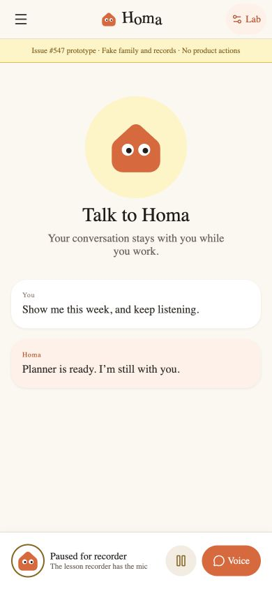
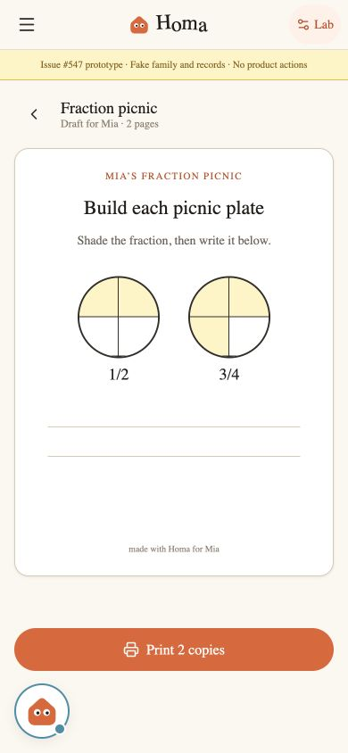
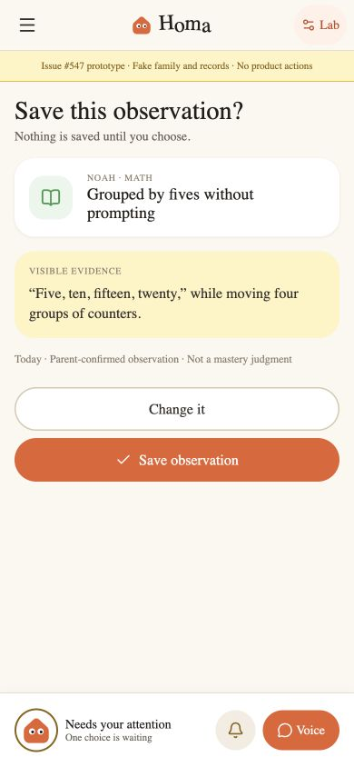
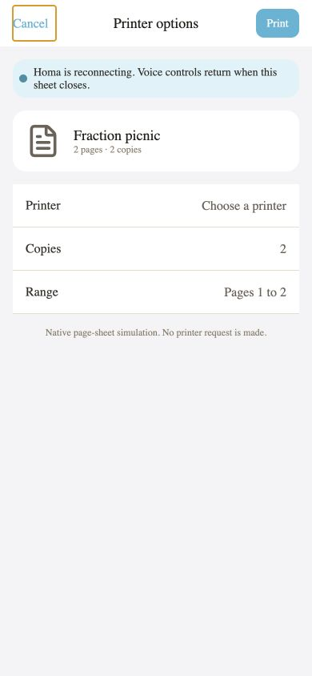

# Voice shell direction lab, gh#547

Status: disposable interaction evidence. This is not a production navigation, Voice session, or active-object implementation.

## Recommendation

**Combine, with the persistent shell direction in gh#535 owning the behavior.** Keep one shell-owned bottom safe lane and one Voice session. Let the dock compress to the Homa puck during routine listening or speaking when a surface benefits from more calm. Expand it into the labeled dock for muted, paused-for-recorder, reconnecting, and attention-required states.

Do not ship a freely positioned overlay. In the lab, the puck only remained safe after every surface reserved its bottom lane. That is shared-shell layout behavior, and duplicating it per screen would make obstruction bugs likely.

## Comparison

| Criterion | Floating control | Persistent dock | Recommendation |
| --- | --- | --- | --- |
| Discoverability | Homa is visually present, but detailed state is hidden until expansion | Status, recovery, and return-to-Voice actions are immediately legible | Use a first-class dock for exceptional states |
| Accidental activation | A single low thumb target is easy to hit unintentionally | Separated, labeled actions reduce ambiguity | Keep the compact puck away from surface actions and preserve its lane |
| Screen obstruction | Visually smaller, but unsafe without reserved space | Taller, but its obstruction is predictable | Shell owns one bottom content inset in both forms |
| One-handed reach | Strongest direction | Good, with larger targets | Preserve low placement and 44-point minimum targets |
| Accessibility | Needs an expanded label and explicit live status | Best semantic grouping and visible text | Announce state changes and auto-expand when action is required |
| Conversation continuity | Strong emotional presence | Strong operational clarity | Compact for routine continuity, dock for recovery and choice |

## Prototype coverage

The unlinked route `apps/mobile/src/app/voice-shell-547-lab.tsx` uses synthetic records only and provides controls for:

- Surfaces: Voice, Planner, Binder, material preview, and confirmation
- States: listening, speaking, muted, paused for recorder, reconnecting, and needs attention
- Stress cases: safe-area reservation, a real Binder text input, Planner and Preview bottom actions, and a native-style page sheet
- Accessibility: semantic button names, state descriptions, live status text, and 44-point minimum interactive targets

When the print sheet is open, the interactive Voice control is removed and a passive continuity notice remains. A system-owned sheet should not receive a second floating interaction layer.

## Expo SDK 56 findings

- Expo SDK 56 targets React Native 0.85 and requires iOS 16.4 or newer with Xcode 26.4 or newer: <https://docs.expo.dev/versions/v56.0.0/>
- Safe-area values come from `SafeAreaProvider` and `useSafeAreaInsets`; the prototype reserves `insets.bottom` in its shared control lane: <https://docs.expo.dev/versions/v56.0.0/sdk/safe-area-context/>
- Expo Router supports modal and page-sheet presentation. This lab uses an app-local page-sheet simulation without changing the production route tree: <https://docs.expo.dev/versions/v56.0.0/sdk/router/>
- Expo's SDK 56 Native Tabs documentation warns that conditionally adding or removing tabs remounts the navigator and resets its state. The lab therefore does not test the floating control by dynamically deleting the production tab shell: <https://docs.expo.dev/versions/v56.0.0/sdk/router/native-tabs/>

## Evidence and limits

- `pnpm --filter mobile typecheck`: passed
- `pnpm --filter mobile lint`: passed
- Expo iOS prebuild: passed
- CocoaPods install: passed, 119 pods installed
- Xcode simulator build: passed for the generated Homa app
- Browser review: passed at 390 by 844 with no uncaught errors, failed resources, horizontal overflow, or hidden bottom actions
- Accessibility DOM review: all direction, state, surface, shell, and sheet controls exposed names
- Binder input: focus and punctuation entry verified in the browser renderer
- Console: one React Native Web deprecation warning for the existing `shadow*` token shape, no prototype error

The final clean-simulator launch was blocked by the local automation approval service after the native build succeeded. The images below are captures of the same React Native component through an isolated Expo web harness, not simulator proof. Native software-keyboard lift and VoiceOver traversal remain unverified. The production decision in gh#535 should retain those as acceptance checks.

## Captures

### Floating, Voice listening

### Floating, Planner speaking

### Dock, Binder muted

### Dock, Voice paused for recorder

### Floating, material preview reconnecting

### Dock, confirmation needs attention

### System sheet continuity

