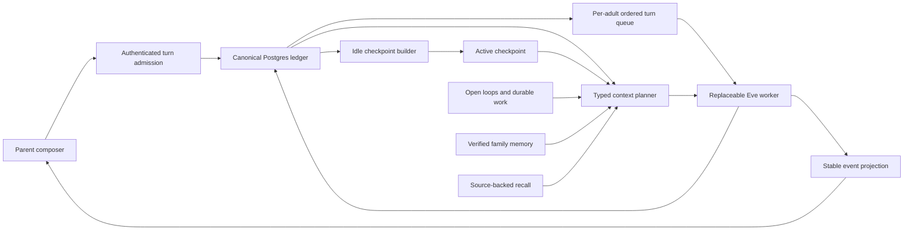

# Conversation continuity v2: reliable turns, typed handoffs, and current memory

Status: design complete, production activation blocked by #606, #754, ownership, and
release gates
Date: 2026-08-02  
Owner: unassigned within product engineering; named DRI required before implementation
Specification PR: #746
Epic: #747
Research cutoff: 2026-08-02 America/New_York  
Homa baseline: `821ca8ff9134b54c26f7e4f53fb3a4ec0d3252a9`

Effort: XL, delivered as independently reversible slices  
Primary files: `apps/web/app/app/chat-client.tsx`, `apps/web/app/app/chat-storage.ts`, `apps/web/lib/chat-history.ts`, `apps/web/lib/conversation-continuity/`, `apps/web/agent/instructions/family-context.ts`, `apps/web/agent/tools/recall.ts`, `apps/web/lib/learning/`, `apps/mobile/src/features/chat/`, `packages/chat-core/`, `supabase/migrations/`, `scripts/`, and focused evals  
Risk: high, because this touches turn admission, session replay, parent privacy, model context, and durable memory  
Migrations: additive first, with dual-read and dual-write shadow periods before any old path is retired  
Rollout control: server-only per-family capability assignments, with global environment
kill switches described below

## Executive decision

Build a Homa-owned conversation kernel around the durable Postgres record. Eve
sessions remain the execution engine, but become replaceable workers rather than
conversation authority.

The first delivery has three parts:

1. A server-side turn coordinator accepts and orders every web turn before Eve
   starts work.
2. Append-only, source-backed conversation checkpoints carry unfinished thought
   across Eve sessions.
3. A typed context planner assembles a bounded manifest from current family state,
   the active checkpoint, open loops, durable work, recent exact dialogue, and
   targeted recall.

Source-backed Recall v2 and one-timeline history are follow-on slices. Background
memory review is a separate later experiment, not part of this epic. A model may
propose semantic structure; deterministic code verifies provenance, scope, versions,
and effects. Provider memory is never product truth.

The Eve package upgrade is linked parallel modernization, not a completion gate. The
family-visible continuity outcome must pass on Eve 0.19 before an all-channel runtime
cutover adds its separate blast radius.

Do not replace Homa's episode ledger with provider conversation history, one eternal
Eve session, a per-family filesystem, or an opaque long-context prompt. Those options
move the failure instead of fixing it.

## Parent-visible promise

The v2 promise is deliberately narrower than the eventual cross-channel vision. One
signed-in adult experiences one private Homa web timeline even when the execution
session, browser tab, device, deployment, model, or context window changes underneath
it. The adult also sees items explicitly shared with or delivered to them. Mobile,
SMS, voice, email, and scheduled delivery keep their existing adapters until they gain
the same admission and receipt contract in a later cross-channel slice.

That promise means:

- Once Homa shows a message as accepted, it cannot disappear or be denied later.
- Refreshing is never the recovery procedure for a correctly accepted turn.
- A fresh morning can begin with a fresh model worker without forgetting what is
  unfinished.
- Homa can find an older exchange without loading the family's lifetime transcript
  into every prompt.
- Homa distinguishes what the parent said, what Homa inferred, what a tool proved,
  what is old, and what could not be loaded.
- Each adult sees only their own private conversation plus messages explicitly
  delivered to them.
- A message marked `Sent` is durably accepted even if Homa's work is still queued,
  waiting for the parent, or being reconciled.
- Once uncertain work is durably fenced and quarantined, unrelated later messages
  continue. Homa blocks only the affected operation or resource, never offers a blind
  Retry, and gives the parent an opaque support reference if the result cannot be
  verified.
- Every state uses visible words and accessible semantics. Meaning never depends only
  on color, motion, a spinner, or knowledge of an Eve session.

## What happens today

### The durable product record is already mostly right

`conversation_episodes`, `conversation_messages`, `conversation_deliveries`,
`conversation_open_loops`, and `conversation_thread_bindings` give Homa an
application-owned record across web, SMS, email, voice, schedules, and Eve sessions.
Messages carry visibility and actor metadata. Deliveries preserve per-recipient truth.
Open loops preserve explicit reply causality.

Dynamic instructions rebuild family, child, progress, onboarding, recent-call, and
continuity context on every `turn.started`. Durable family facts live in Postgres, not
Eve history or the sandbox. This is the correct foundation.

### A fresh Eve session does not read the full earlier session

`loadContinuityContext` looks up the canonical episode, excludes the current runtime
session, and injects the latest 12 episode messages. Those messages are clipped and
rendered as a small prior-conversation block. The new session also receives current
family state and saved memories from Postgres. It does not receive the entire old Eve
transcript, old reasoning, or old tool payloads.

That is safer and cheaper than replaying everything, but it is not a complete handoff.
An unfinished plan, correction, promise, or decision can fall outside the latest 12
messages or be impossible to reconstruct from isolated text.

### The promised episode summary is not operational

The schema has a mutable `conversation_episodes.summary` column, and the PRD requires
an episode summary in Postgres at rotation. Current continuity code neither writes nor
reads that field for fresh-session hydration. The architecture document says a fresh
session with the same episode behaves identically, but the implementation cannot prove
that claim from a 12-message tail.

### Model context and family memory are different systems

Homa is pinned to Eve `0.19.0`. Eve compacts the active model context at 75 percent of
the configured one-million-token window. This keeps one worker running, but its summary
is not the family record and does not cross a new Eve session.

Separately, Homa compacts `family_memories` when the pinned memory budget grows. It can
merge and supersede rows without deleting history. That is semantic family memory, not
dialogue handoff.

### The web browser still participates in execution authority

PRs #602 and #707 repaired stale-cursor recovery, same-day binding adoption, and
multi-tab clobbering. Issue #708 correctly identifies the remaining structural gap:
the browser still participates in Eve continuation state. A client can show a local
bubble before the server has durably accepted the turn, and transport recovery still
has more authority than a display surface should have.

### The Eve pin is materially behind current Eve

Homa uses Eve `0.19.0`, published July 2. Eve `0.29.5`, published August 2, adds manual
compaction and context clearing, cooperative cancellation, stable event IDs, bounded
catch-up streams, automatic reconnect, improved checkpoint compaction, retained
completed sessions, and cursor-consistent snapshots across the intervening releases.
The upgrade is valuable, but it is not a package-number edit. Homa carries a
version-specific patch and has a recorded cross-version parked-session failure.

## Carolyng incident replay

### Observed failure

Carolyng's messages were not lost. They and Homa's matching replies already existed in
the canonical ledger. Her browser was at client sequence 52 while the server was at
sequence 61, nine turns ahead. At an old historical `session.waiting` boundary, the
client replaced each optimistic send with an older reply instead of converging to the
canonical tail. The screenshot therefore looked like Homa had not received the new
schedule even though the server had processed it.

### Shipped mitigation and remaining risk

PR #707 shipped the stale-cursor repair on the baseline used by this specification. It
recovers the missing suffix and protects the immediate user. Issue #708 remains the
structural fix because the browser still participates in continuation authority. A
future cursor, replay, or multi-tab edge can still make an accepted canonical turn and
the visible projection disagree.

Under the target contract:

1. The composer sends an idempotency key to Homa's authenticated turn endpoint.
2. One database transaction persists the accepted input witness, assigns an episode
   ordinal, and returns an accepted `turn_id`.
3. The parent bubble changes from `Sending` to `Sent` only from that server
   acknowledgement. A separate Homa activity row says `Queued` or `Working`.
4. A worker claims the accepted turn. The current user message is passed as input and
   excluded from the prior-context tail, so it is neither missing nor duplicated.
5. If the browser disconnects, it reconnects by `turn_id`. Stable event IDs dedupe
   replay. Terminal output is read from the canonical message row.
6. If the worker dies after acceptance, the turn remains visibly recoverable. A lease
   sweeper starts a fenced attempt only when completed effects are receipt-safe;
   otherwise it shows `Checking result` or `Could not finish`, never silently drops it.
7. If a session rotated first, the replacement worker receives the active checkpoint,
   open loops, recent exact tail, and the accepted message.

Refreshing may redraw the same truthful state. It is not needed to make the message
exist.

The regression fixture must replay the exact sequence-52/client and sequence-61/server
trace with the historical waiting boundary. It passes only when the optimistic parent
message is never replaced, all nine missing turns converge in order, the current reply
appears exactly once, and no duplicate model turn runs.

## Reference semantics map

The table records immutable repository evidence where available, dated current web
evidence otherwise, maturity, the borrowed invariant, Homa's adaptation, and a local
acceptance proof. Repository permalinks prove behavior at the pinned commit. Mutable
vendor documentation records the page observed at this specification's research
cutoff, not an immutable or production-stability guarantee.

| Reference and maturity | Exact current evidence | Borrowed invariant | Homa adaptation | Acceptance proof | Reject |
|---|---|---|---|---|---|
| Homa at `821ca8ff`, repository baseline | Postgres ledger, one adult-visible timeline, family-local 4am rotation, dynamic context each turn, latest 12 prior messages, and an unused mutable episode summary | Application ledger and authenticated scope remain authoritative | Add web admission, fenced attempts, append-only checkpoints, and typed context | Exact Carolyng trace, cross-session open-loop fixture, and two-adult privacy fixture | Browser continuation authority and claims that raw-tail rotation is lossless |
| [Eve 0.29.5](https://github.com/vercel/eve/releases/tag/eve%400.29.5), stable package release | Manual compact, clear, and cancel; [stable `evt_` IDs and explicit 30-day default timeout](https://github.com/vercel/eve/releases/tag/eve%400.28.0); [bounded catch-up](https://github.com/vercel/eve/releases/tag/eve%400.27.7); [checkpoint compaction](https://github.com/vercel/eve/releases/tag/eve%400.27.0); [durable reconnect](https://github.com/vercel/eve/releases/tag/eve%400.26.0) | Stable replay identity, bounded reads, cooperative cancel, and better worker-local compaction | Upgrade only behind Homa's worker adapter and mandatory compatibility runbook; pin every default explicitly | Bidirectional parked-session fixture, stable and legacy event replay, cancel fence, stream-duration guard, and production canary | Eve session or compaction as product truth |
| [OpenClaw main `aba5e56`](https://github.com/openclaw/openclaw/commit/aba5e568572a8b247bcf185afedab41b15b316e3), core SQLite and projection paths mainline and E2E-covered; Active Memory optional; semantic session search experimental | [SQLite event store](https://github.com/openclaw/openclaw/blob/aba5e568572a8b247bcf185afedab41b15b316e3/src/config/sessions/session-accessor.sqlite-transcript-store.ts#L45-L134) and [deterministic projection test](https://github.com/openclaw/openclaw/blob/aba5e568572a8b247bcf185afedab41b15b316e3/src/config/sessions/session-transcript-projection-rebuild.test.ts#L25-L65); [projection-only pruning](https://github.com/openclaw/openclaw/blob/aba5e568572a8b247bcf185afedab41b15b316e3/src/agents/embedded-agent-runner/tool-result-truncation.ts#L169-L237); [two-lane recall](https://github.com/openclaw/openclaw/blob/aba5e568572a8b247bcf185afedab41b15b316e3/docs/concepts/memory-architecture.md#L186-L242); [breaker implementation](https://github.com/openclaw/openclaw/blob/aba5e568572a8b247bcf185afedab41b15b316e3/extensions/active-memory/recall.ts#L174-L213); [fail-closed source visibility](https://github.com/openclaw/openclaw/blob/aba5e568572a8b247bcf185afedab41b15b316e3/extensions/memory-core/src/session-search-visibility.ts#L160-L230); [Dreaming provenance gate and preimage fallback tests](https://github.com/openclaw/openclaw/blob/aba5e568572a8b247bcf185afedab41b15b316e3/extensions/memory-core/src/dreaming-consolidation.test.ts#L84-L165) | Preserve canonical history while pruning only the model projection; scope before retrieval; escalate recall only when needed; expose degraded state; require provenance and a recoverable preimage before promotion | Use tenant-scoped Postgres, per-adult audience, model proposal plus deterministic verification, and candidate-only background synthesis | Full ledger unchanged after pruning, another adult never becomes a recall candidate, timeout opens and resets the breaker, unsupported promotion is rejected | Local Markdown authority, personal-install defaults, regex semantic routing, token-overlap truth, and automatic authority for model-written memory |
| [Hermes Agent main `a6defd4f`](https://github.com/NousResearch/hermes-agent/commit/a6defd4f1549da3fe1d08d6f746fc645c64543f0), mainline gateway recovery and heavily tested compression; delivery remains best-effort at-least-once | [Delivery ledger state machine and caveat](https://github.com/NousResearch/hermes-agent/blob/a6defd4f1549da3fe1d08d6f746fc645c64543f0/gateway/delivery_ledger.py#L1-L37) plus [plain versus marked redelivery test](https://github.com/NousResearch/hermes-agent/blob/a6defd4f1549da3fe1d08d6f746fc645c64543f0/tests/gateway/test_delivery_ledger.py#L117-L173); [crash marker clears only after success](https://github.com/NousResearch/hermes-agent/blob/a6defd4f1549da3fe1d08d6f746fc645c64543f0/tests/gateway/test_restart_resume_pending.py#L58-L72); [strict old-session extraction before rebinding](https://github.com/NousResearch/hermes-agent/blob/a6defd4f1549da3fe1d08d6f746fc645c64543f0/tests/agent/test_memory_boundary_commit.py#L63-L114); [compression commit fence](https://github.com/NousResearch/hermes-agent/blob/a6defd4f1549da3fe1d08d6f746fc645c64543f0/agent/conversation_compression.py#L444-L570); [non-destructive archive and compact](https://github.com/NousResearch/hermes-agent/blob/a6defd4f1549da3fe1d08d6f746fc645c64543f0/hermes_state.py#L6413-L6463) | Durable delivery obligation, success-only clearing, distinct ambiguous recovery, authorization recheck, strict boundary ordering, non-destructive compaction, and stale-owner fences | Upgrade the best-effort local ledger to transactional Postgres, provider idempotency, effect reconciliation, typed evidence, and distributed monotonic fences | Crash before send, during provider await, and after success; plain replay only for never-started; visible Checking result for ambiguous; stale worker writes rejected | Flat-file family truth, daemon best-effort writes, autonomous skill mutation, and optional micro or idle compaction as defaults for Homa |
| [Anthropic memory stores](https://platform.claude.com/docs/en/managed-agents/memory), beta API, and [Dreams](https://platform.claude.com/docs/en/managed-agents/dreams), research preview | Fresh sessions can attach versioned memory stores; Dreaming reads one store and 1 to 100 sessions, writes a separate output store, preserves inputs, and leaves partial output after failure or cancellation | Immutable revisions, copy-on-write consolidation, explicit review or discard, and inspectable partial failure | Keep Homa's database and audience rules authoritative; use typed candidate operations with source evidence in a later experiment | Input hash unchanged through complete, fail, and cancel; output remains inactive until adult review; source audience cannot widen | Mounted provider memory for identity, consent, progress, schedules, or transcript authorization |
| [Anthropic context editing](https://platform.claude.com/docs/en/build-with-claude/context-editing), current API capability | Old tool results and thinking can be cleared selectively while server compaction preserves a smaller working context | Remove old tool payloads before compressing dialogue | Apply only to the model projection and measure cache effects | Canonical ledger byte-for-byte unchanged; tool call and result remain atomic | Context editing as history retention |
| [OpenAI Agents sessions](https://openai.github.io/openai-agents-js/guides/sessions/), current SDK, and [sandbox-agent memory](https://openai.github.io/openai-agents-js/guides/sandbox-agents/memory/), beta | Session history and durable memory are separate; memory uses per-conversation extraction then consolidation; session compaction can use local items as source of truth and may delay stream completion | Separate dialogue from learned memory, extract before consolidation, keep a local source-of-truth mode, compact during idle | Use Homa rows and verified source IDs; keep compaction off the parent completion path | Stream completion latency stays within gate; canonical rows survive compaction; memory candidate sources revalidate | Sandbox files as tenant authority and automatic compaction on the critical response path |
| [OpenAI ChatGPT Dreaming](https://openai.com/index/chatgpt-memory-dreaming/), current product research disclosure | Background synthesis targets continuity, relevance, and freshness across long history | Evaluate correction freshness and relevance, not retrieval recall alone | Make every family-data change source-backed and reviewable | First post-correction turn uses current truth; stale candidate remains inactive | Silent rewriting of current family truth |
| [OpenAI Codex compaction](https://openai.com/index/unrolling-the-codex-agent-loop/), public engineering description | Stateless full input can coexist with provider-native encrypted compaction; stable prompt prefixes preserve cache reuse | Separate durable record from model projection and keep static prefixes stable | Treat provider compaction as an interchangeable worker optimization | Boot the same checkpoint on another provider with no provider state | Opaque compaction as cross-provider handoff or family record |

## Preserve, change, and drop gate

Implementation does not start until an engineer can trace every proposed behavior to
one row below.

### Preserve

- One private timeline per adult, plus explicitly shared or delivered items, with quiet
  day navigation rather than a ChatGPT-style list of raw Eve sessions.
- Postgres as the canonical record and Blob as durable artifact storage.
- Auth-derived `family_id` and adult ownership. No family selector comes from the
  browser or model.
- Dynamic current family, child, progress, onboarding, and call context each turn.
- Explicit typed open loops and per-recipient delivery truth.
- Fresh-morning worker rotation, pending a separate founder ruling to change product
  semantics. Make the seam safe before tuning the boundary.
- Eve as the durable worker behind an application-owned escape-hatch contract.
- Family memory supersession, parent correction, and no destructive history rewrite.

### Change

- Turn acceptance moves from browser plus Eve cursor to an authenticated Homa server
  transaction.
- Episode continuity moves from one mutable summary plus a raw tail to append-only,
  validated checkpoints plus recent exact dialogue.
- Context assembly becomes typed and budgeted before it is rendered into Markdown.
- Recall returns source record IDs, ownership scope, timestamp, freshness, and index
  status.
- Memory compaction emits a candidate revision set first. Activation is a separate
  validated transaction with rollback lineage.
- Compaction and memory review move off the parent-visible completion path whenever
  the framework allows it.
- UI state describes delivery separately from model work.

### Drop

- Any design that asks a parent to refresh to make an accepted message real.
- Any design that equates a one-million-token context window with durable memory.
- Any design that replays a family's full transcript into every turn.
- Any design that lets provider history, filesystem prose, embeddings, or an LLM
  summary authorize family truth.
- Regex or keyword lists that decide what a parent's sentence means.
- A default thread sidebar made from Eve session IDs.
- Hidden automatic branching. Family coordination needs one auditable causal line.
- Automatic promotion of sensitive health, identity, consent, or child-progress
  claims from conversation prose.

## Blindspot pass

Count: 40 concrete gaps or failure surfaces found in current Homa or in tempting
reference patterns.

| # | Blindspot | Evidence or failure | Required prompt or specification fix |
|---:|---|---|---|
| 1 | Visible is not accepted | A local bubble can precede durable server admission | Define server acknowledgement as the only transition out of `Sending` |
| 2 | Cursor ownership is split | Browser state still participates after #707 | Make #708 the turn-authority slice, not another recovery patch |
| 3 | Raw-tail handoff loses intent | Only 12 prior messages are hydrated | Add source-backed checkpoint plus recent exact tail |
| 4 | Episode summary is dead state | Column exists but current hydration ignores it | Replace it with append-only checkpoint revisions; keep the column only for compatibility |
| 5 | Documentation overclaims | Architecture says a fresh session behaves identically | Gate that sentence on cross-session eval evidence |
| 6 | Current message can duplicate | Persist-before-dispatch plus hydration may include the same user row | Exclude `current_turn_id` from prior context while requiring its durable witness |
| 7 | Accepted turn can strand before dispatch | Process can die after DB commit | Treat accepted rows as a leased outbox and sweep stale leases |
| 8 | Concurrent tabs can reorder intent | One adult can send from several surfaces | Allocate monotonic episode ordinals and serialize per adult |
| 9 | Parked HITL can be mistaken for a new turn | A waiting session has a pending answer contract | Resume only with explicit request identity; queue unrelated text |
| 10 | Stop is not undo | Tools may finish before cooperative cancel settles | Preserve effect receipts and say cancellation stops remaining work only |
| 11 | Replay IDs have a legacy seam | Eve says old events may lack new stable IDs | Dual dedupe until every pre-upgrade session expires |
| 12 | Eve upgrade patch manifest is stale | The runbook names two patch purposes; the patch contains reconnect, max duration, and empty-delivery behavior | Inventory every hunk and prove upstream, port, or replace each one |
| 13 | New Eve defaults can silently change lifecycle | Eve 0.28 adds a default 30-day session timeout | Pin an explicit timeout and test parked-session behavior |
| 14 | Rich trace payloads can widen exposure | New Eve releases add more detailed prompt and tool traces | Default payload capture off or sanitized; verify no parent content leaves approved stores |
| 15 | Compaction can block completion | SDK compaction may delay the resolved stream | Run manual or scheduled compaction after terminal delivery or at idle |
| 16 | Compaction can claim success after partial loss | Summarization chunks can fail | Mark partial checkpoints, preserve source bounds, and block rotation on total failure unless raw-tail fallback is explicit |
| 17 | Tool pairs can split | Naive truncation separates a tool call from its result | Prune projection by atomic interaction unit |
| 18 | Recall privacy can filter too late | Ranking before ownership can hide safe results or expose unsafe candidates | Apply family, adult, visibility, and channel scope before ranking and limits |
| 19 | Semantic similarity is not truth | Embedding score can return a plausible wrong memory | Return provenance and let the model cite it; never auto-promote from score alone |
| 20 | Recall miss can become a false denial | Current tool warns about this, but UI and model can still overstate | Return `complete`, `partial`, `stale`, or `unavailable`; require honest retry language |
| 21 | Index rebuild can look like no history | Search infrastructure may be dirty or lagging | Hide dirty shards and expose incomplete-index metadata |
| 22 | Stale memory can beat current correction | Current pinned memories have no explicit validity window | Add observed, confirmed, superseded, and optional valid-through metadata |
| 23 | Background review can race new facts | A slow consolidation may overwrite a newer revision | Copy-on-write candidates plus expected-version activation |
| 24 | Model prose can invent provenance | A consolidation model may paraphrase unsupported content | Require source IDs and verbatim quotes; code rechecks every quote and scope |
| 25 | Account deletion can widen null-owned rows | Existing P0 #606 documents the failure class | Privacy migration and adversarial fixture are a hard gate |
| 26 | Durable work can still live only in chat | Issue #175 records a lost co-drafted plan | Handoffs reference work objects; they do not replace them |
| 27 | One huge context lowers focus and cache reuse | Dynamic data at the front invalidates stable prefix caches | Keep static instructions stable and append typed dynamic slots |
| 28 | A provider-native memory feature can create lock-in | Opaque summaries or mounted stores do not transfer cleanly | Keep the Homa checkpoint and memory schemas provider-neutral |
| 29 | Eve sandbox durability changed after Homa's pin | Eve 0.22.1 keys sandboxes to durable sessions across redeploys, while Homa's architecture note describes deployment-scoped scratch | Continue treating sandbox state as non-authoritative, then test retention, cleanup, expiry, and secret boundaries on the candidate version |
| 30 | Durable acceptance lacks a replayable input | Current message rows require an Eve session and sequence | Store immutable input and fingerprint on the canonical turn before dispatch |
| 31 | Idempotency key can alias different requests | A key-only unique constraint cannot detect changed text or attachments | Fingerprint the immutable request and return `409` on mismatch |
| 32 | Expired leases do not fence old workers | A replaced worker can settle or write an effect late | Propagate monotonic attempt and lease fences through every write and effect |
| 33 | HITL can freeze an adult queue forever | Waiting currently has no expiry contract | Add a server-issued wait record, visible controls, bounded expiry, and durable open loop |
| 34 | Ambiguous side effects invite duplicate retry | A worker crash may happen after provider success | Show `Checking result` and reconcile the original effect key before retry |
| 35 | Global booleans cannot canary families | Environment flags cannot pin semantics to one admitted turn | Use server-side capability assignments and turn-pinned versions |
| 36 | Rollback can double-dispatch accepted input | Legacy and v2 paths can both see one parent request | Make coordinator migration one-way and roll back only to a compatible server coordinator |
| 37 | A context race can include the future or omit a predecessor | Later queued input may exist before an earlier turn appends its output | Hydrate the settled causal queue prefix, exclude later queue identities, and read current truth at one dispatch watermark |
| 38 | Derived data can outlive privacy deletion | Checkpoints, embeddings, and traces copy source meaning | Use immediate query denial plus deletion outbox fan-out and bounded erasure |
| 39 | Durable rows can still look lost | Carolyng's canonical messages existed while her browser was nine turns behind | Gate client projection lag, replacement count, and exactly-once rendering |
| 40 | Strict FIFO can answer burst fragments separately | Parents often send a schedule or correction in pieces | Launch strict for truth, instrument bursts, and test explicit coalescing later |
| 41 | Strict FIFO can become permanent unavailability | An unresolved provider ambiguity can keep the adult queue head nonterminal forever | Fence and quarantine immediately, release unrelated conversation, retain resource-scoped holds, and bound the parent-visible outcome |
| 42 | A legacy request can cross the cutover snapshot | A request may pass the browser gate before `legacy_draining` but call Eve afterward | Commit an epoch-bound ingress reservation before every legacy dispatch and drain reservations to zero |
| 43 | Deletion can erase replay protection | Removing an admission key lets a delayed same-key request recreate content or effects | Retain only approved content-free replay tombstones and emit a deletion projection |
| 44 | Runtime modernization can delay the family fix | #708 can satisfy continuity on Eve 0.19 while #749 adds all-channel cutover risk | Keep #749 parallel and non-gating unless a named invariant proves otherwise |
| 45 | A checkpoint can be perfectly safe and useless | A validator may drop everything while passing every safety test | Require blinded uplift against exact tail plus typed open loops and durable work before hydration |
| 46 | Privacy migration can be logically right but operationally unsafe | #607 combines lock-taking DDL, broad backfill, and policy replacement without bounded production evidence | Stage schema, bounded backfill, validation, and enforcement with lock, latency, and compatibility gates |
| 47 | Truthful state can still be unusable | Cursor convergence does not prove comprehension, focus, accessibility, or safe retry behavior | Gate the rendered experience with parent comprehension, VoiceOver, keyboard, focus, scroll, motion, and color-independent tests |

### Council reconciliation, 2026-08-02

Independent architecture, execution, and family-UX reviewers gave conditional approval.
All three preserved server-owned durable acceptance, principal-scoped authority, fenced
attempts, lineage effects, one-way migration, and source-backed handoff. All three also
found the same liveness defect: unresolved `uncertain` work could block an adult
forever. The accepted correction is immediate durable quarantine, resource-scoped
holds, bounded parent-visible reconciliation, and continued unrelated conversation.

The strongest rival is a thinner principal journal kernel using exact recent dialogue,
typed open loops, durable work, and one source-backed pre-rotation handoff, while
deferring semantic checkpoints, persisted manifests, and the Eve upgrade. This spec
keeps the relational v2 design because it fits Homa's current ledger and RLS model, but
the rival wins if fault injection repeatedly exposes cross-table drift or the blinded
checkpoint ablation shows no material value. The Eve upgrade is therefore parallel,
and checkpoint hydration remains off until it beats the simpler baseline.

### Improved implementation prompt

Use this prompt for every child ticket:

> Implement only the named Conversation Continuity v2 slice. Preserve Postgres as
> product truth, one parent timeline, per-adult privacy, and replaceable Eve workers.
> Start from the current code paths and the reference semantics named in this spec.
> A model may propose semantic structure; deterministic code must verify every family,
> adult, child, source message, verbatim quote, artifact, open-loop, and work-object
> reference. Treat model context as a bounded projection, never the archive. Add the
> failure tests, telemetry, pinned assignment or deployment version, shadow comparison,
> bounded liveness, accessible parent states, rollback path, and live
> verification assigned to the slice. Do not create a second tracker for existing
> issues #708, #179, #175, #302, #493, or #606.

## Goals

1. Zero silently lost, duplicated, or reordered accepted web turns.
2. Cross-session continuity for open intent, decisions, corrections, promises, and
   durable work without full transcript replay.
3. Current, relevant, source-backed recall with per-adult privacy.
4. Model context that is bounded, inspectable, and provider-neutral.
5. A parent-facing experience that explains delivery, work, recovery, and remembered
   context without exposing runtime sessions.
6. A staged implementation that can be rolled back by layer.

## Non-goals

- Changing the founder ruling that Homa presents one family conversation.
- Replacing Eve in this epic.
- Keeping one Eve session alive forever.
- Building a general public context-engine plugin marketplace.
- Making every historical message part of every model prompt.
- Implementing child-facing chat accounts or shared co-parent transcripts.
- Moving mobile, SMS, voice, email, or scheduled delivery onto the web coordinator in
  this epic.
- Shipping background memory consolidation or its parent review surface in this epic.
- Automatically turning family language into fleet skills.
- Moving schedules, progress, consent, identity, or billing into memory prose.
- Resolving the separate communication-style ruling in #400.
- Using Anthropic, OpenAI, OpenClaw, Hermes, or Vercel memory storage as Homa's
  authoritative family database.

## Rollout-control contract

Add a server-only `conversation_capability_assignments` table keyed by family and
capability. A capability resolves to `off`, `shadow`, `canary`, or `on`, plus an
implementation version. Resolution is pinned onto the turn at admission or onto the
session at binding. A flag change never alters an in-flight turn.

Capabilities are intentionally separate:

- `web_turn_coordinator_v2`;
- `checkpoint_generation_v1`;
- `checkpoint_hydration_v1`;
- `context_manifest_recording_v1`;
- `context_manifest_rendering_v1`;
- follow-on `recall_v2_backend`;
- follow-on `history_search_v1`.

Environment variables are exact-value global kill switches only. Shadow turn rows use
`authority_mode = shadow` and are never claimable. Once a family admits its first v2
turn, authoritative server admission is a one-way migration for that family. An
implementation version may roll back only to a schema-compatible coordinator version;
the family never returns to browser-owned #707 admission. The Eve package upgrade is a
deployment change with a compatibility rollback, not a family flag.

## Target architecture



The arrows have different authority:

- Parent to admission is an authenticated request.
- Admission to ledger is the durable acceptance boundary.
- Ledger to worker is leased execution and can retry.
- Context sources to worker are a bounded projection with provenance.
- Worker to ledger records visible output and exact effects.
- Background builders propose checkpoints or memory revisions. Validation decides
  whether they become active.

## Data contracts

### 1. Web admission boundary

This slice is web-only. Existing SMS and email adapters keep
`conversation_inbound_receipts` and their current sweepers. A web turn may link to a
channel receipt when a later cross-channel cutover happens, but this epic does not
create a second sweeper for the same delivery obligation.

#### Private episode authority

After #606, add nullable `principal_id` to `conversation_episodes`, but require it on
every new v2 web episode. A private episode has composite uniqueness on `(family_id,
principal_id, id)`, an adult-local boundary key, and its own `next_episode_sequence`.
Every v2 input, entry, turn, wait, checkpoint, projection source, and binding uses a
composite `(family_id, principal_id, episode_id)` foreign key. No private query accepts
an episode ID alone.

Existing household or mixed legacy episode rows are never reused as v2 private episode
authority. After #606 proves message and delivery ownership, cutover creates a new
principal-bound episode and re-indexes that adult's eligible legacy messages and
explicit deliveries by `(created_at, id)` as source-backed entries. Existing message
rows remain the canonical source; the private entry index owns navigation order. A
household-global ordinal is never returned, logged as a private cursor, or used to
derive counts. Another adult's activity therefore creates no filtered sequence gap.
The bulk re-index is resumable and precomputed outside the family authority lock
through a recorded high-watermark. Ambiguous ownership is never promoted.

#### Always-on admission registry

`conversation_admission_keys` is checked before routing to legacy or v2 execution. It
stores `family_id`, `principal_id`, `idempotency_key`, `request_fingerprint`,
`input_id`, `turn_id`, `ingress_version`, and timestamps, unique on
`(family_id, principal_id, idempotency_key)`. The fingerprint covers normalized text,
modality, immutable attachment IDs and revisions, and reply or wait identity. An exact
retry returns the original input and turn. The same key with a different fingerprint
returns `409`.

The key is inserted only in the same transaction as its input, entry, and turn. There
is no independently committed reservation and no dispatch before that transaction
commits. A crash before commit leaves nothing accepted; a crash after commit leaves a
claimable canonical turn. Shadow observations live in a separate
`conversation_turn_shadow_observations` table and never occupy admission keys or
become claimable. Promotion always creates a fresh authoritative admission; a shadow
row is never converted in place.

The family capability row records `coordinator_migrated_at`, the last legacy canonical
message high-watermark per principal, ingress state (`legacy`, `legacy_draining`, or
`v2`), legacy binding generation, and an ingress protocol epoch. After migration, stale #707-era
client payloads are normalized into this same server transaction using their stable
client message ID as the idempotency key. A retry at or below the legacy high-watermark
reconciles to the existing canonical legacy message and never dispatches it again. The
legacy endpoint becomes translate-or-read-only for that family. It cannot start Eve
work. This admission shim and its historical keys remain active through every
coordinator implementation rollback.

Every legacy request registers a generation-bound ingress reservation before any Eve
dispatch. `conversation_ingress_reservations` records the family, principal, canonical
source key, ingress epoch, binding generation, runtime version, state (`reserved`,
`dispatching`, `settled`, `uncertain`, or `cancelled`), and bounded lifecycle times.
The same canonical source cannot own two nonterminal reservations. Moving to
`legacy_draining` atomically refuses new reservations for the closing epoch. A request
that passed an earlier browser check but has not committed this reservation has no
dispatch authority.

The first migration uses a bounded per-family authority handoff:

1. While the family remains `legacy`, precompute the private entry backfill through
   high-watermark H1.
2. In a short transaction, lock the family capability row, change `legacy` to
   `legacy_draining`, close the current ingress epoch to new reservations, and commit.
   Every #707 dispatch endpoint then returns retryable `migration_in_progress` without
   durable acceptance while preserving the same client key. The bubble remains
   `Checking send`; a bounded hard failure becomes proved `Not sent`, never a new key.
3. Outside the row lock, drain every generation-bound reservation, Eve session, event
   cursor, pending receipt, wait, open loop, and effect. Catch the private entry index
   up from H1 through final high-watermark H2. Require 100 percent eligible-row parity,
   zero ambiguous ownership promoted, and zero running, parked, dispatching, uncertain,
   or unprojected legacy obligations.
4. In a final compare-and-swap transaction, lock the row, recheck the epoch, H2
   checksum, and zero-obligation census, record each principal's final legacy
   high-watermark, increment the binding generation and ingress epoch, change state to
   `v2`, initialize empty v2 queue heads, and only then permit the first authoritative
   admission.

The final transaction targets p99 at two seconds and has a five-second hard timeout.
`legacy_draining` has a 60-second hard timeout and returns to `legacy` before any v2
input is accepted if zero cannot be proved. Persistence hooks reject and quarantine
events from the closed generation. An effect-capable late event triggers resource
reconciliation, never silent discard or duplicate dispatch. After state reaches `v2`,
it never returns to legacy. A migrated family rolls back only to a prior
schema-compatible coordinator that understands the same ingress epochs.

Eve package cutover uses a separate deployment-wide session-admission barrier, not a
family capability. Every Eve-using ingress and scheduler must consult it before
creating a session. The barrier is described in the Eve modernization slice below.

#### Immutable parent inputs

`conversation_inputs` is the permanent accepted-input witness. Required fields are
`id`, `family_id`, `principal_id`, `episode_id`, `entry_id`, `target_turn_id`, `kind`
(`initial` or `resume`), `responds_to_wait_id`, `client_message_id`,
`idempotency_key`, `request_fingerprint`, `input_text`, `input_modality`, immutable
`attachment_refs`, nullable `materialized_message_id`, `state` (`accepted`, `consumed`,
or `tombstoned`), and lifecycle timestamps. `responds_to_wait_id` is null for an
initial input. Validation rejection creates no input row. Stopping or failing the
execution turn never changes the accepted input into an unsent or cancelled message.

Every accepted input is durably visible, searchable, and citable through its entry until
an authorized sentence or account deletion tombstones it, including one that fails
before Eve dispatch. Eve materialization is a runtime witness, not the condition for
history existence. The current message table keeps its non-null runtime `session_id`
and `sequence`; add `conversation_input_id` and `conversation_entry_id` links instead
of inventing a fake session.

`conversation_inputs.input_text` is the sole v2 authority for accepted parent content.
Any materialized runtime message is a derived witness and must be hash-equal to its
authorized input revision. It cannot overwrite, broaden, or resurrect the input.

A first message creates an `initial` input and a new turn in one transaction. An active
HITL answer creates a separate `resume` input with its own entry, sequence,
fingerprint, and message witness, consumes the wait exactly once, and resumes the
original nonterminal turn. It is not queued behind that turn. Assistant output and
activity identify both `turn_id` and `caused_by_input_id`. An answer to an expired wait
is an `initial` input on a new turn linked to the preserved open loop.

#### One ordered visible-entry index

`conversation_entries` is an append-only ordering and projection index, not a second
copy of message text. Required fields are `id`, `family_id`, `principal_id`,
`episode_id`, `episode_sequence`, `audience`, `kind` (`parent_input`,
`assistant_message`, or `delivered_item`), exactly one of `input_id`, `message_id`, or
`delivery_id`, nullable `originating_turn_id` and `originating_member_queue_sequence`,
the source content hash or immutable revision, `deleted_at`, and timestamps. Parent
inputs and assistant outputs carry their causal turn sequence; independent delivered
items leave it null. `episode_sequence` establishes one visible order for every input,
assistant output, and explicitly delivered item across all channels for that principal.
The database uniqueness constraint is the full `(family_id, principal_id, episode_id,
episode_sequence)` key, with the composite episode foreign key above.

Add nullable `conversation_entry_id` and `episode_sequence` to existing message and
delivery rows. New visible writes allocate both under the principal-bound episode
counter lock. After #606, backfill legacy visible rows deterministically into each new
private episode by `(created_at, id)`, then verify counts, ownership, and uniqueness
before checkpoint activation. Until the backfill completes, legacy rows remain
available through the current recent-tail path but are ineligible as checkpoint
sources. No not-null contract migration occurs in this epic.

#### `conversation_turns`

Each turn is an execution obligation, separate from the visible input. Required fields
are `id`, `family_id`, `principal_id`, `episode_id`, `root_input_id`,
nullable `retry_of_turn_id`, immutable `execution_lineage_id`, globally monotonic
`member_queue_sequence`, `admission_episode_sequence`, `predecessor_queue_sequence`,
nullable `current_attempt_id`, `lease_version`, `coordinator_version`, `state`,
`cancel_requested_at`, nullable `failure_code`, nullable `uncertainty_kind` (`dispatch`,
`terminal_output`, or `external_effect`), nullable `quarantined_at`,
`retry_safety`, and lifecycle timestamps.

`admission_episode_sequence` records where the root input appeared in the visible
timeline. `predecessor_queue_sequence` records the causal queue boundary. At claim,
strict FIFO guarantees every lower queue sequence is queue-settled: terminal normally,
or durably fenced and quarantined with an unresolved obligation. Context includes every
authorized input, output, and proved effect from those settled predecessor turns plus
typed unresolved open loops. It never treats an unverified effect as present or absent.
The current input is passed separately. Entries from higher queue sequences are
excluded.

Stored transitions are:

```text
accepted -> running | failed | cancelled
running -> waiting | completed | failed | uncertain | cancelled
waiting -> running | failed | cancelled
uncertain -> completed | failed | quarantined
```

`quarantined` is terminal for the principal conversation queue, but it is not evidence
that an external effect did or did not happen. Entering it requires one transaction
that fences the attempt, creates a reconciliation obligation, records every affected
resource and effect key, advances the queue, and emits a parent-visible projection.
Late outputs and events from the fenced attempt cannot become canonical. Unrelated
later turns may proceed immediately. Conflicting effects remain denied until the
obligation reaches proof or an explicitly authorized new logical operation.

Terminal turns are immutable. If a failed turn, or a quarantined obligation that later
proves absence, is safe to try again under the effect contract, the retry endpoint
creates a new linked turn with the same root input, a new member queue sequence, the
same execution lineage, and no duplicate parent entry. The old turn remains failed or
quarantined. A quarantined turn offers no Retry before that proof. Later proof appends
a linked status entry and settles the obligation; it does not reopen or replay the old
turn.

Automatic recovery attempts within one nonterminal turn are capped at three and stop
immediately on any ambiguous effect. Initial execution and parent-authorized HITL
resumes do not consume that recovery budget.

`Queued` is derived for every accepted turn that no worker has claimed. If an earlier
nonterminal turn exists, the projection may explain what it is waiting behind.
`Stopping` is derived from `cancel_requested_at`. `conversation_principal_queues`
stores `family_id`, `principal_id`, `next_sequence`, nullable `head_turn_id`,
`head_version`, and lifecycle timestamps. Admission locks this row to allocate turn
sequence and sets the head only when the queue was empty. Unique `(family_id,
principal_id, member_queue_sequence)` spans episode rotation.

Workers select queue rows with `FOR UPDATE SKIP LOCKED`, so they may skip an entirely
busy principal. After locking one queue row, a worker may claim only its exact
`head_turn_id` by comparing `head_version`; it never applies `SKIP LOCKED` to turns
inside that principal. Waiting and recoverable heads remain the head. A terminal or
atomic quarantine settlement advances the pointer to the next accepted sequence or
null.
Lease expiry creates recovery only for the same head. Database checks and a unique
active-head constraint allow at most one running or waiting turn per principal and
forbid a higher sequence from becoming active first. A completed turn requires a
canonical terminal assistant entry or a proved no-delivery effect.

#### Admission insertion and foreign-key timing

The server preallocates UUIDs for the admission key, input, entry, and initial turn
before opening the transaction. The intentional input-entry-turn cycle uses foreign
keys declared `DEFERRABLE INITIALLY DEFERRED`: input `entry_id` and `target_turn_id`,
entry `input_id` and `originating_turn_id`, and turn `root_input_id`. They are non-null
for a committed initial admission and must all resolve before commit. A resume input
preallocates its input and entry IDs and targets the already existing waiting turn. No
transaction may commit a dangling source or execution obligation.

`current_attempt_id` remains null until a successful claim. Claim preallocates the
attempt ID and uses a deferred turn-attempt foreign-key pair while atomically inserting
the attempt and updating the turn. `materialized_message_id` remains null until the
idempotent Eve user-event transaction links the real runtime message. Runtime session,
turn, acknowledgement, approval, failure, wait, retry, and deletion fields are nullable
only in the lifecycle states where their source object does not yet exist; database
checks enumerate those state-specific combinations.

#### `conversation_turn_attempts` and fencing

Execution attempts are immutable. Required fields are `id`, `turn_id`,
`attempt_number`, `attempt_kind` (`initial`, `automatic_recovery`, or `hitl_resume`),
nullable `automatic_recovery_number`, nullable `hitl_resume_number`, `lease_version`,
`lease_owner`, `lease_expires_at`, `deadline_at`,
`next_attempt_at`, stable `dispatch_key`, `dispatch_state` (`never_started`,
`dispatching`, `acknowledged`, `terminal`, or `uncertain`), `runtime_session_id`,
`runtime_turn_id`, `runtime_ack_event_id`, `context_settled_through_queue_sequence`,
`dispatch_authority_watermark`, `outcome`, and lifecycle timestamps. A new claim
increments the turn's lease version and replaces `current_attempt_id` atomically.

`attempt_number` is monotonic audit order, not a retry budget. An initial turn has one
`initial` attempt. An automatic lease or dispatch recovery increments only
`automatic_recovery_number`, which is unique per turn and may not exceed three. Each
valid consumed wait creates one `hitl_resume` attempt and increments only
`hitl_resume_number`. A turn may ask at most eight parent questions or approvals; on a
ninth, Homa fences the workflow, preserves its open loop and resume manifest, and asks
the parent to restart cleanly in a new linked turn. Database checks reject mixed or
missing counters for each attempt kind.

The adapter persists `dispatching` before the network call and passes `dispatch_key`
with the request. It stores `acknowledged` only after Eve returns or emits a durable
identity. Only `never_started` may replay directly. A crash in `dispatching` becomes
`uncertain` and reconciles against Eve by dispatch key or runtime event. If the pinned
Eve version cannot prove whether it accepted the request, Homa does not replay it.

Every event projection, message write, tool receipt, and terminal transition compares
both `attempt_id` and `lease_version`. A superseded worker may finish computation, but
its output is rejected. The server stamps `(turn_id, attempt_id,
lease_version, effect_key)` into every effect-capable tool context. Database effects
reject stale fences and return durable receipts. External effects use provider
idempotency where available plus effect-specific reconciliation.

Before automatic whole-turn replay is enabled, inventory every effect-capable tool
reachable from web chat. Replay is allowed only when every completed effect has a
reconciled receipt keyed to the execution lineage and deterministic logical operation,
with the same validated request fingerprint. Turn and tool-call IDs remain forensic
links, not replay authority. If an external effect may have happened but cannot yet be
proved, the turn becomes `uncertain`; the UI says `Checking whether that finished`,
offers no Retry, and Homa immediately fences and quarantines the attempt before
releasing unrelated later turns. An effect-specific reconciler either attaches proof
or leaves the exact operation non-retryable.

#### Reconciliation obligations and bounded liveness

`conversation_reconciliation_obligations` stores `id`, `family_id`, `principal_id`,
`turn_id`, `attempt_id`, `uncertainty_kind`, nullable `effect_receipt_id`, nullable
scoped resource type and ID, nullable `effect_key`, state (`reconciling`,
`proved_succeeded`, `proved_absent`, or `outcome_unverified`), an opaque support
reference, `reconcile_started_at`, `deadline_at`, `escalated_at`, `resolved_at`, and
bounded evidence metadata. The support reference contains no family identifier and
maps to sanitized operator telemetry only.

One durable quarantine transaction must complete before the principal queue advances.
It fences all late attempt writes, creates the obligation, preserves the unresolved
receipt and open loop, and applies resource-scoped holds. Reconciliation begins within
60 seconds. Dispatch or terminal-output uncertainty reaches proof or
`outcome_unverified` within five minutes. External-effect uncertainty reaches proof or
`outcome_unverified`, pages an operator, and shows `Could not confirm` within 15
minutes. These deadlines bound the parent-visible uncertainty, not the lifetime of a
provider investigation. No unrelated successor remains blocked after quarantine, and
no conflicting effect is authorized while its obligation lacks proof.

#### Runtime-event inbox and canonical projection feed

`conversation_runtime_event_receipts` is the authoritative Eve inbox. It stores
`family_id`, `principal_id`, `turn_id`, `attempt_id`, `lease_version`,
`runtime_session_id`, nullable stable `event_id`, nullable absolute
`legacy_sequence`, `event_kind`, keyed payload digest, bounded sanitized projection
payload, receipt state, and timestamps. Stable events are unique on
`(runtime_session_id, event_id)`. Legacy Eve 0.19 events are unique on
`(runtime_session_id, legacy_sequence, event_kind, keyed_payload_digest)`. Only the
current fence may project a receipt.

`conversation_projection_events` is the append-only client change feed. It stores an
auth-derived `family_id`, `principal_id`, monotonic `projection_sequence`, nullable
`entry_id`, `turn_id`, `input_id`, state version, projection kind, audience, nullable
runtime receipt ID, and timestamp. Unique `(family_id, principal_id,
projection_sequence)` is the cursor authority. Composite foreign keys include family
and principal when they reference private entries, turns, inputs, or receipts; no event
may widen its source audience.

`conversation_projection_heads` stores `(family_id, principal_id, next_sequence)`.
Every canonical mutation that changes the client view locks that principal's head,
allocates one sequence or a contiguous block, and inserts the projection events in the
same transaction. Rollback advances neither. A refresh transaction reads entries,
turns, and the committed head under one repeatable-read snapshot, returns that sequence
as its finite cursor, then follows strictly greater events. The browser cursor is
display state only. Canonical entries and turn versions win every mismatch.

The worker dispatches the accepted input with its canonical IDs. Eve then emits the
user event. In one idempotent persistence transaction, the hook inserts one runtime
message linked to `conversation_input_id`, verifies the exact input fingerprint,
updates `materialized_message_id`, and records the runtime receipt. A replay with the
same input and event is a no-op; a mismatched body or second materialization fails
closed. `agent_tool_calls` remains telemetry and is authority for none of these steps.

#### Durable effect receipts and shared-resource conflicts

`conversation_effect_receipts` stores `id`, `family_id`, `principal_id`, `turn_id`,
`execution_lineage_id`, `attempt_id`, `lease_version`, `tool_call_id`, `effect_key`,
`effect_kind`, provider, provider idempotency key, request fingerprint, state
(`started`, `succeeded`, `failed`, `uncertain`, or `reconciled`), authoritative result
table and ID, nullable `approval_receipt_id`, bounded sanitized result metadata, and
timestamps. Each effect-capable tool declares a deterministic logical-operation key
from authenticated domain IDs and validated arguments. Homa's wrapper combines that
key with the execution lineage before the provider call; it is stable across attempts
and linked retry turns, while `turn_id` and `tool_call_id` remain supporting evidence. Unique
`(execution_lineage_id, effect_key)` prevents duplicate authority. Database effects
write their domain row and receipt in one transaction. External effects persist
`started` before the call and reconcile the same provider key after any ambiguous
return. Domain ledgers remain product truth; the receipt proves execution identity and
points to them.

Before creating a linked retry, reconciliation scans every receipt in the execution
lineage. A succeeded or reconciled effect remains complete and its exact result is
returned if the retry invokes the same logical operation and fingerprint. A different
fingerprint under the same key fails closed. A failed effect may run again only when
its tool contract proves no side effect occurred. Any unresolved `started` or
`uncertain` effect blocks Retry. A tool without a deterministic lineage key and
effect-specific reconciliation makes the turn non-retryable after dispatch begins.

Before canary, inventory every effect-capable and shared mutable tool reachable from
web chat. Each shared resource must declare one deterministic concurrency contract:
optimistic version compare, transaction-scoped advisory lock, commutative append, or
explicit conflict result. Idempotency does not prevent two adults from validly
overwriting the same schedule or plan.

#### `conversation_turn_waits`

A durable wait row links `id`, `turn_id`, `attempt_id`, the exact Eve input request or
event ID, required `resume_manifest_id`, `open_loop_id`, `delivery_id`, expected answer
schema, request kind (`question` or `approval`), `authorized_principal_id`,
`authority_epoch_at_issue`, audience, coordinator and runtime session versions, expiry,
single-use state, and lifecycle timestamps. An approval wait
also requires server-owned `effect_kind`, `effect_key`, scoped resource type and ID,
expected resource version, validated argument fingerprint, and an immutable
parent-visible action summary. Those fields are null for an ordinary question.

The server issues the wait identity. The client never invents it. Consumption
reauthorizes membership, audience, source eligibility, deletion epoch, expected
schema, session version, and unused state. An approval answer is never accepted as an
ordinary question answer. Unrelated input becomes a later accepted turn and cannot run
until the wait resolves, is skipped, is stopped, or expires.

The answer endpoint locks the wait row and its principal queue, then performs one
transaction: reauthorization and expiry check; idempotency-key insert; preallocated
resume input and entry insert; optional typed approval decision and receipt; wait-state
compare-and-swap; `waiting` to `running` turn transition; preallocated
`hitl_resume` attempt in `never_started`; current-attempt update; and projection-head
advance plus visible events. Commit makes the answer both visible and runnable. A crash
before commit leaves the wait open; a crash after commit leaves a recoverable
never-started attempt.

An exact same-key replay returns the committed input and attempt. A second device using
a different key after the wait has resolved receives `409 wait_resolved` with the
authorized winning input ID, decision, and turn state; it creates no losing input or
entry. An answer that loses an expiry race follows the explicit expired-open-loop path
and cannot revive or approve the old turn. Unrelated text never enters this transaction
and remains an ordinary later queued turn.

`conversation_approval_receipts` stores `id`, `wait_id`, `family_id`,
`authorized_principal_id`, `authority_epoch_at_approval`, `execution_lineage_id`,
`effect_kind`, `effect_key`, scoped resource type and ID, expected resource version,
argument fingerprint,
`approved_by_input_id`, state (`available`, `consumed`, `declined`, `expired`, or
`revoked`), `consumed_by_effect_receipt_id`, expiry, and timestamps. Only an explicit
server-rendered Approve control may create an available receipt; free text may clarify
or decline but cannot authorize the side effect. The effect wrapper atomically compares
every bound field, requires the principal to remain active at the identical authority
epoch, and consumes the receipt when it creates the matching started effect receipt. A
changed argument, resource, resource version, lineage, effect key, or authority epoch
requires a new approval. Once consumed, the receipt authorizes only reconciliation or
reuse of that exact lineage effect, never a second logical operation.

#### `conversation_turn_resume_manifests`

A wait may become parent-visible only after the current fenced attempt commits an
immutable same-turn resume manifest. Required fields are `id`, `family_id`,
`principal_id`, `turn_id`, `execution_lineage_id`, `attempt_id`, `lease_version`,
`authority_epoch`, `root_input_id`, ordered `same_turn_input_ids`, ordered visible
same-turn entry IDs and content hashes, completed and uncertain effect-receipt IDs,
durable work and artifact
references, wait ID, approval-contract hash when applicable, coordinator version,
runtime version, schema version, completeness, content hash, validation, and
timestamps.

The manifest contains no hidden reasoning or raw provider context. An optional bounded
model-written work-state proposal may name the current subgoal and remaining steps, but
every factual or completed-action claim must cite the canonical inputs, entries, work
objects, or effect receipts above. Code verifies tenancy, audience, hashes, resource
versions, receipt state, and the current fence. A partial manifest may preserve the
open loop but is never enough to resume an approval or effectful workflow.

When the original Eve session is healthy, native resume still revalidates the manifest
and current fence. When that session is gone, a replacement attempt hydrates the
settled lower-queue causal prefix plus the root input, all same-turn resume inputs and
visible entries, proved effect results, current work references, and exact wait or
approval contract from the manifest. If the manifest is absent, stale, partial for an
effectful flow, or contradicts a receipt, Homa fences the worker, fails the turn with
`resume_context_unavailable`, preserves the answer and open loop, and says it could not
safely continue. It may offer `Retry remaining work` only after every `started` or
`uncertain` lineage effect reconciles. Before confirmation, Homa lists proved completed
actions that will be retained. The recovery creates a new linked turn with the same
execution lineage, reuses those receipts, and requires a new operation approval where
the effect contract does. It never guesses or silently replays.

A deliberate second real-world action is not recovery. Homa labels it `Do this again`
and requires a separate explicit parent confirmation after showing the prior completed
effect. Only that path creates a new execution lineage and logical-operation identity,
with fresh approval. A model cannot relabel an unresolved recovery as a duplicate
intent by itself.

The worker preallocates wait and resume-manifest UUIDs and commits both with
`DEFERRABLE INITIALLY DEFERRED` foreign keys in one transaction. The matching
`Needs you` projection event is part of that transaction and cannot exist without both
rows. Approval and effect receipts are nullable until use, then the effect-start
transaction links both directions and consumes the approval atomically.

The interactive wait blocks the queue for at most 15 minutes without parent activity.
Expiry never implies approval or supplies a guessed answer. It fences and releases the
parked worker, transitions the turn to `failed` with `hitl_expired`, preserves an open
loop for seven days, and lets later accepted turns run. A later answer starts a new
canonical turn explicitly linked to that open loop. `Skip` is allowed only when the
request schema defines a safe no-answer branch. `Stop` cancels remaining work. This
keeps `Needs you` visible without letting a forgotten request freeze chat forever.

### 2. `conversation_checkpoints`

Do not put the new contract into the mutable `conversation_episodes.summary` string.
Add append-only checkpoint revisions.

Required fields:

- `id uuid`
- `family_id uuid`
- `principal_id uuid`
- `episode_id uuid`
- `source_through_episode_sequence bigint`
- `source_entry_count integer`
- `source_head_hash text`
- `eligible_source_fingerprint text`
- `source_acl_epoch bigint`
- `source_deletion_epoch bigint`
- `schema_version text`
- `revision integer`
- `lifecycle text`: `candidate`, `active`, `superseded`, or `rejected`
- `completeness text`: `complete` or `partial`
- `payload jsonb`
- `content_hash text`
- `model_id text null`
- `generation_id text null`
- `validation jsonb`
- `created_at`, `activated_at`, `superseded_at`

Constraints include unique `(family_id, principal_id, episode_id, revision)`, a
composite private-episode foreign key, and exactly one active checkpoint per
`(family_id, principal_id, episode_id)`.

Payload schema:

```json
{
  "topic": "Short navigation label",
  "current_goal": {
    "text": "What the parent is trying to finish",
    "sources": [
      {
        "entry_id": "uuid",
        "source_kind": "parent_input|assistant_message|delivered_item",
        "source_id": "uuid",
        "content_hash": "hash",
        "episode_sequence": 41,
        "quote": "verbatim excerpt",
        "start": 12,
        "end": 30
      }
    ]
  },
  "decisions": [{"text": "...", "sources": []}],
  "corrections": [{"old": "...", "new": "...", "sources": []}],
  "completed": [{"text": "...", "effect_receipt_id": "uuid", "sources": []}],
  "pending": [
    {
      "text": "Unfinished commitment or question",
      "owner": "parent|homa|shared",
      "sources": [],
      "work_object_id": null,
      "open_loop_id": null
    }
  ],
  "active_child_ids": [],
  "active_artifact_ids": [],
  "active_work_object_ids": [],
  "last_user_intent": {"text": "...", "sources": []},
  "last_homa_commitment": {"text": "...", "sources": []},
  "degraded": false,
  "missing_ranges": []
}
```

Validation rules:

- The model sees only adult-authorized family-visible source rows.
- Every entry and source ID must exist in the stated family, principal, audience,
  episode, and sequence range.
- Every quote must appear verbatim in its source row after Unicode normalization.
- Every citation binds one `entry_id`, source kind and ID, immutable content hash or
  revision, `episode_sequence`, quote, and source offsets.
- Every child, artifact, work object, delivery, and open-loop ID is re-scoped.
- The model cannot close an open loop, mark work complete, or mutate a durable fact.
- Unsupported items are dropped individually. One bad proposal does not soften into
  a vague accepted sentence.
- Builders read only the settled causal queue prefix as of the turn or rotation
  boundary. A turn's own accepted input is passed separately, and higher queue
  identities cannot leak into its context even if their entries already exist.
- Activating a checkpoint requires the expected previous revision, identical eligible
  source fingerprint, current source head, matching ACL and deletion epochs, and a
  repeatable-read authority watermark.
- The prior active checkpoint remains recoverable.
- A checkpoint is a provenance-validated projection. It can guide the model, but it
  cannot authorize a fact, permission, completion, delivery, or side effect.

Provenance activation and semantic hydration are separate gates. Before any candidate
is injected into an Eve worker:

- an adjudicated sanitized corpus contains at least 50 episodes and 300 proposed
  checkpoint items, including corrections, open approvals, multi-child references,
  burst messages, and adversarial near-neighbor quotes;
- three manual or nightly runs produce zero unsupported or contradictory items;
- typed open loops and explicit corrections have 100 percent preservation;
- source scope, quote, and entry identity are correct for 100 percent of items;
- at least 200 held-out cross-session cases compare checkpoint hydration blindly with
  exact recent dialogue plus typed open loops and durable work across three runs;
- before evaluation, the continuity-quality or bounded-context-cost improvement is
  registered, and hydration requires a positive 95 percent confidence bound with no
  privacy, provenance, correction, decision, or effect-authority regression;
- the first 200 canary candidates receive human review before hydration, with the same
  zero-unsupported and full-preservation thresholds;
- any unsupported item, contradictory correction, missing open loop, or cross-adult
  source stops hydration widening and returns the capability to shadow.

These are rollout-review gates, not required merge checks while #248 remains open.

Trigger policy:

- Coalesce terminal turns and build after 30 seconds of episode idle.
- Build immediately before an idle session rotation when the latest active checkpoint
  does not cover the latest completed turn.
- Build after a durable work-object link, explicit parent correction, new open loop,
  or completed tool effect.
- Do not rotate an active parked HITL session before its bounded expiry. After expiry,
  fence the worker and carry the durable open loop instead of pinning the session.
- A checkpoint failure never deletes the previous checkpoint or raw messages.
- If rotation must proceed after bounded failure, inject an explicit `partial`
  checkpoint plus a larger exact tail and emit `continuity.degraded`.

### 3. Typed context manifest

Refactor context assembly to create a typed internal manifest before rendering the
Markdown Eve consumes.

Slots, in priority order:

1. Authenticated speaker and privacy scope.
2. Current family and child facts.
3. Current progress, onboarding, and recent per-adult call state.
4. Active conversation checkpoint.
5. Exact open loops, deliveries, and reply contracts.
6. Active durable work and artifact references.
7. Current verified family memories.
8. Recent exact dialogue tail, excluding the current accepted message.
9. Optional source-backed recall results requested by the agent.

Each slot records:

- schema version;
- character and estimated token budget;
- source record IDs and source revision;
- observed or confirmed timestamp;
- freshness class;
- truncation status;
- degraded reason;
- content hash.

Extend `session_context_snapshots` additively with `manifest jsonb`,
`manifest_version text`, `degraded_slots text[]`, `source_hash text`,
and `authority_watermark bigint`. The persisted v2 manifest
stores only slot names, budgets, opaque source IDs, keyed digests, versions, and
degradation state. It does not duplicate slot payloads. Existing rendered content
and its retention are unchanged by this epic; the v2 writer does not create another
raw copy. Hidden reasoning and raw provider trace payloads are never stored.

The manifest is assembled from one repeatable-read dispatch snapshot or an explicit
authority watermark. Conversation slots use the current turn's settled causal queue
prefix, including all outputs and proved effects from lower queue sequences and
excluding every higher queue identity. A same-turn HITL replacement attempt may add
only its validated current-turn resume manifest. Independent delivered entries may
join only if they exist by the dispatch snapshot and are authorized. Current family,
progress, memory, and work slots use the latest eligible revision at that same snapshot.
The current input is passed separately. Family content is escaped and placed in typed
untrusted-data envelopes, never interpolated as instructions. Membership, audience,
deletion epoch, source eligibility, attempt fence, resource version, and capability
assignment are rechecked immediately before Eve dispatch.

Budget policy:

- Reserve fixed capacity for the current parent message and the model's response.
- Protect speaker scope, safety, open loops, current goal, and recent exact dialogue.
- Trim old tool results and large artifacts before compressing dialogue.
- Truncate by whole semantic item, never mid-ID, mid-quote, or between a tool call and
  result.
- Keep static instructions and tool order stable at the prompt front. Append dynamic
  context so prefix caching remains useful.
- Emit honest per-slot degradation instead of silently returning an empty block.

### 4. Recall v2

Keep recall as a narrow authenticated tool. The model decides when and what to search.
Code owns scope, retrieval, and result truth.

Input:

- natural-language query;
- enum scope: calls, chats, memories, checkpoints, work, or all;
- optional child ID from the real family catalog;
- optional date bounds;
- result limit.

Execution:

1. Resolve family and adult from authenticated session context.
2. Apply family, adult, visibility, channel, and deletion scope before ranking.
3. Search exact text, full text, semantic vectors, checkpoint fields, and durable work
   metadata in parallel where supported.
4. Deduplicate by canonical source identity, not snippet prefix.
5. Expand a bounded exact neighborhood around transcript hits.
6. Rank current, direct, and source-specific evidence above semantic similarity.
7. Return source IDs, speaker, channel, time, freshness, supersession state, and exact
   excerpts.
8. Return index health: `complete`, `partial`, `stale`, or `unavailable`.

No regex decides whether a parent meant recall. No similarity score turns a result
into fact. A miss says only that this search did not find it.

Two lanes:

- Lane 1 is the checkpoint, open-loop set, verified memories, and recent exact tail
  injected every turn with no retrieval model call.
- Lane 2 is explicit tool-driven search when the parent references older context or the
  current lane is insufficient.

Do not add an automatic background recall model to every turn until traces show Lane 2
is systematically underused. That would add latency and another judgment layer before
there is evidence it is needed.

### Research appendix: copy-on-write memory review

This is an experimental later slice, not a prerequisite for reliable turn delivery.

Separate these memory classes:

| Class | Lifetime | Authority | Examples |
|---|---|---|---|
| Working context | One worker or turn | Eve session state | Current tool plan, temporary scratch |
| Episodic checkpoint | Episode revisions | Canonical conversation sources | Current goal, unresolved promise, decision |
| Semantic family memory | Until corrected or expired | Verified Postgres memory rows | Preference, what works, durable constraint |
| Durable work object | Until completed or archived | Typed product table | Co-drafted plan, material revision, task |
| Fleet procedure | Deployment version | Filesystem fleet skill | How Homa creates and reviews a worksheet |

The review job reads active memories plus selected adult-authorized transcript ranges
and creates a separate candidate revision set. It can propose `add`, `merge`,
`supersede`, `reconfirm`, or `leave`. Every proposal carries source IDs, verbatim
quotes, temporal status, and sensitivity class.

Deterministic code verifies scope, quotes, existing versions, expected lineage, and
content policy. High-risk classes require explicit parent confirmation. The parent can
review the candidate difference in `What Homa remembers`, activate safe changes, reject
them, or restore the prior set.

Never auto-activate:

- identity or legal relationship;
- health, diagnosis, allergy, disability, or accommodation;
- consent or privacy choice;
- payment or account authority;
- child-progress verdict;
- schedule commitment;
- conflict between adults;
- a claimed fact sourced only from Homa's own prior prose.

### 6. Eve modernization boundary

Define the worker adapter and Homa-owned authority first. The Eve package upgrade then
runs independently; it does not block authoritative admission and is not coupled to a
database or UX migration.

Required upgrade work:

1. Read every release from `0.19.0` through the target.
2. Run `node scripts/eve-upgrade-check.mjs --to 0.29.5` from a clean candidate tree.
3. Inventory every hunk in `patches/eve@0.19.0.patch`. The current patch contains at
   least reconnect classification, empty-delivery validation, and Vercel max-duration
   behavior. The runbook currently documents only two purposes.
4. For each hunk, prove it is upstream, port it, or replace it with a Homa-owned test.
5. Run the stream-duration guard, chat UI, continuity, HITL resume, cancellation,
   deployment replay, and legacy-event suites.
6. Inventory live parked sessions before deploy as the runbook requires.
7. Explicitly configure session timeout, compaction threshold, trace payload capture,
   and cancellation behavior. Do not inherit new defaults silently.
8. Keep legacy event dedupe until every pre-upgrade session is terminal.
9. Test the post-0.22 durable-session sandbox lifecycle even though Homa keeps sandbox
   files non-authoritative.
10. Exercise synthetic and internal fixtures on the preview deployment. Do not call
    this a family canary because one production deployment cannot run two Eve package
    versions.
11. Add one Homa-owned Eve session-admission barrier used by web, mobile, SMS, voice,
    email, scheduled activations, and every other session creator. Prove its inventory
    with a static guard and runtime session census.

`eve_session_admission_barrier` is a singleton row with state (`open`, `draining`, or
`paused`), monotonic generation, exact deployment version, and transition timestamps.
`eve_session_reservations` stores `id`, generation, ingress kind, canonical source or
turn ID, stable provider idempotency key, state (`reserved`, `creating`, `active`,
`terminal`, or `uncertain`), nullable runtime session ID, lease, error code, and
timestamps. Every session-creation path must lock the barrier, require `open`, and
require its runtime deployment version to match the open generation, then commit a
unique generation-bound reservation before calling Eve. A static guard rejects any
direct session creation outside this wrapper.

Eve 0.19 does not currently expose a proved session-creation idempotency field through
Homa's client path. Before barrier activation, #749 must name and implement the exact
reconciliation seam, such as a Homa-owned proxy route or a tested patch, then prove by
crash injection that the same reservation key finds the original provider session
after creation but before runtime ID persistence. Until that contract passes, an
ambiguous creation cannot retry and package cutover cannot begin.

Moving to `draining` locks the same singleton row, closes the generation to new
reservations atomically, and records the census generation. Previously committed
reservations may settle, but every `creating` or `uncertain` reservation must reconcile
against Eve by its stable provider key. The zero gate requires no nonterminal
reservation and no live provider session for the closed generation. Only then may the
barrier enter `paused`. Reopening atomically increments the generation and pins the new
exact deployment version before allowing reservations. In `draining`, no adapter may reserve a new Eve session.
Existing work may settle within its bounded deadline. In `paused`, no Eve work starts. Text-channel
receipts and scheduled activations remain durably queued for later claim. Web and
mobile sends that cannot reach their normal durable admission boundary say `Not sent`;
already accepted work remains visible and queued. Voice fails before token or session
creation with a retryable unavailable response. The barrier does not change channel
identity, receipts, or the web-only coordinator scope.

Before a package deploy starts, `draining` may abort back to `open` on the unchanged
generation and deployment version. A drain that cannot prove zero reservations and
provider sessions within 15 minutes aborts, reopens, and pages. The same canonical
source retains its reservation identity and cannot obtain another nonterminal row.
Once candidate deployment begins, only the full zero-census rollback may reopen.

Use Eve native stable event IDs, bounded catch-up, snapshots, reconnect, and cancel
where they pass Homa's contract. Retire custom paths only after shadow traces prove
equivalence.

## User experience specification

### One timeline, no session UI

Preserve the founder ruling: one Homa conversation. Runtime sessions are plumbing.
Ship day separators and search first. Search results open the exact place in the
timeline. If the parent continues from an older result, the composer shows a removable
chip such as `Using your message from Tuesday`, with a source link and `Back to latest`.
The new message still appends at the present end.

Do not show a sidebar of raw Eve sessions. Do not offer invisible branching. If a
parent wants to resume a plan, open its durable work object and add a visible message
to the current timeline. Topic landmarks wait for a later contract with stable IDs,
source ranges, merge rules, provenance, and anti-churn thresholds. A 30-second
checkpoint cadence must not create label confetti.

Before history UX signoff, run a one-pass prototype at 390 by 844 pixels over a long
sanitized timeline. The parent must find Tuesday's schedule, understand the source
chip, return to latest, and send without encountering runtime-session language.

Before activity-state signoff, compare the current two-axis receipt plus activity row,
a composite status, and an exception-first presentation at the same viewport. Five
target parents each test slow admission, two queued sends, `Needs you`, lost
connection, uncertain effect, second-device resolution, Stop, failure, and recovery.
Choose the smallest presentation with at least 90 percent correct answers to whether
Homa received the message, what is happening, and whether retry is safe, with zero
unsafe duplicate-action choices. Automated accessibility scans must have zero critical
or serious findings; VoiceOver-mobile and keyboard-desktop flows must have zero
blockers, preserve focus and scroll, use 44-pixel controls, respect reduced motion, and
never rely on color alone.

### Delivery and work are separate states

Parent message states:

| State | Meaning | Copy or control |
|---|---|---|
| Draft | Only on this device | Composer only |
| Uploading | Attachments are not yet durably referenced | Upload progress and Cancel |
| Sending | Admission has not acknowledged the request | `Sending...` |
| Checking send | Admission response was lost or timed out | Reconcile the same idempotency key; do not create a new send |
| Sent | Authoritative `202` returned the durable input witness | Quiet check, no technical label by default |
| Not sent | Same-key reconciliation proved no durable acceptance occurred | `Try again` with the same key |

Homa activity states are a separate row:

| State | Meaning | Copy or control |
|---|---|---|
| Queued | Accepted and not yet claimed | Quiet `Queued` plus Cancel; name the earlier blocked turn only when one exists |
| Working | A fenced worker owns the turn | `Working` plus Stop |
| Needs you | Homa is waiting for a named answer or approval | Persistent card with Answer, conditionally Skip, and Stop |
| Checking result | A fenced reconciliation obligation is still seeking proof | No Retry; unrelated later messages may continue; show the honest recovery detail below |
| Completed | Canonical reply or proved no-reply effect exists | Usually no label |
| Stopping | Cancellation requested but not yet acknowledged | Disabled Stop control |
| Stopped | Remaining work was cancelled | Completed actions remain visible |
| Could not finish | Accepted work ended without a safe result | Retry only when effect reconciliation proves it safe |
| Could not confirm | The reconciliation deadline ended without proof | No Retry; name the affected action, keep conflicting operations blocked, and show an opaque support reference |

Do not use `Worked for 4 seconds` as evidence that the parent message was seen. It may
remain an expandable activity detail after the acceptance and completion states are
truthful.

`Needs you` names the blocked request and its deadline. Later sent messages visibly say
why they are queued. On bounded expiry, Homa preserves an open loop, releases the queue,
and explains that no approval was assumed. If another device already answered, a stale
card reconciles to `Answered on your other device`, never a generic `409` error.
`Checking result` never offers blind retry and never blocks unrelated later messages
after durable quarantine.

The expandable detail follows `uncertainty_kind`:

- dispatch: `Checking whether Homa started this`;
- terminal output: `Checking Homa's reply`;
- external effect: `Checking whether that action finished`.

If an external deadline ends without proof, use the shape: `I couldn't confirm whether
that action finished. I won't run it again. Check the destination or contact us with
reference H7K4.` The real reference is opaque and correlates only to sanitized operator
telemetry.

Each detail resolves from its own authority: Eve dispatch key and event inbox, Eve
terminal event plus canonical output transaction, or the lineage-scoped provider and
domain receipt. The UI never claims the parent message was unsent after authoritative
admission.

### Session seam

Usually show nothing. When Homa recovered from a rotation or failure and the state is
worth explaining, show one quiet expandable chip:

`Picked up where we left off`

Its detail may name the current goal and the source day. It must not claim a handoff if
the checkpoint was partial. In that case use:

`I found part of our earlier conversation`

Homa then asks for the missing detail rather than inventing it.

### Burst messages

Launch with strict per-adult FIFO. Each `202` is its own accepted turn, and every turn
gets a visible outcome. A parent may cancel a later queued turn before claim. Editing a
sent bubble creates an explicit correction turn rather than rewriting history.

Instrument contiguous text bursts before optimizing them. A later canary may compare a
short pre-claim coalescing window with explicit steering, but it must introduce an
execution-group identity and preserve every accepted message. Do not silently merge
turns or use Eve steering until exactly-once delivery, cancellation, and attribution
are proved. This chooses clarity and recovery over a faster but ambiguous first
release.

### Memory review, separate follow-on

`What Homa remembers` should show:

- the concise current memory;
- who it applies to;
- the effective audience, never broader than the intersection of all sources;
- source date and source type;
- the exact excerpt, speaker, and source link;
- the proposed change and its downstream effect;
- `last confirmed` or `may be old`;
- corrections and superseded history;
- Edit, Remove, and Restore controls;
- pending review candidates separated from active memory.

Raw transcripts remain history, not editable memory cards. `Remove` means stop using
the memory; it does not delete the source chat. `Restore` creates a newly confirmed
revision and never reactivates privacy-deleted or stale truth. An explicit
conversational correction is parent-authorized; an inferred background candidate is
not. Widening audience requires an explicit Share action. This surface is not a child
of the continuity epic.

## Core flows

### Accept and execute a web turn

1. Client creates a random idempotency key and sends authenticated text, modality,
   attachment references, and optional explicit HITL request identity.
2. Server validates membership, attachment ownership, limits, and current queue state.
3. In one transaction, server locks the member queue, resolves the episode, assigns
   the entry and member queue sequences, computes the immutable fingerprint, inserts
   or reuses the admission key, parent input, visible entry, and turn, then returns
   `202`.
4. Client renders the returned entry as `Sent` and subscribes to the canonical
   projection sequence and turn ID.
5. A worker claims the earliest eligible turn with a new fenced attempt. It records the
   settled-through queue sequence and one dispatch authority watermark, then hydrates
   lower-sequence causal outputs while excluding every later queued input.
6. Adapter writes attempt state `dispatching`, sends the exact accepted input and
   stable dispatch key to Eve, then records Eve acknowledgement when one exists.
7. Eve emits the user event. The persistence hook idempotently links its one runtime
   message to the permanent input and records the runtime-event receipt.
8. Server projects later Eve events through the current fence, appends visible entries
   and projection events, and records exact effect receipts.
9. State moves to `completed`, `failed`, `cancelled`, `uncertain`, or `waiting` by
   compare-and-swap. Idle checkpoint work coalesces after settlement.

### Refresh or second device

1. Client loads canonical history and active turn rows.
2. It subscribes by turn ID, not by browser-owned continuation token.
3. Server snapshots a finite cursor-consistent event prefix, then follows from its tail.
4. Event IDs dedupe overlap. Canonical terminal rows win over transient stream state.
5. The exact Carolyng fixture converges from client sequence 52 to server sequence 61
   without replacing the current optimistic bubble or running another model turn.

### Fresh morning rotation

1. Server evaluates the family-local boundary and confirms the worker is idle.
2. If parked, it does not rotate before the bounded HITL expiry. Expiry fences the
   worker, preserves the open loop, and releases the queue.
3. If the checkpoint is stale, a bounded builder creates and validates a revision.
4. Binding generation changes transactionally. Existing accepted turns retain their
   assigned worker or are requeued explicitly.
5. New worker receives active checkpoint, open loops, work references, verified
   memory, and recent exact tail.
6. Shadow evaluator compares the new worker's answers on continuity probes before the
   pinned capability assignment broadens.

### Answer, skip, or stop a HITL request

1. Homa renders the server-issued wait identity in a persistent `Needs you` card.
2. Answer reauthorizes the adult, creates an immutable `resume` input and entry, and
   consumes the wait exactly once in the wait-locked transaction above. An approval uses
   the typed Approve or Decline control; Approve creates the exact operation-bound
   approval receipt in that transaction. While active, its committed never-started
   fenced attempt resumes the same nonterminal turn from the validated resume manifest
   and cites the resume input; after expiry the answer creates a new turn linked to the
   preserved open loop.
3. Skip exists only for a schema-declared safe no-answer branch. Approval expiry or
   Skip never means yes.
4. Stop requests cancellation. The card becomes `Stopping` until the worker
   acknowledges or is fenced out.
5. Unrelated messages are durably sent and visibly queued. They begin only after the
   wait resolves, stops, or expires.

### Reconcile uncertain work

1. Missing dispatch acknowledgement, terminal output persistence, or effect receipt
   moves the turn to `uncertain`, records its typed kind, and shows `Checking result`.
2. In one transaction Homa fences the attempt, creates a typed reconciliation
   obligation with its resource holds and support reference, moves the turn to
   `quarantined`, and advances the principal queue. Unrelated later messages may start;
   no conflicting effect may run and no Retry is offered.
3. Dispatch reconciliation queries Eve by dispatch key and runtime inbox. Output
   reconciliation reads the bounded Eve event prefix and canonical message row. Effect
   reconciliation queries the provider with the original lineage effect key.
4. If the dispatch, output, or effect happened, Homa attaches canonical evidence,
   settles the obligation, and appends one linked status entry. If absence is proved,
   it records that proof and may offer a new linked turn only when the effect contract
   makes retry safe. Proved successful lineage effects are reused, never executed
   again.
5. Reconciliation starts within 60 seconds. Internal uncertainty resolves or becomes
   `outcome_unverified` within five minutes. External-effect uncertainty resolves or
   becomes `outcome_unverified`, pages an operator, and shows `Could not confirm`
   within 15 minutes. The affected operation remains non-retryable without later
   proof, but the adult conversation remains available.

### Recall an older exchange

1. Parent refers to older context.
2. Homa calls recall with natural language and a typed scope.
3. Retrieval applies privacy scope before ranking and returns cited evidence plus index
   status.
4. Homa answers from cited evidence or says the search was incomplete.
5. If the parent resumes durable work, Homa opens or links the work object rather than
   pretending transcript text is the object.

### Correct a stale memory

1. Parent states a correction.
2. The model proposes the target memory, new claim, strength, and verbatim source quote.
3. Code verifies quote, source message, family, adult, child, and target revision.
4. One transaction supersedes the old active row and creates the corrected row.
5. Subsequent context manifests use the new row; recall can still label the old row as
   historical.

## Failure matrix

| Failure | Required behavior | Adversarial proof |
|---|---|---|
| Admission response is lost before or after commit | Bubble says `Checking send`; same-key lookup becomes `Not sent` only when no row exists, or `Sent` with the original turn after commit | Drop response before commit and after commit |
| Server commits, then crashes before dispatch | `never_started` attempt is claimed once | Kill process after admission and before dispatch-state write |
| Process crashes while dispatching to Eve | Turn says `Checking whether Homa started this`; reconcile dispatch key and never blind replay | Kill before and after Eve acknowledgement |
| Same idempotency key carries different content | Reject with `409`; original turn remains unchanged | Vary text, attachment revision, modality, and wait ID |
| Two tabs send together | Stable member queue sequence, one active worker, no loss | Real two-page test with randomized delay |
| First v2 admission races a legacy session | Every legacy request reserves under its closing epoch before dispatch; the send remains `Checking send` on the same key while `legacy_draining` reaches zero, then is admitted once through v2 or becomes proved `Not sent` | Send before and after reservation commit, park, reconnect, and emit a late legacy effect at every cutover boundary |
| Same request retries | Same input, entry, and turn returned | Replay key from two devices |
| Retry after safe terminal failure | New linked turn uses the same root input and execution lineage, reuses proved receipts, and creates no second bubble | Retry before and after later queued work, with one prior success and one proved failure |
| Retry remaining work while an effect is unresolved | Recovery remains blocked on the same lineage; only an explicit confirmed Do again action may create a new lineage after prior-effect disclosure | Attempt Retry remaining work and Do again around started, uncertain, reconciled, and succeeded receipts |
| Active turn is waiting for HITL | Explicit answer resumes; unrelated text queues | Approval, question, and unrelated-message fixtures |
| Parked Eve session disappears during HITL | Replacement uses the validated same-turn manifest, or fails closed into the preserved open loop | Delete runtime session before and after answer for complete, partial, and stale manifests |
| Effect arguments change after approval | Wrapper rejects the old receipt and Homa asks for a new exact approval | Change resource ID, version, argument fingerprint, and effect key after Approve |
| Parent abandons a HITL request | Expiry assumes nothing, fences worker, preserves open loop, and releases queue | Advance clock around 15-minute and seven-day boundaries |
| Browser loses stream | Reconnect by turn ID and stable event cursor | Cut socket at every lifecycle event |
| Browser is nine turns behind at old waiting boundary | Projection catches up 52 to 61; optimistic bubble survives; current reply renders once | Exact Carolyng production trace fixture |
| Eve replays overlapping events | Duplicate IDs dropped, distinct retry IDs kept | Rewind and reconnect overlap fixture |
| Legacy Eve event has no ID | Inbox dedupes exact session, absolute sequence, kind, and keyed payload digest | Pre-upgrade parked session fixture |
| Model succeeds but terminal persistence fails | Turn says `Checking Homa's reply`; recovery reads Eve result and persists once | Fail DB write after terminal event |
| Old worker writes after lease replacement | Every event, message, receipt, and settlement is rejected by fence | Pause worker, expire lease, then release both workers |
| External side effect is ambiguous | Fence and quarantine the attempt, release unrelated conversation, hold the affected resource, show `Checking whether that action finished`, then prove the result or show `Could not confirm` within 15 minutes with no blind Retry | Crash before and after provider acknowledgement, then make the provider permanently unavailable |
| Two adults edit one shared plan | Version, lock, append, or conflict policy preserves both intents | Concurrent schedule, plan, and artifact writes |
| Delayed v2 retry arrives after coordinator rollback | Always-on admission key returns the original result and browser-owned legacy never executes it | Restore the prior compatible coordinator, then replay the old key and a stale-client payload |
| Terminal row exists but stream never reaches client | Automatic catch-up reads the canonical result; refresh is optional redraw, never recovery | Drop final SSE frame and forbid a model rerun |
| Cancel during tool call | Remaining work stops; completed effect and receipt stay visible | Cancel before, during, and after exact side effect |
| Rotation while active | Rotation waits; no binding flip | Barrier test around every state |
| Rotation checkpoint fails | Previous checkpoint plus exact tail, explicit degraded state | Model error, timeout, invalid source quote |
| Checkpoint omits open promise | Validator compares typed open loops and rejects omission | Golden open-loop fixture |
| Checkpoint invents fact | Unsupported item dropped; source survives unchanged | Adversarial quote and ID fixtures |
| Checkpoint races new messages | Expected source head prevents stale activation | Delay builder while adding correction |
| Checkpoint source is edited or access revoked | Checkpoint is ineligible immediately and rebuilt from current authorized sources | Change content hash, ACL epoch, and deletion epoch |
| Context slot times out | Family floor stays; slot marked unavailable; Homa does not claim it | Per-loader latency injection |
| Context exceeds budget | Whole low-priority items drop; protected slots remain | Oversized calls, materials, and transcript |
| Recall index is rebuilding | Result says partial or unavailable, never zero-history | Dirty-index fixture |
| Semantic result is wrong | Provenance shown; no automatic memory write | Near-neighbor family-language eval |
| Co-parent asks for other adult's text | Zero source candidates and no count leakage | Same-family two-adult sentinels |
| Adult account or sentence is deleted | Rows never become shared null-owned history; stale clients receive a deletion projection; content-free tombstones prevent same-key recreation | Post-deletion privacy, stale-device replay, and delayed same-key fixtures from #606 and #754 |
| Background consolidation races correction | Candidate activation loses expected-version CAS | Delayed review job fixture |
| Consolidation partially fails | Input untouched; partial candidate remains inactive | Cancel and restart at every batch |
| Provider changes compaction representation | Homa checkpoint still boots another provider | Cross-model and no-provider-state eval |
| Deployment changes Eve version with parked session | Deployment is blocked or session resolved before bump | Upgrade runbook HITL replay |
| Pre-deploy Eve drain cannot reach zero | Abort within 15 minutes, reopen the unchanged generation and version, and page without issuing duplicate reservations | Leave one `creating` and one `uncertain` reservation during barrier abort |
| Migration and code deploy are skewed | Old path keeps working through expand-contract | Old-code/new-schema and new-code/old-schema checks |

## Privacy and security gates

The P0 in #606 is a hard prerequisite for checkpoint, recall, and history expansion.
Do not broaden context while the current adult-ownership gap remains live.

At this specification's cutoff, PR #607 is open, GitHub reports it conflicting, no
approval review exists, and its rollout contract forbids merge until the one-time
production migration is explicitly approved and schema verification passes. This is a
live P0 escalation, not work satisfied by #746 or #747.

Before #607 is approved, its migration must be rebased and conflict-free, then split
into bounded schema, backfill, and enforcement stages. Lock-taking DDL uses a
two-second `lock_timeout`; idempotent backfill batches contain at most 1,000 rows with
a five-second statement timeout; indexes are concurrent where PostgreSQL permits;
foreign keys are added `NOT VALID` and validated separately. Sanitized production row
counts, query and lock plans, eligible-row parity, old-code/new-schema and
new-code/old-schema probes, two-adult sentinels, database latency stop actions, and the
live alias are required evidence. Privacy rollback never restores permissive RLS;
failure is fail-closed and forward-fixed.

Every new table:

- carries `family_id` and a non-null `principal_id` where private conversation is
  involved;
- carries an explicit audience on every source row and derived row;
- uses auth-derived scope and server-side re-scoping;
- denies Data API access by default until a narrow RLS policy is proved;
- uses an authenticated adult principal or an explicit delivery as the only read path;
- preserves deletion semantics through the tombstoned principal below, never
  conversion of a private row to shared null ownership;
- excludes internal dispatch prompts, undelivered drafts, hidden directives, reasoning,
  and raw tool payloads from parent history and memory candidates;
- records provenance without copying unnecessary sensitive text;
- has an adversarial two-adult fixture before rollout.

`conversation_principals` contains `id`, `family_id`, nullable `member_user_id`,
`status` (`active`, `revoked`, or `deleted`), monotonic `authority_epoch`, and lifecycle
timestamps. The active `(family_id, member_user_id)` mapping is unique. Private rows
reference `principal_id on delete restrict`. Revocation or account deletion atomically
marks the principal non-active, increments its epoch, revokes every available wait and
approval receipt, and fences active attempts; only then may the Auth ID be nulled.
RLS resolves an active principal from the authenticated adult and never treats a null
Auth mapping as shared. The tombstone remains until every dependent deletion job is
proved complete.

`conversation_deletion_outbox` contains `id`, `family_id`, `principal_id`,
`authority_epoch`, source type and ID, target kind, state, attempt count,
`not_before`, completion timestamp, and bounded error code. The revocation transaction
fences active attempts and enqueues all derivatives. Every hydration, recall, search,
checkpoint, and memory query rechecks principal status, authority epoch, audience,
source deletion, and eligibility.

The deletion fan-out covers `conversation_inputs.input_text`, attachment references,
entries, turns, waits, approval receipts, same-turn resume manifests, attempts,
runtime-event receipts, projection content, effect-receipt request metadata,
checkpoints, context snapshots, embeddings, memory candidates, topic labels, indexes,
retained Eve sessions, and durable Eve sandbox data. Individual sentence deletion
erases the source text and raw derivatives, emits an opaque deletion projection so
stale devices remove it on refresh, and invalidates every checkpoint that cited it.
Minimum admission, effect, and ordering tombstones remain only to prevent replay. They
contain no text, embedding, provider payload, source quote, reconstructable content
hash, or context. A delayed same-key request cannot recreate deleted content or
effects. Domain effects such as an already-created schedule follow their own product
deletion contract rather than disappearing as a side effect of chat deletion.

The canonical retention rule comes from `record-export` in
`docs/homa-planning/journeys/10-reconciliation.md`: conversation records remain while
the account exists, a parent may delete a sentence, and account deletion removes the
record. Query-time denial and worker fencing are synchronous. Homa-owned raw content
must be erased within 24 hours of an accepted explicit deletion; retained Eve session
or sandbox copies use the same 24-hour operational SLO and alert on breach. This 24-hour
SLO is an implementation proposal that must be confirmed under the still-open M4-12
retention schedule before production activation. #754 must explicitly authorize the
minimum tombstone fields and their retention. Before it closes, schema and synthetic
fixtures may proceed, but no real-family payload enters a new continuity store,
including shadow storage. No legal-hold exception is currently authorized; adding one
requires a founder and legal ruling. Restore applies only to a superseded memory
revision, never a privacy deletion.

Traces store identifiers, timings, enums, counts, keyed digests, slot metadata, and
bounded sanitized payloads only. Raw content hashes do not leave the approved store.
Detailed Eve prompt or tool tracing is opt-in and cannot be enabled in production
without a retention and access review.

## Observability

Correlate these identifiers:

- family and adult through protected operator scope;
- episode ID, episode sequence, member queue sequence, settled causal prefix, and
  dispatch authority watermark;
- canonical principal, input, entry, turn, execution-lineage, and retry-link IDs;
- attempt ID and lease version;
- canonical user and assistant message IDs;
- Eve session, turn, and stable event IDs;
- binding generation;
- context manifest hash and degraded slots;
- checkpoint revision and source head;
- recall query ID and source IDs;

Events:

- `conversation.turn_accepted`
- `conversation.turn_queued`
- `conversation.turn_claimed`
- `conversation.turn_recovered`
- `conversation.turn_settled`
- `conversation.turn_uncertain`
- `conversation.dispatch_uncertain`
- `conversation.effect_uncertain`
- `conversation.turn_projection_rendered`
- `conversation.turn_projection_mismatch`
- `conversation.attempt_fence_rejected`
- `conversation.wait_created`
- `conversation.wait_expired`
- `conversation.resume_manifest_committed`
- `conversation.resume_context_unavailable`
- `conversation.checkpoint_candidate`
- `conversation.checkpoint_activated`
- `conversation.checkpoint_rejected`
- `conversation.context_degraded`
- `conversation.recall_completed`
- `conversation.recall_degraded`

No event carries raw family text. Register every event in the typed event registry and
run `pnpm check:events`.

Initial rollout gates:

| Gate | Source and definition | Window and minimum sample | Threshold | Owner and stop action |
|---|---|---|---|---|
| Orphan accepted turns | Five-minute reconciliation query for authoritative `accepted` turns older than two minutes with no live attempt | Rolling 24 hours, at least 500 accepted turns | Zero | Chat on-call freezes widening and drains or explicitly fails every row |
| Duplicate canonical input | Query for more than one parent entry per `conversation_input.id` | Rolling 24 hours, at least 500 inputs | Zero | Chat on-call stops admission canary |
| Stale worker writes | `conversation.attempt_fence_rejected` plus receipt audit | Any canary traffic | Zero committed stale writes; rejected attempts are diagnosed | Platform on-call stops widening on the first committed write |
| Parent acceptance visibility | `202` time to matching `Sent` entry with the same canonical input ID | Rolling 24 hours, at least 500 inputs | 99.9 percent within two seconds | Web owner stops widening below target |
| Optimistic replacement | Projection event where an older server row replaces the just-accepted parent bubble | Any canary traffic | Zero | Web owner stops widening immediately |
| Reconnect convergence | Reconnect start until client sequence equals canonical sequence | At least 100 forced reconnects and rolling seven days | p99 at most five seconds | Web owner returns cohort to shadow |
| Terminal exactly once | Canonical terminal row rendered count per turn | Rolling 24 hours, at least 500 terminal turns | Exactly once for 100 percent | Web owner stops widening on any duplicate or omission |
| Bounded wait release | Expiry until queue becomes claimable | At least 100 clock-driven wait fixtures and all canary expiries | 99.9 percent within 60 seconds | Coordinator owner disables HITL parking |
| Uncertainty quarantine | Detection through fenced obligation and queue release | Every forced uncertainty and rolling canary traffic | Reconciliation starts within 60 seconds; zero unrelated successors blocked after quarantine | Coordinator owner stops widening on the first breach |
| Uncertainty disposition | Obligation start through proof or `outcome_unverified` | Every forced uncertainty and all canary uncertainties | Internal at most five minutes; external at most 15 minutes with operator page and support reference | On-call disables effect-capable canarying on the first breach |
| Rendered reconnect integrity | Canonical DOM, status direction, focus, scroll, and model-dispatch audit | At least 100 forced reconnects across two tabs and two devices | p99 convergence at most five seconds; zero duplicate bubbles, backward status, lost focus or scroll, or model reruns | Web owner returns cohort to shadow |
| Status comprehension | Five target-parent one-pass tests covering queue, wait, uncertainty, Stop, failure, and second-device resolution | Before first authoritative UI canary | At least 90 percent correct receipt, state, and safe-action answers; zero unsafe retry choices | Product owner keeps UI in prototype |
| Accessibility | Automated scan plus VoiceOver-mobile and keyboard-desktop paths | Every UI activation candidate | Zero critical or serious automated findings and zero manual blockers; meaning independent of color and motion | Accessibility reviewer blocks canary |
| Checkpoint freshness | Active checkpoint covers latest settled predecessor at rotation cutoff | Rolling seven days, at least 200 rotations | At least 99.5 percent | Continuity owner disables checkpoint hydration |
| Degraded checkpoint rate | Rotations using explicit raw-tail fallback | Rolling seven days, at least 200 rotations | At most 0.5 percent | Continuity owner halts widening and investigates separately from freshness |
| Checkpoint semantic support | Adjudicated item review plus first 200 canary candidates | Three offline runs and 200 reviewed canary candidates | Zero unsupported or contradictory items; 100 percent open-loop, correction, source, and scope preservation | Continuity owner disables hydration on the first miss |
| Checkpoint utility | Blinded comparison with exact recent dialogue plus typed open loops and durable work | At least 200 held-out cross-session cases across three runs | Pre-registered improvement in continuity quality or bounded context cost with positive 95 percent confidence bound and no safety regression | Continuity owner keeps hydration disabled without demonstrated value |
| Cross-adult privacy | Sentinel query across context, checkpoint, recall, and history surfaces | Every CI run and every canary cohort | Zero candidates and zero count leakage | Privacy owner disables the affected capability immediately |
| First useful activity latency | `202` to first Queued, Working, or Needs you state compared with pre-canary baseline | Rolling seven days, at least 500 turns per cohort | p95 regression at most 10 percent | Product engineering returns cohort to shadow |
| Cost per completed turn | Model, database, vector, and background cost divided by completed authoritative turns | Rolling seven days, at least 500 turns | Increase at most 15 percent before an explicit budget ruling | Engineering owner pauses widening |

Insufficient sample size means no widening. Targets may tighten after baseline
measurement. They may not be weakened silently to make a rollout green.

## Evaluation suite

### Deterministic tests

- turn state-machine transition table;
- idempotent admission and monotonic ordering;
- epoch-bound legacy reservation before dispatch, H1/H2 backfill, bounded
  legacy-draining authority handoff, final cursor snapshot, and late-event quarantine;
- immutable request fingerprint mismatch rejection;
- queue leasing, fencing, expiry, and crash recovery;
- per-principal head locking, concurrent-worker FIFO, and atomic head advancement;
- separate automatic-recovery and HITL-resume attempt budgets and overflow behavior;
- exact effect receipts, immediate durable uncertainty quarantine, resource-scoped
  holds, bounded reconciliation, and late-proof settlement;
- retry-lineage receipt reuse and mismatched-fingerprint rejection;
- never-started, dispatching, acknowledged, and uncertain dispatch recovery;
- HITL answer versus new-turn routing;
- two-device wait-answer CAS, crash atomicity, same-key replay, and explicit loser result;
- operation-bound approval creation, atomic consumption, expiry, and mismatch rejection;
- authority-epoch revocation of waits and approvals before reactivation or deletion;
- same-turn resume-manifest validation, session-loss recovery, and fail-closed fallback;
- stable-event and legacy-event dedupe;
- checkpoint schema and provenance validation;
- context slot budgeting and atomic truncation;
- source scope before recall ranking;
- expected-version candidate activation;
- same-family two-adult privacy and post-deletion behavior;
- deletion projection plus content-free replay tombstone behavior against stale-device
  and delayed same-key requests;
- exact sequence-52 to sequence-61 projection replay from one immutable sanitized
  fixture containing all nine production-shaped turns, expected DOM order, optimistic
  send, exactly-once reply, source date, redaction manifest, evidence hash, and
  no-second-model-call assertion;
- tenant-keyed projection allocation, snapshot cursor consistency, and rollback gaps;
- old-code/new-schema and new-code/old-schema compatibility.

Deterministic state-machine, tenancy, idempotency, projection, and fault tests are
merge gates. Behavioral model evals remain nightly or manual rollout evidence until
#248's stability criteria are met. No canary widens from one model-eval run.

### Behavioral evals

Use sanitized real-language fixtures plus adversarial negatives.

Required cases:

- Carolyng's browser replays the exact nine-turn stale-cursor trace at the historical
  `session.waiting` boundary.
- Parent says `continue that plan from yesterday` after more than 12 intervening
  messages.
- Homa made a promise, then the model context compacted.
- Parent corrected a stale preference.
- Parent asks a point-in-time question where an old superseded memory is relevant.
- Two children have similar facts and the model must select the right child.
- Another adult's sentinel is semantically closer than the caller's safe result.
- Search is partial, unavailable, or stale.
- Checkpoint is partial and Homa must ask rather than bluff.
- Provider switches after checkpoint creation.
- Durable work exists but transcript wording changed.

Score:

- continuity of goal;
- preservation of explicit decisions and open promises;
- correct current versus historical truth;
- source citation validity;
- privacy;
- honest degradation;
- no redundant tool re-execution;
- no claim that an action happened without a tool receipt.

### Live canary probes

- authenticated synthetic turn, refresh, and second-device replay;
- deliberate socket interruption;
- fresh-morning rotation with a known open loop;
- parked `ask_question` resume across deployment;
- context manifest inspection with no private payload leakage;
- checkpoint and recall source validation;
- production alias and database migration verification.

## Rollout and rollback

### Phase 0: reconcile and measure

- Begin from the reconciled tracker: #491 closed as a completed investigation; #179,
  #175, #302, and #621 own the follow-on scopes recorded below.
- Rebase #607, resolve its conflict, bound and approve its migration, then complete and
  live-verify #606 before any widened private read. This live P0 is the first execution
  gate.
- Close #754 before real-family payload enters any new continuity store, including
  shadow storage. Schema and synthetic fixtures may proceed independently.
- Land #748's baseline telemetry, immutable Carolyng fixture, and shared fault harness
  before authoritative traffic. #748 remains the cross-cutting release-certification
  stream through every later phase.
- Keep #493's observation window through August 8 as parallel evidence, never a Phase
  1 completion gate.
- Keep #707 recovery active.
- Establish baseline turn, client projection, context, latency, and cost metrics.

Rollback: none, this phase changes no behavior.

### Phase 1: authoritative web coordinator on the current Eve pin

- Deliver #708 as separate schema and compatibility, metadata-only shadow, Eve 0.19
  adapter and receipts, authoritative admission and projection, waits and resume, and
  one-way family-canary slices. Every slice has its own owner, flag, merge gate,
  deploy probe, and rollback. No mega PR owns the whole transition.
- Put Eve behind a worker adapter whose contract includes causal cutoff, fences,
  waits, receipts, bounded uncertainty quarantine, and terminal projection.
- Backfill through H1, close the legacy ingress epoch to new reservations, drain and
  catch up through H2 outside the row lock, then atomically advance the family to v2
  only after checksum and zero-obligation proof.
- Canary authoritative server admission only after the exact Carolyng replay,
  rendered reconnect, status-comprehension, accessibility, and all deterministic gates
  pass.
- Keep #707 as the legacy admission path for families that have never entered v2.

Coordinator rollback is admission-first, drain-safe, and never crosses the one-way
authority boundary:

1. Stop migrating new families.
2. If the coordinator itself is unsafe, reject new affected sends before durable
   acceptance and show `Not sent`.
3. Keep coordinator worker, event, reconciliation, and UI read paths available for
   every accepted nonterminal turn and quarantined obligation.
4. Drain or explicitly fail those turns without redispatching input through legacy.
5. Disable optional candidate capabilities, then deploy the prior schema-compatible
   coordinator implementation for already migrated families.
6. Keep #707 only for families that never crossed the authority boundary. A migrated
   family never routes new or retried sends through browser-owned dispatch.

### Parallel, non-gating modernization: Eve 0.29

#749 does not gate #747 closure. #708 is required to satisfy every family-visible
continuity invariant on Eve 0.19. Split barrier schema, wrappers, static guard, census,
and abort behavior from package compatibility and package activation. A later finding
may make #749 gating only by attaching evidence that a named #747 threshold cannot pass
on Eve 0.19.

- Land and prove the all-ingress barrier and census under Eve 0.19 first. Every creator
  checks that its runtime version matches the open generation, so a warm old deployment
  cannot create sessions after reopen.
- Upgrade through the mandatory runbook in a separate code-only PR with all newly
  available behavior disabled.
- Prove the worker adapter against both versions before enabling stable IDs, bounded
  catch-up, snapshot, reconnect, cancel, or improved compaction.
- Put every Eve ingress and scheduler into `draining`, close the barrier generation,
  inventory and reconcile every reservation plus running or parked provider session
  across all channels, then require both counts to reach zero.
- Disable new HITL parking across all channels during the window, move the global
  barrier to `paused`, deploy the exact pin, run cross-channel synthetic admission
  probes, then reopen.

Before package deployment begins, `draining` may return to `open` on the unchanged
version and generation. A pre-deploy drain that cannot prove zero reservations and
provider sessions within 15 minutes aborts, reopens the old version, and pages. The
same canonical source cannot obtain a second nonterminal reservation. After candidate
deployment starts, rollback follows the full drain procedure below.

The Eve upgrade is one global cutover. To roll back: move every Eve ingress and
scheduler to `draining`, durably defer new text and scheduled work, drain or explicitly
terminate every session created on the candidate, reconcile every candidate-generation
reservation, verify zero nonterminal reservations and zero parked or running candidate
sessions across all channels, move to `paused`, restore the prior exact pin,
probe each ingress, then reopen. This spec deliberately does not build a dual-runtime
session router. If the session census or effect reconciliation cannot reach zero, the
rollback stops and the incident remains live rather than mixing runtime versions.

### Phase 3: checkpoints, then context manifest

- Generate checkpoint candidates in non-authoritative shadow.
- Compare them blindly with exact recent dialogue plus typed open loops and durable
  work across at least 200 held-out cross-session cases and three runs. Pre-register the
  continuity-quality or bounded-context-cost improvement, require a positive 95
  percent confidence bound, and preserve zero unsupported claims plus 100 percent of
  corrections, decisions, sources, and open loops.
- Enable checkpoint activation separately from hydration.
- Record metadata-only manifests while rendering the current Markdown unchanged.
- Enable manifest rendering separately from recording.
- Enable checkpoint hydration for canaries only after #606, source-revocation tests,
  and the comparative utility gate. A safe checkpoint that adds no measured value does
  not ship.

Rollback disables hydration first while leaving the current family context and raw
recent tail. Generation may continue in shadow. Candidate rows remain non-authoritative
and non-claimable; active rows remain provenance-validated audit records.

### Follow-on, not an epic completion gate: Recall v2 and history

- Add checkpoint and work search.
- Return sources and index health to the agent.
- Ship one-timeline search with date separators and visible source chips through #179.
- Resolve #175's parent surface before durable work resumption becomes a dependency.

Rollback disables backend result sources separately from timeline UI. No index rollback
deletes canonical data. Memory review remains a separate P2 experiment after its
privacy and existing-compaction overlap are reconciled.

## Migration order

0. Rebase on current main. Run `pnpm check:isolation` before authoring each schema or
   query change.
1. Complete, apply, and live-verify #606 with explicit migration approval before any
   widened private read.
2. Add only the turn-coordinator schema. Deploy shadow writers and verify it.
3. Separately land the #749 barrier and census under Eve 0.19. Activate the package
   upgrade only in its own release window after the #708 canary stabilizes.
4. Add checkpoint schema only when #708 identity is authoritative.
5. Add manifest metadata columns only when the manifest writer is ready.
6. Add Recall v2 indexes and functions in their own additive migration.
7. Run `check:isolation` again after every change and prove old-code/new-schema plus
   new-code/old-schema compatibility.
8. Make reads authoritative only after shadow equivalence and the named rollout gates.
9. Update `01-architecture.md`, the PRD statement, the Eve runbook, and the build log
   only when observed behavior matches the new contract.

No destructive migration belongs in this epic's first release.

## Issue decomposition

Tracker reconciliation completed on 2026-08-02 against Homa `821ca8ff`:

- #491 closed with merged #602 and #707 evidence; #708 owns the residual structural fix.
- #179 now owns one-timeline search and exact-position reopen with no raw session list.
- #175 now owns only chat-born durable work after #377 shipped binder drafts; its
  binder-versus-separate-area surface remains a `founder-decision`.
- #302 retains shared protocol, state-machine, and render-by-kind work under the iOS
  epic. Only its scoped `packages/chat-core` protocol slice precedes #708's client
  subscription and queue UI; unrelated mobile rendering does not block web continuity.
- #621 retains native offline drafts and interrupted-state language.
- #493 remains open only for its production observation window through August 8.
- #606 remains the open P0 production privacy gate.

Core epic children:

| Order | Issue | Type and priority | Parent-visible outcome | Completion dependency |
|---:|---|---|---|---|
| 1 | #748, continuity observability and fault-injection gates | chore, P1 | The team detects stale projection, orphan turns, duplicate output, inaccessible states, and degraded handoff before a parent does | Baseline lands first; certification expands with every child and closes last |
| 2 | Existing #708, authoritative web turns | feature, P1 | A sent message never disappears; Queued, Working, Needs you, Checking result, Stop, and failure states tell the truth without blocking unrelated later turns | Scoped protocol slice from #302; #748 pre-canary harness |
| 3 | #750, append-only conversation checkpoints | feature, P1 | A fresh worker retains the current goal, decisions, corrections, and open promises | #708 identity; #606 and #754 before real-family data; comparative utility before hydration |
| 4 | #751, typed context manifest and bounded renderer | feature, P1 | Homa uses current authorized context and says when a source could not load | #606; winning handoff contract for checkpoint slot |

Prerequisites and gates are linked to the epic but are not children: #606 is the live
P0 privacy gate for expanded private reads, #493 remains open only for its observation
window through August 8, #302 owns shared chat protocol work under the iOS epic, and a
#754 `founder-decision` must confirm M4-12 retention plus the proposed 24-hour
physical-erasure SLO before production activation.

Related follow-ons, not epic completion gates:

| Issue | Role |
|---|---|
| #753 | Adds cited, scoped Recall v2 retrieval and index health after #606 |
| Existing #179 | Adds one-timeline date search, exact-position reopen, and visible source chips after Recall v2 |
| Existing #175 | Adds durable work resumption after its parent-surface decision |
| #752 | P2 investigation of copy-on-write memory candidates after privacy, current compaction, and review semantics are reconciled |

Linked parallel modernization, not an epic completion gate:

| Issue | Role |
|---|---|
| #749 | Lands the all-ingress barrier and census on Eve 0.19, then separately validates and activates Eve 0.29 in its own release window |

Issue #400 remains out of scope until its founder decision. Issue #396 is not required
because a filesystem workspace is not memory.

Every child ticket contains:

- parent-visible outcome;
- named implementation owner and exact files;
- schema and API contract;
- explicit non-goals and overlap with existing issues;
- state transitions and failure behavior;
- deterministic tenancy, provenance, and idempotency rules;
- named tests and fault injections;
- telemetry query, window, minimum sample, threshold, and stop action;
- assignment or deployment rollback, including in-flight work;
- production probe and sanitized evidence required to close.

Before implementation, assign each child a named DRI and backup plus its migration
owner, canary owner, on-call responder, and stop-action authority. Record native
dependency edges rather than leaving the graph only in prose.

#708 remains one parent issue but ships through mandatory staged PR slices: additive
schema and compatibility; metadata-only shadow admission and largest-cohort backfill
rehearsal; Eve 0.19 adapter, attempts, fencing, receipts, and bounded uncertainty;
authoritative admission, projection, and accessible state UX; waits, approvals, and
resume manifests; then legacy drain and one-way family canary. Each slice has its own
flag, tests, owner, rollback, production probe, and merge criterion.

The critical path is #607 and #606 in parallel with #754 and #748 baseline, then the
scoped #302 protocol slice, staged #708 on Eve 0.19, #750 only after its ablation, and
#751 against the winning handoff path. #749 and #493 remain parallel evidence and
modernization.

Each child starts `docs/notes/conversation-continuity-<slice>-implementation.md` as a
small deviation log. Discoveries may refine the implementation, but cannot silently
rewrite the authority, privacy, or parent-visible contract.

## Section A: judgment decisions

These are meaningful knobs. The recommended choice is already reflected in the
architecture, but changing one alters cost, latency, or product semantics.

### A1. Turn serialization scope

Recommended: serialize per authenticated adult. Before canary, every shared mutable
tool must declare optimistic version compare, transaction-scoped advisory lock,
commutative append, or explicit conflict. Exact idempotency and receipts remain
required but do not substitute for shared-resource concurrency.

Alternative: serialize the whole family. It is simpler, but one adult's long material
generation would block another adult's private chat and can leak activity timing.

Alternative: allow all turns concurrently. It is fast, but produces ambiguous message
order, tool races, and harder recovery.

Cost of the recommendation: queue UX and explicit resource-level concurrency rules.

### A2. Checkpoint timing

Recommended: coalesced idle checkpoints plus a mandatory freshness check before
rotation.

Alternative: checkpoint every turn. It maximizes freshness but adds model cost and
background write churn.

Alternative: checkpoint only at rotation. It is cheapest, but makes rotation slow and
leaves no recent recovery artifact after an unexpected worker death.

Cost of the recommendation: a small scheduler and stale-head compare-and-swap logic.

### A3. History navigation

Recommended: one timeline with search, day separators, visible older-source chips, and
durable work links. Topic landmarks wait until stable source-range and anti-churn
semantics exist.

Alternative: ChatGPT-style threads. It conflicts with the founder ruling and exposes
arbitrary worker/session seams.

Alternative: no history navigation. It preserves simplicity but leaves #179 and the
lost-plan evidence unresolved.

Cost of the recommendation: exact-position search and visible source-chip UX without a
second conversation identity model.

### A4. Memory activation

Recommended: candidate generation and parent review first; no automatic activation in
this epic.

Alternative: auto-activate low-risk facts after deterministic validation. It reduces
friction, but sensitivity classification and stale-language mistakes need measured
evidence and a founder ruling.

Alternative: no background consolidation. It is safest but duplicates and stale
memory will continue growing.

Cost of the recommendation: review UI and a slower learning loop.

### A5. Compaction engine

Recommended: use Eve's improved compaction for the current worker while keeping Homa
checkpoints provider-neutral.

Alternative: use a provider-native opaque compaction item. It may improve quality for
that provider but cannot serve as cross-provider handoff or inspectable product state.

Alternative: custom Homa-only summarization for every model turn. It creates a large
maintenance and evaluation burden with little product value.

Cost of the recommendation: two intentionally separate artifacts, one worker-local
compaction and one product checkpoint.

### A6. Fresh-morning rotation

Recommended for this epic: preserve the existing family-local 4am product behavior,
make it invisible and safe, then measure it.

Alternative: rotate on risk and idle signals only, such as deployment version, token
pressure, event count, poisoned state, or long inactivity. This may reduce seams, but it
changes a founder-facing fresh-morning decision and needs a separate ruling.

Alternative: never rotate. It increases compaction dependence, parked-session upgrade
risk, and workflow event growth.

Cost of the recommendation: checkpoints must make a daily seam genuinely safe.

## Section B: implementation sequence

1. Rebase and reconcile the live tracker and exact production evidence.
2. Run `check:isolation`, then finish #606 before any widened private read.
3. Baseline server durability and parent projection, latency, and cost.
4. Extract or define the shared chat protocol boundary owned by #302.
5. Add coordinator schema and non-claimable shadow writes.
6. Put current Eve 0.19 behind the worker adapter and prove fenced attempts, receipts,
   waits, and the exact Carolyng replay.
7. Make #708 authoritative for internal families, then canary and drain-safe rollout.
8. Upgrade Eve independently through the mandatory runbook.
9. Add checkpoint schema, model proposal, and deterministic validator in shadow.
10. Activate checkpoints separately, then hydrate only after #606 and revocation proof.
11. Record metadata-only context manifests, then canary the bounded renderer separately.
12. Reconcile architecture, PRD, runbook, and old issues only after production evidence.
13. Start Recall v2, #179, #175, and memory review as independently approved follow-ons.

Each behavior is pinned by capability assignment or deployment version and has its own
drain-safe rollback. No step waits for the whole epic to deploy.

## Section C: mechanical work

### Eve slice

- bump the exact dependency and lockfile;
- reconcile all patch hunks;
- run mandatory upgrade, stream-duration, HITL, chat, continuity, type, lint, and build
  checks;
- add stable and legacy event fixtures;
- add the global session-admission barrier, static ingress inventory, deferred-receipt
  tests, and all-channel zero-session census;
- set explicit timeout, tracing, cancel, and compaction configuration;
- record the result in `eve-churn-log.md`.

### Turn coordinator slice

- additive migration and RLS or server-only grants;
- typed state machine and transition tests;
- authenticated admission route;
- immutable accepted-input witness and request fingerprint;
- attempt ledger, monotonic fence, effect receipts, and ambiguous-effect reconciliation;
- ordered claim and stale-turn sweep;
- durable HITL wait identity, bounded expiry, and open-loop release;
- canonical same-turn resume manifest and session-loss recovery;
- server-owned Eve continuation adapter;
- client subscription by turn ID;
- separate message and Homa activity states;
- exact Carolyng replay plus multi-tab, multi-device, retry, crash, cancel, and HITL E2E.

### Checkpoint slice

- additive checkpoint table;
- complete versioned Zod payload and deterministic provenance validators;
- bounded model proposal prompt outside always-on agent context;
- idle coalescer and pre-rotation freshness gate;
- source-head, audience, deletion, and settled-prefix race tests;
- separate generation, activation, and hydration assignments.

### Context-manifest slice

- additive metadata-only snapshot manifest columns and bounded rendered-content TTL;
- typed manifest builder and Markdown renderer;
- context budget and degradation tests;
- repeatable-read authority watermark and pre-dispatch reauthorization;
- untrusted-data envelopes and injection fixtures;
- admin trace rendering of versions, sources, and missing slots.

### Recall and history slice

- source identity in lexical and semantic results;
- adult scope before ranking;
- checkpoint and work indexes;
- index-health result contract;
- one-timeline search API and UI;
- citations into exact transcript locations;
- negative privacy, stale, partial, and semantic-neighbor evals.

### Separate memory-review investigation

- candidate run and operation tables or equivalent append-only revision records;
- source and quote validator;
- expected-version activation transaction;
- review, reject, and restore UI;
- candidate-only schedule and cost telemetry;
- freshness, contradiction, sensitivity, and provenance evals.

This work does not begin under the continuity epic. It first reconciles the existing
`HOMA_MEMORY_COMPACTION_ENABLED` path, audience intersection, deletion fan-out, and the
founder review policy.

### Documentation and tracker slice

- link the epic and every child to this specification;
- comment on existing issues with their exact role and non-overlap;
- update priorities only where the dependency order requires it;
- update architecture, PRD, runbook, and build log after behavior ships;
- close an issue only with merged, deployed, and live-probed evidence.

## Signoff gate

Before implementation begins, sign off that:

- the one-timeline founder ruling is preserved;
- #607 is conflict-free, current, bounded, explicitly approved, migrated, and
  live-probed; #606 closes with two-adult sentinel evidence;
- #754 authorizes the erasure SLO and minimum content-free replay tombstones before
  any real-family payload enters a new continuity store;
- provider sessions and provider memory are not product truth;
- checkpoint proposals cannot authorize facts or effects;
- accepted input means a durable Homa row, not a client bubble or stream event;
- every legacy request reserves under its ingress epoch before Eve dispatch, and no
  accepted input can reach both legacy and v2 execution paths;
- uncertain work is fenced and quarantined before queue release, remains non-retryable
  without proof, and blocks only conflicting resources;
- deletion removes stale-device content while replay tombstones prevent recreation;
- each child has a pinned assignment or deployment version, drain-safe rollback,
  adversarial tests, and observable outcome;
- existing issues are reused rather than duplicated;
- Carolyng's exact nine-turn report replays cleanly without asking her to refresh;
- status comprehension and accessibility gates pass before authoritative UI canary;
- checkpoint hydration beats the exact-tail and typed-open-loop baseline before it
  becomes authoritative;
- #749 remains linked and non-gating unless measured evidence proves a named #747
  invariant cannot pass on Eve 0.19;
- #606 remains a plainly visible live P0 gate for private retrieval.

## Decisions locked for implementation

1. Keep the 4am seam for this epic. A later founder decision may consider risk-based
   idle rotation only after checkpoint handoff is proven.
2. Ship no memory activation in this epic. Any later low-risk auto-activation class
   requires measured evidence and a founder ruling.
3. Serialize per adult. Shared family writes use explicit resource concurrency rather
   than a whole-family chat queue.
4. Treat the design as complete but production activation as blocked until #606,
   #754, ownership, observability, bounded uncertainty, and rollback gates are proved.
