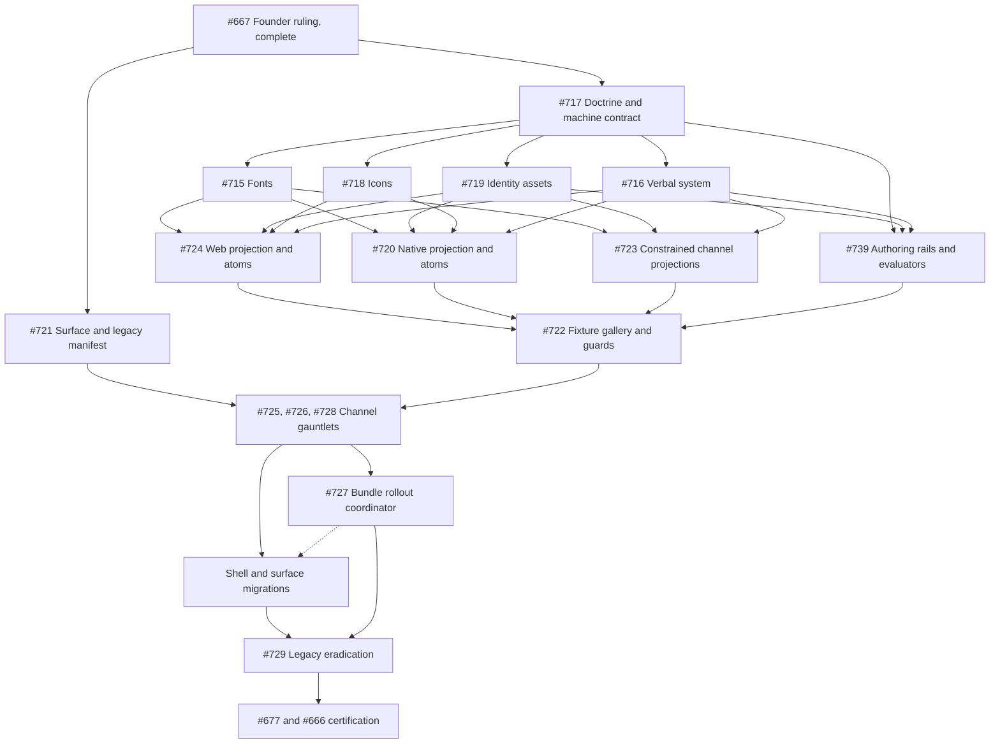

# Homa ground-up omnichannel brand system redesign

**Status:** Founder approved for full ground-up omnichannel execution on 2026-08-02; implementation is tracked by gh#666 and its dependency-ordered children
**Date:** 2026-08-02
**References:** [Anatomy Atelier](https://anatomy-livid.vercel.app/), [`thebuggeddev/anatomy`](https://github.com/thebuggeddev/anatomy/tree/c44eaa0e5bb0670925a49c6c76eba06f123487ef), and [Marble](https://withmarble.com/)
**Method:** [`gauntlet-loop`](https://github.com/sidneyswift/skills/blob/main/gauntlet-loop/SKILL.md), with separate builders and fresh-context critics
**Homa snapshot:** `4d4ce09a48c5efa7dbb78799407f06776a251210`
**Approval artifact:** [Quiet authority cross-surface review](./2026-08-02-homa-brand-system-approval.html)
**Reference-study gauntlet:** Four builder and fresh-critic waves informed the approved artifact. Their directional scores are not release evidence; gh#721 and gh#677 require the raw artifacts, rubrics, findings, and remediations before any implementation score is valid.

## 1. Executive decision

Homa should not copy Anatomy Atelier's anatomy theme, art-school voice, 3D viewer, or ornamental motion. Homa should adopt the product mechanics that make Anatomy feel unusually coherent:

1. One dominant work object in the first viewport.
2. One reusable surface grammar across navigation, stage, context, sheets, and cards.
3. State-preserving transitions that make a change feel continuous instead of replaced.
4. Responsive transformation, not desktop stacking.
5. Intent prefetch, stable loading geometry, and delayed busy UI that make the product feel faster.
6. Art direction that supports the task instead of decorating every empty area.

Homa can exceed the reference by combining those mechanics with capabilities Anatomy does not prove: real family work, trustworthy system state, stronger one-handed use, accessible motion, plain privacy boundaries, and a warm educational identity that never grades or judges a child.

The selected typography foundation is explicit: use EB Garamond for semantic display roles at `20px` and above, DM Sans for UI, body, controls, labels, and parent-facing data, and Fredoka only through the real Homa Logo. This combines an organic editorial voice with a modern interface rhythm without adopting Marble's commercial Merel family or another brand's exact treatment. The founder approved Quiet authority as the active target law for a complete ground-up redesign on 2026-08-02. The migration begins in doctrine and machine-readable foundations, then moves outward through assets, atoms, patterns, compositions, routes, channels, and final legacy eradication. Approval authorizes that program, not an unsafe global search and replace.

The target is a **calm, capable, editorially human Homa** across every product and brand surface. Every route or message should make the parent's current object, current state, and next useful action obvious within five seconds. “Dominant” means highest decision priority, not automatically the largest object or the most screen area.

## 2. Scope and boundaries

### In scope

- A founder-approved typography, color-role, Logo, imagery, layout, component, motion, accessibility, and governance contract in `DESIGN.md` and `docs/homa-design/`.
- Shared design foundations and semantic vocabulary for web, native, email, print, and distribution implementations.
- Public web: landing, blog, join, privacy, terms, public experiments, metadata, and error states.
- Acquisition and monetization presentation: sign-in, onboarding, sample, trial, paywall, billing, unsubscribe, and hosted provider handoffs.
- The signed-in web shell and its mobile-web transformation.
- Signed-in web routes: Chat, Progress, Planner, Tasks, Library, Binder, Hours, Settings, children, lessons, and global states.
- Founder and administrative web routes use the same approved foundations, Logo, controls, states, and artifact previews. They do not need customer-facing storytelling, but they may not retain the superseded type, color, asset, or component system.
- Development benches, public experiments, raw HTML endpoints, and lab routes are individually classified as retained and environment-gated, migrated, or retired. An unclassified route is a release failure.
- Native presentation across the Voice-first home, primary routes, settings, consent, billing, sheets, sharing, iPhone, and the ruled iPad posture.
- Public and authenticated reports, share links, generated materials, worksheets, parent keys, state packs, letters, and print or PDF output.
- Lifecycle email, SMS/MMS identity, phone-linked assets, and visually approved future push templates.
- App Store, app icon, splash, favicon, manifest, Open Graph, SEO-card, social, and campaign identity.
- The closest supported Homa presentation on external hosted touchpoints such as Stripe.
- Semantic motion, loading, feedback, and continuity rules.
- Deterministic render fixtures, accessibility checks, performance budgets, channel-appropriate delivery checks, and independent UX review.

This program owns presentation consistency and the shared foundation. Native navigation, Voice, Progress, device accessibility, performance, iPad, release, billing, consent, report evidence, materials, communications delivery, and other domain behaviors remain under their existing issues. Each modernization child must cross-link those owners instead of absorbing them.

### Out of scope

- Adding 3D, parallax, a generic animation library, or motion for its own sake.
- Rewriting domain behavior already owned by Planner, Progress, Binder, Voice, or native launch issues.
- Changing billing, tenancy, model behavior, or durable family state.
- Forcing the customer-interface font onto child-facing instructional material when a specialist reading face is more appropriate.
- Redesigning founder-console workflows that are unrelated to brand adoption. Admin still receives the complete identity and primitive baseline, while customer artifact previews remain exact mirrors.
- Shipping a global font swap before gh#715 defines the semantic roles, fallbacks, licenses, platform binaries, and layout-regression evidence, and before gh#722 proves those roles in the deterministic fixture gallery.
- Shipping placeholder buttons or demo-only interactions to make a screenshot feel complete.

## 3. Evidence and verification boundary

This audit compared:

- Anatomy live at desktop `1440 x 900` and phone `390 x 844`.
- Anatomy source at commit `c44eaa0e5bb0670925a49c6c76eba06f123487ef`.
- Anatomy’s exact font imports: Cormorant Garamond and DM Sans through `next/font/google`.
- Marble’s live heading and body typography, including computed font families, weights, line heights, and tracking.
- Marble’s current Merel licensing paths for web, native application, and document use. Homa has no right to reuse Marble’s delivered font files.
- Homa's live public landing page and sample report at the same desktop and phone widths.
- Homa's signed-in web, onboarding, email, report, material, metadata, distribution, and native architecture at the repository snapshot above.
- The current synthetic Voice shell direction lab, clearly treated as prototype evidence rather than native-device proof.
- Open GitHub Issues and current founder rulings so the program does not fork active work.

The Anatomy repository snapshot and live deployment were both inspected on 2026-08-02. The audit does not claim that the inspected commit is the exact Vercel deployment artifact because the deployment SHA was not exposed by the site.

Homa's production `/app` redirected the available sandbox account into trial onboarding, so no claim here treats that session as a complete production product audit. Signed-in product findings come from current source, public surfaces, existing verified artifacts, and route-specific implementation evidence. Phase 0 must render and record the authenticated synthetic fixture before any route target is treated as pixel-approved.

The cross-surface approval lab uses exact embedded EB Garamond, DM Sans, and Fredoka binaries with fictional content only. Its first comparison pass isolated typography and color before Quiet authority was selected. The current artifact intentionally removes the legacy Homa examples and rejected branches and freezes the founder-approved target identity across product, landing, native, email, reports, print, and distribution. Approval authorizes the dependency-ordered epic; it does not certify any implementation surface before that surface passes its own evidence gates.

### 3.1 Fresh parent read of the public report

A fresh-context Homa UX reviewer inspected the public sample report exactly once at `390 x 844` and `1440 x 900` as a busy homeschool mom. The title, Logo, sample disclosure, and personal note made the purpose clear and lowered judgment anxiety. The same reviewer found five high-value failures:

1. The tiny header run of age, “subjects mapped,” answer count, and “national benchmarks” requires inference instead of a glance.
2. The first phone viewport is mostly cover and letter, so it does not yet demonstrate the report the parent came to inspect.
3. The early acquisition link competes with completing the sample-review task.
4. “Months ahead” framing reintroduces comparison anxiety inside otherwise kind copy.
5. The desktop fold exposes a naked negative-looking chart label before its explanation, which reads like a bad grade.

The benchmark and negative-delta presentation is a live public web finding, not modernization backlog. It is tracked separately as [gh#665](https://github.com/sidneyswift/homa/issues/665) and should be corrected and verified without waiting for this program.

## 4. Concrete quality bar

Every migrated journey must pass all hard gates and score at least `4.2 / 5` across the scored dimensions. No scored dimension may be below `3.5 / 5`.

### Hard gates

- The first viewport has one clear purpose, one dominant work object, and one primary action.
- A fresh reviewer can name the page's purpose and next action within five seconds.
- All standalone controls and links are at least `44 x 44` CSS pixels or points. Inline links inside continuous prose may use the text line box when they remain visibly underlined, keyboard focus is obvious, and adjacent links cannot be mistaken for one target.
- The same outcome is available by keyboard and screen reader.
- Reduced Motion preserves meaning and removes nonessential spatial movement.
- Visible focus survives every background and `200%` browser zoom; content reflows at `400%` without two-dimensional scrolling outside genuine data canvases.
- Windows forced colors and increased-contrast modes preserve selection, focus, status, and action hierarchy.
- No unexpected layout shift when real data, previews, fonts, or long names load.
- Loading, empty, stale, interrupted, success, and error states have explicit copy and geometry.
- No animation implies listening, saving, completion, or delivery before system truth exists.
- Phone layouts work at `320`, `390`, and `430` CSS pixels without horizontal overflow.
- Desktop layouts work at `1024`, `1280`, and `1440` CSS pixels without a stranded context panel or unreadably wide text.
- Existing tenant, RLS, family-context, and deterministic write contracts remain unchanged.

### Scored dimensions

| Dimension | What a 5 means |
|---|---|
| Purpose and hierarchy | The current object and next action are unmistakable without reading every label. |
| Visual coherence | Type, spacing, radii, panels, controls, and states feel authored by one system. |
| Responsive behavior | The layout changes role and priority across widths instead of merely stacking. |
| Interaction continuity | Selection, navigation, loading, and completion preserve orientation. |
| Educational warmth | The surface feels capable, kind, memorable, and recognizably Homa. |
| Accessibility and trust | Meaning survives assistive settings, and the UI never overstates system truth. |
| Perceived performance | The interface responds immediately, holds stable geometry, and explains real waits. |

### Score anchors and aggregation

| Score | Anchor |
|---:|---|
| 5 | Immediate comprehension, no observed friction, and the route clearly improves the parent job. |
| 4 | Hard gates pass and the outcome is clear; only minor non-blocking friction remains. |
| 3 | The outcome is possible, but one avoidable pause, reread, wrong tap, or orientation loss occurs. |
| 2 | The reviewer needs substantial inference, backtracking, or assistance to complete the outcome. |
| 1 | The purpose, next action, or outcome cannot be identified or completed. |

Two fresh-context reviewers score each route independently from the same fixture and recording. Use the lower score for each dimension. If any dimension differs by more than one point, a third fresh reviewer adjudicates that dimension from the artifact only. The release score is the mean of the retained dimension scores, rounded to one decimal. Hard gates remain pass or fail and cannot be averaged away.

## 5. What Anatomy is doing well

### 5.1 One dominant object organizes the whole surface

Desktop uses a bounded three-part workspace: a `285px` library rail, a flexible central specimen, and a `330px` context panel. All three use the same border, paper, radius, and shadow grammar. The central object occupies most of the first viewport, so the page reads as a tool before it reads as a dashboard.

Evidence: [`app/globals.css` lines 137 to 152](https://github.com/thebuggeddev/anatomy/blob/c44eaa0e5bb0670925a49c6c76eba06f123487ef/app/globals.css#L137-L152).

On phone, the viewer remains first and consumes about two thirds of the viewport. The library becomes a bottom sheet and the vertical tools become a bottom toolbar. This is a change in hierarchy, not a simple column wrap.

Evidence: [`app/globals.css` lines 508 to 548](https://github.com/thebuggeddev/anatomy/blob/c44eaa0e5bb0670925a49c6c76eba06f123487ef/app/globals.css#L508-L548).

### 5.2 A compact token set produces unusually strong coherence

Eight core tokens control ink, muted text, canvas, paper, line, three accents, and shadow. The system repeats one panel treatment rather than inventing a new card on every section. Atmospheric gradients and restrained transparency give the cream canvas depth without adding new semantic colors.

Evidence: [`app/globals.css` lines 3 to 28](https://github.com/thebuggeddev/anatomy/blob/c44eaa0e5bb0670925a49c6c76eba06f123487ef/app/globals.css#L3-L28).

### 5.3 Motion preserves object identity

Changing organs does not cross-fade two unrelated pages. The outgoing model shrinks, the camera backs away, the incoming model begins smaller and farther back, then scale, depth, opacity, and camera settle together. The selected object feels changed, not destroyed and recreated.

Evidence: [`app/lib/three/viewer.ts` lines 242 to 305](https://github.com/thebuggeddev/anatomy/blob/c44eaa0e5bb0670925a49c6c76eba06f123487ef/app/lib/three/viewer.ts#L242-L305).

The information panel uses a short `480ms` reveal with `35ms` stagger after selection. This sequence communicates reading order without turning every child into a separate spectacle.

Evidence: [`app/components/AnatomyApp.tsx` lines 85 to 91](https://github.com/thebuggeddev/anatomy/blob/c44eaa0e5bb0670925a49c6c76eba06f123487ef/app/components/AnatomyApp.tsx#L85-L91).

### 5.4 It hides latency before showing a spinner

The organ list prefetches the model on pointer intent or keyboard focus and preloads the associated images on selection. The full loader waits `900ms`, preventing a fast transition from flashing a loading state.

Evidence:

- [`app/components/AnatomyApp.tsx` lines 93 to 111](https://github.com/thebuggeddev/anatomy/blob/c44eaa0e5bb0670925a49c6c76eba06f123487ef/app/components/AnatomyApp.tsx#L93-L111)
- [`app/components/OrganViewer.tsx` lines 37 to 44](https://github.com/thebuggeddev/anatomy/blob/c44eaa0e5bb0670925a49c6c76eba06f123487ef/app/components/OrganViewer.tsx#L37-L44)

### 5.5 Expensive work is bounded

The viewer chooses a lower pixel ratio and disables antialiasing on smaller or lower-core devices, disables real-time shadows, stops useful work offscreen or while the page is hidden, renders only while dirty or animated, and disposes observers, listeners, renderer resources, and tweens.

Evidence:

- [`app/lib/three/viewer.ts` lines 70 to 139](https://github.com/thebuggeddev/anatomy/blob/c44eaa0e5bb0670925a49c6c76eba06f123487ef/app/lib/three/viewer.ts#L70-L139)
- [`app/lib/three/viewer.ts` lines 381 to 403](https://github.com/thebuggeddev/anatomy/blob/c44eaa0e5bb0670925a49c6c76eba06f123487ef/app/lib/three/viewer.ts#L381-L403)
- [`app/lib/three/viewer.ts` lines 600 to 625](https://github.com/thebuggeddev/anatomy/blob/c44eaa0e5bb0670925a49c6c76eba06f123487ef/app/lib/three/viewer.ts#L600-L625)

### 5.6 Canvas interaction retains semantic equivalents

The interactive viewer has a named region, labeled controls, `aria-pressed` state, keyboard controls, a polite loading region, and a screen-reader list equivalent for visual hotspots. The callout position is updated imperatively so a rotating object does not cause React renders every frame.

Evidence:

- [`app/components/OrganViewer.tsx` lines 124 to 185](https://github.com/thebuggeddev/anatomy/blob/c44eaa0e5bb0670925a49c6c76eba06f123487ef/app/components/OrganViewer.tsx#L124-L185)
- [`app/lib/three/viewer.ts` lines 501 to 525](https://github.com/thebuggeddev/anatomy/blob/c44eaa0e5bb0670925a49c6c76eba06f123487ef/app/lib/three/viewer.ts#L501-L525)

## 6. What Homa already does better

Homa should modernize from strength, not erase its identity.

- Homa has a substantially richer semantic color, type, radius, shadow, spacing, and motion system in `docs/homa-design/`.
- The public landing page already shows professional art direction, responsive composition, a recognizable character, good typographic hierarchy, and purposeful reveal motion.
- Product copy has a binding voice and safety standard: true, clear, memorable, kind, and never a verdict on a child.
- The signed-in shell persists across route changes, which is the correct base for stable navigation and cross-surface continuity.
- Several newer product controls use `min-h-11`, proving the `44px` floor fits the visual language, although the audit also found many older `36px` and `40px` controls that need migration.
- Chat contains sophisticated work-state, voice, artifact, composer, and long-running-job behavior that is deeper than the reference's mostly local demo state.
- Homa has explicit privacy, tenancy, reduced-motion, and truthful-effect laws that can turn polish into trust instead of theater.

## 7. The delta

### 7.1 Summary

Homa's marketing surface feels designed as one composition. Homa's signed-in product feels designed route by route. The delta is the absence of a shared product composition model.

| Area | Anatomy | Homa now | Required delta |
|---|---|---|---|
| First-screen hierarchy | One specimen dominates | Many routes begin with title, filters, and stacked cards | Give every route one dominant work object and one next action |
| Surface grammar | One shared panel language | Similar tokens, route-specific Tailwind strings | Ship reusable product primitives and state variants |
| Responsive behavior | Rail and tools become sheets and bottom tools | Shell changes, inner routes mostly own their own collapse | Define cross-route desktop and phone composition contracts |
| Navigation | Compact, stable, five-item top nav | Eight product rows, including separate Planner and Calendar | Reconcile to ruled primary labels: Chat, Progress, Planner, Tasks |
| Motion | Selection and object state transition together | Good isolated motion, weak cross-route continuity | Add semantic motion roles and persistent object transitions |
| Latency | Intent prefetch, delayed loader, fixed stage | Loading patterns vary by route and long turns can feel silent | Adopt one immediate-acknowledgment and delayed-busy contract |
| Art direction | One object, one accent, one playful note | Strong marketing art, plainer product routes | Use Homa character, material previews, and family artifacts at key moments |
| Implementation | Small data-driven surface | Large global CSS and several 1,000 to 3,000 line route components | Extract primitives and state contracts without broad rewrites |
| Accessibility | Strong canvas semantics, incomplete motion and target sizing | Better target floor in many places, inconsistent route acceptance | Combine Homa's stronger floor with deterministic route tests |

### 7.2 Code-level symptoms in Homa

1. `apps/web/app/globals.css` contains the copied design tokens and application-specific styling in one `1,354` line file. Its header explicitly says the runtime `packages/design` package remains future work.
2. `packages/design/README.md` says `@homa/design` does not yet supply runtime tokens or components.
3. `apps/web/components/dashboard/PageColumn.tsx` standardizes only padding and maximum width. It does not define stage, context, header, toolbar, empty, loading, or action composition.
4. `APP_NAV_ITEMS` currently exposes Chat, Progress, Planner, Calendar, Hours, Library, Binder, and Tasks. This has drifted from the binding simplified labels and from the one-Planner ruling.
5. Route title rituals already differ: Progress uses `text-3xl` to `text-4xl`, Planner, Binder, and Tasks use `2rem`, Calendar uses `1.45rem`, and Library uses `text-3xl`.
6. Core interactive files are large: Chat is more than `3,000` lines, Calendar more than `1,500`, and Library more than `1,200`. New consistency should arrive by extracting stable seams, not by adding more one-off classes inside those files.
7. The mobile drawer has a good entrance transition and body-scroll lock, but close unmounts it immediately. The source comment correctly describes that behavior, which means the visible transition has no symmetric exit state.
8. Calendar enforces an `860px` minimum canvas on phone and relies on horizontal scrolling, while many calendar, shell, settings, Progress, onboarding, and Chat controls remain below the `44px` target.
9. Motion is concentrated in a `1,737` line thinking-act stylesheet while dialogs, route changes, and selection transitions use several unrelated patterns. The modernization task is to reduce and semanticize motion, not add more total animation.
10. Homa already has strong route-specific state handling, including Library recovery states, Tasks focus restoration, Progress partial-data states, and Planner's honest provisional week. Shared primitives must preserve those behaviors.

Relevant source:

- [`apps/web/app/globals.css`](../../../apps/web/app/globals.css)
- [`packages/design/README.md`](../../../packages/design/README.md)
- [`apps/web/components/dashboard/page-column.tsx`](../../../apps/web/components/dashboard/page-column.tsx)
- [`apps/web/components/dashboard/sidebar-nav.tsx`](../../../apps/web/components/dashboard/sidebar-nav.tsx)
- [`apps/web/components/dashboard/mobile-nav.tsx`](../../../apps/web/components/dashboard/mobile-nav.tsx)

## 8. Anti-requirements from the reference

Anatomy is a strong visual reference, not a production standard in every dimension. Homa must not copy these weaknesses:

- Do not use `32px`, `34px`, or `36px` controls as primary touch targets.
- Do not leave auto-rotation or other imperative motion active under Reduced Motion.
- Do not rely on a global animation-duration override as the complete reduced-motion implementation.
- Do not use perpetual pulse, orbit, heartbeat, or spin in routine product state.
- Do not snap a bottom sheet because the open state has no transition contract.
- Do not open a modal without focus containment, focus return, Escape behavior, and scroll containment.
- Do not use placeholder navigation or superficial actions to imply capability.
- Do not adopt `Comic Sans` fallback or Anatomy's serif-dominant voice.
- Do not add GSAP merely because the reference uses it. Most Homa work needs stable CSS or Web Animations transitions, not a 3D timeline engine.
- Do not reproduce Anatomy's blank stage between object changes. The old object remains until the replacement can enter or the stage shows a stable local loading state.
- Do not reproduce its 8px to 12px low-contrast metadata. Direct token checks put several small Anatomy color combinations below `4.5:1`.
- Do not copy its testing posture. Its remaining rendered-HTML test targets deleted starter components and does not cover responsive, modal, drawer, accessibility, or 3D behavior.

## 9. Target product composition

### 9.1 The Homa workspace model

Each signed-in surface composes the same roles:

1. **Global shell:** Logo, primary navigation, family context, account, and Voice-owned safe lane.
2. **Orientation header:** short eyebrow only when useful, sentence-case title, one-line purpose, and at most one primary page action.
3. **Work stage:** the dominant family object or current job.
4. **Context:** details, evidence, explanation, or secondary actions for the selected object.
5. **Supporting shelf:** history, alternatives, related artifacts, or lower-priority items after the primary outcome.
6. **Feedback layer:** immediate acknowledgment, busy state, completion receipt, recovery, and undo.

Not every route needs every role. It must not fill empty roles with decorative cards.

The work stage must keep the primary action or first useful interpretation in the first phone viewport. A visual artifact may occupy more space only when inspecting that artifact is itself the parent job.

### 9.2 Desktop contract

- The global rail stays stable and visually quieter than the work.
- Primary navigation uses the ruled labels Chat, Progress, Planner, and Tasks. `nav-chat-label` supersedes the older “Ask” label for this one tab.
- A secondary “Your work” group contains Library, Binder, and Hours. It is visually quieter than the primary group and remains directly reachable by keyboard and screen reader.
- Settings and account remain in the existing account menu. Family and child scope remain in the context switcher.
- Calendar becomes a Planner view, not a primary destination. While the one-Planner flag is off, the old `/app/calendar` route remains reachable from Planner and fully functional. After parity and rollout, old calendar links redirect to the equivalent Planner view.
- Data-rich routes may use `rail | stage | context` within the product content area.
- Stage width is flexible and dominant. At `1280px` and wider, context is docked and bounded between `300px` and `360px`. From `1024px` to `1279px`, context is an overlay panel. Below `1024px`, it uses the phone sheet or full-detail contract.
- Long reading copy remains between `60ch` and `72ch`, even when the stage is wider.
- The primary action stays in a predictable header or stage location, not duplicated across header, card, and footer.

### 9.3 Phone contract

- The work stage comes first.
- The current local tools may occupy one reachable bottom toolbar or Voice-safe lane, never both.
- Selection detail uses a bottom sheet when the parent benefits from seeing the stage behind it. The resting detent is `min(56dvh, 560px)`. The expanded detent is `min(92dvh, calc(100dvh - 16px - env(safe-area-inset-top)))`.
- A full-height detail route is reserved for multi-step editing, privacy-sensitive settings, long forms, or content whose scroll position must be addressable by URL and Back.
- Inline disclosure is reserved for three short lines or fewer with no sticky action and no nested interaction.
- The global hamburger remains the global navigation door unless a later founder ruling changes it.
- Secondary details do not push the first useful action below a decorative hero.
- The system respects safe areas, keyboard height, Voice persistence, and one-thumb reach.
- Local selection survives opening and closing context.
- The sheet owns its scroll; the covered page remains fixed. A sticky action may live at the sheet bottom only when it is the single next action.
- Back, Escape, a labeled `44px` close control, focus containment, focus return, and drag dismissal all resolve to the same state. Drag is never the only dismissal method.
- When the keyboard opens, the focused field and primary action remain visible without moving the Voice lane.
- The Voice-safe lane outranks local tools. A route with local bottom tools must merge them into the lane contract or move them into context.

### 9.4 Tablet and narrow desktop contract

- Context collapses before the stage becomes unusable.
- A two-column route becomes stage plus on-demand context, not three squeezed columns.
- Desktop-only labels may collapse to icons only when every icon has a persistent accessible name and unambiguous tooltip.

### 9.5 Route composition decisions

The target renders in Phase 0 must explicitly choose one pattern for each state. “Any of these could work” is not an implementation decision.

| Route | Desktop | Phone | Context behavior |
|---|---|---|---|
| Chat | conversation or active artifact stage | conversation or active artifact stage | inline for brief scope, sheet for artifact or job detail |
| Progress | evidence list plus selected evidence stage | one evidence answer and next move | sheet for source, confidence, conflict, and correction |
| Planner | unscheduled rail, week stage, item context | Today or week stage | sheet for item detail and scheduling controls |
| Tasks | state-ranked list plus selected task | state-ranked list | sheet for review, response, receipt, and history |
| Library | discovery rail, selected source stage, source context | selected source or discovery list | sheet for source detail and use actions |
| Binder | collection rail, selected artifact stage, artifact context | artifact or collection list | sheet for version, print, revise, and file actions |

## 10. Visual language

### Keep

- Quiet mineral canvas and white or lightly raised paper objects.
- Bright clay `#E7602F` as the visual brand color in the Logo, character, and art.
- Sage for constructive or complete state, gold for selective emphasis, sky for information.
- Fredoka only through the real `Logo` component.
- Homa's warm shadows, restrained paper cues, real material previews, and character system. The active radius ladder is `12px` for controls, `18px` for cards, and `28px` for large frames.

### Refine

- Reduce the number of visually equal cards in the first viewport.
- Use borders and elevation to communicate layer, not as defaults on every block.
- Make selected state a coordinated change in surface tint, border, text, and context, not color alone.
- Give previews stable aspect-ratio containers and never crop worksheets or child work without an explicit preview affordance.
- Compose warmth across asymmetry, real family artifacts, sky or clay accents, Homa's character, paper cues, and human annotation. Give each surface one dominant authored moment, but do not flatten the rest into a sterile grid.
- Use one ownable cross-surface signature: a real learning object leads, the little home may peek in as a guide, and the Homa thread begins as a tiny roof line before becoming an underline or connector. Then the composition becomes still. Adapt the motif to the medium instead of stamping the same layout everywhere.
- Prefer real family objects over generic icons when the object is the purpose of the page.
- Separate Homa's bright visual signature from the functional anchor. The selected foundation uses midnight `#27374D` for repeated actions and selection, `#A33F22` for accessible coral-family text, and semantic inks only when their meaning is true.
- Replace route-selected font sizes with named semantic roles and platform mappings.
- Use the controlled Foundation specimen in the approval lab to verify typography. Other tabs show the selected composition, hierarchy, and token behavior in context.

### Do not introduce

- Colors, type voices, Logo treatments, radii, or glass effects outside the founder-approved foundation.
- Decorative gradients on every card.
- A dense dashboard of status tiles when one recommendation or work object is more useful.
- Child-score gamification, celebratory confetti, sibling comparison, or red deficit framing.

### Homa signature system

Quiet authority becomes ownable through repeated behavior, not through more decoration. Every migrated surface must use the smallest channel-appropriate version of the same signature system.

| Element | Chosen contract | Guardrail |
|---|---|---|
| Master Homa | One canonical silhouette and character anatomy derived from the real Logo, with approved full-color, one-color, dark-surface, tiny, print, and motion states | Never rebuild Homa from CSS primitives, generic rounded squares, or channel-specific eye and roof geometry |
| Composition | A real family or learning object leads, Homa provides one useful orientation, and one next move lands at the end of the reading path | Product UI must not become a mascot scene; marketing must still prove a real object or outcome |
| Object prominence | The real object carries roughly `55%` to `70%` of the composition's visual weight; Homa is normally `10%` to `16%` of the short edge | Homa may become larger only when Homa herself is the active voice or system-state object |
| Coral roof thread | One `#E7602F` line begins with a small roof gesture, uses round caps, makes no more than two purposeful turns, and connects context to the next move | Use `2px` in product and `3px` in large brand media; never cross a face, readable text, or an interactive control, and never use it as free-floating decoration, a repeated divider, or a loading spinner |
| Typography behavior | EB Garamond frames one meaningful invitation, reflection, or orientation; DM Sans carries facts and action. Display lines are intentionally balanced and normally stop at two lines | Coral punctuation is reserved for rare campaign or editorial moments, never routine product headings or data |
| Imagery | Natural window light, lived-in objects, child-height or table-height camera, visible process, quiet imperfection, and privacy-safe crops | Avoid staged stock smiles, immaculate schoolroom tableaux, floating supplies, and decorative imagery unrelated to the current task |
| Shape and elevation | The core radius ladder is `12px` for controls and compact objects, `18px` for cards and sheets, and `28px` for large story frames. Physical artifacts may use paper edges, slight rotation, or a restrained roof-derived corner. One viewport uses at most two elevation levels | Pills are for compact actions, filters, tags, and status, not every container. Functional controls stay geometrically quiet. Rotation belongs only to objects that could physically rotate |
| Icons | One unmodified functional icon family at `16`, `20`, and `24px`, with a consistent stroke and explicit active, disabled, status, and forced-color treatments | Homa's identity lives in composition, container, thread, and state, not in ornamental edits to generic glyphs |
| Motion | The recognizable sequence is `peek → orient → draw → land → still`: Homa enters, looks toward the real object, the roof thread reveals the next move, feedback lands, and all non-live motion stops. Individual transitions run `120ms` to `320ms`; the complete one-time sequence stays under `900ms` | Continuous movement is reserved for truthful listening, recording, transfer, or indeterminate work. Every live motion has cancellation and expiry behavior. Reduced Motion shows the final oriented still with an immediate state change |
| Verbal cadence | Name one real family detail, show that Homa kept the thread, then offer one useful next move | Never turn the cadence into a slogan pasted onto every surface |

The full expressive tier uses character, object, thread, motion, and next move in web or native moments with room to breathe. The static rich tier uses object, character or mark, a fixed thread, and next move in landing, reports, social, and store media. The constrained tier uses the real Logo or tiny mark, EB Garamond or a declared safe fallback, a coral cue, and the verbal cadence in email, hosted providers, monochrome print, favicon, and metadata. A channel may reduce expression, but it may not invent a different Homa.

### Selected semantic color contract

Quiet authority is the founder-approved color direction under gh#667: exact Homa coral as the memorable signature, midnight as the dependable interaction and structural anchor, and cooler mineral neutrals as the dominant environment. These values become active only through the dependency-ordered migration in this program. Until a surface adopts the generated contract and passes its gates, its current values remain implementation reality rather than design authority.

| Role | Selected pair | Contrast | Use | Do not use |
|---|---|---:|---|---|
| Default canvas and ink | `#F7F4EE` with `#20242B` | `14.18:1` | Default web, native, report, email, and artifact environment | Do not tint every nested region |
| Paper surface | `#FFFEFC` with `#20242B` | `15.45:1` | Cards that are true objects, previews, sheets, and artifacts | Do not turn every text block into a card |
| Floating layer | `#FFFFFF` with `#20242B` | `15.57:1` | Menus, sheets, focused objects, and temporary layers | Do not use white as a second default canvas |
| Expressive coral | `#E7602F` | Visual only | Logo, Homa character, illustration, large decorative marks | Do not use for normal text or white-text controls |
| Primary action and selection | `#27374D` with white | `12.07:1` | Primary buttons, active navigation, selected controls, and structural dark fields | Do not use as a decorative accent on every surface |
| Brand text | `#A33F22` on `#F7F4EE` | `5.81:1` | Links, eyebrows, and small brand accents | Do not carry error meaning or selected state |
| Control boundary | `#918B83` on white or canvas | `3.37:1` and `3.07:1` | Input, control, and focus boundaries | Do not use as small body text |
| Constructive state | `#335C46` on `#E5EFE8` | `6.46:1` | Success, ready, saved, or complete, with words or structure | Do not use for selection, approval, or generic decoration |
| Information state | `#2F5968` on `#E4EFF2` | `6.52:1` | Helpful context, neutral information, and progress explanation | Do not become a generic accent |
| Selective highlight | `#76560F` on `#F7EBC7` | `5.68:1` | One useful emphasis or coaching note | Never place white text on gold |
| Error state | `#923F33` on `#F5E5E1` | `5.76:1` | Real system error, destructive confirmation, or blocked effect | Never use as deficit or judgment framing |
| Contained story band | `#F7F4EE` on `#27374D` | `10.99:1` | A rare landing, campaign, social, footer, or editorial beat | Never make it the default light product canvas |

Color is never the only state carrier. Selected, saved, working, offline, warning, and error states also change language, structure, border, icon, or accessible state. The visual signature, functional anchor, and semantic colors have different jobs and are not interchangeable in code.

Color proportions are part of the contract, not a mood-board suggestion. Aim for roughly `76%` mineral canvas and paper, `16%` midnight and ink structure, `6%` expressive coral, and no more than `2%` semantic color in a typical composition. `#A33F22` is the accessible text proxy for coral, not a second brand color. Success, information, highlight, and error colors never decorate. Homa remains coral in success states; constructive green appears as a badge, ring, or receipt so system meaning never erases identity.

### Density recipe

- Phone outer padding: `16px` to `20px`. Desktop content padding: `32px` to `40px`.
- Related controls: `8px` to `12px` apart. Card internals: `12px` to `16px`. Major regions: `24px` on phone and `32px` on desktop.
- Page title: `2rem` on phone and up to `2.5rem` on desktop. Section title: `1.5rem` to `2rem`. Body: at least `1rem` for parent guidance and `0.875rem` for supporting UI. Meaningful metadata never drops below `0.8125rem`.
- Use one primary display heading per viewport. EB Garamond is selected only for display roles at `20px` and above. Dense grids, labels, controls, data, body copy, and supporting information use DM Sans.
- Use at most two visible elevation levels in one viewport.
- Do not nest a bordered card inside another bordered card. Use spacing, a rule, tint, or a detail region unless the inner object is an actual preview.
- Interactive rows are at least `52px` high when they contain title plus metadata, and at least `44px` otherwise.
- A phone first viewport should normally contain the orientation title, the dominant object or its first useful portion, and the next action. Decoration yields before any of those.
- A worksheet, report, or material preview uses a declared aspect ratio and `object-fit: contain`; lists reserve the final dimensions before the media arrives.

### Selected semantic typography contract

This table is the active foundation approved under gh#667. Exact machine values live in `packages/design/src/contract/`, and generated projections must match its version and source checksum.

| Role | Selected family | Typical compact size | Typical desktop size | Rule |
|---|---|---:|---:|---|
| Hero display | EB Garamond 400 to 500 | `44/46px` | `64/66px` | One per composition, editorial promise only, tracking `-0.025em` to `-0.04em` after wrap testing |
| Page title | EB Garamond 500 | `32/36px` | `40/44px` | Orientation and human question |
| Section title | EB Garamond 500 | `26/31px` | `32/37px` | May not become UI chrome |
| Card title | EB Garamond 500 or DM Sans 650 | `20/26px` | `22/28px` | Serif only when the card is an editorial object |
| Large body | DM Sans 400 to 500 | `18/28px` | `18/28px` | Parent guidance and promises |
| Body | DM Sans 400 to 500 | `16/24px` | `16/24px` | Default reading text |
| Small body | DM Sans 400 to 500 | `14/20px` | `14/20px` | Supporting facts, never verdicts by color alone |
| Control | DM Sans 600 | `15/20px` | `15/20px` | Interactive text is at least `14px` |
| Label and navigation | DM Sans 600 | `14/20px` | `14/20px` | Scannable and sentence case |
| Caption | DM Sans 500 | `13/18px` | `13/18px` | Meaningful customer text floor |
| Eyebrow | DM Sans 700 | `12/16px` | `12/16px` | High contrast, nonessential orientation only |
| Metric | DM Sans 650 to 700, tabular | `16px` to `36px` | `16px` to `40px` | No monospace merely to imply data |
| Logo | Fredoka 600 through `Logo` | Existing lockup | Existing lockup | Never hand-typeset the wordmark |

Email maps display roles to Georgia and functional roles to a system sans stack. Print embeds deterministic approved faces and may use a specialist child-reading face for instructional content. Native bundles the approved binaries, preserves Dynamic Type, and validates the largest accessibility categories. No EB Garamond appears below `20px`, in a control, or in dense family data. Merel is not a baseline dependency; reopening it requires a consolidated written license covering production and preview web domains, iOS and Android binaries, over-the-air app delivery, server-generated personalized documents, and static campaign assets.

## 11. Product primitives

The runtime system should expose semantic components rather than a second pile of styling utilities.

| Primitive | Responsibility |
|---|---|
| `AppFrame` | Global rail, phone bar, safe areas, Voice lane, content region |
| `Workspace` | Stage and optional context geometry across breakpoints |
| `PageHeader` | Orientation, purpose, primary action, compact variants |
| `WorkStage` | Dominant object, stable loading geometry, state label |
| `ContextPanel` | Selected-object details on desktop, sheet adapter on phone |
| `ToolShelf` | Bounded local actions with selected and disabled semantics |
| `SurfaceCard` | Standard interactive, selected, quiet, warning, and disabled states |
| `ActionButton` | Primary, secondary, quiet, and destructive contracts with `44px` floor |
| `StateNotice` | Empty, stale, offline, interrupted, error, and success language |
| `LoadingFrame` | Stable skeleton, delayed status, progress disclosure, cancellation slot |
| `ActionReceipt` | Truthful effect, destination, visibility, and undo or correction path |

Implementation rule: a primitive is justified only after two real product surfaces need the same role. Route-specific behavior stays with the route.

gh#630 is authoritative for cross-platform Homa state names and the truth conditions behind them. `@homa/design` packages that vocabulary alongside tokens, type-safe semantic names, platform mappings, and parity checks. DOM and React Native components remain platform adapters because layout and accessibility primitives differ. Shared tokens do not justify forcing one rendering component across both runtimes.

## 12. Motion and continuity

### 12.1 Semantic roles

| Role | Default | Purpose |
|---|---:|---|
| Press | `120ms`, scale to `0.98` | Confirm direct manipulation |
| Select | `120ms` to `200ms`, color, border, opacity | Connect the chosen item to context |
| Reveal | `200ms`, `4px` to `8px`, opacity | Introduce newly relevant content |
| Context enter or exit | `200ms` to `320ms`, from its physical origin | Preserve orientation when panel or sheet changes |
| Object continuity | up to `320ms`, transform and opacity | Show that the same plan, material, or task changed state |
| Completion | one bounded settle, up to `320ms` | Confirm real completion after server truth |
| Homa thinking or working | existing character acts | Communicate real system state, never decoration |

Use the existing `--ease-out`, `--ease-in-out`, `--dur-fast`, `--dur-base`, `--dur-slow`, and `--press-scale` tokens. No bounce, spin, confetti, parallax, or unbounded loop belongs in routine product UI.

### 12.2 Continuity rules

- Keep the selected item's thumbnail, title, and accent stable between rail, stage, and context.
- Animate state changes inside a persistent container when possible.
- When an object opens into detail, preserve its identity with a shared title or preview and a clear origin.
- When a server-confirmed action changes status, settle the same object before moving it to history.
- Do not animate a full route merely because navigation occurred.
- An interrupted animation must resolve immediately to the newest true state.
- Exit animation never delays a critical route, error, or Voice handoff.

### 12.3 Route continuity maps

Each migrated route ships a small map identifying what persists. The component and data contracts must make the map testable.

| Route | Persistent identity | State that survives | Focus destination after close or Back |
|---|---|---|---|
| Chat | conversation id, active artifact id, title or preview | transcript, draft, job, Voice session | originating composer or artifact trigger |
| Progress | child id, evidence id, subject accent, dated title | filters, freshness, correction state | originating evidence row |
| Planner | plan revision, activity id, day, label | scroll, selection, optimistic write, undo | originating activity or day |
| Tasks | job or task id, stage label | response draft, stream state, receipt | originating task card |
| Library | source id, cover, title | query, filters, scroll, processing state | originating source card |
| Binder | material id, revision id, preview | collection, filters, scroll, draft state | originating artifact card |

The selected object's thumbnail or preview, title, accent, and status must agree across list, stage, and context. That cross-pane identity is a data requirement, not optional animation polish.

### 12.4 Reduced Motion

- Replace spatial travel with immediate state plus a brief opacity change where useful.
- Stop automatic character, preview, carousel, or decorative movement.
- Keep progress, listening, and completion semantics in text and accessible state.
- Do not set every animation to `0.01ms` and assume imperative animation stopped.
- Automated tests cover the preference before manual acceptance.

## 13. Latency and performance

### Interaction response contract

1. Acknowledge the input in the same frame with pressed, selected, or queued state.
2. Prefetch likely route data, material previews, and code on pointer intent, focus, or touch intent when safe.
3. Hold stable geometry. Never replace a small row with a page-sized spinner.
4. Avoid a full busy surface for work that resolves inside `500ms`.
5. After `500ms`, show a stable skeleton or local status where the result will appear.
6. After `2s`, say what Homa is doing in plain language.
7. For genuinely long work, route through the existing job and streaming-progress owners and provide a resumable destination.
8. On failure, preserve the parent's input and explain retry, fallback, or what remained unchanged.

### Initial web budgets

These are release floors to measure and tighten with real devices, not performance claims about the current product.

| Measure | Budget |
|---|---:|
| Input acknowledgment | next animation frame |
| Local selection to visible context | `<= 200ms` |
| Warm route usable | p75 `<= 700ms` |
| Cold route first useful content | p75 `<= 1.5s` on a representative phone profile |
| Layout shift | CLS `<= 0.05` for the signed-in route fixture |
| Long task first truthful status | `<= 500ms` |
| Long task plain-language explanation | `<= 2s` |

Web budgets should align with, not duplicate, the native measurement work in gh#632. Long-turn feedback remains coordinated with gh#203.

### Reproducible verification profile

- Phone lab profile: current stable Chromium, `390 x 844`, device scale factor `3`, four-times CPU slowdown, `1.6 Mbps` down, `750 Kbps` up, `150ms` round trip, cold cache on first run, then warm-cache repeat.
- Desktop lab profile: current stable Chromium, `1440 x 900`, no CPU throttle, cold and warm cache runs.
- Synthetic stress family: four children, twelve subjects, one hundred scheduled or unscheduled Planner items, one hundred Library or Binder items with mixed preview states, fifty Tasks across all stages, and a two-hundred-message Chat history. Content is fixture-only.
- Media budget: list thumbnails are responsive and normally at most `150 KB`; first-viewport editorial or preview media is normally at most `500 KB`; exceptions require measured value and a stable placeholder.
- Client JavaScript budget: a migrated route may not add more than `25 KB` gzip without a measured rationale. No animation dependency is added only for standard press, reveal, panel, sheet, or selection motion.
- Prefetch is same-origin, bounded to two outstanding speculative requests, disabled under Save-Data, canceled or deprioritized after intent leaves, and never fetches family content the current authenticated view could not already request.
- Record route bundle, request count, transferred bytes, first useful content, layout shift, input delay, and first truthful long-work status for every baseline and candidate.
- Pin the Chromium revision through the repository's Playwright dependency and lockfile. The CI artifact records the revision, operating system, command, and fixture checksum.
- Add one named command, `pnpm check:interface-gauntlet`, that builds or boots the deterministic fixture, runs the route journeys, captures screenshots and timings, and emits a machine-readable result plus human-review artifacts.
- Run ten cold-cache and twenty warm-cache samples per route and profile. “First useful content” is a route-owned `performance.mark` fired when the dominant object and its primary action are both visible and enabled or truthfully unavailable. “Usable” means that same condition. Long-work acknowledgment and explanation use separate marks.
- Compute p75 from the retained run set. A failed journey, missing mark, console error, uncaught rejection, or cross-route state mismatch fails the run rather than disappearing from the percentile.

## 14. Accessibility and trust

- Use landmarks that match visual regions: global navigation, main stage, context, and supporting content.
- Every visual selection exposes `aria-current`, `aria-selected`, `aria-pressed`, or native equivalent as appropriate.
- Focus moves only when the interaction opens a new modal, sheet, or route context that requires it.
- Sheets and modals trap focus, return focus, close with Escape, and contain background scroll.
- Reading and focus order follow the same priority as the visual composition.
- Do not use handwriting, color, animation, haptic, or sound as the only carrier of meaning.
- Large text can increase height without hiding actions or forcing two-dimensional scrolling.
- Body and control text meets WCAG AA contrast. Visible focus meets the non-text contrast requirement against adjacent colors.
- Browser zoom at `200%`, reflow at `400%`, forced colors, and increased contrast are named acceptance cases, not optional manual notes.
- Error, saved, sent, shared, listening, and complete are announced only after their deterministic truth exists.
- The native route acceptance work remains owned by gh#633. This program adds the parallel web contract and shared fixtures.

## 15. Surface adoption specs

### Chat

**Dominant object:** the current conversation or active family artifact.
**Next action:** speak or type one useful request.
**Context:** active child or family scope, current job, selected artifact, and truthful state.

- Keep Voice first-class and preserve gh#535's session-lifetime ownership.
- Do not redesign opening prompts until gh#532 identifies the actual activation failure.
- Reduce empty-page competition around the composer.
- When Homa makes a plan, material, or task, let that object become the stage without losing the conversation.
- Preserve long-turn status and resumable work through gh#203.

### Progress

**Dominant object:** one dated observation or evidence-backed answer.
**Next action:** one useful parent-chosen move.
**Context:** source, freshness, confidence, conflict, and correction.

- Treat gh#617 and its children as the outcome and data-contract owners.
- Do not make score tiles or age-gap verdicts the visual hero.
- Use evidence as the object, then reveal explanation and one next move.
- Preserve unknown, stale, inferred, and conflicting states in words and form.

### Planner

**Dominant object:** the current week, with today and the next unfinished work visible.
**Next action:** schedule, check off, or adjust the selected item.
**Context:** activity detail, recurrence, source, conflict, and undo.

- The one-Planner arc, gh#259 through gh#267, owns behavior.
- Planner and Calendar must not remain visually separate primary destinations.
- Desktop may use rail, week stage, and selected-item context.
- Phone keeps the week or today stage first and moves detail into a sheet.
- Direct manipulation and check-off motion follow real write truth, revision preconditions, and undo.

### Tasks

**Dominant object:** work that needs the parent now or is actively running.
**Next action:** answer, review, resume, or open result.
**Context:** stage, owner, timing, effect, and recovery.

- Separate “needs you,” “working,” and “done” through content and structure, not color alone.
- Preserve active job identity when it moves into detail or history.
- Reuse the same receipt and long-work language as Chat.

### Library and Binder

**Dominant object:** selected source in Library or selected kept family artifact in Binder.
**Next action:** inspect, use with Homa, print, revise, file, or continue.
**Context:** provenance, version, child or subject, state, and family-safe actions.

- Library discovery and Binder ownership remain distinct even if they share visual primitives.
- Use real cover, worksheet, or material previews as the stage.
- Keep previews uncropped and stable.
- Coordinate adoption with gh#175, gh#530, and gh#531 rather than redefining drafts, collections, revision, or lineage.

### Public acquisition and trust

**Dominant object:** one believable Homa promise supported by a real product object.
**Next action:** begin the truthful sample, report, or sign-up path.
**Context:** how Homa works, who it helps, privacy, pricing, proof, and support.

- gh#683 owns the landing page, blog/content templates, join, privacy, terms, public error states, and reachable `/world*` experiments.
- Editorial display type may carry the promise; navigation, proof, pricing, forms, and legal copy remain functional sans text.
- Every public experiment receives an explicit keep, redirect, or retire ruling. Reachability is part of brand quality.

### Sign-in, onboarding, paywall, and billing

**Dominant object:** the current setup or purchase decision.
**Next action:** complete one truthful step, resume, or leave with terms understood.
**Context:** progress, saved state, price, trial, consent, cancellation, error, and support.

- gh#684 owns presentation continuity through sign-in, onboarding, sample, trial, paywall, billing gates, unsubscribe, and hosted Stripe handoffs.
- Existing consent, entitlement, pricing, Stripe, analytics, and server authority remain unchanged.
- A hosted provider gets the closest supported Homa Logo, color, fallback typography, and support identity. Unsupported styling is documented, not simulated.

### Secondary signed-in web

gh#685 covers Hours, Settings, children and family, lessons, recorder, Firsts, and global loading, error, empty, stale, and offline states. These routes use the same shell and semantic grammar without being hidden inside shell implementation or losing their existing behavior owners.

### Native iPhone and iPad

**Dominant object:** Voice-first help or the selected family work object.
**Next action:** speak, type, open the day, or act on the current object.
**Context:** session truth, child or family scope, consent, billing, state, offline, and recovery.

- gh#686 owns presentation parity across sign-in, Voice-first home, Chat, Progress, Planner, Hours, Binder, Tasks, Settings, consent, billing, share, print, and sheets.
- gh#299 and its children retain release and behavior. gh#535 retains Voice session ownership. gh#617 retains Progress behavior. gh#631 retains iPad, orientation, and appearance rulings.
- Shared tokens do not force web layouts into React Native. Dynamic Type, VoiceOver, safe areas, Reduce Motion, Increase Contrast, Reduce Transparency, interruption, and representative-device performance are release evidence.

### Reports, sharing, generated materials, and print

**Dominant object:** the report, evidence item, worksheet, parent key, record, or letter itself.
**Next action:** understand, correct, share, print, file, or continue.
**Context:** provenance, privacy, version, evidence confidence, print geometry, and recipient.

- gh#687 covers sample, token, authenticated, evidence, plan, lesson, and one-page reports; public share states; PDFs; worksheets; parent keys; Binder previews; state packs; and filing letters.
- gh#665 remains a live production report bug and cannot wait for modernization.
- Brand typography frames an artifact. Child-readable instructional typography remains a pedagogical choice. Browser, PDF, printed, grayscale, and embedded-font outputs must agree.

### Email, SMS/MMS, and future push

- gh#688 modernizes the shared email shell and every transactional or lifecycle variant, with email-safe fallbacks, dark-client, image-blocked, plain-text, forwarded, reply, and unsubscribe states.
- SMS/MMS keeps platform typography but adopts recognizable sender language, link/media preview, Logo or character assets where supported, and the same truthful semantic states.
- Push templates may be approved visually, but remain explicitly future until gh#307 ships their behavior.

### Distribution identity

- gh#689 covers app icon, splash, App Store previews, favicon, Apple icon, PWA manifest, Open Graph, SEO cards, social templates, and campaign assets.
- gh#308 and gh#310 retain App Store listing, submission, access, and release ownership. Social publishing stays with its existing account owners.
- Historical templates are evidence, not automatically current assets. Regeneration follows approved Logo, character, crop, privacy, photography, minimum-size, monochrome, and dark-surface rules.

## 16. Architecture and change map

### 16.1 Binding ground-up laws

1. **Doctrine and atoms precede screens.** No route, template, message, or distribution migration begins until its approved semantic roles, assets, atoms, states, and target fixture exist.
2. **One human doctrine and one machine contract.** `docs/homa-design/` owns intent, principles, usage, and founder decisions. `packages/design/src/contract/` owns exact machine-readable values and identifiers. Everything else is a generated projection or a platform adapter.
3. **Semantic sharing, platform-correct rendering.** Web, React Native, email, print, hosted providers, and distribution assets share names and meaning. They do not pretend to share React components, layout engines, accessibility APIs, or delivery constraints.
4. **The design package never decides product truth.** It may map `working` to a visual state, but it may not decide that a job is working, saved, delivered, complete, safe, or authorized.
5. **New and legacy systems never alias.** The new `--homa-*` contract may coexist temporarily with a frozen legacy compatibility layer. Old token names must not silently resolve to new values, because that changes pixels without proving that the consuming surface migrated.
6. **Every migration is behavior-preserving.** Domain actions, tenancy, billing, consent, agent behavior, artifact provenance, and durable family state stay under their current owners and existing tests.
7. **Every layer supplies positive and negative proof.** Positive proof shows the approved system rendered and working. Negative proof shows that old fonts, tokens, assets, geometry, templates, flags, and style paths can no longer reach the migrated output.
8. **Evidence is inspectable and versioned.** A builder's explanation, a component name, or a successful deploy is not visual proof. Each gate records fixtures, pixels, recordings, automated results, critic findings, remediation, and the exact commit.
9. **Historical truth is preserved but cannot remain active guidance.** Dated planning and approval evidence may remain. Retired design kits, specimens, and templates leave the active design source tree; git is the archive.
10. **Zero traces means zero controlled active or default-visible legacy identity.** Current views, public links, downloads, generators, supported installed clients, and default artifact versions resolve to the approved presentation or a positive approved profile rule. Private provenance and externally delivered historical copies remain truthful records, not active brand surfaces.

### 16.2 Authority, generation, and adapter boundaries

| Layer | Canonical home | Owns | Must not own |
|---|---|---|---|
| Founder policy | `docs/homa-planning/journeys/10-reconciliation.md` | Approved direction, invariants, and exceptions | Token serialization or platform code |
| Human doctrine | `docs/homa-design/` | Principles, usage, examples, anatomy, accessibility, channel reduction, content design | Hand-copied runtime values |
| Machine contract | `packages/design/src/contract/` | Typed colors, type roles, space, shape, elevation, motion, icons, state names, asset geometry, profiles, versions | React, React Native, route behavior, provider calls |
| Generators | `packages/design/src/generators/` | Reproducible platform projections, docs data, assets, manifests, checksums | Hand-authored product behavior |
| Platform adapters | App-local design directories | DOM, React Native, email table, print, hosted, and asset rendering semantics | New token values or alternate meanings |
| Patterns and compositions | App-local shared components | Interaction, layout, state, and channel composition | Reimplementation of business logic |
| Routes and channels | Existing feature homes | Actual family outcomes and domain behavior | Local copies of the design contract |

`@homa/design` exports typed semantic subpaths such as `tokens`, `brand`, `icons`, `motion`, `states`, and `profiles`. Its root has no React or React Native dependency. Deterministic generators produce, at minimum:

- web CSS custom properties and Tailwind mappings,
- the React Native theme projection,
- email-safe semantic tables,
- print CSS and embedded-font metadata,
- hosted-provider and distribution profiles,
- Logo, character, icon, and campaign asset variants,
- an asset manifest with dimensions, safe areas, appearance, source checksum, and output hash,
- the machine-readable surface manifest and fixture index,
- `DESIGN.md` front matter and active specimen data.

Generated outputs include the design-contract version and source checksum. CI regenerates them into a clean temporary directory and fails on a byte difference. Hand editing a generated output is never an accepted repair.

### 16.3 Atom, primitive, pattern, and composition catalog

The existing route components are not the new atom catalog. Before a route can become precedent, the foundation program maps every current visual role to one of four levels and records migrate, merge, retain, or delete.

| Level | Required catalog |
|---|---|
| Atoms | Semantic color pairs, type roles, spacing, density, grids, radii, borders, elevation, opacity, icon roles, Logo geometry, character anatomy, imagery direction, roof thread, motion roles, haptic roles, focus, and appearance profiles |
| Primitives | Text, Heading, Eyebrow, Link, Icon, Logo, Character, Surface, Paper, Divider, Button, IconButton, Field, TextField, TextArea, Checkbox, Radio, Switch, Select, Chip, Status, Avatar, ArtifactPreview, and ProgressIndicator |
| Patterns | Navigation item, tabs, menu, form group, validation, selection treatment, StateNotice, LoadingFrame, Skeleton, EmptyState, ActionReceipt, Toast, Dialog, Drawer, Sheet, SidePanel, Tooltip, truthful Homa presence, and artifact handoff |
| Compositions | AppFrame, Workspace, PageHeader, WorkStage, ContextPanel, SupportingShelf, Voice-safe lane, object-guide-next-move frame, authentication frame, paywall frame, report frame, communication frame, and print frame |

Every interactive primitive proves all applicable states: rest, hover, keyboard focus, pressed, selected, disabled, read-only, loading, success, error, forced colors, increased contrast, Reduced Motion, `200%` zoom, `400%` reflow, native Dynamic Type, dark or adaptive appearance, long names, and localized expansion. Platform adapters may omit impossible states only when the contract records why.

The shared package passes the deletion test. Removing it would force values, geometry, roles, and parity logic back into every channel. Route behavior remains local, so the package does not become a shallow universal component dump.

### 16.4 Surface manifest and exhaustive reachability

Phase 0 creates a checked-in manifest with one stable row for every route, screen, component family, template, renderer, generator, asset, provider-owned surface, and durable artifact class. The 2026-08-02 forensic snapshot found 61 web page routes, including customer, admin, development, and public experiment routes, plus native route screens, raw HTML endpoints, 226 active design files, and hundreds of candidate legacy references. Those counts are evidence for the first inventory, not a maintained substitute for regenerating the manifest.

Each row contains:

- stable surface ID and exact paths, globs, URLs, provider, or durable-store query,
- manifest type, including `route`, `screen`, `component-family`, `template`, `renderer`, `generator`, `asset`, `provider`, `durable-artifact`, `authoring-rule`, `agent-skill`, `prompt`, `evaluator`, or `golden-fixture`,
- reachability and audience,
- objective criticality: `journey-critical`, `supporting`, or `utility`, assigned by published rules based on family task impact, reachability, frequency, trust, and failure cost rather than owner preference,
- owner issue and upstream domain owners,
- required states, viewports, devices, clients, assistive modes, and appearance,
- baseline fixture checksum, screenshot or render, and interaction recording,
- approved target and required atoms, patterns, assets, fonts, and copy roles,
- legacy signatures and current asset hashes,
- disposition: `approved-carry-forward`, `replace-active`, `retire-reachable`, `regenerate-derived`, `migrate-durable`, `update-external`, `historical-git-only`, `approved-profile-rule`, `immutable-external-content`, or `temporary-migration-exemption`,
- migration flag, rollback boundary, evidence path, production or provider read-back, and deletion commit.

The manifest explicitly covers:

1. Public web, blog, join, legal, errors, 404, install, metadata, and every `/world*` experiment.
2. Sign-in, password recovery, authentication callbacks, onboarding, sample, report reveal, trial, paywall, billing, unsubscribe, and hosted handoffs.
3. Every signed-in web route, nested child route, modal, sheet, loading, error, empty, stale, interrupted, offline, and permission state.
4. Every founder and admin route at the foundation and primitive level, plus exact customer-artifact previews.
5. Every `/dev/*` route and raw HTML response such as link-phone and unsubscribe. Development or lab content must be build-gated and production-probed.
6. Every native route, layout, consent or billing gate, permission handoff, Voice overlay, share sheet, icon, splash, and packaged lab.
7. Reports, charts, shared links, PDFs, worksheets, parent keys, state packs, filing worksheets, parent-authored letters, generated materials, revisions, previews, and Blob URLs.
8. Email variants, plain text, SMS/MMS, vCard, contact image, link preview, future push templates, and carrier-required protocol text.
9. App Store, PWA, favicon, Open Graph, search cards, social and campaign templates, provider branding, and cached external assets.
10. Active design docs, executable design skills, agent and generator prompts, evaluator rules, golden fixtures, generated bundles, templates, UI kits, specimens, uploaded review images, and asset generators across `docs/homa-design/`, `.agents/skills/`, `apps/web/agent/`, and `marketing/`.

No “secondary,” “miscellaneous,” or “and similar” row satisfies coverage. A new route, template, or generator cannot merge until it registers itself in the manifest and declares its design profile.

Every reachable row passes the same applicable brand, behavior, accessibility, residue, and production gates. Criticality controls scorecard depth, critic frequency, rollout cohort size, and evidence breadth only. It can never excuse a legacy dependency or a broken state. Phase 0 also records an explicit Android disposition: supported product, intentionally unreleased build, or retired target. Shared Android assets and adaptive icons remain governed in every disposition; supported Android adds installed-app, accessibility, performance, binary or over-the-air, and Google Play evidence, while an unreleased or retired target adds compile and distribution guards that prevent accidental shipping.

Legacy baselines live only in a dedicated evidence namespace with design-era metadata and content hashes. That namespace is excluded from product bundles, indexing, public routes, asset generators, and active design discovery. Its residue allowance is path-and-hash specific, never a broad screenshot, font, token, or asset allowlist. The progress viewer is local or authenticated and receives a production probe proving it is unreachable to the public.

### 16.5 Legacy eradication and durable artifact policy

The first foundation wave establishes a removal ledger and the guard before broad replacement begins. The guard begins with a reviewed, explicit legacy allowlist and requires that allowlist to shrink with each migration. It covers:

- every superseded display, interface, handwriting, and data font package or binary outside approved historical evidence,
- every superseded palette, shape, depth, decoration, radius, and token namespace,
- duplicated Logo, eye, roof, wordmark, thread, icon, or character geometry,
- direct generic-icon imports outside approved adapters,
- old component paths, local token objects, raw values, inline email and print styling, and route-local legacy style layers,
- obsolete design kits, templates, social layouts, screenshots, generated bundles, source assets, and binary output hashes,
- expired migration flags, compatibility imports, public experiments, development benches, and packaged labs,
- stale local build products, generated native catalogs, CDN variants, and provider-owned caches.

The scan is a candidate finder, not the policy engine. Exact Homa coral, Fredoka inside the real Logo, pedagogically chosen child-reading typography, carrier protocol text, a deliberately unbranded parent-authored filing letter, family uploads, required third-party marks, benchmark logos, and immutable provenance are positive approved profile rules or immutable external content. They never enter a legacy deletion allowlist. Only a temporary migration exemption has an owner, reason, expiry, and shrinking removal path.

Durable old pixels require migration, not denial. The artifact child performs a dry-run inventory of stored HTML, PDF, raster preview, revision, public Blob URL, shared link, and cache generation. The default policy is:

1. Preserve original bytes and generation metadata privately when lineage or evidence requires them.
2. Generate a new Quiet authority revision or wrapper from the same immutable content when deterministic regeneration is safe.
3. Point current parent views, default downloads, previews, and active public links to the approved revision after parity and permission checks.
4. Keep the original reachable only through explicit provenance or version history, never as the default current artifact.
5. Stop for a founder ruling before any case where brand migration would change evidence meaning, legal authorship, child readability, or an externally filed record.

Every branded output also receives a delivery-state classification:

1. **Controlled current surface:** Homa can update it directly and must remove the old identity.
2. **Revocable public reference:** Homa migrates or revokes the URL, preview, cache, or provider reference and verifies the current destination.
3. **Installed client:** Homa records the minimum supported version, update path, adoption telemetry, and retirement rule for older visible binaries.
4. **Externally delivered historical copy:** prior email, SMS/MMS, download, print, mailed card, or third-party copy cannot be recalled. Record its stop-generation timestamp and honest residual status; never present it as a current surface.
5. **Private provenance:** original bytes remain access-controlled for lineage, evidence, or legal truth.

Closeout requires zero unclassified manifest rows, zero temporary or unowned migration exemptions, zero active legacy imports, zero public development benches, zero stale generated output, zero default-visible old artifact URL, and a truthful residual record for every non-revocable delivered copy or retired client. Git and private provenance remain the truthful archive.

### 16.6 Verification ladder

No dependent layer advances on intention. It advances only when its gate is green from a clean checkout.

| Gate | Required positive proof | Required negative proof |
|---|---|---|
| 0. Ruling and doctrine | Ruling register, active docs, content rules, target profiles, and version agree | No active superseded visual authority or conflicting copy law |
| 1. Contract | Type/schema tests, exhaustive semantic roles, approved contrast pairs, profile completeness | No duplicate meanings, unresolved values, or platform-only token inventions |
| 2. Generation | Byte-stable clean regeneration, source checksums, output manifests | No hand-edited or stale projection |
| 3. Fonts and assets | License, hashes, weights, glyphs, metrics, CLS, Dynamic Type, print embedding, Logo and icon snapshots | No old font import, duplicate master geometry, obsolete asset hash, or unsupported variant |
| 4. Primitives | Deterministic specimens, keyboard, screen reader, VoiceOver, targets, focus, forced colors, large text, appearance, and state tests | No route-local clone of a migrated role or color-only state |
| 5. Patterns and motion | Interaction recordings, truth source, cancellation, expiry, interruption, focus lifecycle, Reduced Motion endpoint | No false state, unbounded decorative loop, trapped focus, or snap caused by premature unmount |
| 6. Compositions | Responsive fixtures, safe areas, context behavior, Voice lane, loading geometry, performance | No stranded context, duplicate primary action, accidental overflow, or competing bottom control |
| 7. Route or channel | Existing domain tests plus target pixels, real interaction, accessibility, latency, delivery, and fresh critic evidence | No behavior moved into design code and no legacy dependency for that manifest row |
| 8. Integrated journey | Cross-route continuity, browser and device matrices, email client set, tagged PDF policy, Letter/A4 and grayscale print, provider read-back | No seam between separately migrated surfaces and no unsupported styling claim |
| 9. Production rollout | Alias or installed-build probe, telemetry, task completion, recovery, cache and external-state verification | No expired flag, stale cache, old current artifact, or rollback gap |
| 10. Eradication | New contract fingerprint and closed removal ledger | Zero active or default-visible legacy identity |

Every surface evidence record contains: clean-tree state, source commit, design-contract version, fixture checksum, owned-input fingerprint, harness version, observed timestamp, environment, browser or operating-system version, device model, installed-build and runtime fingerprint, email-client or provider version, printer and output settings where applicable, state, baseline and candidate renders, recordings, automated output, timings, hard-gate booleans, builder identity, independent critic identity, largest gap, remediation, retained risk, production read-back, and deletion proof.

Evidence is valid only while its fingerprints match. A change to an owned file, design-contract version, fixture, generator, target profile, provider configuration, client or runtime fingerprint, or installed build invalidates that row and every dependent rollout or eradication record. Reopening a manifest row performs the same invalidation. CI fails stale evidence instead of displaying an old pass. Committed evidence uses synthetic data only; provider and production receipts that could contain family data, account identifiers, or secrets are redacted or stored in the approved private evidence location with a content-free receipt committed beside the row.

Minimum channel evidence floors are binding:

- Web meets WCAG 2.2 AA with automated checks plus manual VoiceOver on Safari and NVDA on a named Chromium browser for journey-critical paths.
- Native covers the oldest supported and current iPhone hardware and operating-system profiles, real VoiceOver, applicable Voice Control or Switch Control, Dynamic Type, Reduced Motion, and gh#633 participant evidence. A supported Android target receives equivalent installed-device and assistive-technology proof.
- Email is delivered through Apple Mail, Gmail, and Outlook families and checked in light, dark, image-blocked, forwarded, replied, plain-text, unsubscribe, zoom, and screen-reader states.
- Parent-facing informational PDFs prove language metadata, tags, headings, reading order, links, selectable text, and manual screen-reader use. A child worksheet that cannot reasonably satisfy that contract supplies an equivalent accessible companion or a narrow, owned exception.
- Physical print records printer model, settings, paper, page count, crop and margins, grayscale and color readability, plus a scan or photograph of the output.

Required permanent commands are introduced and then enrolled in CI:

- `pnpm check:brand-surfaces`
- `pnpm check:design-parity`
- `pnpm check:brand-assets`
- `pnpm check:brand-residue`
- `pnpm check:artifact-brand-era`
- `pnpm check:interface-gauntlet`

The current `check:design-tokens` guard remains useful for undefined Tailwind token names, but it is not parity or eradication proof.

### 16.7 Shell and surface adoption

- Extend `DashboardShell` and `PageColumn` into `AppFrame`, `Workspace`, and header composition rather than replacing authenticated behavior.
- Reconcile `APP_NAV_ITEMS` with the binding navigation and one-Planner rulings.
- Give the mobile drawer a real exit lifecycle, focus containment, and focus return.
- Define how phone context sheets coexist with the Voice-safe lane. This program owns geometry and the slot API; gh#535 owns Voice runtime, microphone and session state, persistence, interruption, and navigation lifetime.
- Extract only semantic roles already proven in target specimens. Preserve route-specific domain actions and tests.
- Migrate one manifest row or coherent surface bundle at a time behind an independent, expiring presentation flag when rollback is necessary.
- Delete the old classes, components, and allowlist entries as part of the same surface child after production verification. Adoption without deletion is incomplete.

### 16.8 Native and external release boundaries

- Add `packages/design/**` and generated design outputs to native workflow path coverage. A design-contract change may not deploy only to web by accident.
- Classify each native change as JavaScript or asset OTA-safe, fingerprint-changing, or store-binary-required. Fonts, icons, splash, asset catalogs, or native dependencies receive the appropriate EAS and App Store path.
- Verify native from an installed build. Simulator pixels and a successful OTA command are not installed-user proof.
- Resolve Android in Phase 0. If supported, extend gh#686, gh#726, gh#730, and gh#689 through installed Android, accessibility, performance, release, and Google Play verification. If intentionally unreleased or retired, keep shared-asset parity while adding compile and distribution guards that make an accidental public Android release fail closed.
- Update Stripe, Apple, Google, Supabase, App Store, Telnyx, social profiles, vCard, Open Graph caches, and other provider-owned presentation through a provider inventory. Each provider row records configurable fields, account owner, cache behavior, update step, read-back, rollback, and known limitations.
- A constrained provider surface may degrade to Logo, accessible colors, plain language, and one next move. It may not invent an alternate Homa.

### 16.9 Finding-unknowns register

| Quadrant | Current result | Resolution gate |
|---|---|---|
| Known knowns | Quiet authority foundation, full surface scope, dependency-first migration, current duplication seams, and zero-active-legacy closeout are approved | Encode in doctrine, contract, manifest, and CI |
| Known unknowns | Adaptive dark and iPad treatment under gh#631, Android support disposition, durable artifact delivery-state classification, provider customization limits, exact client fingerprints, tagged-PDF capability, and measured performance baselines | Resolve before the affected projection or channel begins; do not block unrelated foundation work |
| Unknown knowns | Existing history shows two prior broad design replacements missed later-added native, email, print, assets, and character systems; comments and docs also contain stale design laws | Use history only as inventory evidence; reconcile active authority and quarantine dated evidence |
| Unknown unknowns | Future routes, templates, assets, and providers can silently bypass a fixed checklist | Generated reachability manifest, required registration, clean-build scans, and external provider read-backs make new surfaces fail closed |

The highest-risk active blindspots are durable old artifact pixels, the two native release rails, raw HTML and non-CSS renderers, provider caches, and lab-route reachability. They receive dedicated issue ownership rather than a closing checklist sentence.

## 17. Delivery sequence

### Phase 0: ruling, baseline, inventory, and target lock

- Record the 2026-08-02 founder ruling and close the approval-only gh#667 with a link to the ruling, frozen approval artifact, and implementation epic.
- Freeze the approved Quiet authority artifact as target evidence. Later craft refinement may improve implementation without reopening rejected identity branches or weakening the approved contract.
- Generate the exhaustive surface, route, provider, durable-artifact, authoring-rule, prompt, evaluator, golden-fixture, marketing-production, asset, and legacy-residue manifest from the current checkout and live external state.
- Capture immutable current pixels and interaction recordings for every reachable manifest row at its required dimensions and states. Record build, fixture, URL, provider, or artifact provenance.
- Score representative baselines with the section 4 rubric and retain the raw critic evidence rather than only aggregate scores.
- Remove or production-gate any development or lab route found publicly reachable. Production safety fixes do not wait for the redesign.
- Classify approved carry-forwards, replacements, retirements, regeneration, durable migrations, external updates, historical evidence, approved profile rules, immutable external content, temporary migration exemptions, and all five delivery states.
- Cross-link every manifest row to its domain owner, implementation child, migration boundary, rollback, and proof obligation.

**Exit:** the ruling is canonical, gh#667 is closed, the manifest has no unclassified row, every active baseline is reproducible, and no safety leak is deferred into presentation work.

### Phase 1: doctrine, contract, and master identity

- Replace the active `docs/homa-design/` direction with Quiet authority, reconcile the newer content and casing laws, and remove superseded active guidance from HEAD.
- Define the typed machine contract, design versioning, semantic names, surface and channel profiles, and deterministic generators.
- Bundle and prove fonts, fallbacks, layout metrics, licensing, glyph coverage, Dynamic Type, and print embedding.
- Canonicalize the Homa Logo, character anatomy, roof thread, imagery, icon registry, motion vocabulary, verbal cadence, and asset pipeline.
- Establish parity, generated-output, asset, route-classification, and legacy-residue guards before broad migration.

**Exit:** doctrine and machine contract agree, clean generation is byte-stable, master assets and fonts pass their matrices, and the old system cannot silently re-enter a new projection.

### Phase 2: projections, atoms, patterns, and deterministic fixtures

- Generate web, React Native, email, print, hosted-provider, and distribution projections from the contract.
- Build semantic DOM and React Native primitives under their platform homes.
- Build state, selection, validation, loading, receipt, overlay, Homa presence, and artifact-handoff patterns.
- Build the deterministic fixture gallery for every primitive and pattern across the required state and accessibility matrix.
- Produce target compositions and storyboards only from approved atoms and patterns. Include populated, empty, loading, stale, error, interrupted, offline, permission, long-name, large-text, adaptive-appearance, and Reduced Motion variants.
- Run separate builder and critic loops on each catalog family, then a cross-family smoothing pass.

**Exit:** every atom and pattern has a real target, rendered proof, accessibility proof, negative residue proof, and at least one approved composition consumer.

### Phase 3: shell, hierarchy, and shared compositions

- Reconcile navigation and Planner/Calendar presentation.
- Implement desktop workspace, phone context, authentication, paywall, communication, report, and artifact-frame compositions.
- Fix drawer lifecycle, focus behavior, safe areas, keyboard behavior, and Voice-safe-lane coexistence.
- Integrate the shell contract with persistent Voice without moving Voice behavior into design code.
- Apply the identity and primitive baseline to admin so shared global changes cannot leave a split console.

**Exit:** route changes preserve orientation, every current destination remains reachable, admin and customer shells share one foundation, and no Voice session or domain behavior regresses.

### Phase 4: product and brand surface adoption

Adopt in dependency-aware waves. A child may advance only after its target, prerequisite atoms, negative-residue guard, and domain-owner cross-links are approved:

1. Public web and acquisition, because they establish the first brand promise and typography delivery without signed-in behavior risk.
2. Tasks, because its working, needs-parent, completion, and receipt states exercise the shared grammar.
3. Library, Binder, reports, and generated artifacts, because real visual objects test stage, context, print, and sharing composition.
4. Planner and secondary web, coordinated with the one-Planner, lesson, family, Hours, and account behavior owners.
5. Progress, coordinated with gh#617's evidence-first behavior and the immediate gh#665 report correction.
6. Chat and native, after gh#532 establishes the activation mechanism and gh#535's shell boundary is stable.
7. Email, SMS/MMS, distribution, store, metadata, social, and external-provider identity after the corresponding destination and projection contracts are stable.

Each child migrates every manifest row it owns, passes behavior and design gates, verifies production or provider state, deletes the replaced implementation, and removes its legacy allowlist entry before closing.

**Exit:** every active route and channel independently passes its quality bar; no surface remains half migrated or becomes precedent from screenshots alone.

### Phase 5: durable artifacts, external state, and cross-surface convergence

- Run the approved artifact dry run and migrate current previews, downloads, public links, and default revisions without breaking provenance or child readability.
- Update provider-owned branding and purge or expire caches with read-back evidence.
- Remove seams between separately migrated routes, devices, messages, reports, printouts, store media, social assets, and provider handoffs.
- Normalize typography, timing, selection language, Homa presence, loading geometry, haptics, native sheets, email and print fallbacks, and one-useful-next-move cadence.
- Run end-to-end family journeys that cross at least three surface families, such as landing to onboarding to native, Chat to material to print, and Progress to report to email.

**Exit:** current family objects and actions preserve identity and orientation across channel boundaries; current artifacts and provider state use the approved system.

### Phase 6: eradication, rollout, and certification

- Run clean-checkout generation, design parity, asset, route, artifact-era, residue, accessibility, performance, delivery, and interface gauntlet commands.
- Delete the frozen legacy CSS and native theme, superseded fonts, copied Logo geometry, old active docs, obsolete templates, public experiments, packaged labs, duplicate assets, expired flags, and shrinking allowlists.
- Roll out one reversible surface or channel bundle at a time, measure, remediate, and re-run the integrated gauntlet after every meaningful change.
- Require final independent critics for visual craft, ICP comprehension, accessibility, motion truth, cross-channel coherence, performance, and zero-legacy proof.
- Verify the production web alias, installed native build, email delivery, PDF and physical print, current public artifact links, provider consoles, cached metadata, store assets, and social identity.

**Exit:** the full journey set passes every hard gate, scores at least `4.2 / 5`, has production evidence, has zero unclassified manifest rows, and has zero active or default-visible legacy identity.

## 18. Gauntlet loop

This program uses the supplied gauntlet technique as an execution rule, not as a one-time review.

For each phase and each migrated surface:

1. **Set the bar:** bind the route to the hard gates, scorecard, two target widths, states, and domain-owner acceptance criteria.
2. **Build the smallest piece:** one primitive, state transition, shell role, or surface adoption at a time.
3. **Use a separate critic:** the builder never grades its own output. The critic receives the goal, target pixels, current pixels, rubric, and artifact, but not the builder's rationale.
4. **Inspect the real artifact:** review rendered pixels and interaction recordings, not component names or a self-report.
5. **Name the largest remaining gap:** fix the highest-impact miss before polishing minor ones.
6. **Loop:** repeat until all hard gates pass and either the score clears or further change is demonstrably marginal.
7. **Smooth across pieces:** a fresh critic inspects the integrated journeys for timing, spacing, language, responsive behavior, and state seams.

Each loop records:

- artifact and commit,
- viewport or device,
- state and data fixture,
- critic identity or fresh-context run,
- score and largest gap,
- remediation,
- remaining risk,
- pass or next loop.

### 18.1 Independent agent panels

Important bars always use separate contexts. One agent may hold only one role in a loop:

| Bar | Builder | Fresh critic | Required specialist challenge |
|---|---|---|---|
| Doctrine and brand identity | Design-system author | Senior brand-system critic | Homa ICP and distinctiveness critic |
| Tokens, generators, and assets | Foundation engineer | Design-architecture critic | Accessibility and cross-platform parity critic |
| Atoms and patterns | Platform builder | Senior UI craft critic | Keyboard, screen reader, Dynamic Type, forced-colors, and motion-truth critics |
| Composition and route | Route builder | Fresh Homa UX reviewer | Responsive, performance, domain-owner, and behavior-regression critics |
| Native | Native builder | Fresh installed-build reviewer | iOS accessibility, performance, release-rail, and Voice-continuity critics |
| Email, print, and distribution | Channel builder | Cross-channel brand critic | Client-render, PDF accessibility, physical-print, provider, and cache critics |
| Eradication | Migration engineer | Fresh repository-forensics critic | Durable-artifact, generated-asset, external-state, and clean-checkout critics |

The implementation agent must proactively dispatch these critics when the bar becomes relevant. It does not wait for a closing PR review. A critic inspects the actual current artifact and may block advancement. The builder fixes the largest gap and resubmits to a new or still-independent critic until the bar passes. There is no fixed number of rounds.

### 18.2 Wave gates

Every implementation wave has four required review moments:

1. **Before code:** manifest row, target, dependency, behavior boundary, and test plan review.
2. **After first render:** hierarchy, type, color, shape, spacing, responsive, state, and accessibility critique before broad reuse.
3. **Before rollout:** complete interaction, performance, Reduced Motion, assistive technology, delivery, and negative-residue review.
4. **After production:** alias, installed-build, provider, artifact, cache, analytics, and route-local deletion read-back coordinated through gh#727.

No downstream child treats an upstream component as precedent until its after-first-render gate passes. gh#727 begins after the manifest and web, native, and channel gauntlet harnesses are ready, then coordinates bundle-by-bundle rollout while migration issues remain open. A migration issue closes only after gh#727 marks every owned manifest row `production-accepted`, its after-production evidence is fresh, and its removed legacy dependency is verified absent. gh#729 begins only after gh#727 and every migration parent close; it deletes the final compatibility layer and certifies program-wide eradication.

### 18.3 Live program evidence

gh#677 publishes a versioned, locally renderable or authenticated progress page generated from evidence manifests. It shows the dependency graph, each surface row, current phase, baseline and target, last critic score, largest gap, automated gates, rollout state, and legacy-removal status. It is excluded from public product routing and receives a production-unreachable probe. The page is an evidence viewer, not a parallel tracker: GitHub retains ownership and status, while committed manifests retain proof.

Aggregate scores may summarize a wave, but they never replace raw critic reports. A claimed score without the referenced artifact, rubric, and remediation record is invalid.

## 19. GitHub hierarchy

GitHub Issues is the execution layer. This document remains the design and evidence contract. Issue numbers are filled after creation so the hierarchy can be verified through the GitHub sub-issue API.

### Umbrella epic and direct children

- [gh#666](https://github.com/sidneyswift/homa/issues/666) Epic: Omnichannel Homa brand and product experience modernization
  - [gh#667](https://github.com/sidneyswift/homa/issues/667) Approval-only founder gate, closed after the 2026-08-02 ruling is recorded
  - [gh#668](https://github.com/sidneyswift/homa/issues/668) M1-17 parent: Ship the approved shared runtime design system
    - [gh#717](https://github.com/sidneyswift/homa/issues/717) Canonical Quiet authority doctrine, typed contract, and deterministic generators
    - [gh#715](https://github.com/sidneyswift/homa/issues/715) Cross-channel font bundling and verification
    - [gh#719](https://github.com/sidneyswift/homa/issues/719) Master Logo, character, roof thread, imagery, and asset pipeline
    - [gh#718](https://github.com/sidneyswift/homa/issues/718) Semantic icon registry and web/native adapters
    - [gh#716](https://github.com/sidneyswift/homa/issues/716) Verbal identity and cross-channel content design system
    - [gh#739](https://github.com/sidneyswift/homa/issues/739) Migrate executable design-authoring rails, prompts, evaluators, and golden fixtures
    - [gh#724](https://github.com/sidneyswift/homa/issues/724) Generated web projection and semantic DOM primitives
    - [gh#720](https://github.com/sidneyswift/homa/issues/720) Generated React Native projection and semantic native primitives
    - [gh#723](https://github.com/sidneyswift/homa/issues/723) Email, print, hosted-provider, and distribution projections
    - [gh#722](https://github.com/sidneyswift/homa/issues/722) Deterministic fixture gallery and foundation guards
  - [gh#683](https://github.com/sidneyswift/homa/issues/683) Modernize Homa public web, landing, content, and trust surfaces
  - [gh#684](https://github.com/sidneyswift/homa/issues/684) Modernize sign-in, onboarding, paywall, billing, and hosted handoffs
    - [gh#732](https://github.com/sidneyswift/homa/issues/732) Provider-owned acquisition, authentication, and billing presentation
  - [gh#669](https://github.com/sidneyswift/homa/issues/669) Modernize the web app shell, navigation, context sheets, and route frame
  - [gh#670](https://github.com/sidneyswift/homa/issues/670) Build the web semantic motion and interaction-state adapters
  - [gh#671](https://github.com/sidneyswift/homa/issues/671) Adopt the workspace grammar in Tasks
  - [gh#672](https://github.com/sidneyswift/homa/issues/672) Adopt the workspace grammar in Library
  - [gh#673](https://github.com/sidneyswift/homa/issues/673) Adopt the workspace grammar in Binder
  - [gh#674](https://github.com/sidneyswift/homa/issues/674) Adopt the workspace grammar in one Planner
  - [gh#675](https://github.com/sidneyswift/homa/issues/675) Adopt the workspace grammar in evidence-first Progress
  - [gh#676](https://github.com/sidneyswift/homa/issues/676) Adopt the workspace grammar in Chat after the activation diagnosis
  - [gh#685](https://github.com/sidneyswift/homa/issues/685) Modernize secondary signed-in web, account, and lesson surfaces
  - [gh#733](https://github.com/sidneyswift/homa/issues/733) Apply the approved identity baseline across founder and admin surfaces
  - [gh#686](https://github.com/sidneyswift/homa/issues/686) Apply the approved Homa brand system across the native app
    - [gh#730](https://github.com/sidneyswift/homa/issues/730) Fix native design release rails and remove packaged labs
  - [gh#687](https://github.com/sidneyswift/homa/issues/687) Modernize reports, sharing, generated materials, and print
    - [gh#731](https://github.com/sidneyswift/homa/issues/731) Migrate durable branded artifacts and public links without breaking provenance
  - [gh#688](https://github.com/sidneyswift/homa/issues/688) Modernize lifecycle email, SMS, MMS, and future push identity
    - [gh#740](https://github.com/sidneyswift/homa/issues/740) Migrate Handwrytten stationery and the physical thank-you-card system
  - [gh#689](https://github.com/sidneyswift/homa/issues/689) Unify App Store, browser metadata, social, and distribution identity
    - [gh#741](https://github.com/sidneyswift/homa/issues/741) Migrate the complete marketing production and publishing system
  - [gh#677](https://github.com/sidneyswift/homa/issues/677) Verification parent: Run the omnichannel interface gauntlet and controlled rollout
    - [gh#721](https://github.com/sidneyswift/homa/issues/721) Exhaustive surface registry and immutable legacy baselines
    - [gh#725](https://github.com/sidneyswift/homa/issues/725) Deterministic web interface gauntlet runner
    - [gh#726](https://github.com/sidneyswift/homa/issues/726) Native interface gauntlet and installed-device evidence
    - [gh#728](https://github.com/sidneyswift/homa/issues/728) Email, PDF, print, provider, and distribution render gates
    - [gh#727](https://github.com/sidneyswift/homa/issues/727) Staged production rollout, telemetry, and rollback verification
    - [gh#729](https://github.com/sidneyswift/homa/issues/729) Delete the legacy Homa design system and prove eradication

### Dependency spine

The GitHub tracker carries real `blocked by` edges matching this spine. Prose order is not the only control.

gh#630 blocks semantic state and motion work. gh#631 blocks adaptive appearance and iPad-specific targets. gh#632 and gh#633 block native performance and accessibility closeout. gh#183, gh#308, and gh#310 block live social and store convergence. The artifact, provider, admin, native release, stationery, marketing-production, and authoring-rail children are nested under their owning parents so their high-risk work cannot disappear inside a broad checklist.

### Related work that stays under its current owner

- gh#183, canonical Homa social accounts and Postiz connection.
- gh#203, streaming feedback and background jobs for long work.
- gh#259 through gh#267, one-Planner behavior and data contracts.
- gh#299, iOS launch.
- gh#303 through gh#305, native planning, deep-link, and launch behavior.
- gh#307, future push behavior.
- gh#308 and gh#310, App Store listing, assets, submission, and founder actions.
- gh#532, Chat activation diagnosis.
- gh#535, persistent Voice shell and session lifetime.
- gh#617 and children, evidence-first Progress.
- gh#630, native semantic character, motion, haptics, and sound vocabulary.
- gh#631, native iPad, orientation, and appearance ruling.
- gh#632, native performance budgets.
- gh#633, native accessibility acceptance.
- gh#634, native five-parent diagnostic study.
- gh#175, gh#530, and gh#531, Binder drafts, collections, and revision behavior.

The route children own presentation, composition, and adoption of shared primitives only. They do not own domain writes, schemas, agent behavior, or product policy carried by the related issues.

The reconciled `agent-led-live-progress` ruling supersedes the older report-as-home contract for the default authenticated home. The later `nav-chat-label` ruling names that primary entry Chat. This program therefore does not create a second M2-08 report-home issue, while Progress becomes a stronger outcome surface under gh#617.

## 20. Rollout and evidence

### Before implementation

- Close gh#667 with the recorded founder approval, then make the canonical doctrine and machine contract the first implementation work. The approved option is now authority; the approval artifact remains evidence, not a runtime token source.
- Rule Android as supported, intentionally unreleased, or retired and bind the corresponding installed-build or non-shipping evidence to the manifest.
- Record route-level baselines, including first useful content and interaction latency.
- Record channel baselines for native rendering, representative email clients, PDF or print output, and distribution asset sizes.
- Inventory current analytics and add only content-free events needed to compare completion and failure.
- Define the route-scoped flag and rollback boundary.

### During implementation

- Compare old and new with the same fixture and viewport.
- Test real interactions, not screenshots alone.
- Keep the old route available until the new route passes its gauntlet.

### Production rollout

- Start gh#727 once gh#721, gh#725, gh#726, and gh#728 have produced usable manifest and channel harnesses. Do not wait for migration parents to close.
- Roll out one reversible surface or channel bundle at a time to sandbox and internal families.
- Keep each migration issue open until gh#727 marks all of its rows `production-accepted` with fresh evidence. Close gh#727 only after every bundle is accepted, then close the migration parents and allow gh#729 to perform final deletion and certification.
- Verify navigation reachability, first useful action, successful completion, abandonment, error recovery, and Voice continuity where relevant.
- Verify email delivery and fallback rendering, PDF and print output, public metadata, store assets, and hosted-provider identity through their channel-specific probes.
- Expand only after qualitative review and performance measurements agree.
- Roll back if task completion, error recovery, accessibility, or latency materially regresses, using the rail-specific recovery below.

Rollback has three explicit epochs:

1. **Web and OTA-safe native:** rehearse a route flag reversal or republish the last compatible JavaScript bundle for the same runtime fingerprint.
2. **Binary-required native:** use TestFlight, a phased App Store release, a documented release-pause path, and server compatibility with the previous installed binary. Complete an App Store clean install and upgrade proof before close. A supported Android target receives equivalent Google Play proof.
3. **Providers and distribution:** archive the prior configuration and assets, name the account owner, document API or manual restore steps and measured restore time, and verify the customer-visible handoff after restoration.

After gh#729, rollback means the previous compatible Quiet authority release. The deleted legacy identity is never a rollback target.

For a route cohort, “materially regresses” means any hard-gate failure, task completion down at least `5` percentage points, recoverable-error completion down at least `5` percentage points, route error rate up at least `1` percentage point, or p75 first-useful-content slower by at least `20%` or `250ms`, whichever is smaller. Qualitative evidence of a privacy, child-judgment, false-state, or Voice-session failure stops rollout regardless of sample size.

Before each cohort, gh#727 declares the observation window, minimum task attempts, baseline-comparability rule, and event-coverage floor. Insufficient traffic makes the metric `inconclusive`, never “no regression.” Inconclusive rows require controlled cross-channel task sessions with representative homeschooling parents before acceptance. gh#634 supplies native participants, and gh#727 owns equivalent real-parent journeys across web, communication, report, and handoff surfaces. Agent critics remain independent craft gates; they do not substitute for user evidence.

### Closeout evidence

- Before and after screenshots and recordings at target widths.
- Hard-gate checklist and final scorecard.
- Automated results and manual accessibility notes.
- Measured performance against the initial budgets.
- Fresh-context critic logs and resolved largest-gap notes.
- Production probe and rollout metrics.
- Removed flags, obsolete CSS, and duplicate components.

## 21. Risks and controls

| Risk | Control |
|---|---|
| A visual rewrite forks active domain work | Foundation owns grammar; domain epics keep behavior and data contracts |
| New primitives become an abstract rewrite | Require two real consumers before extraction |
| Motion becomes ornamental or untruthful | Semantic roles, deterministic truth gate, Reduced Motion, bounded duration |
| Desktop composition harms phone use | Stage-first phone contract and independent `320` to `430` checks |
| The shell conflicts with persistent Voice | gh#535 keeps session and safe-lane ownership |
| Navigation cleanup hides existing destinations | Reachability matrix before and after, no deletion by visual design alone |
| Screenshot polish hides slow or broken behavior | Interaction recordings, latency budgets, real state fixtures |
| Anatomy becomes a copied theme | Homa tokens, character, voice, and real family objects remain binding |
| The font change becomes a global search and replace | Semantic roles, `20px` serif floor, bundled native and web assets, email and print fallbacks, and per-surface layout regression evidence |
| The brand diverges across channels | One gh#667 ruling, canonical `@homa/design` data, platform mappings, asset manifest, and parity checks |
| The omnichannel epic absorbs behavior work | Presentation-only child contracts and explicit cross-links to existing domain owners |
| Email, print, or hosted surfaces are treated like CSS-capable web | Channel-specific fallbacks, rendering fixtures, and documented provider limitations |
| Large route files absorb more local styling | Extract stable seams first, delete duplicates after verified adoption |
| Old pixels survive in stored artifacts and public Blob URLs | gh#731 dry-run inventory, private provenance retention, current-revision migration, cache verification, and zero unclassified current URL |
| Active old docs keep teaching agents the retired system | Replace active doctrine in place, delete retired kits from HEAD, regenerate discovery artifacts, and use git as history |
| A shared package change deploys to web but not native | gh#730 path coverage, fingerprint classification, OTA or binary routing, and installed-build proof |
| Binary and generated assets escape text searches | Canonical generator, source and output hashes, perceptual fingerprints, contact sheets, and clean regeneration diffs |
| Public experiments or development benches survive the redesign | Generated route manifest, tested production gates, explicit retire decisions, and production probes |
| Admin partially inherits globals and becomes a mixed system | gh#733 applies the full identity and primitive baseline without absorbing workflow redesign |
| Provider consoles and caches retain old branding | Provider inventory, named account owner, live read-back, cache expiry or purge, and rollback |
| Skills, prompts, evaluators, or marketing generators keep recreating the retired identity | Manifest executable authoring rules and migrate `.agents/skills/`, `apps/web/agent/`, and `marketing/` before broad generation |
| Delivered email, print, mailed stationery, or old clients cannot be recalled | Stop-generation timestamps, current-link migration, supported-version policy, adoption telemetry, and honest historical-copy residual records |
| Baseline evidence becomes a public old-brand gallery or residue loophole | Dedicated path-and-hash evidence quarantine, local or authenticated viewer, bundle exclusion, and production-unreachable probe |
| Rollout flags make a split identity permanent | Independent expiring presentation flags, named deletion version, and gh#729 zero-flag closeout |

## 22. Definition of done

This program is complete only when:

- All new and related GitHub issues are closed with implementation or explicit no-build evidence.
- gh#667 is closed with the founder ruling, and `DESIGN.md`, `docs/homa-design/`, the typed contract, generated projections, and their versions agree.
- Every route, screen, template, renderer, generator, authoring rule, agent skill, prompt, evaluator, golden fixture, marketing-production path, asset, provider, durable artifact class, and active design source has a stable, closed manifest row.
- Public web, acquisition, signed-in web, founder and admin baseline, native, reports, generated artifacts, communications, providers, store, metadata, social, and distribution identity use one recognizable Homa system.
- Chat, Progress, Planner, Tasks, Library, and Binder use the shared composition and state contracts.
- Primary navigation matches founder rulings and every current destination remains intentionally reachable.
- Web, native, email, print, and distribution outputs share semantic tokens and state vocabulary without pretending their rendering primitives are identical.
- Every reachable manifest row passes applicable hard gates with fresh fingerprints and critic evidence. `journey-critical` rows score at least `4.2 / 5` across the full rubric; supporting and utility rows may use a smaller channel-appropriate scorecard, but never reduced brand, behavior, accessibility, residue, or production proof.
- Every surface has approved targets at the sizes and states appropriate to its medium plus required continuity or delivery evidence.
- Reduced Motion, keyboard or VoiceOver, large text, loading, error, stale, offline, and interruption variants pass.
- Performance meets measured budgets on representative phone and desktop profiles.
- Production rollout is verified on the live web alias, installed native build, delivered messages, PDF and physical print, current artifact links, provider consoles, metadata caches, store, and social profiles.
- Durable originals required for truth survive only as private provenance or explicit version history; current parent views, default downloads, previews, and public links do not default to old branding.
- `check:brand-surfaces`, `check:design-parity`, `check:brand-assets`, `check:brand-residue`, `check:artifact-brand-era`, and `check:interface-gauntlet` pass from a clean checkout.
- There are zero unclassified rows, temporary or unowned migration exemptions, public development benches, packaged labs, stale generated outputs, default old artifact URLs, legacy imports, old font dependencies, duplicate master geometry, or migration flags. Approved profile rules and immutable external content remain positive contract entries, not residue exceptions.
- Skills, prompts, evaluators, golden fixtures, the complete marketing production tree, and external publishing state can no longer generate or distribute the retired identity.
- Every installed client or externally delivered historical copy has a supported-version or stop-generation policy and an honest residual record; Homa never claims to have recalled copies it cannot control.
- Temporary flags, frozen compatibility layers, obsolete styling, duplicate components, stale templates, superseded active docs, and old assets are removed.

The final product should feel less like a collection of good pages and more like one calm, capable Homa workspace. The parent should always know what she is looking at, what Homa is doing, and what she can do next.
