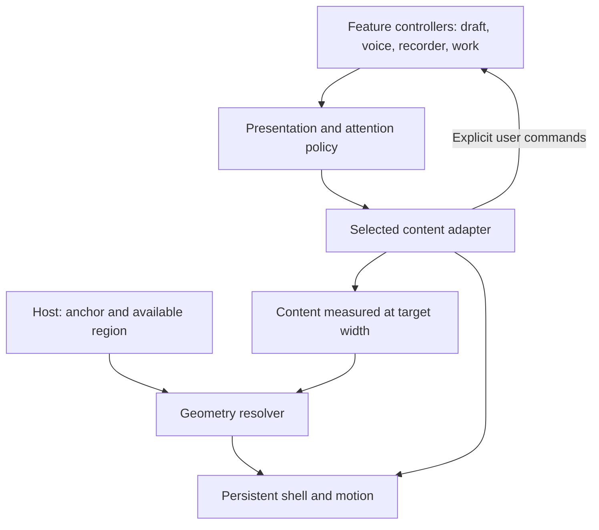

# Adaptive island: research and design questions

Status: research reference with accepted local preview decisions. On 2026-09-12 the founder approved adding motion to the existing Text, Voice, and Settings layouts in `/app2`. Real audio and additional activity views remain outside this implementation.

Owner and tracker: [#1158](https://github.com/sidneyswift/homa/issues/1158). Research date: 2026-09-11. Repository observations below use Homa commit `9d7f0d074d0e52c1546163e1aa10f68277c13a53`. No app behavior, dependency, recording permission, or production setting changed during this research.

## Read this first

Build toward a reusable, placement-aware activity surface. Voice and text are its first application, not its definition. beUI is the strongest implementation starting point among the inspected examples, but it does not solve placement, activity lifetime, attention policy, or Homa integration.

The most consequential separation is between **what the island shows** and **what is actually running**. Changing a view must not accidentally end a call, restart a recorder, discard a draft, or lose a finished worksheet. The shape is a presentation of those activities, not their owner.

This file collects source evidence, deliberate departures, proposed architecture, and experiments. It is the review reference for this exploration. GitHub owns work status. Exact visual values remain in the [design contract](../../../packages/design/src/contract/motion.ts). Future implementation approval should name the chosen decisions and experiments here; it should not be inferred from the existence of this document.

## 1. Requirements versus proposals

### User requirements from this conversation

- The component works anywhere: at the bottom it grows upward, at the top downward, and in the middle in both directions.
- Placement adapts to its surroundings. A bottom-only chat dock is insufficient.
- The first intended forms are a Voice/Text selector, compact voice controls, and an expanded text input.
- Shape changes must feel smooth, dynamic, and physically understandable.
- Design for possible uses beyond chat, including lesson recording. Those examples are exploration, not approval to implement every activity.
- Research and challenge the approach before building. Previously rejected conversation-state designs remain rejected.
- Preserve the existing local exploration constraints: white canvas, authentic still Homa mark, actual responsive layout, and the static Dev mode state reference.

### Proposals requiring evaluation

- A content-sized shell, independent placement resolver, and feature-owned activity controllers.
- Automatic placement with an optional host override, never a Desktop/Mobile toggle for users.
- Physics-based, interruptible geometry with separately timed content transitions.
- User-focused interaction stays foreground while background updates remain discoverable.
- One microphone capture owner at a time until a deliberate concurrent-capture design is justified.
- The island hands large work into the surrounding workspace instead of growing without limit.

These proposals do not approve a final appearance, spring tuning, placement thresholds, audio handoff policy, recorder integration, or whole-app navigation model.

### Accepted interaction decisions, 2026-09-12

Source: founder agreement and correction in the current design conversation. This updates the earlier assumption that opening text input necessarily makes the session quiet.

| User action | Text input | Microphone | Homa's spoken output |
| --- | --- | --- | --- |
| Open keyboard | Show | Preserve current setting | Preserve current setting |
| Hide keyboard | Hide; preserve draft | Preserve current setting | Preserve current setting |
| Mute/unmute mic | Preserve visibility and draft | Change only this setting | Preserve current setting |
| Silence/enable speaker | Preserve visibility and draft | Preserve current setting | Change only this setting |
| Choose text-only mode | Show; preserve draft | Off | Off |

Keyboard visibility, microphone input, and spoken output are independent. A parent can type while the microphone remains open and Homa keeps speaking. Opening the keyboard never implicitly mutes or unmutes the microphone. Text-only is a deliberate shortcut that applies all three settings, not another name for revealing the keyboard. Preserve the conversation and background work when choosing it.

The earlier accepted voice controls were Mute mic, Switch to text, and End voice. Following this clarification, distinguish the keyboard reveal from the explicit text-only shortcut, and include independent speaker control. End voice remains an explicit action; exact layout and labels have not been approved. Do not infer that every control must always be visible or add an automatic volume/audio change when the shape changes.

Remaining engineering question: how to implement quiet audio while preserving conversation continuity, including connection retention, pending speech, and resumption. The user-facing behavior above is settled; the transport mechanism and rules for re-enabling voice from text-only remain to be designed.

## 2. What the references add beyond beUI

The references are complementary evidence, not a list of packages to combine. In particular, Emil's demo is not a verified missing-feature upgrade to beUI.

| Reference | Incremental value | How to use it |
| --- | --- | --- |
| [beUI](https://beui.dev/components/blocks/dynamic-island) | Reusable React shell and content measurement baseline | Starting architecture, adapted to Homa |
| [Emil Kowalski](https://emilkowal.ski/ui/dynamic-island) | A second designer's perceptual reference | Compare the feel of transitions, not a source-code dependency |
| [Dynamic Island Notifications](https://github.com/nithinpjohn/Dynamic-island-notifications) | Example of a primary activity coexisting with incidental updates | Study activity selection and return paths |
| [Apple's design session](https://developer.apple.com/videos/play/wwdc2023/10194/) | Reasons to expand, stay compact, and ask for attention | Product and information-design criteria |
| [Apple's springs session](https://developer.apple.com/videos/play/wwdc2023/10158/) | Explanation of motion continuity and retargeting | Physics evaluation criteria |
| [SmartIsland](https://github.com/agupta07505/SmartIsland) | Broader Android activity and gesture example | Challenge the abstraction with concurrent activities |

### beUI: what is actually present

[Pinned source](https://github.com/starc007/ui-components/blob/b64c092b63b99c7340376b522325ea309156ba00/components/motion/dynamic-island.tsx), commit `b64c092b63b99c7340376b522325ea309156ba00`.

Observed: composable controlled views; synchronous measurement then ResizeObserver; width/height springs; shell duration/bounce 0.8/0.2; content 0.8/0.35; radius 32px; entry scale 0.9, blur 5px and vertical travel; exit 0.08 seconds. Reduced motion makes geometry immediate with brief fades.

Top alignment is fixed. No placement, collision, space constraint, state persistence or focus controller appears in the inspected component. Views mount conditionally; the root is a polite status region; sizing uses max-content.

Correction: the shell avoids whole-container scaling, but content entrances deliberately scale. [MIT license](https://github.com/starc007/ui-components/blob/b64c092b63b99c7340376b522325ea309156ba00/LICENSE) verified; preserve attribution when adapting code. [Spectrum](https://ui.spectrumhq.in/docs/dynamic-island) identifies beUI as its source.

### Emil: a benchmark, not an extra library

The public [exploration](https://emilkowal.ski/ui/dynamic-island) exposes Idle, Ring Mode, Timer, and Listening. It is useful for comparing proportion, elasticity, and whether a state change feels like one object transforming. No public implementation or reusable-code license for that exact demo was verified in this review. A third-party project describing itself as inspired by Emil does not establish that it contains his code.

The incremental value is judgment and an independent reference, not a demonstrated beUI feature gap. A build need not include anything from this demo to benefit from comparing against it. We have not performed a controlled side-by-side motion study or measured its frame timing.

### Dynamic Island Notifications: useful activity separation, limited implementation fit

[Pinned component](https://github.com/nithinpjohn/Dynamic-island-notifications/blob/14f8363bff72ebc180bfa466c9162d48c34b1880/src/components/DynamicIsland.tsx), commit `14f8363bff72ebc180bfa466c9162d48c34b1880`.

A player can occupy the primary compact view while notification indicators remain visible; an expanded detour can return to the player. This illustrates a policy problem outside beUI's shell. Actual springs are stiffness/damping/mass `380/36/0.9` and `280/34/1`, not the README's `400/30`. It uses fixed widths, top placement, hover expansion, and `AnimatePresence mode="wait"`. Runtime exit sequencing and smooth interruption remain unverified. The component lacks explicit reduced-motion handling and a complete keyboard/focus implementation.

Its [notification context](https://github.com/nithinpjohn/Dynamic-island-notifications/blob/14f8363bff72ebc180bfa466c9162d48c34b1880/src/contexts/NotificationContext.tsx) keeps state outside the view but caps the queue at three and adds a separate toast. Its [audio context](https://github.com/nithinpjohn/Dynamic-island-notifications/blob/14f8363bff72ebc180bfa466c9162d48c34b1880/src/contexts/AudioPlayerContext.tsx) simulates playback with an interval; it does not establish real audio lifecycle correctness. The [README](https://github.com/nithinpjohn/Dynamic-island-notifications/blob/14f8363bff72ebc180bfa466c9162d48c34b1880/README.md) declares MIT, but no LICENSE file was found at this commit. Study the pattern; do not treat it as a drop-in production component.

### Apple: decide what belongs here

[Design dynamic Live Activities](https://developer.apple.com/videos/play/wwdc2023/10194/) addresses ongoing activity, essential controls, compactness, recognizable identity, and meaningful updates. It recommends maintaining relative element placement, fitting content comfortably inside rounded boundaries, and revealing more information as it becomes relevant. These help decide when to change the island and what deserves its limited space. They do not amount to a web implementation or disclose Apple's proprietary spring constants.

Homa implication: elapsed recording time and Stop may belong in a compact view; a long transcript probably belongs in the workspace. This is our proposed application of the principles. iOS sensor geometry, operating-system alert behavior, and system presentation rules do not transfer automatically to an in-app web component.

[Animate with springs](https://developer.apple.com/videos/play/wwdc2023/10158/) explains preserving position and velocity when motion changes target, and that a spring need not visibly bounce. This provides a testable criterion beyond a pretty one-way transition: rapid reversal should remain continuous. It does not prove that any inspected recreation already meets that criterion on our devices.

### SmartIsland: operational cases to learn from

[Pinned Android source](https://github.com/agupta07505/SmartIsland/blob/66f278616fa8bee494f131605fbcee7b9bec90f0/app/src/main/java/com/agupta07505/smartisland/ui/IslandOverlayView.kt), commit `66f278616fa8bee494f131605fbcee7b9bec90f0`.

The source coordinates geometry, separates alpha timing, accepts measured content heights, and handles concurrent notifications with companion shapes. Geometry stiffness is 520; damping ratios include 0.72 for width and 0.76 for height; crossfades use 190ms. It includes gestures and hiding behavior, but also assumes top-center placement. It does not solve our arbitrary-position requirement. Its GPL-3.0 source is a conceptual reference in this proposal; no code is copied. Auto-hide and notification-driven switching are not defaults to inherit for a recorder.

## 3. Reference semantics map

This maps source behavior to a proposed Homa equivalent. It is a review checkpoint, not instructions to paste multiple implementations together.

| Source behavior | Proposed Homa behavior | Disposition and reason |
| --- | --- | --- |
| beUI measurement | Measure content at its resolved available width | Preserve the idea; add fitting so wrapping is measured correctly |
| beUI composition | Keep one shell per host; feature controllers own their state | Preserve shell continuity; prevent view swaps from owning sessions |
| beUI anchoring | Resolve top, center, or bottom anchoring from the host | Deliberately change to meet the user's modularity requirement |
| beUI motion | Compare source feel against bounded, velocity-aware motion | Do not adopt tuning before evaluation and contract review |
| Generic status semantics wrap all contents | Semantic form/control region plus a separate concise status announcement | Change for editable controls and screen readers |
| Notifications example chooses a primary player and secondary updates | Make attention selection independent of running activities | Preserve the separation; decide precedence for Homa |
| Hover expands the notifications example | Explicit pointer, touch, and keyboard actions | Drop hover dependence because primary use includes phones |
| Notification queue drops older entries | Durable results remain retrievable outside the transient surface | Drop truncation as product truth; bounded display is still useful |
| SmartIsland can auto-hide | Active capture remains visible with access to Stop | Deliberate departure for understandable recording state |
| Apple's system island occupies a fixed OS location | Homa's host supplies location and boundaries | Transfer principles, not the hardware constraint |

## 4. Proposed architecture: a small shell with clear boundaries

Use “adaptive island” as a working engineering name. It is not proposed parent-facing copy or a new product brand.

| Responsibility | Owns | Does not own |
| --- | --- | --- |
| Host | Stable location, available region, stacking/clipping context, overlay versus in-flow behavior | Chat or recorder state |
| Geometry resolver | Target rectangle, growth origin, collision correction and size limits | Activity priority or audio permission |
| Shell | Measurement coordination, animation, clipping, surface styling, reduced motion | Network calls, microphone acquisition, family identity |
| Content adapter | Compact/expanded contents, size constraints, accessible label, focus behavior | Global placement assumptions |
| Feature controller | Draft, session identity, media resources, pending commands, truthful outcomes | Animation completion as permission to act |
| Attention policy | Which activity is foreground and which updates remain discoverable | Silently ending or deleting background work |

Prefer a controlled view key and composable contents over a shell enum that knows about every Homa feature. Start with selector, voice, and text adapters. Do not build a plugin ecosystem, arbitrary component loader, global event bus, or generic task database for three views. Extract a multi-activity registry only when a concrete second simultaneous activity requires it.

Separate three concepts: **activity** (what is running), **presentation** (what is open), and **attention** (what needs acknowledgment). “Text,” “working,” and “ready” cannot be mutually exclusive states of one enum. A parent can type while a worksheet is running, then receive its result without leaving the draft.

## 5. Placement that works wherever the host lives

### Automatic does not mean guessing from the moving shape

The host supplies a stable anchor element or rectangle and permitted region. Resolve placement from those, never from the expanding shell's current center. An edge-docked host has a clear top or bottom intent; an interior host normally uses centered growth. For an ambiguous embedding, permit a developer override. The default remains adaptive, without a user-facing placement switch.

“Top” must be relative to the relevant host, not always the whole page. An island near the top of a scrolled panel can still be in the middle of the browser. The host must declare whether the panel or viewport is its permitted region. Pixel thresholds and hysteresis for automatic classification remain an experiment, not an approved constant.

### Preserve a physical anchor

| Resolved position | Fixed feature while resizing | Normal growth |
| --- | --- | --- |
| Top | Top edge | Down |
| Center | Center | Up and down |
| Bottom | Bottom edge | Up |

For a vertical anchor coordinate A, animated height h, and origin fraction p, derive the current top as **A − p × h**. Use p = 0 at the top, 0.5 in the center, and 1 at the bottom. Apply the equivalent relationship horizontally. This is a proposed geometry model, not copied source.

Position and height should share this relationship every frame. Independently springing the top coordinate and height with different settings would let the supposedly fixed edge drift. A CSS transform origin alone does not change where real width/height growth happens; the layout geometry must agree with it.

Resolve direction before a transition and retain it during ordinary content growth. Keep the ideal host anchor distinct from the collision-adjusted anchor. Keyboard/bounds changes normally shift or cap geometry while retaining the origin; never reclassify from that shifted shell. Add hysteresis around classification boundaries so small rounding changes cannot flip direction repeatedly.

If a genuine host relocation changes origin during motion, first preserve the current rectangle by rebasing the anchor: **new A = current top + new p × current height**. Then retarget toward the new host anchor. Changing p without that continuity step would cause a snap. Autonomous relocation remains unapproved.

### When symmetric growth cannot fit

Proposed priority: usable controls and visible bounds first, exact anchor preservation second, perfect symmetry third. Measure at the allowed width; cap size; shift only enough to fit. A central island can expand asymmetrically near an obstruction. If the required content still does not fit, scroll a bounded content area or open a larger workspace. Keep critical controls reachable. Do not shrink touch targets or text to protect the metaphor.

Account for overshoot too: a target rectangle that fits does not prove every animation frame fits. Compare a reserved motion margin against reduced/no overshoot near boundaries. Do not hard-clamp every spring frame in a way that creates an abrupt stop.

The [VisualViewport API](https://developer.mozilla.org/en-US/docs/Web/API/VisualViewport) describes the visible area and offsets, which can change with keyboards and zoom independently of the layout viewport. Use a consistent coordinate system for anchor, allowed bounds, and portal. Keyboard appearance, browser chrome, rotation, nested scrolling and pinch zoom require real-device verification. Automatically counter-scaling the UI against zoom is not the proposed solution.

### Geometry tooling

[Floating UI](https://floating-ui.com/docs/computeposition) can help with reference coordinates and clipping contexts; [size](https://floating-ui.com/docs/size) exposes available dimensions and [autoUpdate](https://floating-ui.com/docs/autoupdate) tracks relevant changes. Its [custom offsets](https://floating-ui.com/docs/offset#creating-custom-placements) can center a floating element over a reference. It does not supply our activity policy or spring behavior. Use a small pure geometry resolver first if the approved hosts are simple; add this dependency when portals and nested boundaries justify it. Avoid combining conflicting auto-placement strategies: its [autoPlacement documentation](https://floating-ui.com/docs/autoplacement#conflict-with-flip) distinguishes choosing maximum space from preserving a preferred side.

Overlay versus in-flow is a separate host decision. Overlay expansion covers neighboring work; in-flow expansion moves it. Modularity supports different hosts, but cannot remove that tradeoff. Initial app placement and whether the island later moves between hosts are still open product choices.

## 6. Motion: borrow principles, test the actual tradeoffs

The objective is immediate response, continuous movement, stable readable controls, and a convincing settle. More bounce is not automatically more natural. A slow reference may feel pleasant once and cumbersome after frequent switching. Conversely, making it faster by default could remove the quality the user liked. Compare both before choosing.

[Motion transitions](https://motion.dev/docs/react-transitions) distinguishes physics-based springs using stiffness, damping and mass from duration/bounce springs. Physics-based springs incorporate existing velocity; the duration-based form does not. Choose the former as the candidate for rapid reversal, then verify the integration actually retains its state. Changing keys or restarting values can defeat the intended continuity.

Two rendering strategies deserve a bounded comparison:

| Strategy | Potential advantage | Risk to measure |
| --- | --- | --- |
| Animate measured width/height | Straightforward content sizing and no whole-shell text scaling | Repeated layout/paint, measurement feedback, expensive contents |
| Transform-based layout or separate animated background | Less layout work during motion | Text/corner distortion, clipping and hit-testing coordination |

[Motion layout animations](https://motion.dev/docs/react-layout-animations) use transforms and provide child/radius correction mechanisms. That makes them a viable alternative, not proof that arbitrary editable contents remain crisp. Profile the actual composer before choosing. Start with beUI's bounded measurement model; do not broadly apply width/height springs to the page.

Proposed content policy: steady readable text during interaction; short opacity changes for entering/leaving controls; consistent icon identity where the same action survives. Evaluate blur and scale rather than inheriting them. Critical actions, especially Stop and quiet-mode selection, act immediately and never wait for the shell to settle.

The [ResizeObserver documentation](https://developer.mozilla.org/en-US/docs/Web/API/ResizeObserver) describes resize feedback-loop hazards. Measure intrinsic content under target constraints, not the changing shell. Deduplicate unchanged measurements; isolate outgoing content from target measurement. Avoid mounting a second live input or media component merely to measure it. Account for late fonts, wrapping, attachments and textarea growth without queuing obsolete transitions.

### Existing Homa contract conflict

The [current motion contract](../../../packages/design/src/contract/motion.ts) limits object continuity to transform/opacity and 320ms, with no spring preset. Its reduced-motion endpoint is immediately still. Therefore real width/height springs and beUI's 800ms tuning need an explicit shared-contract decision before implementation. A research reference does not silently override this.

Decide whether to retain the current limits or introduce a narrow adaptive-resize role after comparing examples. If approved, encode validated values and allowed properties in the contract and regenerate its projections. Never add a local magic-number exception inside app2. The [doctrine](../../homa-design/doctrine.md) continues to own truthful motion, interruption, and no delayed voice handoff.

Reduced motion is not solved solely by a library default. [Motion's accessibility guide](https://motion.dev/docs/react-accessibility) preserves some non-layout animations under its global option. Homa requires explicit final-state handling for dimensions, blur, fades, and any activity visualizer so its stricter endpoint is met.

## 7. Homa integration blindspots bought with code evidence

These are risks in the proposed integration, not newly observed production failures. No production flag, microphone, or family session was exercised in this research.

| Blindspot | Evidence in this repository | Constraint for implementation |
| --- | --- | --- |
| Swapping a view can terminate a call | [VoiceMode](../../../apps/web/app/app/voice-mode.tsx) acquires audio in its mount effect and cleans up on unmount; [chat-client](../../../apps/web/app/app/chat-client.tsx) mounts it under voiceOpen and voiceGeneration | Keep call ownership outside animated keyed contents. A view change is not a session command |
| Independent audio controls need actual session semantics | VoiceMode exposes end/close and saving states, not a general pause/resume controller | Follow the accepted interaction table: keyboard reveal preserves audio; text-only makes both directions quiet. Determine the connection mechanism without assuming a pause API exists |
| Several features request the microphone | VoiceMode, [dictation](../../../apps/web/app/app/dictation.tsx), and [lesson recorder](../../../apps/web/app/app/[childId]/lessons/record/recorder.tsx) have separate capture paths | Define exclusive ownership and explicit handoff before combining them |
| Composer geometry has hidden assumptions | [SlashComposer](../../../apps/web/app/app/slash-composer.tsx) uses a single-line input with a text mirror; suggestion/error overlays open above it | Preserve draft, caret, selection and IME composition. Adapt multiline separately. Position overlays outside shell clipping and within available bounds |
| Result delivery already has identity rules | [Voice result handoff](../../../apps/web/app/app/voice-result-handoff.ts) and chat-client track source session, generation and handled effects; relevant history `817967be` / PR #1151 | Preserve deduplication and speech rules. Shown, spoken, completed and acknowledged are separate facts. Never reopen audio because a result arrived |
| A task has more outcomes than busy/done | [Tasks view](../../../apps/web/app/app/tasks/tasks-view.tsx) includes partial, uncertain, failed and skipped states | Keep real outcome meaning and a durable path to inspect it |
| The dev reference list mixes different dimensions | [app2 preview](../../../apps/web/app/app2/voice-workspace-preview.tsx) lists voice state, work state and presentation mode together | Keep it as design reference; do not turn it into one mutually exclusive runtime state machine |

### Recording already exists

The lesson recorder records standalone 180-second segments, uploads privately, uses a wake lock, and has recording/finishing/upload handling. Its [route](../../../apps/web/app/app/[childId]/lessons/record/page.tsx) is gated by [lessonListenEnabled](../../../apps/web/lib/lessons/flag.ts), which checks `HOMA_LESSON_LISTEN_ENABLED`. [Route authentication](../../../apps/web/lib/lessons/route-auth.ts) and [lesson creation](../../../apps/web/app/api/lessons/route.ts) own authenticated family and consent checks.

The [founder registry](../journeys/10-reconciliation.md) contains the lesson-listen policy allowing child voice within a parent's lesson recording under dedicated consent and the specified retention/no-identification boundaries. Preserve that workflow when considering a new presentation. This is repository evidence only; enabled production behavior and sustained mobile recording reliability were not verified.

Moving its controls into the island is consequently a potential integration, not proof that long-running recording is solved in every browser. Minimize must not mean stop; stop must not mean successfully saved; route navigation and device suspension need separate lifecycle decisions.

## 8. What it could become, and where to stop

The reusable idea is a compact home for an activity's essential state and controls. It need not become the container for every page.

| Possible use | Evidence / new work | What might remain compact | What should probably open elsewhere |
| --- | --- | --- | --- |
| Voice conversation and text | First intended use; existing chat/voice integration | Current mode and essential controls | Full conversation history |
| Lesson recorder | Existing recorder; island presentation unapproved | Recording truth, elapsed time, Stop | Transcript, consent detail and lesson review |
| Worksheet generation | Existing work and result handoff; new adapter needed | Honest progress or completion indication | Worksheet preview and editing |
| Dictation | Existing review-before-send flow; integration unapproved | Recording/transcribing state and cancel | Review/edit of a long transcript |
| Upload | Recorder has upload stages; generic adapter is a hypothesis | Progress, recoverable failure, retry | File organization and history |
| Lesson timer | New surface in this exploration; no dedicated implementation established here | Remaining time and pause | A full schedule or planning editor |
| Playback of a lesson excerpt | Future hypothesis, not established by a simulated demo player | Play/pause and position | Transcript-linked review and annotations |

These are pressure tests, not roadmap commitments. A recorder-shaped inert fixture can challenge extensibility without connecting a microphone or building a new feature.

### The hardest question: competing activities

Example: a parent is recording a lesson, types a note, and a worksheet finishes. One selected view cannot express all of that by itself.

Proposed attention rules for discussion:

1. A user-focused draft keeps focus and space until the user chooses otherwise.
2. Ongoing capture remains observable and stoppable even when another view is foreground.
3. Completion can signal availability without replacing the user's controls or reopening audio.
4. Minimize, hide details, dismiss an update, cancel work and stop capture are separate commands.
5. Results outlive the transient indicator and remain retrievable in the workspace.

Do not implement an automatic priority ladder merely because a reference has one. Possible treatments include a compact secondary indicator, a small activity switcher, or persistent essential controls. Choose through scenarios before expanding the visual design.

### Challenges to the premise

- A morphing surface can conceal capability. If users cannot predict where a control went, visual continuity has not produced usability.
- A universal island can become a bottleneck that fights the user's current task. Stable workspace regions may be better for editing and comparison.
- Constantly adapting position can feel less predictable than a stable host. Placement awareness is required; autonomous roaming is not yet requested.
- A recording indicator must not resemble idle voice presence. Animation alone cannot communicate whether sound is being captured or merely played.
- Abstracting future features too early creates a framework with no proven callers. Require a second real use case before generalizing activity registration.
- “Generative UI” should select approved components with validated data. Model output must not directly grant capture permissions, invent actions, or decide geometry. Existing family-scoped tools and controllers still own exact effects.

## 9. Unknowns and the cheapest way to answer them

Applied [finding-unknowns](../../../.agents/skills/finding-unknowns/SKILL.md), specifically the reference-semantics map and blindspot pass. Structured Markdown is intentional: the requested output is a durable engineering reference rather than a disposable mock.

| Class | Question or assumption | Discovery step |
| --- | --- | --- |
| Known known | Top/center/bottom adaptive growth and first three forms | Carry into every prototype review |
| Known known | Keyboard visibility, mic and speaker are independent; text-only explicitly disables both audio directions | Preserve the accepted interaction table in every view and transition |
| Known unknown | How are quiet audio, pending speech and voice resumption implemented while preserving conversation continuity? | Design connection/resource handling before real audio integration; do not reopen the settled keyboard behavior |
| Known unknown | Is the island fixed in a host, or can activities move it across the page? | Start fixed per host; review a relocation scenario separately |
| Known unknown | How can recording stay visible while typing? | Compare secondary indicator, activity switcher and persistent stop access |
| Known unknown | Is 800ms reference motion desirable in frequent use, and may the contract change? | Side-by-side repeated-use motion comparison, not a single animation |
| Unknown known | How much shape change, blur or elasticity feels calm to the founder? | Show a small labeled set of motion variations after prototype approval |
| Unknown known | Which work deserves permanent space rather than an island? | Walk a real lesson, note-taking and worksheet-review scenario |
| Discovered trap | Mounting/unmounting currently owns voice resources | Inspect lifecycle seam before putting VoiceMode inside a view slot |
| Discovered trap | Mention menus still assume upward expansion | Include menu and clipping cases in all placements |
| Discovered trap | Keyboard bounds and shell measurement can feed back into placement | Stable host anchor; instrument geometry changes in a future spike |
| Unverified | Actual performance, retargeting and long-session behavior on devices | Measure after implementation approval; source inspection is insufficient |

## 10. Proposed validation ladder and stop points

1. **Review this research.** Carry forward the accepted interaction table. Resolve initial host behavior and whether comparing motion outside the present contract is allowed. No product implementation is approved by this step.
2. **Geometry-only prototype after approval.** Same selector/voice/text fixtures at top, center and bottom, plus a narrow scrolling host. No real microphone or model. Controls and exact visual treatments remain subject to review.
3. **Motion comparison.** Compare measured-dimension and transform strategies with equivalent contents. Compare source-style glide and quicker physics-based tuning. Slow motion exposes clipping; normal speed and repeated use decide the feel. Instrument frame times on representative devices before claiming smoothness.
4. **Input and accessibility proof.** Real local draft, caret, selection, IME, multiline limits, menus, screen reader, keyboard navigation, large text, zoom and Reduced Motion. No invisible interactive outgoing layers or duplicate input identities. Request Text focus within the user action, not an animation-completion callback; then fit to the actual keyboard viewport. Verify focus handoff on physical mobile devices.
5. **Lifecycle plan review.** Keep feature ownership above the shell; specify quiet-mode semantics, Stop behavior, stale callbacks, session identity and navigation behavior. Only then authorize real voice integration.
6. **Extensibility challenge.** Introduce an inert recorder-shaped fixture and a background-result event. If either requires feature-specific geometry in the shell, revise the boundary. Do not wire real recording until that use is separately selected.

### Acceptance scenarios for the eventual implementation

| Scenario | Observable pass condition |
| --- | --- |
| Open each form from each placement | Correct growth direction; stable expected edge/center; no clipping |
| Rapidly reverse a transition | No snap to old start, queued obsolete view, or stuck controls |
| First click immediately after load | Same animated behavior as later clicks; no measurement snap |
| Keyboard opens, closes or rotates | Text focus does not wait for animation; input and critical controls remain visible without direction oscillation |
| Reveal or hide keyboard while audio is active or muted | Both audio settings remain exactly as they were; draft survives |
| Change mic or speaker setting | Only the selected audio direction changes; input visibility is preserved |
| Choose text-only | Input appears; mic and spoken output are off; conversation, draft and background work survive |
| Content grows or fonts load | Latest constrained size wins; no resize-observer loop |
| Long text, zoom, localization | Readable wrapping and bounded interior; no horizontal overflow |
| Switch away from a draft and back | Draft, selection intent and composition are preserved correctly |
| Move/minimize the shell during an activity | No implicit restart, stop, duplicate capture, or missing receipt |
| Worksheet completes during input/capture | No focus theft, false success, hidden Stop or duplicate speech |
| Permission, connection or save fails | Truthful recoverable state; UI does not merely animate success |
| Reduced motion or screen reader | Immediate stable state, correct semantics, concise status announcements |
| Activity is too large for the host | Predictable workspace handoff or constrained content, not unreadable shrinking |

## 11. Implementation brief to reuse after decisions are made

Build a reusable adaptive presentation shell whose placement resolves from a stable host anchor and explicit allowed bounds. It must support top, centered and bottom growth independently of feature content. Keep geometry, motion, selected presentation, attention and activity lifetime separate. Start with selector, voice controls and text, preserving input and focus. Do not mount an audio owner inside a keyed animation slot. Preserve existing family context and voice-result handoff semantics. Add no unapproved conversation states or recorder behavior. Use the design contract; obtain a narrow motion-contract decision if required. Prove geometry, interruption, mobile keyboard and accessibility before connecting real effects. Stop for visual and lifecycle review before broadening use cases.

## 12. Evidence maintenance and review record

- The source links above identify pinned code where available. Upstream pages and demos may change; recheck relevant files and licenses before copying code or upgrading Motion.
- Keep imported code attribution with the code. This research adapts concepts and contains no vendored component implementation.
- Review method: primary documentation, actual source inspection and three independent research passes covering reference code, Homa integration, and placement. No instrumented runtime comparison was performed.
- Document verification: local file links resolve, Markdown fences are balanced, and the diff passes whitespace checks. The repository-wide documentation audit fails on pre-existing drift and also reports this new file as absent from its frozen first-seen inventory and manifest. That historical audit was not rewritten as part of this research; this is not a claim that the global documentation gate passes.
- Homa paths are repository-relative so this reference survives another engineer's checkout. Verify them against the current branch before implementing; the opening commit identifies this snapshot.
- Proposed defaults are labeled throughout. Record accepted decisions with date and tracker evidence; remove superseded recommendations rather than letting contradictory guidance accumulate.
- Review prompts, in priority order: **While recording and typing, keep… visible; the initial host should…; motion comparison may…; next approved prototype scope is…**. These are a reply template, not decisions already made. Keyboard/audio independence is already accepted above.

## 13. First local motion implementation, 2026-09-12

The founder approved the existing compact Voice dock, single-row Text composer, and inline Settings view before requesting the dynamic island implementation. The selected mode now uses the neutral canvas fill, dark ink, and no additional selected hover highlight. Earlier black selection screenshots are historical.

Implementation: [AdaptiveIsland](../../../apps/web/app/app2/adaptive-island.tsx), [geometry](../../../apps/web/app/app2/island-geometry.ts), and the [conversation preview](../../../apps/web/app/app2/conversation-controls-preview.tsx). Motion 13.2.0 is used through its React API. This is an original implementation informed by the references, with no copied third-party component code.

- One persistent form changes size using transform-based layout animation. The contract supplies 320ms ease-out geometry and 120ms opacity; this is a bounded tween, not a physics spring or a claim of velocity continuity.
- Child layout correction keeps button and text proportions stable. Both view containers stay mounted. Inactive views are inert, hidden from accessibility, excluded from target sizing, and clipped to prevent invisible scroll overflow. The original input instance and its draft remain in place.
- A stationary host determines top, center, or bottom growth, with an explicit host override and optional region. A neutral band prevents placement chatter. Viewport/region intersection constrains dimensions, and VisualViewport changes adjust collision offsets without moving the original host.
- Reduced Motion uses a live media-query subscription, zero durations, and immediate CSS endpoints, including when the preference changes during motion. The installed library's snapshot-only preference hook is deliberately not relied upon.
- Presentation changes never acquire audio resources or change microphone/speaker state. Existing explicit audio buttons still change only local preview state.

Verified in the local in-app browser: intermediate shell widths; unchanged control dimensions during contraction; draft and caret preservation through Settings, Voice and Text; independent mic/speaker state preservation; keyboard skipping inactive controls; repeated mode switching with one active view and one input; 320px viewport without page overflow; bottom-anchored upward growth for wrapped Settings; and no invisible scroll area after collapsing Settings. Geometry tests cover region-relative placement, boundary jitter, fixed anchors, keyboard obstruction, and oversized content.

Limits: these checks are not a physical iPhone keyboard test, a live OS Reduced Motion toggle test, a frame-rate profile, or an instrumented mid-flight velocity test. Placement fixtures at the top and center are covered mathematically, not by a rendered multi-host gallery. Real audio, recording, generated results and unapproved states remain separate work. The user is reviewing motion feel in the local prototype; no production release is implied.
