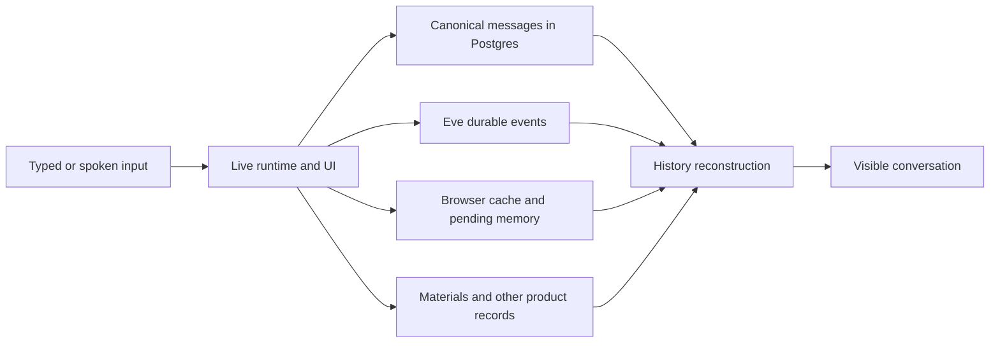

# Homa conversation persistence audit

Date: September 12, 2026. Owner: Homa v2 investigation under gh#1158. Open defects: [gh#1182](https://github.com/sidneyswift/homa/issues/1182).

## Conclusion

The existing app has a substantial durable foundation, but its visible conversation is assembled from several representations that do not reliably agree. A missing bubble can mean a saved row was filtered out, a tab never loaded it, an interactive card was never represented in the durable transcript, or words never reached durable storage. Those failures need different repairs.

For Homa v2, preserve the canonical server ledger, adult privacy, safe retries and session authorization. Rework the shared conversation display and pending-write recovery around stable message identities and one chronological history. A permanent conversation does not require one permanent model or microphone session.

## Evidence and limits

This was a read-only investigation of product code. No production data was queried, no family conversation was started, and no implementation was changed during the audit. Only this report and synthetic probe evidence were added. Findings below remain OPEN unless explicitly described as a design limit. They are repository findings, not a claim that a particular family experienced every failure.

Audited worktree: `.claude/worktrees/homa-audit-cleanup-424b11`, branch `codex/gh-1158-generative-workspace`, HEAD `6befd102534cd8a9bd0cc9d76892da2062ed742f`, including the task's existing local voice changes.

Current remote main was independently read at `ff0ae150989644398f74d1212ee08a3259222a0a` (September 12, 18:54:15 UTC). The history reader and history model are byte-identical to the audited copies. Main's conversation logger adds preparation timing instrumentation but still awaits embedding before canonical persistence. Main's live voice controller lacks this worktree's improved save-status callback/retry serialization, but retains the same ordinary-caption sealing behavior. This comparison does not establish the hosted deployment revision or incidence.

Three bounded audits examined client recovery, server storage, and voice. Their focused existing suites passed 71, 55, and 59 tests respectively. Counts overlap; do not present their sum as unique coverage. New synthetic probes exercised actual helpers/controllers and the installed Eve store with fake transports and repositories. No fresh full authenticated browser lifecycle or hosted PostgreSQL/RLS certification was performed. Existing browser two-tab coverage was inspected, not rerun.

## What is stored where

| Layer | Contents | Purpose and limit |
| --- | --- | --- |
| Canonical Postgres messages | Message text, adult/family ownership, channel, modality, session/turn/sequence, episode, visibility and search metadata | Long-lived searchable conversation record. Not a full serialization of every interactive card. |
| Continuity records | Episodes, transport/runtime bindings, deliveries, reply links and open loops | Connect channels and requests without treating internal work as a new parent message. |
| Eve durable sessions/events | Runtime turns, tool events, continuation state and streamed execution history | Resume/replay agent execution and recover rich live results. Separate from the permanent transcript. |
| Browser localStorage | Up to 200 archived messages, 2,000 current-session events, cursor, observed times and last activity, keyed per adult | Fast same-browser restoration and fallback. Not a reliable pending-send outbox. |
| Current React/controller memory | Drafts, queued/failed sends, staged attachment references, live speech and voice result cards | Immediate UI. Refresh destroys this state unless it was separately persisted. |
| Artifact/domain stores | Materials, uploaded files, plans and other product records | The actual worksheet or plan can survive even when its chat card disappears. |

The arrows represent separate paths, not one atomic save. In particular, normal voice captions can remain in memory and do not all pass through Eve.

### Typed turn lifecycle

`/app/page.tsx:134` loads server history. `chat-storage.ts:278` loads browser state and decides whether to start a new model session after the 4am family-local boundary. `chat-client.tsx:666` connects Eve with saved events and session state. Stream events and optimistic UI are not themselves canonical-write acknowledgements.

The user persistence hook aborts a turn on a thrown canonical persistence error before tools proceed. The generic assistant hook is best-effort; the screen delivery hook also persists terminal output before recording delivery. Browser events/cursor are normally checkpointed at `onFinish` (`chat-client.tsx:704`), with additional recovery checkpoints. Reload uses server history plus replay and deduplication of the live reducer.

### Voice lifecycle

Both `/app` and `/app2` use `VoiceMode` and `LiveVoiceConversation`. The older `voice-session.ts` controller is not the active lifecycle. Captions display immediately; selected rows are sealed on delegation or typed handoff; stopping seals the rest. Sealed rows are posted serially to `/api/voice/realtime/turn`, whose authenticated handler writes the same canonical table with modality `voice`.

### What Homa remembers

Display history and model context are separate. Recent continuity is bounded to 12 relevant rows, with 1,200 characters per row (`postgres-repository.ts:427`, `reply-policy.ts:354`). The agent can search older history with recall and receives separately stored family context. A fresh voice session has family facts and a new audio runtime, not the entire old transcript. On delegation, the backend can retrieve recent durable continuity.

This is a useful separation: scrolling months of history should not require sending months of raw messages into every model call. It still requires an explicit, tested context handoff when switching between speaking and typing.

## Strengths worth keeping

1. **Server-owned conversation records.** Postgres supplies history on another device; the system does not fundamentally depend on one browser's cache.
2. **Per-adult privacy.** Caller JWT/RLS and explicit adult filters protect history; canonical server queries re-scope family and membership. Ambiguous null-owned legacy rows stay hidden. Conversations are private per adult even though materials and other family state are shared. This follows the founder ruling in `journeys/10-reconciliation.md:167`.
3. **Retry identity and transaction boundaries.** Canonical writes use stable session/turn/role identities, and message/episode/reply resolution uses transactions. Retrying storage is separate from rerunning a family action.
4. **Authenticated session restoration.** The app checks binding before sending, can replay missed execution, blocks unverifiable recovery, and uses a same-browser lock to avoid simultaneous session forks.
5. **Stale cache protection.** Same-session event merging preserves a newer cursor and event tail when an old tab writes later. Our stale-tab probe confirmed the saved cache remained complete even when the visible reducer did not.
6. **Durable artifacts and partial reconstruction.** Worksheets are stored outside the conversation. Material cards can be reconstructed even when their accompanying assistant prose did not persist. Attachment markers can restore file/photo UI from saved text when those markers survive normalization and truncation.
7. **Execution and history are already separate.** Daily model-session rotation and bounded context can coexist with a continuing visible conversation. Internal prompts and private voice-backend chatter are intentionally excluded from parent history.
8. **Meaningful existing guards.** Tests cover adult scope, visibility, concurrent continuation reservation, retries, reply claiming, recovery, hydration and source attribution. The gaps are specific lifecycle interactions, not an absence of all testing.

## Findings

Severity is audit priority, not measured production frequency. P1 means repair before treating v2 conversation persistence as dependable; P2 means important fidelity or resilience work. All defects remain OPEN at this audit's completion; suspected live impact is escalated through the tracking issue and this report, not described as fixed.

| ID | Priority | Finding and user effect | Evidence and confidence |
| --- | --- | --- | --- |
| C1 | P1 | Older saved messages can be hidden by current-session messages with the same turn number. | **Reproduced.** Four durable rows spanning yesterday/today plus today's two live rows resulted in zero archived rows; yesterday's pair was wrongly removed. `chat-history-model.ts:277` compares turn+role without session; Eve IDs restart per session. This is display loss, not database deletion. Identical history-model code confirmed on current main. |
| C2 | P1 | A stale tab can skip another tab's messages even after sending again. | **Reproduced with actual Eve store, fake transport.** Tab B showed turns 0 and 2 while merged cache held 0,1,2. `chat-client.tsx:1184` adopts the new cursor without hydrating its missing events; `reattachable-eve-session.ts:14` changes transport state only. No claim of a complete mounted browser reproduction. |
| C3 | P1 | Drafts, queued text, failed optimistic sends and staged file references are not refresh-safe. | **Failed-send path reproduced.** Visible failed optimistic message, zero durable stream events, zero replayed messages. Draft/queue/staging are source-confirmed in-memory state. `chat-client.tsx:704,792,2094`; `chat-attachments.tsx:78`. Accepted canonical rows are a different category. |
| V1 | P1 | Casual spoken conversation does not save continuously. | **Reproduced.** Ten visible caption rows caused zero writes before stop, ten afterward. `live-voice.ts:130,184,233,333`. No persistent voice outbox protects those rows through refresh/crash. Shared by active `/app` voice, not just the preview. |
| V2 | P1 | Stopping can discard a late transcription tail despite reporting a successful save. | **Controller reproduction plus source trace.** A suffix delivered after `finish()` was ignored. `voice-mode.tsx:125` cancels and finishes before closing the provider; `live-voice.ts:173,333` rejects later captions. Real provider frequency is unmeasured. |
| V3 | P1 | One oversized spoken row blocks saving later rows; retry repeats the permanent failure. | **Reproduced.** An 8,001-character row followed by another row saved neither. Endpoint rejects above 8,000; serial queue stops at first failure. `live-voice.ts:144`, `api/voice/realtime/turn/route.ts:70`. |
| R1 | P1 | Voice-created material may survive in the library while its inline chat card fails to restore. | **Source chain and mocked-reader reproduction.** Material creation stamps the separate Eve bridge session; canonical speech uses a hashed voice session. History requires material session to occur among canonical history sessions. Matching-session control restored; bridge-session fixture did not. `create_printable.ts:1014`, `persist-conversation.ts:18`, `chat-history.ts:121`. |
| R2 | P2 | One failed material query suppresses otherwise valid text history. | **Reproduced, deliberate current all-or-nothing policy.** Reader returns null on material error and falls back to local cache. A clean device has no fallback. `chat-history.ts:125`; current source test explicitly requires the null return despite the older text-only fallback comment. |
| R3 | P2 | History and material retrieval are bounded without older-history paging. | **Source-confirmed; material crowd-out reproduced.** Latest 240 messages, latest 80 family materials, local archive 200. Material limit is applied before session matching: 80 unrelated newer items excluded the older matching card. `chat-history.ts:35,125`; `chat-storage.ts:169`. Records may still exist in storage. |
| R4 | P2 | Message text truncation can remove attachment identities. | **Reproduced.** Two 4,000-character document extractions precede marker lines; canonical 8,000-character truncation removed both markers. `conversation-log.ts:144`, attachment normalization. Uploaded bytes and attachment database rows were not lost; restored transcript loses its file references. |
| O1 | P2 | Chronology changes across live, recovered and saved states. | **Reproduced helper/controller cases plus source trace.** Archive is rendered before speech regardless of timestamps. Speech arrival order can differ from spoken order. Persisted voice records use write time, not audio time; terminal assistant retries update created_at. `transcript-days.ts:194,218`, `live-voice.ts:104`, `ledger.ts:503,515`. |
| S1 | P2 | Search indexing delays the canonical save. | **Dependency-injection probe.** While embedding remained pending, canonical writes were zero; resolving embedding to null allowed the write. `conversation-log.ts:187`. Current main adds timing instrumentation but retains this ordering. No production timeout incidence or total latency was measured. |
| C4 | P2 | Cache trimming can cut through one large turn. | **Reproduced.** 2,105 valid events became 2,000 starting mid-turn; replay retained assistant but lost user question. `chat-storage.ts:381`. Canonical history can compensate when available. |

### Additional limits and risks

- The mounted server-history prop is not a live synchronization feed. The app does not continuously ingest other-device, SMS or scheduled-message arrivals.
- The durable transcript reconstructs text and printable materials, not every dynamic tool card, interaction status or Undo receipt. Same-device Eve replay can look richer than a fresh device. Replaying a card must also never rerun its original action.
- Partial assistant output that does not end with `finishReason='stop'` is not represented as a durable visible interrupted message. Internal-progress hiding is intentional, but the user-facing transcript has no uniform interrupted-response state.
- localStorage failure is swallowed with no acknowledgement to the UI. Parsed cache content is not fully schema-validated. These are resilience gaps, not evidence that normal storage is currently failing.
- Lost-turn lookup uses text/time matching among a bounded recent set. Repeated wording and clock skew are risks; we did not reproduce a wrong-session attachment.
- The semantic embedding fallback tolerates errors, but the audited helper's own timeout is conditional on a supplied signal. Do not infer a measured provider timeout or that every upstream layer is unbounded.

## What the tests establish

| Probe | Result | Scope |
| --- | --- | --- |
| Cross-session dedup | Older pair wrongly hidden | Actual history helper + installed Eve reducer |
| Stale-tab catch-up | Display 0,2 while cache 0,1,2 | Actual store and adoption helpers, fake transport |
| Failed optimistic send | Bubble absent after event replay | Actual Eve store, rejected synthetic send |
| Oversized event cache | User question absent after trim | Actual trimmer/reducer |
| Archive versus spoken chronology | Later recovered text precedes earlier speech | Actual transcript helper |
| Casual voice autosave | 0 writes open, 10 after stop | Actual controller, fake endpoint |
| Late stop caption | Late suffix ignored | Actual controller, synthetic delivery order |
| Oversized voice row | Later writes blocked, retry does not recover | Actual controller with route-equivalent validation |
| Late transcript arrival | Assistant persisted before earlier user speech | Actual controller |
| History material failure | Valid text history becomes null | Actual reader, mocked caller repository |
| Voice artifact session mismatch | Card excluded, matched-session control included | Actual reader, synthetic material records |
| Material cap | 80 unrelated items crowd out matching card | Actual reader with limit-respecting mock |
| Document marker truncation | Two file markers become zero | Actual message composition/persistence/parser with synthetic normalized document blocks and injected storage |
| Embedding before save | No canonical write until embedding settles | Actual persistence function, controlled dependency |

Probe sources are preserved in `2026-09-12-chat-persistence-evidence/`. They capture the observed current behavior and intentionally assert the bad result, so a passing probe is evidence of the finding, not a regression suite that certifies a fix. They pin this worktree's absolute path and require its installed dependencies. Run from the worktree with `TSX_TSCONFIG_PATH=apps/web/tsconfig.json node --import tsx <probe-path>`.

The 71/55/59 existing-test groups all passed while these gaps existed. Several tests assert source patterns; the existing browser two-tab scenario loads cache/lock helpers on a blank fixture page. It does not establish complete authenticated ChatClient behavior under concurrent sends, refresh, network loss, voice or artifact restoration.

## Retention and deletion boundary

No ordinary age-based expiration of canonical Postgres chat rows was found in the inspected paths; family deletion cascades those records. The 240-message display cap is not evidence that older database rows are deleted. Eve runtime retention and complete deletion of that separate runtime store were not verified. Do not treat an old migration comment about a roughly seven-day runtime lifetime as a current platform guarantee.

## Recommended v2 direction

Keep a permanent conversation per adult. Audio sessions and model sessions should be replaceable execution details linked to that conversation. Preserve existing stored messages and privacy rules when `/app2` replaces `/app`.

1. **Durable message identity first.** Every message needs a conversation-wide ID, stable order, creation time, status and revision. Scope legacy IDs by session during migration. A cursor must describe the history actually rendered, not merely the newest cursor found in a cache.
2. **One chronological display.** Read and incrementally synchronize one canonical timeline containing speech, text and durable references to artifacts/cards. Paginate older history. Reconnect from a stable cursor and reconcile by ID/revision, not text guesses.
3. **Recoverable pending writes.** Persist local drafts and a per-adult pending-send queue before clearing the input. The server acknowledges saved IDs. Retry storage without re-executing an accepted action. Local data is a recovery cache, never the only durable product truth.
4. **Voice persistence throughout the call.** Define stable caption IDs/revisions and a safe finalization boundary, with bounded writes that tolerate late transcription and do not prematurely freeze incorrect fragments. Stop immediately releases microphone capture and playback, then drains only already captured transcript events with an honest timeout; an unresolved write remains recoverable. This wording was corrected during the September 12 planning council; it is a proposed behavior, not a shipped fix.
5. **First-class artifact links.** Store message-to-result and message-to-upload relationships directly. Reconstructing links from session coincidence or markers inside truncated prose is too fragile. Keep existing artifact storage and authorization.
6. **Save before optional indexing.** Commit the canonical message first; make semantic indexing an independently retryable follow-up. Preserve the guard preventing an old embedding from attaching to revised content.
7. **An honest minimal interface.** Routine saving should be quiet. Show an actionable unsaved state only when needed, and preserve it across refresh. A microphone Stop button stops audio; it must not be the sole boundary protecting the conversation.

Suggested sequence: repair proven history-loss defects, establish the common timeline/read API and identity contract, add durable pending writes, then integrate voice and rich cards against that foundation. Keep all existing adult-scope and action-idempotency guards. Avoid another parallel chat-storage subsystem just for v2.

## Acceptance scenarios before replacement of /app

- Refresh immediately after Send, during streaming, and after a failed send: text is preserved, no duplicated action.
- Crash or close during casual voice: already displayed speech returns within the defined checkpoint guarantee.
- Stop while final transcription is delayed: final words save, or a recoverable unsaved state remains.
- Alternate speech, typing and attachments: one stable chronological history before and after reload.
- Use two tabs and a second device: each catches up without losing, hiding or duplicating messages.
- Generate a worksheet by voice, reload elsewhere: same card and durable artifact, with no action replay.
- Exceed 240 messages, 80 materials, one large event turn and 8,000-character speech: history remains navigable and saves do not deadlock behind one entry.
- Fail the history/material read or local storage: explain the actual incomplete state and recover without silently presenting empty history as a fresh conversation.
- Cross the daily model-session boundary: old conversation remains visible and references remain resolvable.
- Verify two adults, logout/login, current membership, and artifact access: no raw conversation crosses adult boundaries.

This is a repair and design assessment, not a migration approval, deployed fix or certification of production persistence.

## Source navigation

All line references in this audit refer to the inspected worktree, not moving main.

- [Server history and fixed caps](/Users/sidneyswift/Documents/Projects/Sidney/homa/.claude/worktrees/homa-audit-cleanup-424b11/apps/web/lib/chat-history.ts:35)
- [History identity and card reconstruction](/Users/sidneyswift/Documents/Projects/Sidney/homa/.claude/worktrees/homa-audit-cleanup-424b11/apps/web/lib/chat-history-model.ts:267)
- [Canonical save ordering and truncation](/Users/sidneyswift/Documents/Projects/Sidney/homa/.claude/worktrees/homa-audit-cleanup-424b11/apps/web/lib/conversation-log.ts:144)
- [Transactional canonical writes](/Users/sidneyswift/Documents/Projects/Sidney/homa/.claude/worktrees/homa-audit-cleanup-424b11/apps/web/lib/conversation-continuity/ledger.ts:451)
- [Adult privacy containment migration](/Users/sidneyswift/Documents/Projects/Sidney/homa/.claude/worktrees/homa-audit-cleanup-424b11/supabase/migrations/20260807040000_conversation_privacy_attribution_containment.sql:228)
- [Client checkpoint and session catch-up](/Users/sidneyswift/Documents/Projects/Sidney/homa/.claude/worktrees/homa-audit-cleanup-424b11/apps/web/app/app/chat-client.tsx:666)
- [Browser cache and daily rotation](/Users/sidneyswift/Documents/Projects/Sidney/homa/.claude/worktrees/homa-audit-cleanup-424b11/apps/web/app/app/chat-storage.ts:165)
- [Active voice persistence controller](/Users/sidneyswift/Documents/Projects/Sidney/homa/.claude/worktrees/homa-audit-cleanup-424b11/packages/core/src/live-voice.ts:130)
- [Voice shutdown](/Users/sidneyswift/Documents/Projects/Sidney/homa/.claude/worktrees/homa-audit-cleanup-424b11/apps/web/app/app/voice-mode.tsx:125)
- [Voice persistence endpoint](/Users/sidneyswift/Documents/Projects/Sidney/homa/.claude/worktrees/homa-audit-cleanup-424b11/apps/web/app/api/voice/realtime/turn/route.ts:42)
- [Material session provenance](/Users/sidneyswift/Documents/Projects/Sidney/homa/.claude/worktrees/homa-audit-cleanup-424b11/apps/web/agent/tools/create_printable.ts:1014)
- [Attachment normalization](/Users/sidneyswift/Documents/Projects/Sidney/homa/.claude/worktrees/homa-audit-cleanup-424b11/apps/web/lib/attachments/normalize-chat-attachments.ts:90)
- [Recent context limits](/Users/sidneyswift/Documents/Projects/Sidney/homa/.claude/worktrees/homa-audit-cleanup-424b11/apps/web/lib/conversation-continuity/postgres-repository.ts:332)
- [Existing two-tab browser fixture](/Users/sidneyswift/Documents/Projects/Sidney/homa/.claude/worktrees/homa-audit-cleanup-424b11/apps/web/e2e/chat-storage-two-tab.spec.ts:90)
