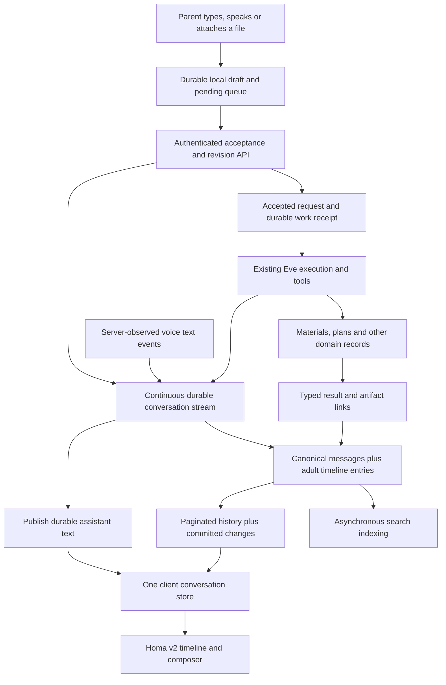

# One continuing conversation with Homa

Status: implementation in progress. Sidney explicitly authorized implementing this plan on September 12, 2026. Completion still requires the validation and rollout evidence below. Product exploration: [gh#1158](https://github.com/sidneyswift/homa/issues/1158). Existing persistence defects remain OPEN under [gh#1182](https://github.com/sidneyswift/homa/issues/1182), escalated September 12, 2026. This plan does not close or repair them.

Implementation evidence: [local changes, validation and unresolved recording/dispatch gates](2026-09-12-conversation-rebuild-implementation.md). The new recorder is disconnected from live traffic.

Planning estimate: **28 to 44 engineering days**, including discovery, migration, testing and rollout, plus **5 to 7 days observing a canary**. This is an estimate, not a measured delivery commitment; two engineers can overlap client and server work after contracts settle. Budget roughly **25 to 40 source/test files**, **3 to 5 additive migrations** and an initially dark release. Exact file count and schedule follow the discovery gate. Highest risk: compatibility between old and new clients, voice recovery, and actions whose outcome is uncertain after a disconnect.

## The experience we are rebuilding

Homa v2 becomes `/app`. A parent has one continuing conversation with Homa, whether they speak, type, upload a photo, leave the page or come back on another device. They never manage a model session or press Save. Work remains connected to the request that started it.

The product promises:

1. **I can leave and come back.** Accepted messages and completed results return. Content blocked by a connection or recording failure is clearly identified and recovered automatically on the originating device where storage permits.
2. **Talking and typing are the same conversation.** Switching input does not restart context or create a second independent assistant answering the same request.
3. **Stop means stop listening, immediately.** It stops microphone capture and current playback. Already accepted worksheet or planning work can continue; its status stays visible in the conversation. Canceling that work is a separate action.
4. **I do not have to repeat work because the connection failed.** A retry of the same accepted request finds its existing result. A genuinely new request with the same wording remains a new request.
5. **My work is where I left it.** A worksheet, unfinished plan, approval or result keeps its identity and current status. “Make that harder” can refer to the same artifact tomorrow.
6. **My private conversation stays mine.** A second adult has their own raw chat. Family materials and other shared state retain their existing sharing rules.
7. **The interface stays quiet.** No normal save button, mode picker or permanent saving banner. Actual recording or delivery failures get a small, truthful, actionable state next to the affected content; routine recording stays invisible. Connecting voice remains in the composer placeholder.

Honest limit: no browser can promise recovery of audio that was never transcribed or data it never durably stored. “Saved” means a server acknowledgement, not that text briefly appeared on screen. The server-owned recording contract below governs connected operation; the app must explicitly identify actual delivery failures and cannot claim to have received unavailable audio or disconnected client data.

## Continuous server recording, founder requirement

Sidney clarified that every incoming and outgoing conversation token must be recorded on the server continuously. Canonical ruling: `conversation-continuous-server-recording`. This is infrastructure behavior, never a model-selected tool, summarization decision, occasional save operation or parent chore. It supersedes the browser checkpoint cadence and lossy provisional-snapshot approach in the earlier draft.

- Capture the full submitted parent message before executing it. Record all provider-exposed incoming transcript updates and outgoing assistant text, including partial replies, corrections and interruptions, through an authenticated server-owned recording path as they arrive. A final message row is a readable projection, not the only retained evidence.
- Preserve an ordered, replayable stream of content deltas or lossless revisions, scoped to adult, conversation, message and source stream. Retries deduplicate event identity, never equal words. Corrections update the readable message while retaining the received content needed to reconstruct prior revisions. Existing deletion, recipient-revision and retention rules apply to the recording too.
- For assistant text, durable recording precedes forwarding that text to the browser. The model never decides whether to record. Server recording continues independently of the page lifetime for an already-running output stream. Request execution and transcript recording remain different effects; receiving or replaying a caption never executes a tool.
- This does not require one SQL row or transaction per tokenizer token. A transport chunk can contain several tokens. Batching must preserve every content event and its order; it cannot discard interim text, silently drop overflow, or expose assistant text backed only by volatile memory. A timer that periodically saves the latest browser string is insufficient.
- Voice needs a server observer or relay with recoverable event delivery. Prove that the current provider exposes each conversation text event to that durable path, including the relationship between spoken output and its transcript. Browser-only callbacks or a best-effort transcript copy after playback do not meet this requirement. If the existing transport cannot meet it, present the concrete transport change required; do not quietly weaken the requirement or substitute raw-audio retention.
- During a lost connection, client-only content remains in an automatic local delivery queue where available and synchronizes when authenticated connectivity returns. Do not claim disconnected content is already on the server. Content not yet transcribed or exposed by the provider cannot be fabricated. These physical limits do not turn routine saving back into a user task.
- Unsubmitted drafts remain drafts, not model input. The recording concerns the conversation and its delivered parts; it does not authorize collecting hidden model reasoning or creating a raw-audio archive. File bytes and domain artifacts keep their dedicated durable stores and linked identities.
- Normal recording has no Save, Saving or Saved UI. Only a real recording/delivery problem produces an actionable notice, with automatic recovery first. Recording failures must not silently fall back to an ephemeral conversation.

Phase 0 must prove this path and revalidate the baseline estimate. Optimize latency and storage around complete recording, not by making it optional. Test every published output chunk against durable history, and reconcile the complete provider-visible test stream after forced disconnects, process exits and browser termination.

## Decisions to react to first

These are proposed defaults unless marked as existing policy. Costs below are incremental planning estimates, not independent additions to the total.

| Decision | Recommended behavior and reason | Alternative, benefit and cost |
| --- | --- | --- |
| One chat, several underlying sessions | One adult-scoped timeline; replaceable voice/model sessions. Keep existing Postgres records and Eve execution, rebuild their handoff. | A new conversation database alongside the old one offers a clean schema but requires reconciling two authorities. Estimated 5 to 10 extra engineering days and substantially harder rollback. Do not choose it merely for clean code. |
| Voice and typing at the same time | **Founder selected continued voice while typing**, September 12, `conversation-voice-typing-continues`. Keep the composer open. While live voice and a draft coexist, show **Send and Stop** as two compact controls. Otherwise keep the single mic/send/stop control. | Ending voice when typing begins was considered and declined. Simultaneous input stays in scope; keep one accepted-request path and an immediately reachable Stop. |
| Unsent content after returning offline | **Founder selected automatic sending**, September 12, `conversation-offline-auto-send`. Requests the parent pressed Send on are delivered automatically when connectivity and the authenticated client are available, including after reopening the next day. Preserve the original intent ID so an uncertain earlier acceptance is not duplicated. Unsent drafts remain drafts. | Review-before-sending was considered and declined. Special handling for delayed relative dates is deferred by the founder (`conversation-delayed-dates-deferred`); it is not an initial rebuild requirement or approval gate. Do not reinstate an age-based review gate. Browser-closed background execution remains subject to platform capability. Estimate 2 to 4 days for automatic queued-delivery reliability and validation, excluding special delayed-date handling. |
| Continuous recording and quiet feedback | **Founder required every incoming/outgoing conversation token to be recorded continuously on the server**, September 12, `conversation-continuous-server-recording`. Infrastructure owns recording; normal operation has no saving UI. Only an actual recording/delivery problem is surfaced and automatically retried where possible. | Occasional model/browser saving and routine Save/Saving/Saved UI are rejected. Stream storage, latency and transport implementation need proof, not another product decision about whether to save. |
| Returning to old conversation | **Founder selected newest message on return**, September 12, `conversation-return-newest`. Reopening or returning goes to the latest message, with compact current work receipts. During an active visit, preserve the parent's reading position when incoming messages arrive and offer New messages. | Restoring an older reading position on return was considered and declined. Do not confuse returning with an incoming update while the parent is actively reading. |
| Switching to another app during voice | **Founder selected continued listening and talking**, September 12, `conversation-voice-app-switch-continues`. Keep the active conversation going across app switching; explicit Stop stays immediate. | Pausing merely on app switch was declined. Prove actual device support and handle true interruptions honestly; screen lock and phone-call behavior remain separate validation cases. |
| Voice history versus audio recordings | Preserve verbatim transcripts indefinitely, subject to existing deletion policy. No new persistent raw-audio recording. These are existing transcript/privacy constraints, not fresh consent. | Keeping raw audio would need a separately approved product, privacy and retention decision; it is not part of this rebuild. |

Existing policy already decides per-adult raw chats, indefinite call transcripts, background voice work, recipient scoping, material versions and unfinished plans in Binder. Do not ask the founder to re-decide those. See the policy pointers below. No new transcript editing, temporary/private chat, household-wide raw chat or new notification subscription is implied by this plan.

## What the evidence says

The [persistence audit](2026-09-12-chat-persistence-audit.md) contains exact source references and synthetic reproductions. It audited the current local worktree and compared selected files with remote main `ff0ae150989644398f74d1212ee08a3259222a0a`. It did not verify the hosted revision or measure incidence among families. Passing synthetic probes reproduced defects; they did not fix them.

Keep the strengths: authenticated Postgres history, per-adult privacy, stable canonical row IDs, transactional write/reply boundaries, family-scoped artifact stores, authenticated Eve restoration, and existing tool idempotency. Replace the habit of rebuilding the screen from unrelated browser events, voice arrays, text rows and guessed artifact matches.

### Finding-unknowns pass

Source method: [finding-unknowns](https://github.com/sidneyswift/skills/tree/main/finding-unknowns), remotely read through GitHub on September 12. Applied its blindspot pass and tweakable-plan guidance. The decisions above expose assumptions for reaction; the work order below turns each trap into a constraint.

| Quadrant | This plan's treatment |
| --- | --- |
| Known knowns | Current reproduced audit failures, founder privacy/retention rules, one-chat v2 direction and existing durable stores. |
| Known unknowns | U1-U11 have an owner, experiment and a release/implementation stop condition. |
| Unknown knowns | The interactive walkthrough and decision controls let the founder react to Stop, offline return and reading-position behavior. Defaults are proposals until confirmed. |
| Unknown unknowns | Independent council challenges, bounded git history, lifecycle fault injection and a real-parent return visit expose assumptions the initial storage audit missed. New discoveries amend the plan; 50 journeys are not a proof of exhaustiveness. |

**6 landmines, 3 hidden conventions, 2 missing concepts, 3 relevant historical repairs.**

| Type | Concrete blindspot and evidence | What the implementation prompt must require |
| --- | --- | --- |
| Landmine | C1: turn IDs restart in another Eve session. `chat-history-model.ts:277` deduplicates without session identity. | Preserve canonical message IDs across all renderers. Scope legacy fallback by full session/turn/role/sequence, never text or turn alone. |
| Landmine | C2: adopting a newer cursor does not hydrate the missing UI. The cache may be complete while a mounted tab is not. | Apply data and cursor atomically in the client store; test two real mounted clients, not only cache helpers. |
| Landmine | V1/V2: casual voice seals at stop; finish ignores late captions. | Checkpoint live transcript revisions continuously; stop capture first, then bound the drain of already captured provider events. |
| Landmine | R1/R4: material matching depends on runtime session coincidence; attachment identity is embedded after extracted text that can be truncated. | Persist typed parts and explicit request/result links. Never parse identity out of prose as the new primary representation. |
| Landmine | O1: display timestamps, mutable retry timestamps and save-arrival order disagree. A database sequence can also allocate before another transaction commits. | Separate immutable display position, source occurrence time, content revision and commit-safe synchronization cursor. |
| Landmine | S1/R2: embedding delays message persistence; one failed material query can erase an otherwise healthy history response. | Commit first, index later; return readable text with typed partial failures for unavailable enrichments. |
| Hidden convention | Canonical owner and addressed recipient are not always identical. `conversation_deliveries` can grant a recipient a visible entry. | Use adult-scoped timeline entries referencing canonical rows; preserve existing ownership and recipient rules. Never broaden raw chat visibility to repair missing rows. |
| Hidden convention | Voice bridge prompts are private; real family effects are stored outside chat. | Do not expose bridge internals or replay tools to reconstruct cards. Use operation receipts and domain records. |
| Hidden convention | `HOMA_CHAT_HISTORY_DISABLED` bypasses server history, and older native clients retain legacy voice paths. | Record actual flag/deployed-client state at migration time. Test old writers during rollout and ensure fallback cannot silently report an empty history as success. |
| Missing concept | “Message saved,” “request accepted,” and “work completed” currently have no common durable contract. | Give each a separate identity, state and acknowledgement. An incoming caption revision must never itself rerun a tool. |
| Missing concept | A retained transcript does not guarantee referential context for “that worksheet.” | Preserve task/artifact referents separately from model summaries; rebuild context from authorized durable sources. |
| History | `0e0f254f` repaired disappearing chat at turn/role granularity; `a55f324d` repaired binding races; `9fa13bb7` added stale-cursor recovery. C1/C2 still reproduce. | Keep the original guards and add lifecycle interaction tests. Replacing the client must not discard the hard-won authentication and restoration rules. No reverted rebuild was found in this bounded history pass. |

## Proposed architecture

Build a shared conversation module around the existing durable foundation. Web v2 is its first renderer; legacy web and native remain compatible while adapters migrate. This is a conversation transport/storage/UI change, not a new agent capability, fleet skill, model provider or infrastructure procurement.



### 1. Identity and storage contract

Logical entities below describe responsibilities. Prefer extending existing tables and receipts over creating duplicate ledgers. The discovery gate decides exact table layout and verifies every supported writer before a migration is written.

| Entity | Proposed fields / constraints | Why it exists |
| --- | --- | --- |
| Conversation | `id`, `family_id`, `adult_id`, `head_change_sequence`, `access_epoch`; unique family/adult scope | Permanent account conversation, independent of runtime. Ownership is derived on the server, never selected by model/client input. |
| Conversation content stream | Authenticated conversation/message/source IDs; ordered event ID or ordinal; lossless text delta or revision; committed receipt | Records every received conversation text event independently of the model and browser. Canonical message projections can be rebuilt without losing interim content. Exact storage follows Phase 0 proof. |
| Canonical message | Keep existing UUID and provenance; add `revision`, immutable creation, `updated_at`, `content_state`, structured parts; retain legacy session/turn/role/sequence mapping | One identity through streaming, correction, retry and reload. An updated caption edits its own message, not a new bubble. |
| Adult timeline entry | `entry_id`, `conversation_id`, `message_id`, immutable `position`, `authorized_message_revision`, visibility/revocation reference; unique conversation/message | A message can appear for its owner or an authenticated addressed recipient without rewriting raw ownership or exposing a different adult's chat. |
| Message part | Stable `part_id`, versioned closed `kind`, typed text/file/artifact/work payload and provenance | Files and cards survive independently of text truncation; internal extracted document context is stored separately from display content. |
| Accepted request | `request_id`, caller-scoped `client_intent_id`, immutable accepted content snapshot/revision, state, execution reference; unique caller+intent | Separates sending from transcription and tool execution. Same intent retry is deduplicated; same words with a new intent are allowed. |
| Work / result link | Existing job/tool receipt plus `operation_id`, source request, current status, domain record/version references | Closing voice does not orphan work. Rendering and retrying delivery never re-executes it. Reuse receipts before adding a new work registry. |
| Conversation change | `conversation_id`, committed `change_sequence`, affected entry/message revision or tombstone, access epoch | Reliable catch-up for two tabs/devices, including corrections and deletes. Contains no cross-adult metadata. |
| Browser durable store | Schema version; account-scoped drafts, pending intents, captured transcript revisions, acked cache, scroll anchor and sync cursor | Recovery when the browser exits before the server responds. IndexedDB is proposed; feature-detect and handle failure explicitly. No claim of guaranteed storage against OS eviction. |

Proposed boundaries, deliberately not a complete implementation:

```ts
type ContentState = "partial" | "final" | "interrupted";
type DeliveryState = "local" | "sending" | "acknowledged" | "needs_attention";
type WorkState = "accepted" | "running" | "needs_input" | "succeeded"
  | "failed" | "cancel_requested" | "cancelled" | "outcome_unknown";

type MessagePart =
  | { id: string; kind: "text"; text: string }
  | { id: string; kind: "attachment"; attachmentId: string; name: string }
  | { id: string; kind: "artifact"; artifactId: string; versionId: string }
  | { id: string; kind: "work"; operationId: string }
  | { id: string; kind: "interaction"; interactionId: string; schemaVersion: number };

type ConversationAck =
  | { kind: "transcript_saved"; messageId: string; messageRevision: number;
      receivedRevision: number; committedChangeToken: string }
  | { kind: "request_accepted"; clientIntentId: string; requestId: string;
      messageId: string; messageRevision: number; acceptedAt: string;
      committedChangeToken: string };
```

A transcript acknowledgement never requires or creates a work request. `committedChangeToken` is a receipt hint, **not** permission to advance the client's applied catch-up cursor. The client still fetches and atomically applies every intervening change. `messageRevision` advances for that message's content; `change_sequence` advances for every authorized timeline mutation. Same revision plus changed content is a conflict; older retries cannot overwrite a newer revision. Captions additionally retain unique authenticated runtime binding + provider item + speaker identity.

Addressed content needs a version boundary: the owner can see later transcript corrections, while a different adult sees only the revision they were actually addressed, or an explicit newly authorized update. Retain delivered revision payloads or immutable delivery snapshots. Never let a recipient link to revision 1 reveal private additions in revision 2. Retain accepted command evidence likewise. The content stream preserves received deltas and corrections losslessly under existing retention/deletion rules. Derived snapshots may be compacted only if the recorded stream still reconstructs the content and authorized delivered revisions; compaction cannot erase conversation tokens merely because they were provisional. Test this policy before schema approval.

`outcome_unknown` is required for an external effect whose provider did not answer; ordinary Retry must not blindly repeat it. `interaction` persists approved choices/confirmations with versioned status; it does not grant new voice-only cards or new permissions. Cursor values remain opaque strings, avoiding JavaScript integer precision problems and client guesses about ordering. Drafts remain device-local initially: syncing keystrokes across devices adds conflict resolution and privacy surface, estimated 2 to 4 days, without evidence of demand.

### 2. Acceptance, acknowledgements and exact effects

1. Persist the parent's intent and staged references locally before clearing the composer. If local persistence fails, keep the draft until server acknowledgement, expose Copy when necessary, and never falsely say it is safe on the device.
2. Server authenticates adult, family, membership, source session and all referenced IDs. A caller retry with the same intent ID receives the original acceptance receipt. Reusing that ID with different content returns a conflict.
3. In one database transaction, commit the canonical user message, visible entry, acceptance receipt and execution-dispatch record. Do not wait for embeddings, card enrichment or an AI response. Dispatch recovery must be durable; a process-local promise after the transaction is insufficient.
4. Existing Eve execution claims the dispatch idempotently. Internal commands, user message snapshots and casual voice transcript revisions have different types. A caption checkpoint saves words only. A voice delegation explicitly creates a request snapshot; later caption correction does not rerun it.
5. Tools keep their existing family-scoped validation and effect receipts. A message deduplication key is not a replacement for provider/domain idempotency. For ambiguous external outcomes, reconcile the original operation before offering retry or explain that the outcome is unknown.
6. Record each assistant text chunk durably on the server before publishing it to the browser. Stream already-recorded partial text responsively; partial is a completion state, not a durability exemption. Continue recording server-generated output when the page disappears. Finalize the readable message and result links at completion; interruptions retain the exact recorded prefix and an honest incomplete state.
7. Index and summarize asynchronously after commit, keyed by message ID and revision. Ignore stale jobs; deletion cancels or invalidates pending jobs. Durable retries need a discoverable pending record and bounded failure alerts, not `fire and forget`.

No “exactly once” network promise: delivery can repeat. The target is one committed acceptance per intent, idempotent state transitions, and one authorized effect per operation where the domain/provider supports it. Unknown outcomes are represented instead of guessed.

### 3. Voice lifecycle that does not depend on Stop to save

Use the current `gpt-live-1`/`gleam` adapter and credential boundaries; no provider migration in this plan.

Reserve a stable utterance ID at provider speech onset only if that event exists and is reliable; otherwise use the first received fragment. Retain supported provider event identity and stream ordinal, then persist monotonic transcript revisions. The current Live adapter does not expose a response-done event. Phase 0 must prove onset, identity and finality mapping rather than inventing a final-turn signal. If no authoritative final signal exists, use bounded observation with an explicit interrupted/unconfirmed state; silence alone does not prove completeness. Continuously record every exposed transcript delta/revision through the server-owned path defined above. Lossless transport batching and derived-message refresh cadence may be tuned, but a one-second browser save timer is not the persistence authority. Keep local recovery for client events that have not reached the server. Measure recording latency separately from display refresh, provider finality and offline recovery. Use bounded chunked text and revision updates so an 8,000-character utterance cannot block later saves. One permanent validation failure becomes a visible item failure, while unrelated items can still progress; retain the failed text for correction/export.

Stop path:

1. Release microphone tracks and stop playback immediately. The icon and accessible label change immediately.
2. Prevent new audio capture and new conversation requests from the closing adapter.
3. Continue accepting final events for audio already captured through a bounded provider drain, proposed 2 seconds initially. Server recording continues for already-produced provider text events independently of the closing page; client-only undelivered events stay in the automatic pending queue. Stop/drain may finalize an utterance but never serves as the normal save trigger. Prove provider event coverage and residual unavailable-audio limits in U1.
4. On drain timeout or provider failure, preserve the last durable revision as interrupted. Never label an incomplete tail complete. A later verifiable final event may reconcile the same utterance without creating a new request.
5. Background work already accepted continues according to existing policy. Its receipt and artifacts remain available on reload. No new SMS/email/push permission is inferred from closing the mic.

Important discovery gate: determine whether the deployed Live transport supports reliable onset/utterance identity/finality, server-side transcript observation or replay of pending events after a browser dies. If it does not, identify the server observation/relay or recoverable-delivery change required and bring back its evidence and scope. Do not declare continuous server recording complete with browser-only checkpoints. Separately, do not promise recovery of audio the provider never exposed as text. Do not introduce raw audio retention to hide that limitation.

Keep Stop available while typing/uploading during voice. Stopping keeps focus on the initiating control or a stable logical target, without automatically focusing the input and opening the phone keyboard. If a new voice session starts while the old one drains, session-generation fencing routes each event to its original message and permits storage retries without old audio playback or blocking the new connection. Route accepted typed requests through the same acceptance boundary, regardless of prior message history. A voice session is an input/output adapter, not an independent source of authority about completed work. Existing bridge conversation and tools remain, but share accepted request IDs and context.

### 4. Reading, syncing and continuity

Return a stable page of authorized timeline entries plus `hasMore`, an older-history cursor and a synchronization cursor. These cursors are separate. A live subscription can notify the client to fetch changes; it is not the only source of truth. On reconnect, visibility change or a missed notification, catch up from durable changes. Polling is an acceptable fallback behind the same protocol; no new realtime service is assumed.

Allocate change revisions by locking the conversation head within the write transaction. All mutations, including recipient-entry changes, deletions and backfills, use the same commit discipline. When several conversations are affected, lock in a deterministic order. A plain SQL sequence or timestamp is insufficient: a later allocated value can commit before an earlier transaction, causing clients to skip the late commit. Initialize the first page and high-water cursor from the same consistent database snapshot. Merge the returned changes and cursor in one local transaction. Never advance a cursor over unapplied content.

Give each accepted entry an immutable display position. Voice events reserved at speech start can acquire their position then; later text corrections keep it. If a browser was offline and could not reserve an entry, the message arrives at server acceptance with truthful “said earlier” metadata rather than rewriting the already-read conversation. Client clocks are provenance, not ordering authority. Legacy history uses a separate pre-cutover ordering region keyed by preserved historical timestamp+canonical UUID, while new accepted entries use post-cutover ordinals. Establish the cutover boundary once per adult before live entry creation; backfilled older rows belong in the earlier region even if imported later. The change sequence still reports that import now. Define the boundary and dual-writer mapping before migration, and test browsing during partial backfill. Do not put old imports after today's conversation merely because their writes happened later; uncertain historical order is not fabricated.

Preserve viewport anchors when older pages load or new messages arrive while reading. Follow new text only if the parent is already near the bottom. Offer a New messages control, keep focused controls stable, and never rely on visual fade or gray text to communicate incomplete/error states. Screen-reader announcements use completed clauses or turns, not every token. While Homa playback is audible, suppress automatic duplicate transcript narration but keep captions manually navigable. When audio is muted, announce each completed reply once; rehydration or a revision alone must not speak the same sentence again. Test switching audio/announcement modes midway through a reply. Partial captions remain available without flooding the live region. Keyboard, reduced-motion and large-text behavior are acceptance gates.

Build model context separately from display pagination: bounded recent authorized exchange, accepted request snapshot, relevant pending work and explicit artifact referents, plus current family facts and permission-scoped recall. Summaries are derived and revision-linked, never durable proof of an action. “That one” with two plausible artifacts must prompt a short clarification. The controller must not infer intent through keyword rules or pick the latest artifact blindly. A caption correction after an accepted action cannot silently rewrite the action's original evidence. An explicit typed/spoken change to the child, date or task becomes a new linked intent with a `supersedes_request_id` or `amends_operation_id`; the model resolves the reference and deterministic code checks the operation's current state. If the original effect already happened, show whether it can be changed or needs another action, never claim an impossible cancellation. Preserve the hybrid voice architecture: ordinary conversational speech need not make a slow round trip through Eve. Persist transcript observation independently, while accepted effectful/delegated work uses the common receipt boundary.

### 5. Results, files, privacy and recovery

Attachments get durable IDs and upload states before they become message parts. Persist enough local metadata to resume or truthfully request reselection if the browser cannot retain bytes. Upload completion alone is not message acceptance. Recheck ownership and scan/processing readiness when a message is accepted. Do not send partial document contents as if the whole upload succeeded.

Result cards refer to artifact IDs and immutable version IDs, with separately fetched current status. A historic card identifies the version delivered then; “latest version” is explicit. Existing material-version policy preserves previews/source but permits print-file reclamation. Retrieve or rebuild an old print file under that policy; do not promise original PDF bytes or immediate availability forever. Revoked, deleted or temporarily unavailable resources have distinct states. A failed material lookup does not suppress healthy text. Restoring an approval/Undo card fetches its current authority and expiry, never replays its original click.

Private timeline entries do not change shared family domain ownership. Every message part, cursor, search result, pending operation and artifact request is authorized independently. Do not overstate file protection: the existing interim public-by-URL storage ruling means a copied direct link may bypass application authorization until the separately tracked storage migration is verified. Recheck current delivery/storage facts, preserve truthful copy, and track that boundary without expanding this conversation rebuild into an unapproved file-store migration. A second adult may see a shared worksheet in Binder while never seeing the private conversation that created it. Family membership removal and recipient revocation must remove visibility from snapshots, catch-up, local cache, search and recall. Invalidate active feeds and voice/dispatch session leases when feasible, and recheck authority before effects. A fully offline device cannot be remotely erased; enforce on reconnect and state the already-downloaded-data limit. Recipient correction retracts only that adult's entry; it does not delete the original owner's history. Old change payloads must recheck current access rather than leaking revoked content during replay. Rejoining a family creates a new access epoch; it never silently revives the old outbox.

Local data is partitioned by authenticated family/adult and an access epoch. Clear it on confirmed logout/account switching and avoid painting cached text before identity is established on a shared device. Logout with pending text should warn and offer Copy/Stay plus an immediate Sign out and discard path. It must not trap someone on a shared device or upload pending content into the next account. Browser storage encryption with keys available to the same origin is not a substitute for XSS defenses or device security.

Deletion needs tombstones and stale-client rejection so old outboxes cannot resurrect erased material. Verify existing deletion policy before adding any message-level delete UI; existing indefinite transcript retention is not permission to retain deleted account data. Trace the deletion/export boundary through canonical messages, derived indexes, local cache, Eve state, files and backups, and report any unverified retention boundary explicitly.

## Customer journey acceptance matrix

Every row is a required design case. Tier A gates the first real-family pilot. Tier B gates the replacement of `/app`; implementation may group tests by invariant, but must not silently drop journeys. Proposed behavior is not a claim that it works today.

| ID | Parent journey | Expected experience and proof | Gate |
| --- | --- | --- | --- |
| J01 | Send first text, immediately refresh | One accepted message, one response/work receipt; pending send restores if no acknowledgement. Kill after each handoff. | A |
| J02 | Receive streaming answer, refresh midway | Every published assistant text chunk is already server-recorded. Reload reconstructs the exact partial or continued response; no lost visible tokens, duplicate request or fake completion. Kill browser and stream worker independently. | A |
| J03 | Request accepted, acknowledgement lost | Retry same intent retrieves the original receipt; one domain effect. | A |
| J04 | Double tap Send | One intent and one acceptance. A later deliberate identical request has a new intent and is allowed. | A |
| J05 | Draft, staged photo or failed send then reload | Originating device restores text/references; missing bytes clearly require reselection. No disappearance disguised as success. | A |
| J06 | Browser denies storage or quota is full | Keep unsent content visible; preserve composer until ack; Copy available. Test private mode and forced storage exceptions. | A |
| J07 | Lose internet mid-send; return hours later | Automatically send queued requests on reconnect or return, with the original intent ID; recover already accepted work without duplication. Keep original message time/context. Unsent drafts do not send. | A |
| J08 | Speak casually, then refresh without Stop | Incoming/outgoing provider text events continuously reach server recording without Stop or a model save call. Restore exact received text and corrections after browser loss; prove source-event coverage and identify genuinely unavailable audio separately. | A |
| J09 | Stop just as last words are transcribed | Mic/playback stop immediately, already captured final text drains; no silently dropped suffix. | A |
| J10 | Very long speech or malformed caption | Chunk/revise within limits; unrelated later rows save; failed content remains recoverable. | A |
| J11 | Mic permission denied or permission revoked | Text stays usable; no retry loop or false active mic; explain a recovery step only when needed. | A |
| J12 | Phone locks, call interrupts, Bluetooth changes | Audio capture ends or suspends truthfully; received words and work survive. Never auto-open mic on recovery. Real-device evidence required. | A |
| J13 | Type/add a file while voice is active | Send and Stop both remain reachable. One accepted intent path, coherent context and no competing answers. | A |
| J14 | Stop voice during worksheet generation | No more listening/playback; accepted worksheet continues with visible work receipt and later result. No new notification opt-in. | A |
| J15 | Say “cancel that” or press cancel after work starts | Model resolves intended work; code scopes operation. Show cancel requested until confirmed; completed external action is not claimed undone. | A |
| J16 | Talk to a child or TV is audible | Captions are not automatic tool commands. Delegation/intent uses existing model interpretation and action rules; ambiguous referent asks. | A |
| J17 | Two tabs send concurrently | Both see all accepted messages once; stale cursor cannot hide missing entries. Test mounted clients and both race orders. | A |
| J18 | Phone and laptop, second device after first closes | Server history and work receipts restore without first device cache. Mic does not transfer automatically. | A |
| J19 | Return after daily model-session rotation | Continuous history; no turn-ID collisions or unnecessary repeated greeting; authorized recent context/referents available. | A |
| J20 | Voice creates worksheet, later opens text on laptop | Same card and delivered version; no runtime-session matching guess; shared Binder still works. | A |
| J21 | “Make that harder” tomorrow after several topics | Correct artifact/version or one clarification if ambiguous; no full transcript needed in every model prompt. | A |
| J22 | Plan unfinished, switch topic, return | Resume exact working plan from domain record; Planner changes only after current approval. | A |
| J23 | Add equal minutes for two different activities | Two legitimate records when two intents; retry same accepted event does not duplicate. Text equality never deduplicates intent. | A |
| J24 | Material service fails while history loads | Text appears with a retryable unavailable card, not an empty screen. | A |
| J25 | Read older chat while a response arrives | Position/focus remain stable, New messages control appears. No forced jump or clipped reading. | A |
| J26 | Screen reader, keyboard, large text, reduced motion | Role/context available accessibly without visual names; announcements batched; composer and mic-stop reachable at zoom. | A |
| J27 | Shared tablet: logout and another adult signs in | No flash of previous raw chat or draft. Private search/recall and artifact links enforce separate rules. | A |
| J28 | Membership/recipient access revoked while tab open | Next authenticated sync rejects/clears unauthorized data; no future offline flush under wrong identity. State limits of data already viewed offline. | A |
| J29 | Hundreds of messages and older results | Page beyond every current cap; results fetched by reference rather than latest 80 family materials. Existing-user pilot must include long histories. | A |
| J30 | Two long documents in one message | File references survive extraction size; no hidden truncation of visible words. | A |
| J31 | Worksheet revised, old link or card reopened | Delivered version remains identifiable; older print file may require rebuilding from retained source; latest is explicit and links are resolved under actual storage/access policy. | B |
| J32 | Approval already used, expired or changed elsewhere | Restored interaction displays current resolved state; cannot approve an obsolete version or rerun the original action. | A |
| J33 | Scheduled/SMS/email reply arrives during web chat | Only messages addressed to this adult appear with correct source and stable position; no other adult's raw lines. Preserve current channel gates. | B |
| J34 | Parent travels or DST changes | Conversation identity does not change; accepted dates carry timezone context; chronology remains stable. | B |
| J35 | Delete account, then old device reconnects | Stale pending writes cannot resurrect content; derived/history caches purge per policy and authority. | A |
| J36 | Session expires, billing/access gate changes | Do not clear readable/pending content on transient auth failure; reauthenticate same owner. Preserve existing entitlement and record-access rules. | A |
| J37 | Old app/native client writes during v2 rollout | Adapter creates the same canonical identity and recipient entry; no missing or duplicate records. | A |
| J38 | Rollback while new clients have queued writes | New protocol still accepts/reconciles pending work; legacy reader can show text/results fallback. Never switch off the only compatible writer. | A |
| J39 | Search/index provider unavailable for hours | Messages commit and reload; pending indexing catches up, no stale deleted text resurfaces. | A |
| J40 | External action succeeds but connection dies | Reconcile existing receipt/provider identity; show outcome unknown until verified, never duplicate a calendar entry to repair a bubble. | A |
| J41 | Reconnect with expired sync cursor and stale cache | Scoped snapshot reset, preserve local pending intents and active-reading anchors when possible; on return open at newest; honor tombstones/access epoch. | A |
| J42 | Replay assistant audio after reconnect | No automatic re-speaking old answers. Resume playback only on explicit parent action; transcript and work still restore. | A |
| J43 | Press Stop while permission/connection is pending | A late successful permission/token response cannot open capture or playback. Cancellation generation invalidates the old connection; test accessible control and fast double taps. | A |
| J44 | Change child/date while the original task runs | New linked intent, immutable original evidence, correctly scoped target. Show applied, needs clarification or too late; no competing silent effects. | A |
| J45 | Homa speaks first, parent leaves without speaking | Authenticated session-start provenance authorizes assistant attribution without inventing a user row. Restore first assistant speech on another device. Current guard risk is source-derived, not yet reproduced. | A |
| J46 | Recipient receives a message, owner later revises it | Recipient sees only their authorized delivered revision; no later private additions. Revocation removes that entry alone. | A |
| J47 | Read history while legacy backfill and new sends run | Old records occupy their historical ordering region; new changes are not skipped, view/focus stable and incomplete migration is truthful. | A |
| J48 | Stop and immediately restart voice while old events arrive | Old captions/results reconcile original identities; no old audio in the new session, no save failure indefinitely blocks restart. | A |
| J49 | Stop on phone while a worksheet is visible | Capture ends immediately, focus stays logical, keyboard does not automatically cover the work. | A |
| J50 | Toggle audio while using a screen reader mid-reply | One automatic spoken output at a time; captions remain manually readable; recovered/revised text does not announce twice. | A |

## Unknowns with a way to resolve them

These are uncertainty owners and tests, not a claim that an exhaustive list prevents every surprise. The council record adds the objection that motivated each experiment.

| Unknown | Why it matters | Owner, experiment and stop condition |
| --- | --- | --- |
| U1: Server voice recording, identity, finality and recovery | Continuous recording must not depend on a browser transcript copy | Voice/backend engineers: prove authenticated server observation or relay of all exposed input/output text events, record/replay identity, correction handling and audio/transcript timing. Kill browser and server worker separately. If the current transport cannot satisfy the requirement, present the required change; do not certify browser checkpoints as equivalent. Unexposed audio remains a distinct physical limit. |
| U2: Durable dispatch and recovery in installed Eve | Acceptance must not lose work between DB commit and execution | Backend engineer: fault-inject before/after dispatch, process exit and tool response. Reuse existing durable scheduler/receipt if sufficient; specify a minimal DB-backed dispatcher only if evidence requires it. No new vendor by default. |
| U3: Legacy writers/visibility/retention in deployed state | A clean new reader can still miss old native/SMS/dispatch writes | Data engineer: inventory every canonical writer, applied migration, deployed flag and supported client; use synthetic accounts and sanitized counts. Do not backfill guessed adult ownership. |
| U4: Delayed relative dates, deferred | Founder called this too much of an edge case and chose to skip it (`conversation-delayed-dates-deferred`) | Outside initial rebuild scope. No special delayed-date interpretation or clarification workflow, dedicated experiment, or blocking founder question. Keep ordinary timestamp provenance and existing date validation; automatic queued sending remains required. |
| U5: Lossless stream recording cost and latency | Complete recording is required; implementation must remain responsive | Performance owner: benchmark 30-minute voice and text streams, durable-before-publish text latency, lossless batching, storage growth and reconnect bursts. Tune event representation, batching and projections without dropping any received content. Fault-test every output boundary; baseline schedule is revalidated from this proof. |
| U6: Referential context across voice/text/days | Persistent text alone can still feel forgetful | Agent engineer: eval “that worksheet,” unfinished plan, revised duration and two ambiguous artifacts; verify exact domain IDs and scope, not merely plausible wording. |
| U7: Artifact and interaction contracts supported today | Prevents replay-only rich cards and invented functionality | Client/backend owner: enumerate renderers and domain receipts; classify supported, read-only historical fallback, unknown. Unknown parts must retain text and safe resource link. |
| U8: Shared-device cache policy and pending logout | Privacy conflicts with preserving unsent text | Security/product owners: threat-model existing auth; prototype Copy/Stay/Discard during logout; no raw-cache paint before account verification. Do not claim local secrecy against device owner. |
| U9: Export/deletion across Eve, indexes and backups | Canonical deletion alone may be incomplete | Security/backend owners: map real retention and deletion implementation, verify synthetic family erase end-to-end. Escalate policy gaps instead of promising unverified erasure. |
| U10: Real users understand the three states | “Saved” may be mistaken for “Homa did it” | Research owner: observe whether parents can tell sent vs pending, working vs done, mic stopped vs work cancelled without coaching. Revise UI if they cannot. |
| U11: Background audio feasibility and true interruptions | App-switch continuation is founder-decided; device behavior still needs proof | Voice/product owners: prove continued listening/talking while switching apps. Never pause merely on hidden-tab/window-blur events. Separately test phone lock, incoming calls, permission loss and audio-device changes. If the platform interrupts capture, represent it honestly; never silently reopen a microphone explicitly stopped by the parent. |

### Actual parent validation before rollout

Recruit 6 to 8 real parents spanning newer/experienced homeschooling, busy multi-child days, phone/laptop switching, unreliable internet, shared devices and assistive technology. This sample detects usability failures, not market prevalence. Use fictional child details and disposable activities. No interviews were conducted for this plan.

Ask them to: start a worksheet by voice, add a typed clarification, stop listening, leave/reopen, locate the result, revise it, experience one dropped connection and one ambiguous reference, and switch adults on a shared device. Observe recovery without coaching. Ask “What do you believe Homa saved?” and “Is Homa still listening or working?” Record confusion and successful recovery, not a fabricated satisfaction score. Every observed lost request, privacy exposure, duplicate effect or misunderstood live mic blocks the pilot until repaired and retested.

## Build order and release gates

Each phase is independently reviewable with green relevant CI. New behavior stays dark until its release gate; targeted legacy bug repairs may ship earlier. Estimates include tests and review; assumptions may change after discovery.

| Phase | Work and estimate | Evidence to advance |
| --- | --- | --- |
| 0. Resolve the load-bearing unknowns | 2 to 3 days. Server stream recording and voice observation/relay proof, provider drain/crash spike, durable dispatch spike, current writer/flag/retention inventory, parent prototypes for mixed-input controls and automatic offline delivery, plus continued app-switch voice and lock/interruption device trials. | Document actual guarantees, split save/request acknowledgements, recipient revision authorization, deterministic backfill ordering, exact schema contract and policy gaps. Stop before migration or rollout if complete server recording cannot be demonstrated, acceptance cannot reliably recover execution, addressed revisions cannot be scoped or identity cannot be attributed. |
| 1. Contain existing loss | 3 to 5 days. Ship separable C1/C2/S1/R2 corrections and bounded voice-tail/size containment where safe. Full C3/V1 durability belongs to Phases 2 to 4, after the shared contract and outbox exist; do not build a throwaway queue to claim it early. | Convert contained defects into regressions; verify mounted-client and relevant failure cases. Explicitly leave pending-send and continuous-voice recovery OPEN until their later gates pass. Verify hosted fixes before marking #1182 items fixed. Broad work remains open. |
| 2. Durable conversation contract | 5 to 7 days. Add the lossless content stream and durable-before-publish output path; extend canonical rows/parts and adult entries; commit-safe changes; caller intent receipts; transactional dispatch handoff; recipient/deletion guards and legacy adapter. | Local PostgreSQL race tests, RLS negative tests, crash-boundary acceptance/action tests and old-writer parity. Isolation/migration preflight before changes. |
| 3. Shared client and history | 4 to 6 days. IndexedDB store/outbox, one projection, history paging/catch-up, typed partial errors, composer states, scroll/focus recovery. | Fresh browser plus two mounted tabs/devices, blocked-storage failure, slow/partial history, >240 rows and rollback-compatible pending intents. |
| 4. Voice and referential continuity | 4 to 7 days. Same acceptance boundary, server-recorded caption events/revisions/drain, background work observation, Stop+Send interaction and context handoff. | Physical iPhone/Safari and desktop voice certification, interruption/background matrix, cross-mode/day referent evals. No claimed real-device pass from fake transports. |
| 5. Durable parts and legacy migration | 4 to 7 days. Attachment/result/interaction mapping, explicit artifact versions, deterministic backfill, shadow comparison and recovery tooling. | Counts and identity comparisons per adult/source, sampled rich fidelity, unresolved attribution quarantined; deletion and recipient access change tested. |
| 6. Canary and replace `/app` | 6 to 9 engineering days across release prep/support and 5 to 7 calendar days observing real use. Gradual adult-scoped flag, then `/app2` becomes `/app`; retain old protocol until supported clients/outboxes drain. | All Tier A and B cases, real parent sessions, no unexplained accepted-message loss/duplicate effects/privacy failures, target latency evidence and tested rollback. |

Estimate check: phases total 28 to 44 engineering days. Canary observation is calendar time and is not silently counted as full additional engineering days. This baseline must be revalidated for the founder-required continuous server recording path. Required transport changes, provider recovery or legacy migration findings can increase this range.

### Migration and rollback, spelled out

1. Keep `conversation_messages` IDs and current visibility/continuity records authoritative. Add fields/tables and compatibility code; no destructive rename or replacement ahead of deployed readers.
2. Funnel every supported writer into one commit path, including legacy endpoints and server-originated channels. A compatibility adapter or database trigger must transactionally create the new entry/change for old writes; choose the mechanism only after inventory. Backfill alone is not a dual-write strategy.
3. Backfill using deterministic legacy identity mappings. Do not deduplicate by matching text, timestamp proximity or runtime turn alone. Preserve uncertain order and hidden ownership rather than guessing.
4. Run an idempotent batch backfill and concurrent-write catch-up with per-source/per-adult counts, duplicate/orphan checks and random authorized fidelity samples. Shadow-read both views, compare, and investigate every mismatch. Raw family content stays out of logs and issue comments.
5. Canary the new reader/writer for explicitly selected adults. Authorize on every call, independent of the UI flag. Use protocol versions and capability negotiation; register any new flag centrally with owner/removal criteria. `HOMA_CHAT_HISTORY_DISABLED` is existing; new release flag names are not yet chosen.
6. Roll back the renderer/feature exposure first while keeping compatible acceptance and sync endpoints alive. New structured messages retain a legacy text/resource fallback. Keep pending receipts, tombstones and idempotency records; do not reverse-copy data or drop additive tables.
7. Cut `/app` over only after real-device certification and supported-client compatibility. Remove dead session-derived rendering and old storage later, when telemetry confirms they are unused. Never force users to lose their queued work as a cleanup shortcut.

### Proposed service targets and checks

Targets are acceptance goals under measured supported-device/network conditions, not current performance claims: local draft checkpoint p95 under 250 ms; healthy-network server receipt p95 under 1 second; active-device catch-up p95 under 2 seconds; visible usable history p95 under 1.5 seconds warm and 3 seconds cold. Measure a 30-minute voice session and long history before finalizing them. A device offline for hours is not a latency miss; claiming it was server-saved is a correctness failure.

Correctness gates: every published assistant text chunk has a prior durable record; every provider-exposed conversation text event is accounted for in the recording/recovery fault suite; zero lost acknowledged messages, zero duplicated accepted operations in the fault suite, zero unauthorized raw entries, no silent result loss on enrichment failure, no stale-delete resurrection, no mic restart without user action. Operational signals: pending-intent age, transcript ack lag, finalization timeout, dispatch age, unknown action outcome, change cursor reset, artifact hydration failure and legacy/new mismatch. Record sanitized identifiers and event timings, not raw conversation content. Add an authenticated support trace by message/request/operation ID so support can answer “Was it saved?” without guessing from a spinner.

Test layers: pure merge/state tests; actual database transactions/RLS and delivery policies; property-based retry/reorder tests; mounted browser lifecycle tests; real-provider/physical-device voice journeys; model evals for reference resolution; deployed canary probes. Existing continuity, isolation, event registry and action guards remain. Enumerate current CI rather than copying a stale roster; run `corepack pnpm check:continuity` for adapter changes and `check:isolation`/`check:migration-versions` before relevant edits. Existing tests are necessary but do not substitute for kill/reconnect/refresh evidence.

## Mechanical work

Extract shared types, reader/store and transport adapters; replace separate app2 text/voice arrays with entry-ID reconciliation; version cache migrations; update typed event registry and fixtures; maintain legacy text fallback; expose sanitized support counters; remove obsolete cache-only reconstruction after compatibility expires. Likely seams: `apps/web/lib/conversation-continuity/`, `conversation-log.ts`, `chat-history.ts`, `chat-history-model.ts`, `apps/web/app/app/chat-storage.ts`, `chat-client.tsx`, `voice-mode.tsx`, `apps/web/app/app2/use-workspace-chat.ts`, `conversation-controls-preview.tsx`, `packages/core/src/live-voice.ts`, voice endpoints, artifact producers and additive `supabase/migrations/`.

No schema edits, runtime package bumps, model/provider changes or implementation patches were made to produce this plan. Planning review validation: all 50 journeys are present in the self-contained HTML; its walkthrough, search and reply composer were exercised in the browser, including narrow reflow. These checks validate the review artifact only, not any proposed conversation behavior.

## Council review

Two rounds completed with three independent subagents: data/distributed systems/privacy; voice/mobile/accessibility; and six explicitly simulated parent situations. [Council record](2026-09-12-conversation-rebuild-council.md) separates actual historical customer feedback from hypothetical objections and records the resulting plan changes. No customer interviews or approval votes were fabricated. Phase 0 experiments and platform interruption details remain open; special delayed-date handling was deferred by the founder; automatic offline sending, continued voice during app switching and typing, and newest-message return were selected by the founder; continuous server recording with failure-only notices is required; review does not certify production correctness.

## Ready-to-use implementation brief

1. Rebuild Homa as one persistent conversation per authenticated adult across text, voice and authorized addressed messages, preserving existing family sharing/privacy rules and canonical message IDs. `/app2` is the future `/app`, not a separate history.
2. Treat visible content, durable acceptance and completed domain work as distinct. Use stable message/entry/request/operation IDs, typed parts, immutable positions, revisioned content and a commit-safe catch-up protocol. Do not infer identity from text or runtime turn number.
3. Record every incoming/outgoing conversation text event continuously through infrastructure-owned server storage, without model save calls or routine saving UI. Record assistant text durably before publishing. Preserve client-only pending content locally, commit accepted requests before indexing/execution, and make dispatch recovery durable. Never rerun an accepted action to repair a missing bubble. Preserve legitimate repeated requests.
4. Prove and implement server-owned recording of every exposed voice transcript event; browser checkpoint timers cannot be the authority. Stop capture/playback immediately, drain only already captured events, and represent incomplete tails truthfully. Keep Stop reachable beside Send during simultaneous voice and text. No raw-audio retention or new notifications.
5. Restore files, work, approvals and artifacts through scoped durable references. Preserve current versions/approval rules, private bridge visibility and existing Eve/tool authority. Rebuild bounded model context from authorized requests and work, not all scrollback.
6. Repair and verify the audited defects; add the journey matrix's database, mounted-browser, physical-device and model-reference tests. Do not claim hosted fixes or provider guarantees from synthetic probes.
7. Use additive migration, transactional old-writer compatibility, deterministic backfill, shadow comparison and a canary. Test rollback with outstanding pending intents and supported older native clients. Keep correctness and privacy gates above delivery dates.
8. Start with Phase 0 discovery and the proposed controls/offline prototypes. **Stop after presenting the evidence, exact schema/acceptance contract and updated plan for founder confirmation, before implementation/migrations.** A later explicit instruction to implement may establish that confirmation; this planning artifact is not it.

## Tweak these three things

- “Keep Stop and Send available together while I am talking and typing.”
- “Automatically send queued requests when the connection returns, including after reopening Homa.”
- “Use this plan, but show me the Phase 0 evidence before implementing.”

Use the companion HTML review's selections and Copy response button to assemble a different combination. Selections are proposals until the founder sends them; opening the review is not approval.

## Evidence and policy pointers

- [Persistence audit and probe directory](2026-09-12-chat-persistence-audit.md), source findings C1-C4, V1-V3, R1-R4, O1, S1; all OPEN as of this planning pass.
- `docs/homa-planning/journeys/10-reconciliation.md`: `chat-privacy-per-adult`, `voice-transcript-per-adult`, `voice-retention`, `voice-dispatch-delivery`, `voice-live-gleam`, material version retention and `working-plans-live-in-binder`. Their canonical rows govern; this document proposes no supersession.
- Git history: `0e0f254f`, `a55f324d`, `9fa13bb7`; bounded source history inspected September 12, 2026.
- [Finding unknowns source](https://github.com/sidneyswift/skills/tree/main/finding-unknowns); local `references/blindspot-pass.md` and `references/tweakable-plan.md` read for technique details.
