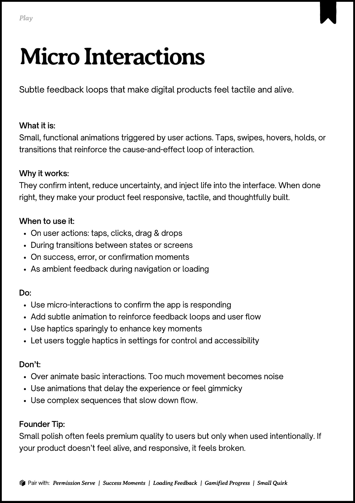
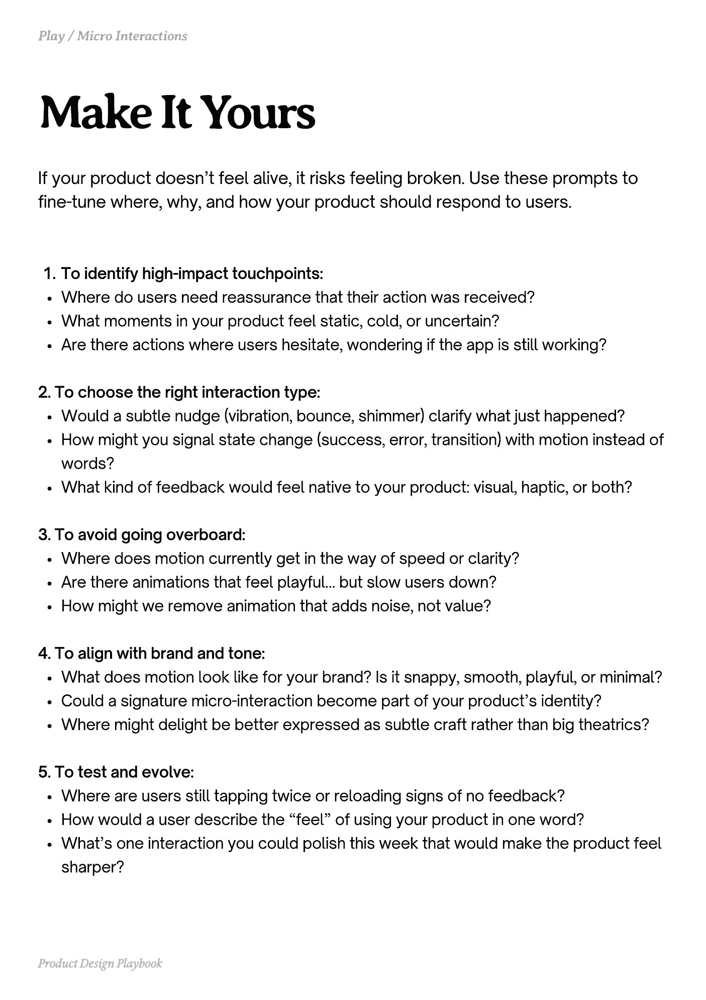
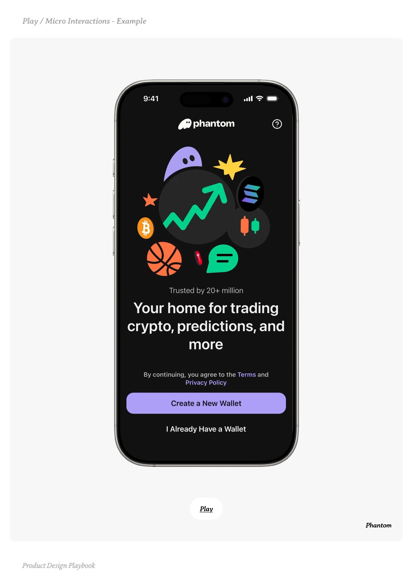
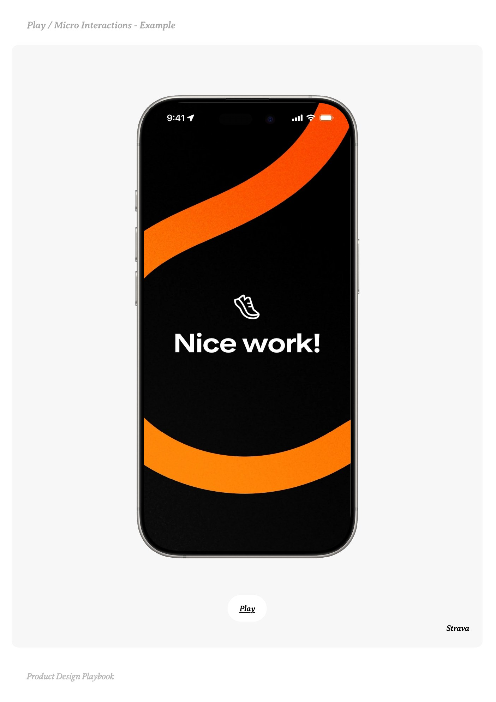
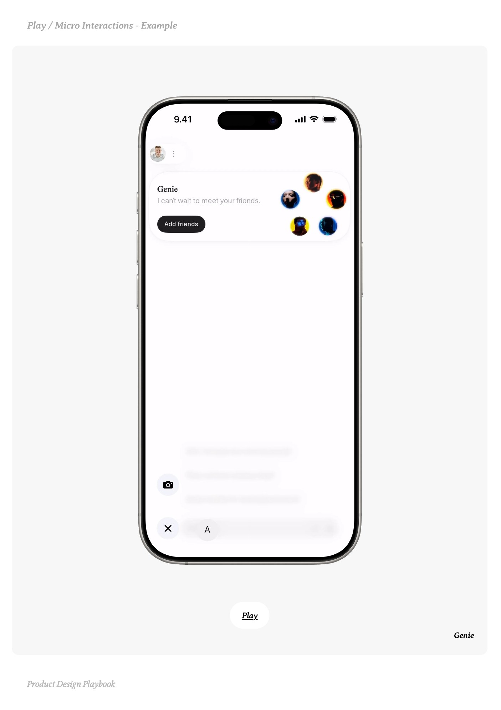

# Micro Interactions


Source-faithful grouping of PDF pages 42 through 46.


## Play overview, PDF page 42

[Open extracted page text](../source/pages/page-042.md) | [Open full-page screenshot](../screenshots/page-042.jpg)



### Extracted text

```text
􀉟

Pla

Subtle feedback loops that make digital products feel tactile and alive.

What it is:

Small, functional animations triggered by user actions. Taps, swipes, hovers, holds, or
transitions that reinforce the cause-and-effect loop of interaction.


Why it works:

They confirm intent, reduce uncertainty, and inject life into the interface. When done
right, they make your product feel responsive, tactile, and thoughtfully built.


When to use it:

On user actions: taps, clicks, drag & drops

During transitions between states or screens

On success, error, or confirmation moments

As ambient feedback during navigation or loading


Do:

Use micro-interactions to confirm the app is responding

Add subtle animation to reinforce feedback loops and user flow

Use haptics sparingly to enhance key moments

Let users toggle haptics in settings for control and accessibility


Don’t:

Over animate basic interactions. Too much movement becomes noise

Use animations that delay the experience or feel gimmicky

Use complex sequences that slow down flow.


Founder Tip:

Small polish often feels premium quality to users but only when used intentionally. If
your product doesn’t feel alive, and responsive, it feels broken.

􀰴 Pair with:

Permission Serve

|

Success Moments

|

Loading Feedback

| Gamified Progress

| Small Quirk
```

## Make it yours prompts, PDF page 43

[Open extracted page text](../source/pages/page-043.md) | [Open full-page screenshot](../screenshots/page-043.jpg)



### Extracted text

```text
If your product doesn’t feel alive, it risks feeling broken. Use these prompts to
fine-tune where, why, and how your product should respond to users.
To identify high-impact touchpoints:

Where do users need reassurance that their action was received?

What moments in your product feel static, cold, or uncertain?

Are there actions where users hesitate, wondering if the app is still working?


2. To choose the right interaction type:

Would a subtle nudge (vibration, bounce, shimmer) clarify what just happened?

How might you signal state change (success, error, transition) with motion instead of
words?

What kind of feedback would feel native to your product: visual, haptic, or both?


3. To avoid going overboard:

Where does motion currently get in the way of speed or clarity?

Are there animations that feel playful… but slow users down?

How might we remove animation that adds noise, not value?


4. To align with brand and tone:

What does motion look like for your brand? Is it snappy, smooth, playful, or minimal?

Could a signature micro-interaction become part of your product’s identity?

Where might delight be better expressed as subtle craft rather than big theatrics?


5. To test and evolve:

Where are users still tapping twice or reloading signs of no feedback?

How would a user describe the “feel” of using your product in one word?

What’s one interaction you could polish this week that would make the product feel
sharper?

Product Design Playbook
```

## Example 1, PDF page 44

[Open extracted page text](../source/pages/page-044.md) | [Open full-page screenshot](../screenshots/page-044.jpg)



### Extracted text

```text
Playontatonaml

Play
Phantom

Product Design Playbook
```

## Example 2, PDF page 45

[Open extracted page text](../source/pages/page-045.md) | [Open full-page screenshot](../screenshots/page-045.jpg)



### Extracted text

```text
Playrtratal

Play
Strava

Product Design Playbook
```

## Example 3, PDF page 46

[Open extracted page text](../source/pages/page-046.md) | [Open full-page screenshot](../screenshots/page-046.jpg)



### Extracted text

```text
Playineainale

Play
Genie

Product Design Playbook
```
