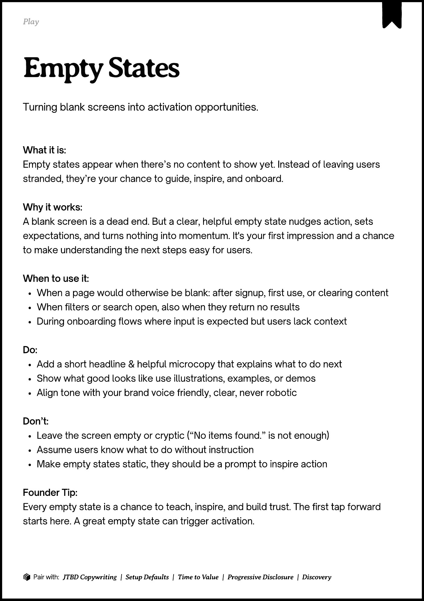
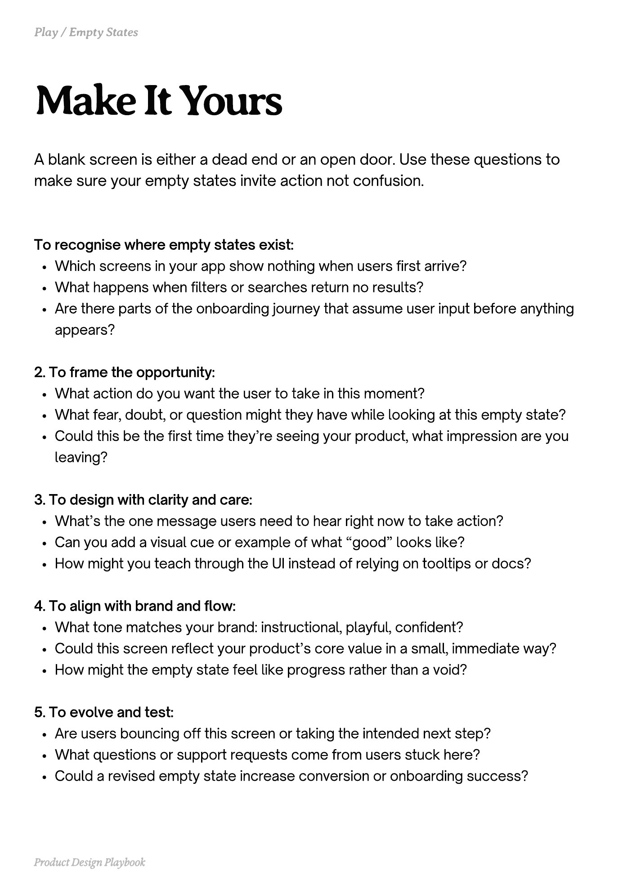
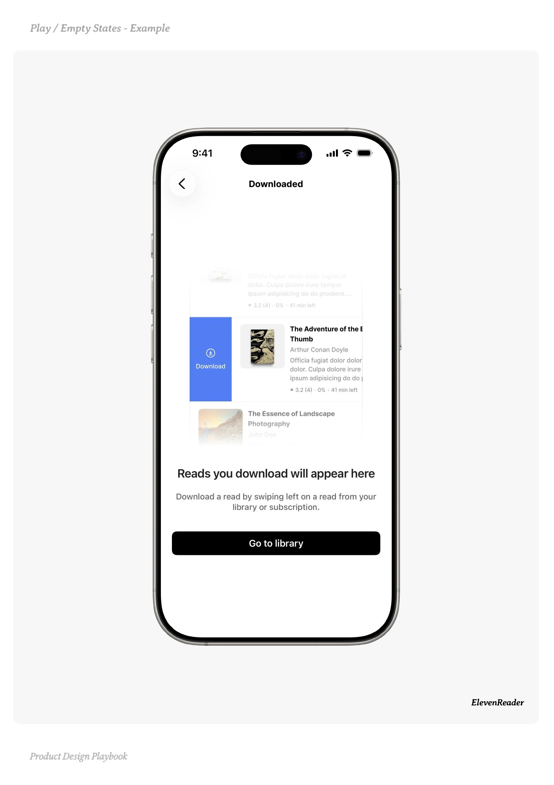
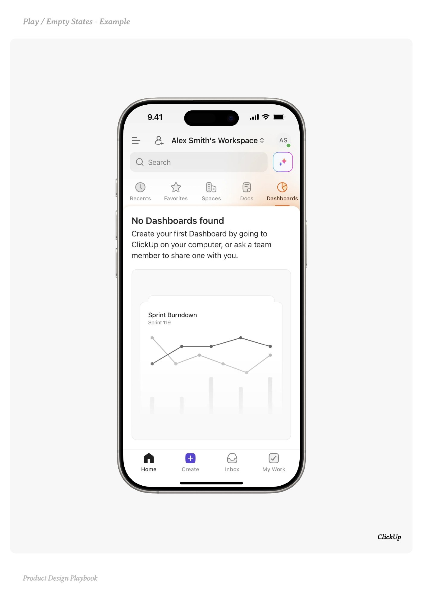
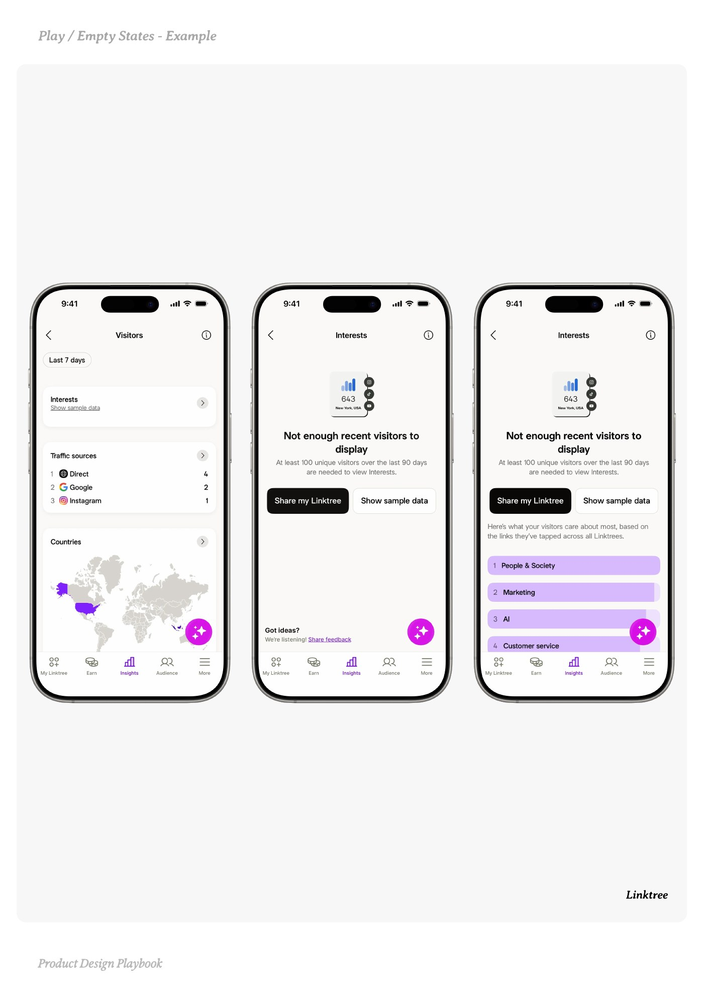

# Empty States


Source-faithful grouping of PDF pages 47 through 51.


## Play overview, PDF page 47

[Open extracted page text](../source/pages/page-047.md) | [Open full-page screenshot](../screenshots/page-047.jpg)



### Extracted text

```text
􀉟

Play

Turning blank screens into activation opportunities.

What it is:

Empty states appear when there’s no content to show yet. Instead of leaving users
stranded, they’re your chance to guide, inspire, and onboard.


Why it works:

A blank screen is a dead end. But a clear, helpful empty state nudges action, sets
expectations, and turns nothing into momentum. It's your first impression and a chance
to make understanding the next steps easy for users.


When to use it:

When a page would otherwise be blank: after signup, first use, or clearing content

When filters or search open, also when they return no results

During onboarding flows where input is expected but users lack context


Do:

Add a short headline & helpful microcopy that explains what to do next

Show what good looks like use illustrations, examples, or demos

Align tone with your brand voice friendly, clear, never robotic


Don’t:

Leave the screen empty or cryptic (“No items found.” is not enough)

Assume users know what to do without instruction

Make empty states static, they should be a prompt to inspire action


Founder Tip:

Every empty state is a chance to teach, inspire, and build trust. The first tap forward
starts here. A great empty state can trigger activation.

􀰴 Pair with:

JTBD Copywriting

| Setup Defaults |

Time to Value

|

Progressive Disclosure

| Discovery
```

## Make it yours prompts, PDF page 48

[Open extracted page text](../source/pages/page-048.md) | [Open full-page screenshot](../screenshots/page-048.jpg)



### Extracted text

```text
A blank screen is either a dead end or an open door. Use these questions to
make sure your empty states invite action not confusion.

To recognise where empty states exist:

Which screens in your app show nothing when users first arrive?

What happens when filters or searches return no results?

Are there parts of the onboarding journey that assume user input before anything
appears?



2. To frame the opportunity:

What action do you want the user to take in this moment?

What fear, doubt, or question might they have while looking at this empty state?

Could this be the first time they’re seeing your product, what impression are you
leaving?



3. To design with clarity and care:

What’s the one message users need to hear right now to take action?

Can you add a visual cue or example of what “good” looks like?

How might you teach through the UI instead of relying on tooltips or docs?



4. To align with brand and flow:

What tone matches your brand: instructional, playful, confident?

Could this screen reflect your product’s core value in a small, immediate way?

How might the empty state feel like progress rather than a void?



5. To evolve and test:

Are users bouncing off this screen or taking the intended next step?

What questions or support requests come from users stuck here?

Could a revised empty state increase conversion or onboarding success?

Product Design Playbook
```

## Example 1, PDF page 49

[Open extracted page text](../source/pages/page-049.md) | [Open full-page screenshot](../screenshots/page-049.jpg)



### Extracted text

```text
laEaeEale

ElevenReader

Product Design Playbook
```

## Example 2, PDF page 50

[Open extracted page text](../source/pages/page-050.md) | [Open full-page screenshot](../screenshots/page-050.jpg)



### Extracted text

```text
lppl

ClickUp

Product Design Playbook
```

## Example 3, PDF page 51

[Open extracted page text](../source/pages/page-051.md) | [Open full-page screenshot](../screenshots/page-051.jpg)



### Extracted text

```text
tttee

Linktree

Product Design Playbook
```
