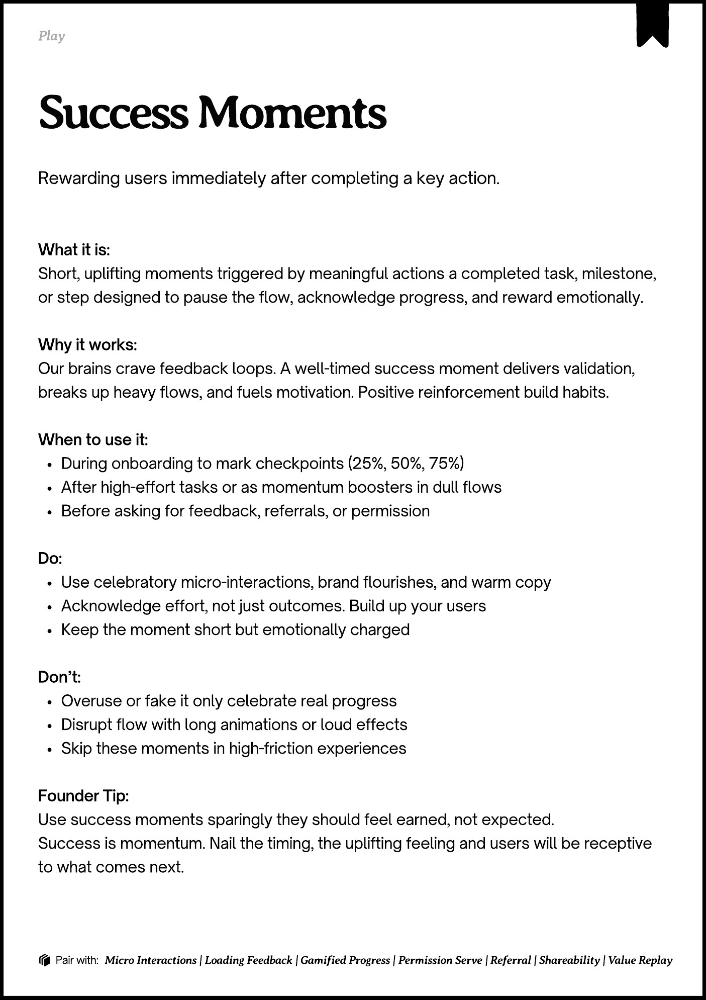
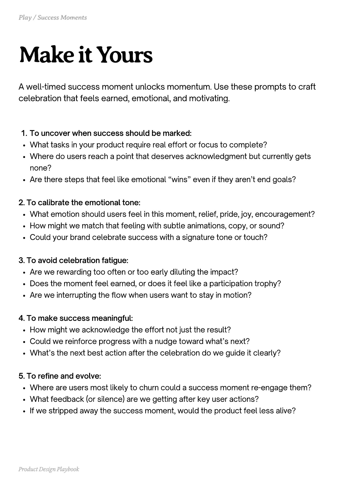
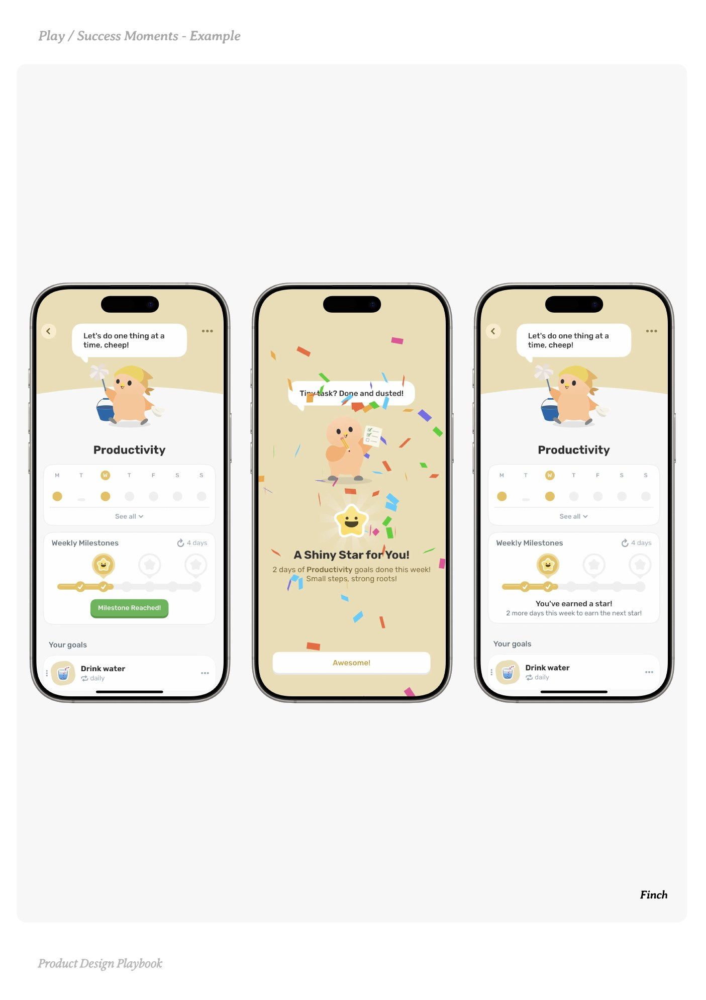
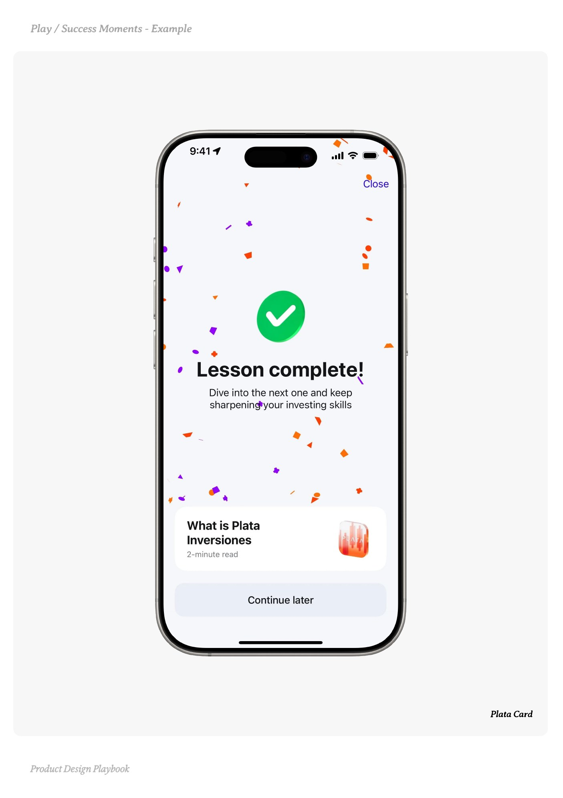
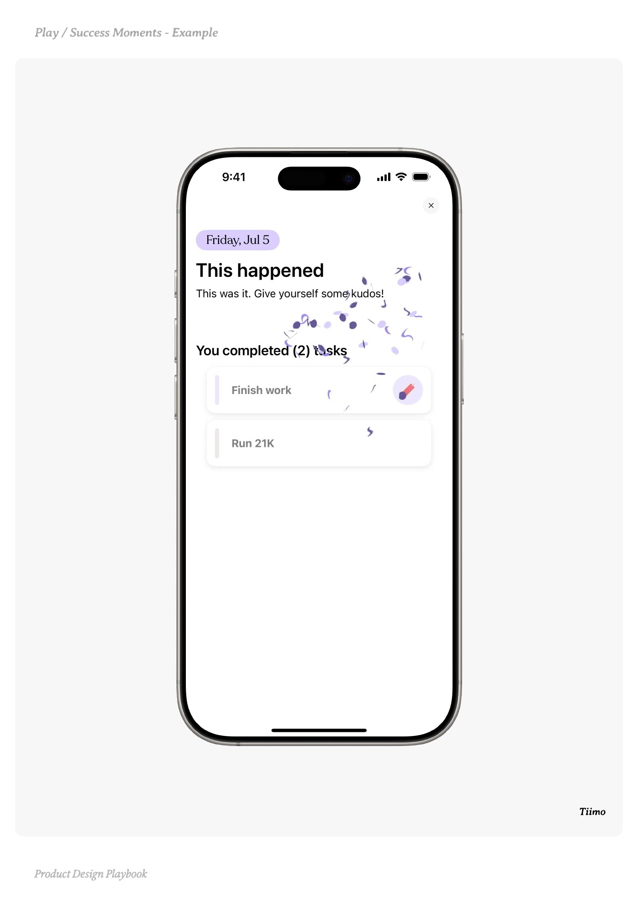

# Success Moments


Source-faithful grouping of PDF pages 52 through 56.


## Play overview, PDF page 52

[Open extracted page text](../source/pages/page-052.md) | [Open full-page screenshot](../screenshots/page-052.jpg)



### Extracted text

```text
􀉟

Play

Rewarding users immediately after completing a key action.

What it is:

Short, uplifting moments triggered by meaningful actions a completed task, milestone,
or step designed to pause the flow, acknowledge progress, and reward emotionally.



Why it works:

Our brains crave feedback loops. A well-timed success moment delivers validation,
breaks up heavy flows, and fuels motivation. Positive reinforcement build habits.


When to use it:

During onboarding to mark checkpoints (25%, 50%, 75%)

After high-effort tasks or as momentum boosters in dull flows

Before asking for feedback, referrals, or permission


Do:

Use celebratory micro-interactions, brand flourishes, and warm copy

Acknowledge effort, not just outcomes. Build up your users 

Keep the moment short but emotionally charged


Don’t:

Overuse or fake it only celebrate real progress

Disrupt flow with long animations or loud effects

Skip these moments in high-friction experiences


Founder Tip:

Use success moments sparingly they should feel earned, not expected.

Success is momentum. Nail the timing, the uplifting feeling and users will be receptive
to what comes next.

􀰴 Pair with:

Micro Interactions | Loading Feedback | Gamified Progress | Permission Serve | Referral | Shareability | Value Replay
```

## Make it yours prompts, PDF page 53

[Open extracted page text](../source/pages/page-053.md) | [Open full-page screenshot](../screenshots/page-053.jpg)



### Extracted text

```text
A well-timed success moment unlocks momentum. Use these prompts to craft
celebration that feels earned, emotional, and motivating.
To uncover when success should be marked:

What tasks in your product require real effort or focus to complete?

Where do users reach a point that deserves acknowledgment but currently gets
none?

Are there steps that feel like emotional “wins” even if they aren’t end goals?


2. To calibrate the emotional tone:

What emotion should users feel in this moment, relief, pride, joy, encouragement?

How might we match that feeling with subtle animations, copy, or sound?

Could your brand celebrate success with a signature tone or touch?


3. To avoid celebration fatigue:

Are we rewarding too often or too early diluting the impact?

Does the moment feel earned, or does it feel like a participation trophy?

Are we interrupting the flow when users want to stay in motion?


4. To make success meaningful:

How might we acknowledge the effort not just the result?

Could we reinforce progress with a nudge toward what’s next?

What’s the next best action after the celebration do we guide it clearly?


5. To refine and evolve:

Where are users most likely to churn could a success moment re-engage them?

What feedback (or silence) are we getting after key user actions?

If we stripped away the success moment, would the product feel less alive?

Product Design Playbook
```

## Example 1, PDF page 54

[Open extracted page text](../source/pages/page-054.md) | [Open full-page screenshot](../screenshots/page-054.jpg)



### Extracted text

```text
ccn

Finch

Product Design Playbook
```

## Example 2, PDF page 55

[Open extracted page text](../source/pages/page-055.md) | [Open full-page screenshot](../screenshots/page-055.jpg)



### Extracted text

```text
Pla t al

Plata Card

Product Design Playbook
```

## Example 3, PDF page 56

[Open extracted page text](../source/pages/page-056.md) | [Open full-page screenshot](../screenshots/page-056.jpg)



### Extracted text

```text
omm

Tiimo

Product Design Playbook
```
