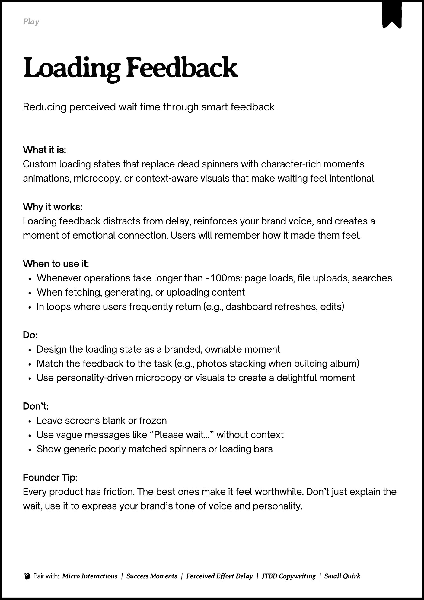
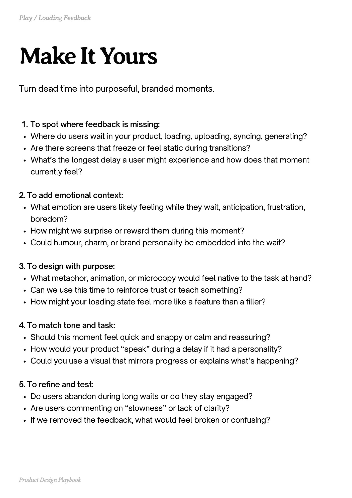
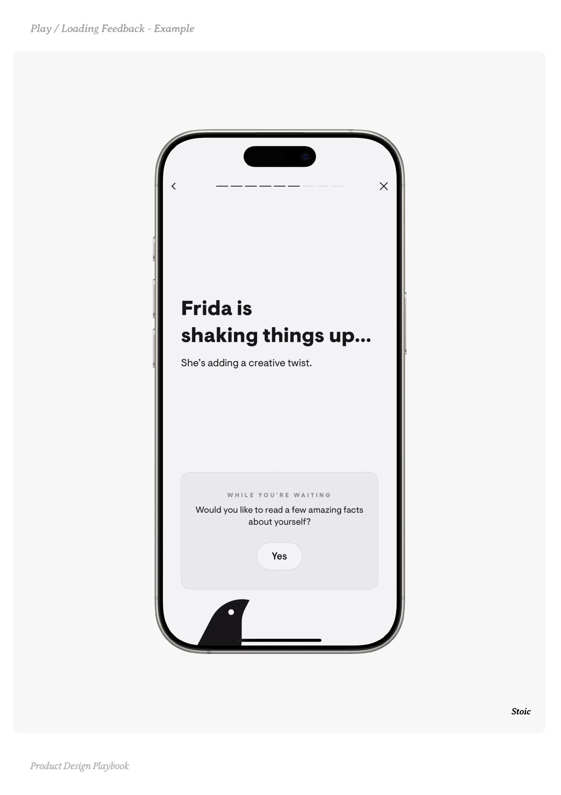
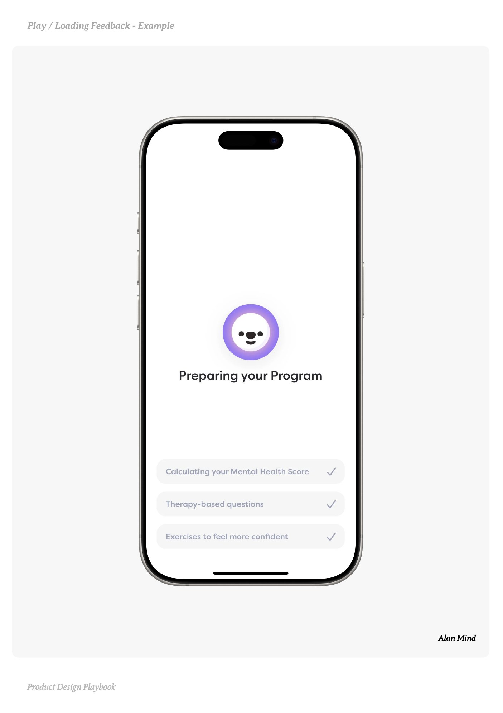
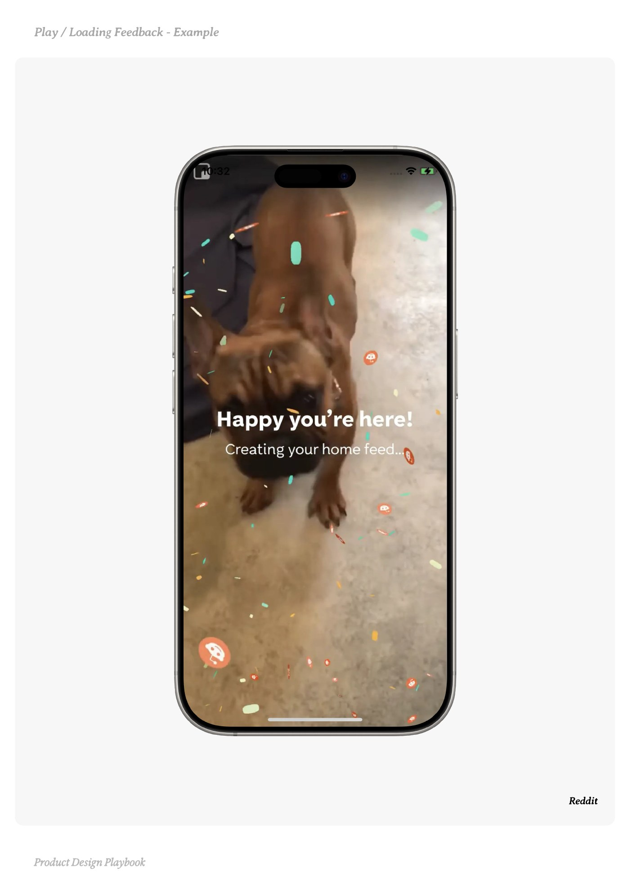

# Loading Feedback


Source-faithful grouping of PDF pages 57 through 61.


## Play overview, PDF page 57

[Open extracted page text](../source/pages/page-057.md) | [Open full-page screenshot](../screenshots/page-057.jpg)



### Extracted text

```text
􀉟

Play

Reducing perceived wait time through smart feedback.

What it is:

Custom loading states that replace dead spinners with character-rich moments
animations, microcopy, or context-aware visuals that make waiting feel intentional.



Why it works:

Loading feedback distracts from delay, reinforces your brand voice, and creates a
moment of emotional connection. Users will remember how it made them feel.


When to use it:

Whenever operations take longer than ~100ms: page loads, file uploads, searches

When fetching, generating, or uploading content

In loops where users frequently return (e.g., dashboard refreshes, edits)


Do:

Design the loading state as a branded, ownable moment

Match the feedback to the task (e.g., photos stacking when building album)

Use personality-driven microcopy or visuals to create a delightful moment


Don’t:

Leave screens blank or frozen

Use vague messages like “Please wait…” without context

Show generic poorly matched spinners or loading bars


Founder Tip:

Every product has friction. The best ones make it feel worthwhile. Don’t just explain the
wait, use it to express your brand’s tone of voice and personality.

􀰴 Pair with: Micro Interactions

|

Success Moments

|

Perceived Effort Delay

|

JTBD Copywriting

| Small Quirk
```

## Make it yours prompts, PDF page 58

[Open extracted page text](../source/pages/page-058.md) | [Open full-page screenshot](../screenshots/page-058.jpg)



### Extracted text

```text
Turn dead time into purposeful, branded moments.

To spot where feedback is missing:

Where do users wait in your product, loading, uploading, syncing, generating?

Are there screens that freeze or feel static during transitions?

What’s the longest delay a user might experience and how does that moment
currently feel?



2. To add emotional context:

What emotion are users likely feeling while they wait, anticipation, frustration,
boredom?

How might we surprise or reward them during this moment?

Could humour, charm, or brand personality be embedded into the wait?



3. To design with purpose:

What metaphor, animation, or microcopy would feel native to the task at hand?

Can we use this time to reinforce trust or teach something?

How might your loading state feel more like a feature than a filler?



4. To match tone and task:

Should this moment feel quick and snappy or calm and reassuring?

How would your product “speak” during a delay if it had a personality?

Could you use a visual that mirrors progress or explains what’s happening?



5. To refine and test:

Do users abandon during long waits or do they stay engaged?

Are users commenting on “slowness” or lack of clarity?

If we removed the feedback, what would feel broken or confusing?

Product Design Playbook
```

## Example 1, PDF page 59

[Open extracted page text](../source/pages/page-059.md) | [Open full-page screenshot](../screenshots/page-059.jpg)



### Extracted text

```text
oic

Stoic

Product Design Playbook
```

## Example 2, PDF page 60

[Open extracted page text](../source/pages/page-060.md) | [Open full-page screenshot](../screenshots/page-060.jpg)



### Extracted text

```text
la adin da al

Alan Mind

Product Design Playbook
```

## Example 3, PDF page 61

[Open extracted page text](../source/pages/page-061.md) | [Open full-page screenshot](../screenshots/page-061.jpg)



### Extracted text

```text
dieede

Reddit

Product Design Playbook
```
