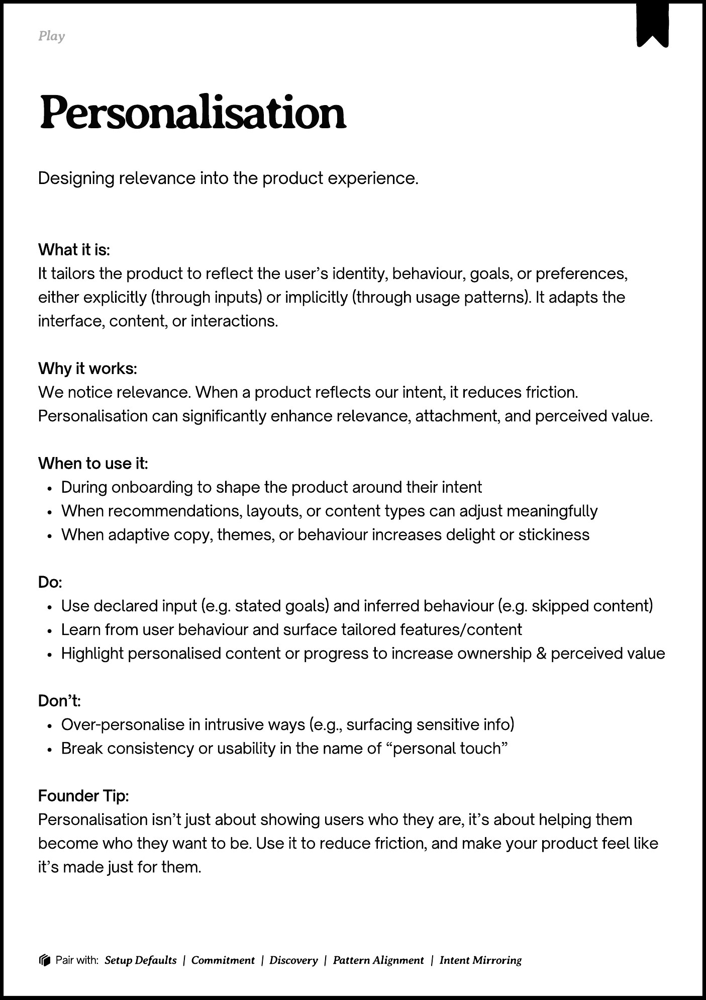
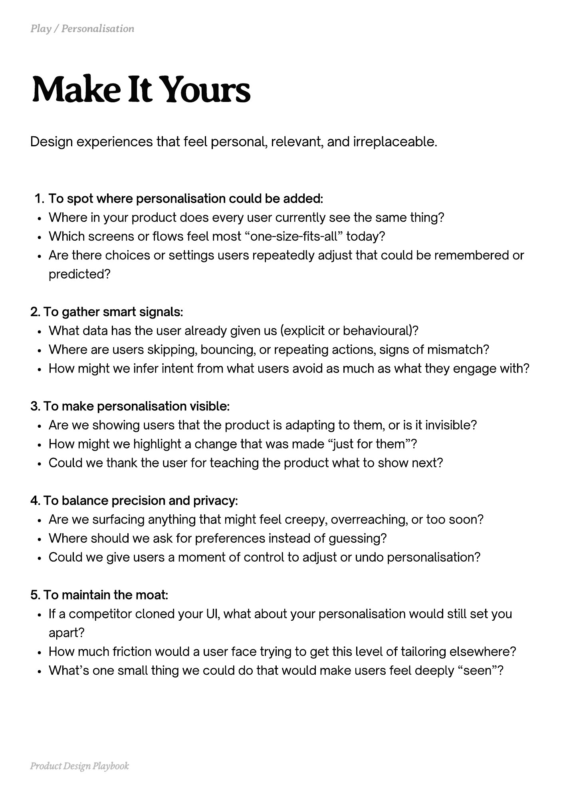
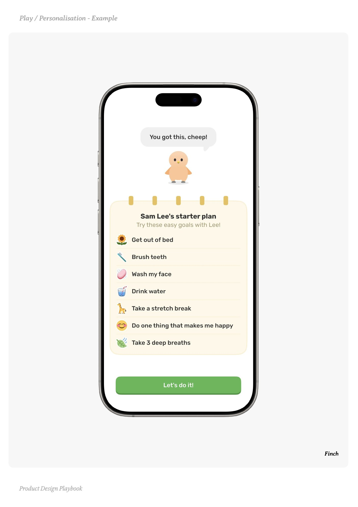
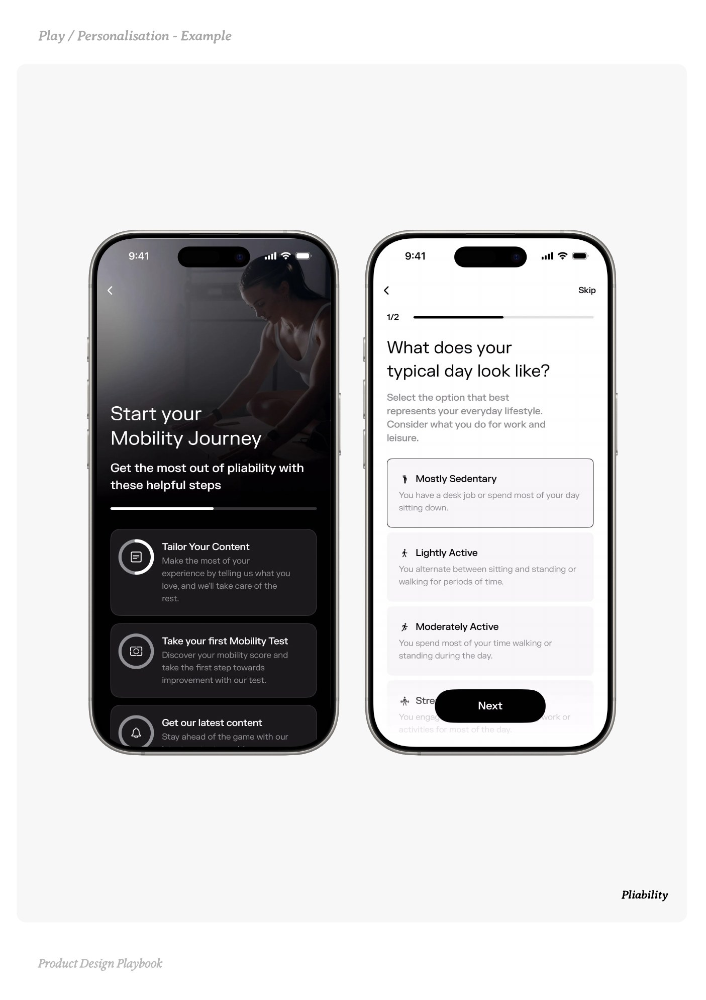
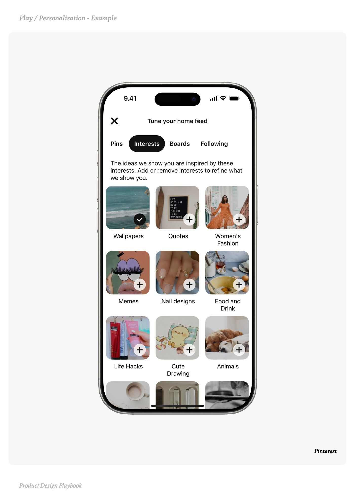

# Personalisation


Source-faithful grouping of PDF pages 62 through 66.


## Play overview, PDF page 62

[Open extracted page text](../source/pages/page-062.md) | [Open full-page screenshot](../screenshots/page-062.jpg)



### Extracted text

```text
􀉟

Play

Designing relevance into the product experience.

What it is:

It tailors the product to reflect the user’s identity, behaviour, goals, or preferences,
either explicitly (through inputs) or implicitly (through usage patterns). It adapts the
interface, content, or interactions.


Why it works:

We notice relevance. When a product reflects our intent, it reduces friction.
Personalisation can significantly enhance relevance, attachment, and perceived value.



When to use it:

During onboarding to shape the product around their intent

When recommendations, layouts, or content types can adjust meaningfully

When adaptive copy, themes, or behaviour increases delight or stickiness


Do:

Use declared input (e.g. stated goals) and inferred behaviour (e.g. skipped content)

Learn from user behaviour and surface tailored features/content

Highlight personalised content or progress to increase ownership & perceived value


Don’t:

Over-personalise in intrusive ways (e.g., surfacing sensitive info)

Break consistency or usability in the name of “personal touch”


Founder Tip:

Personalisation isn’t just about showing users who they are, it’s about helping them
become who they want to be. Use it to reduce friction, and make your product feel like
it’s made just for them.

􀰴 Pair with:

Setup Defaults | Commitment | Discovery |

Pattern Alignment

|

Intent Mirroring
```

## Make it yours prompts, PDF page 63

[Open extracted page text](../source/pages/page-063.md) | [Open full-page screenshot](../screenshots/page-063.jpg)



### Extracted text

```text
Design experiences that feel personal, relevant, and irreplaceable.

To spot where personalisation could be added:

Where in your product does every user currently see the same thing?

Which screens or flows feel most “one-size-fits-all” today?

Are there choices or settings users repeatedly adjust that could be remembered or
predicted?



2. To gather smart signals:

What data has the user already given us (explicit or behavioural)?

Where are users skipping, bouncing, or repeating actions, signs of mismatch?

How might we infer intent from what users avoid as much as what they engage with?



3. To make personalisation visible:

Are we showing users that the product is adapting to them, or is it invisible?

How might we highlight a change that was made “just for them”?

Could we thank the user for teaching the product what to show next?



4. To balance precision and privacy:

Are we surfacing anything that might feel creepy, overreaching, or too soon?

Where should we ask for preferences instead of guessing?

Could we give users a moment of control to adjust or undo personalisation?



5. To maintain the moat:

If a competitor cloned your UI, what about your personalisation would still set you
apart?

How much friction would a user face trying to get this level of tailoring elsewhere?

What’s one small thing we could do that would make users feel deeply “seen”?

Product Design Playbook
```

## Example 1, PDF page 64

[Open extracted page text](../source/pages/page-064.md) | [Open full-page screenshot](../screenshots/page-064.jpg)



### Extracted text

```text
niin

Finch

Product Design Playbook
```

## Example 2, PDF page 65

[Open extracted page text](../source/pages/page-065.md) | [Open full-page screenshot](../screenshots/page-065.jpg)



### Extracted text

```text
PlayPaliatial

Pliability

Product Design Playbook
```

## Example 3, PDF page 66

[Open extracted page text](../source/pages/page-066.md) | [Open full-page screenshot](../screenshots/page-066.jpg)



### Extracted text

```text
PPersnistine

Pinterest

Product Design Playbook
```
