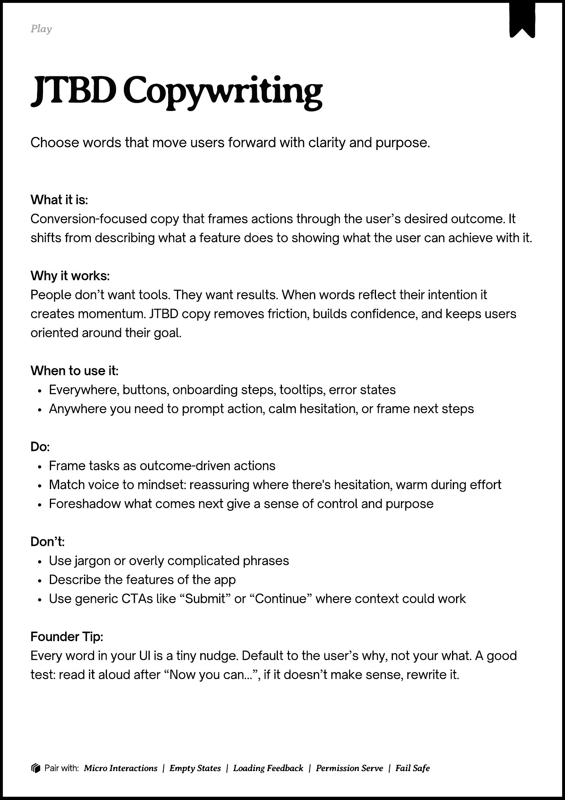
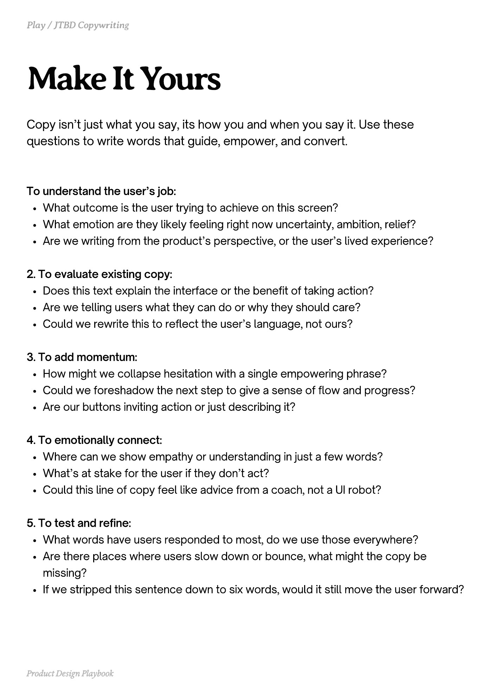
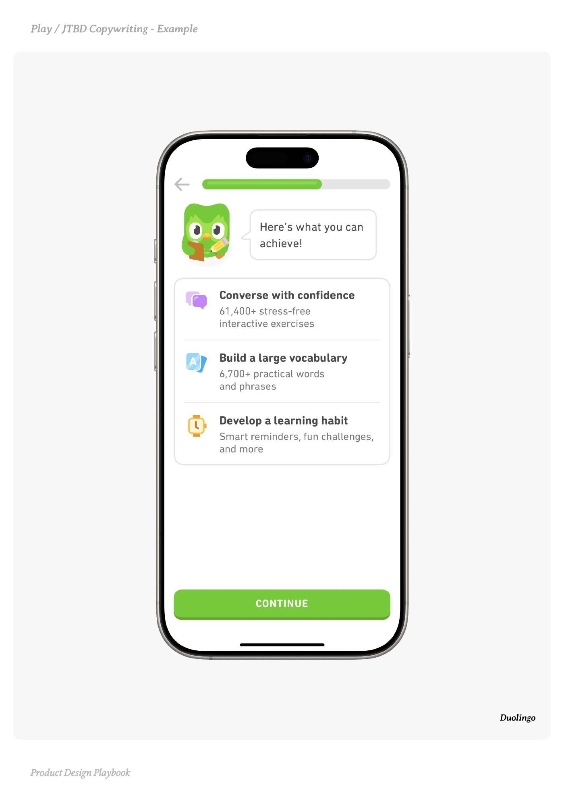
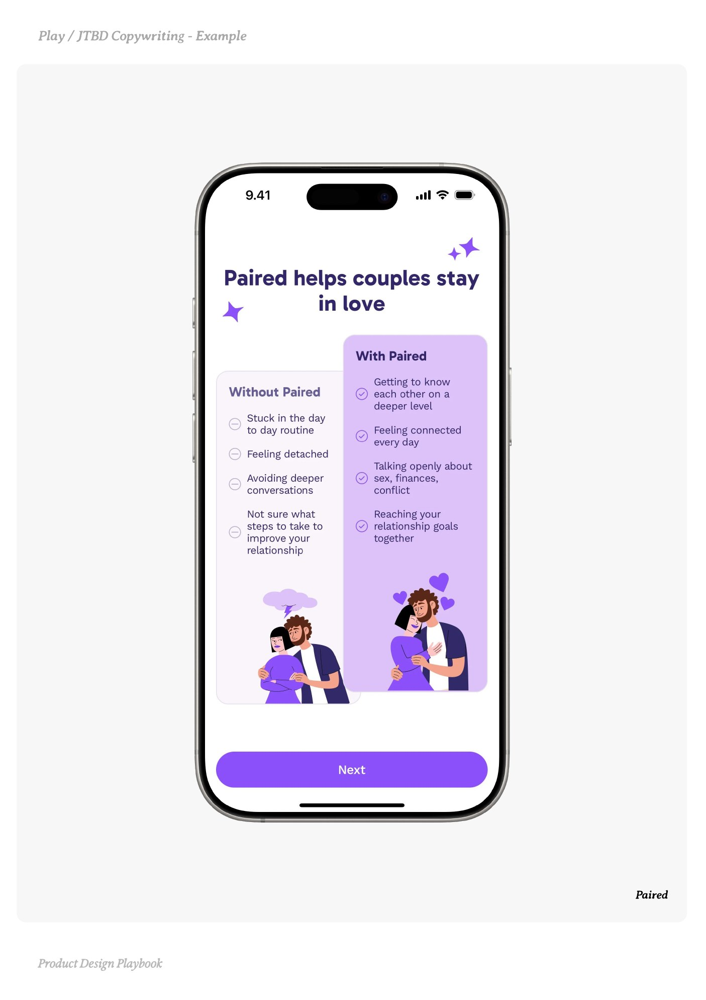
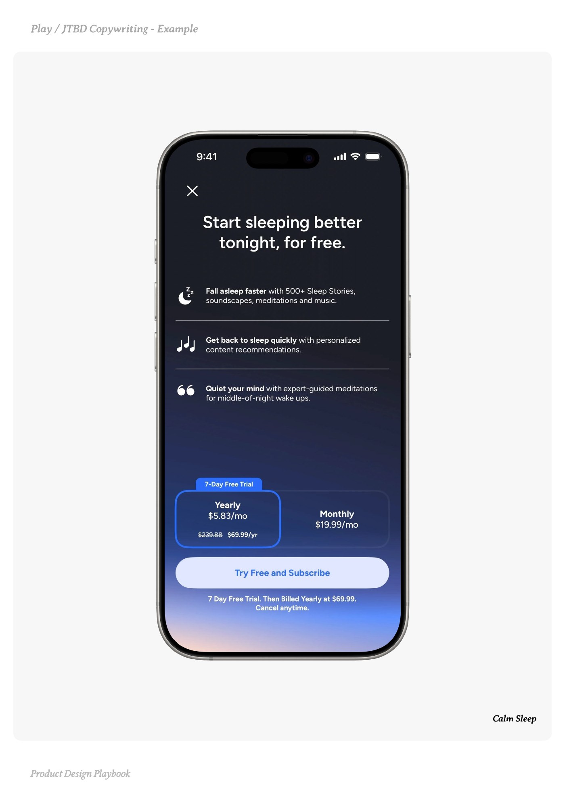

# JTBD Copywriting


Source-faithful grouping of PDF pages 67 through 71.


## Play overview, PDF page 67

[Open extracted page text](../source/pages/page-067.md) | [Open full-page screenshot](../screenshots/page-067.jpg)



### Extracted text

```text
􀉟

Play

Choose words that move users forward with clarity and purpose.

What it is:

Conversion-focused copy that frames actions through the user’s desired outcome. It
shifts from describing what a feature does to showing what the user can achieve with it.


Why it works:

People don’t want tools. They want results. When words reflect their intention it
creates momentum. JTBD copy removes friction, builds confidence, and keeps users
oriented around their goal.


When to use it:

Everywhere, buttons, onboarding steps, tooltips, error states

Anywhere you need to prompt action, calm hesitation, or frame next steps


Do:

Frame tasks as outcome-driven actions

Match voice to mindset: reassuring where there's hesitation, warm during effort

Foreshadow what comes next give a sense of control and purpose


Don’t:

Use jargon or overly complicated phrases

Describe the features of the app

Use generic CTAs like “Submit” or “Continue” where context could work


Founder Tip:

Every word in your UI is a tiny nudge. Default to the user’s why, not your what. A good
test: read it aloud after “Now you can…”, if it doesn’t make sense, rewrite it.

􀰴 Pair with:

Micro Interactions

|

Empty States

|

Loading Feedback

|

Permission Serve

|

Fail Safe
```

## Make it yours prompts, PDF page 68

[Open extracted page text](../source/pages/page-068.md) | [Open full-page screenshot](../screenshots/page-068.jpg)



### Extracted text

```text
Copy isn’t just what you say, its how you and when you say it. Use these
questions to write words that guide, empower, and convert.

To understand the user’s job:

What outcome is the user trying to achieve on this screen?

What emotion are they likely feeling right now uncertainty, ambition, relief?

Are we writing from the product’s perspective, or the user’s lived experience?


2. To evaluate existing copy:

Does this text explain the interface or the benefit of taking action?

Are we telling users what they can do or why they should care?

Could we rewrite this to reflect the user’s language, not ours?


3. To add momentum:

How might we collapse hesitation with a single empowering phrase?

Could we foreshadow the next step to give a sense of flow and progress?

Are our buttons inviting action or just describing it?


4. To emotionally connect:

Where can we show empathy or understanding in just a few words?

What’s at stake for the user if they don’t act?

Could this line of copy feel like advice from a coach, not a UI robot?


5. To test and refine:

What words have users responded to most, do we use those everywhere?

Are there places where users slow down or bounce, what might the copy be
missing?

If we stripped this sentence down to six words, would it still move the user forward?

Product Design Playbook
```

## Example 1, PDF page 69

[Open extracted page text](../source/pages/page-069.md) | [Open full-page screenshot](../screenshots/page-069.jpg)



### Extracted text

```text
lDoiingl

Duolingo

Product Design Playbook
```

## Example 2, PDF page 70

[Open extracted page text](../source/pages/page-070.md) | [Open full-page screenshot](../screenshots/page-070.jpg)



### Extracted text

```text
Pariiae

Paired

Product Design Playbook
```

## Example 3, PDF page 71

[Open extracted page text](../source/pages/page-071.md) | [Open full-page screenshot](../screenshots/page-071.jpg)



### Extracted text

```text
la Cp ample

Calm Sleep

Product Design Playbook
```
