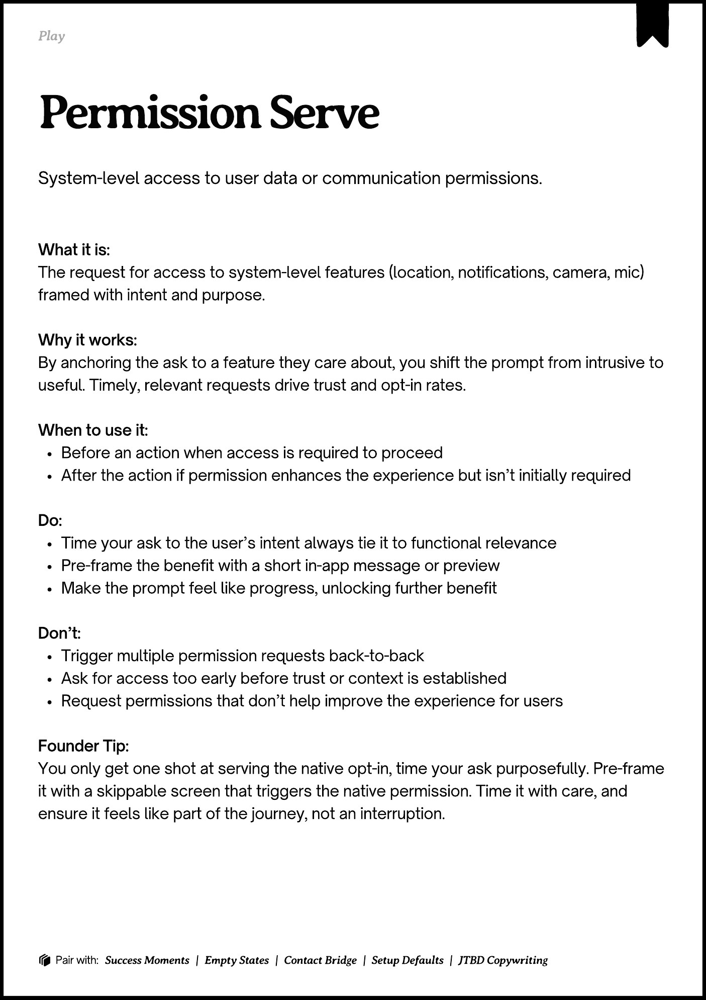
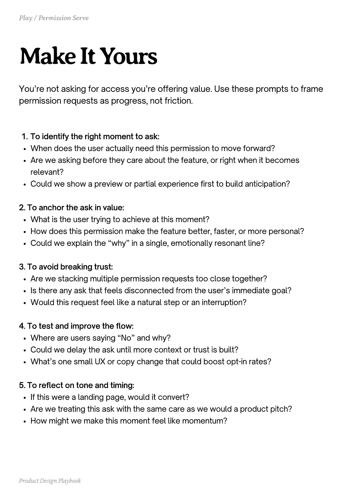
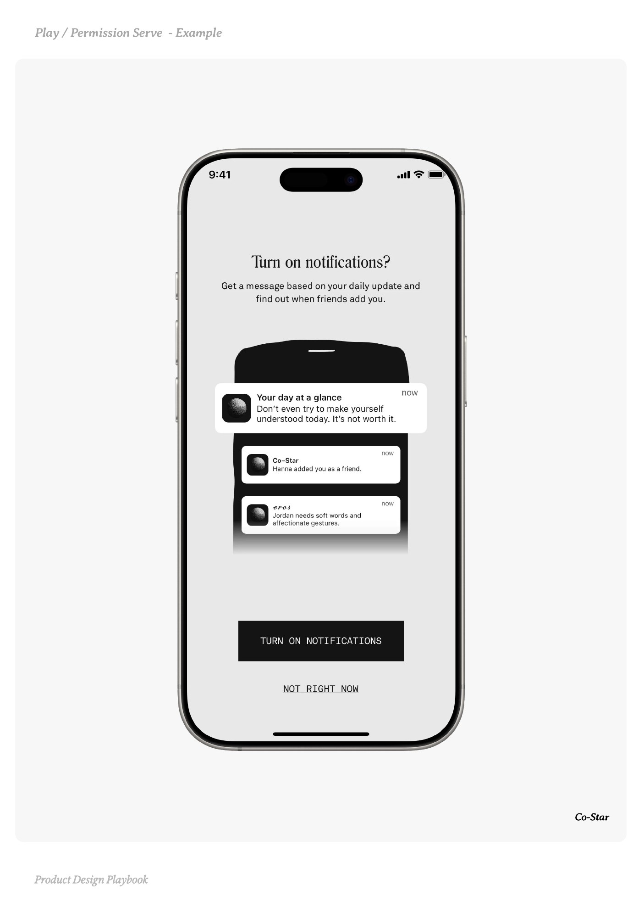
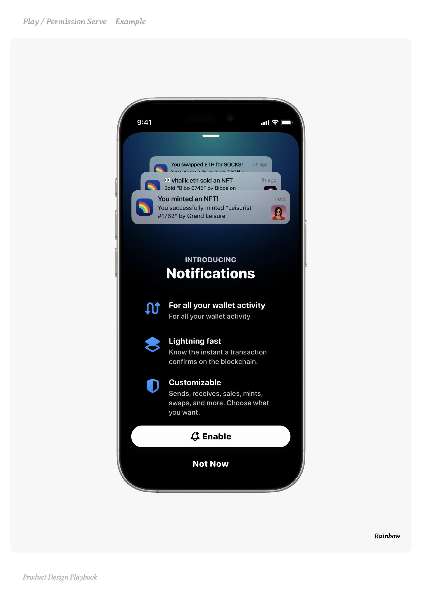
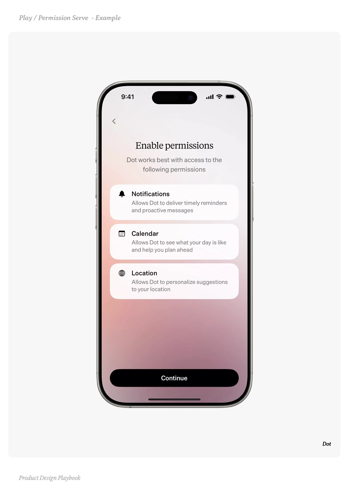

# Permission Serve


Source-faithful grouping of PDF pages 72 through 76.


## Play overview, PDF page 72

[Open extracted page text](../source/pages/page-072.md) | [Open full-page screenshot](../screenshots/page-072.jpg)



### Extracted text

```text
􀉟

lay

System-level access to user data or communication permissions.

What it is:

The request for access to system-level features (location, notifications, camera, mic)
framed with intent and purpose.


Why it works:

By anchoring the ask to a feature they care about, you shift the prompt from intrusive to
useful. Timely, relevant requests drive trust and opt-in rates.


When to use it:

Before an action when access is required to proceed

After the action if permission enhances the experience but isn’t initially required


Do:

Time your ask to the user’s intent always tie it to functional relevance

Pre-frame the benefit with a short in-app message or preview

Make the prompt feel like progress, unlocking further benefit


Don’t:

Trigger multiple permission requests back-to-back

Ask for access too early before trust or context is established

Request permissions that don’t help improve the experience for users 


Founder Tip:

You only get one shot at serving the native opt-in, time your ask purposefully. Pre-frame
it with a skippable screen that triggers the native permission. Time it with care, and
ensure it feels like part of the journey, not an interruption.

􀰴 Pair with: Success Moments | Empty States | Contact Bridge | Setup Defaults | JTBD Copywriting
```

## Make it yours prompts, PDF page 73

[Open extracted page text](../source/pages/page-073.md) | [Open full-page screenshot](../screenshots/page-073.jpg)



### Extracted text

```text
You’re not asking for access you’re offering value. Use these prompts to frame
permission requests as progress, not friction.

To identify the right moment to ask:

When does the user actually need this permission to move forward?

Are we asking before they care about the feature, or right when it becomes
relevant?

Could we show a preview or partial experience first to build anticipation?



2. To anchor the ask in value:

What is the user trying to achieve at this moment?

How does this permission make the feature better, faster, or more personal?

Could we explain the “why” in a single, emotionally resonant line?



3. To avoid breaking trust:

Are we stacking multiple permission requests too close together?

Is there any ask that feels disconnected from the user’s immediate goal?

Would this request feel like a natural step or an interruption?



4. To test and improve the flow:

Where are users saying “No” and why?

Could we delay the ask until more context or trust is built?

What’s one small UX or copy change that could boost opt-in rates?



5. To reflect on tone and timing:

If this were a landing page, would it convert?

Are we treating this ask with the same care as we would a product pitch?

How might we make this moment feel like momentum?

Product Design Playbook
```

## Example 1, PDF page 74

[Open extracted page text](../source/pages/page-074.md) | [Open full-page screenshot](../screenshots/page-074.jpg)



### Extracted text

```text
aroSr-a

Co-Star

Product Design Playbook
```

## Example 2, PDF page 75

[Open extracted page text](../source/pages/page-075.md) | [Open full-page screenshot](../screenshots/page-075.jpg)



### Extracted text

```text
aiiona

Rainbow

Product Design Playbook
```

## Example 3, PDF page 76

[Open extracted page text](../source/pages/page-076.md) | [Open full-page screenshot](../screenshots/page-076.jpg)



### Extracted text

```text
o

Dot

Product Design Playbook
```
