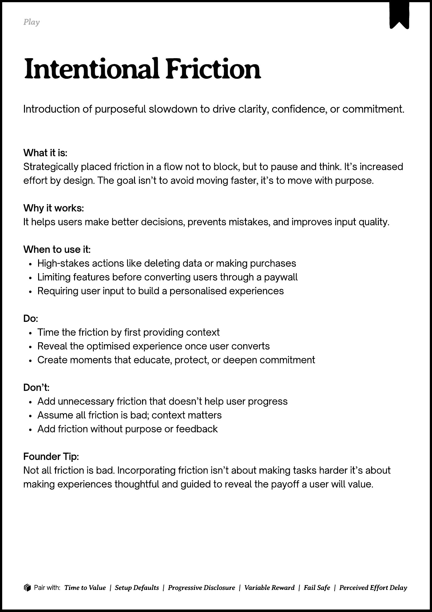
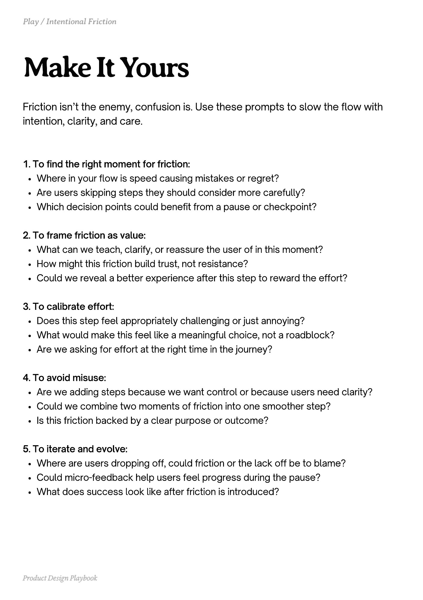
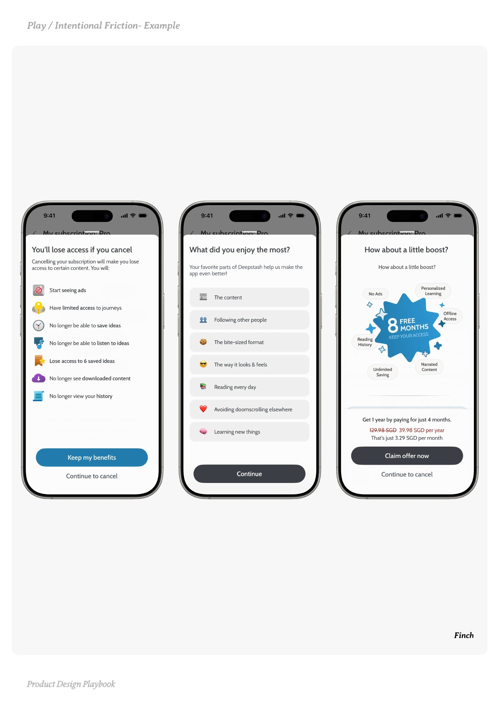
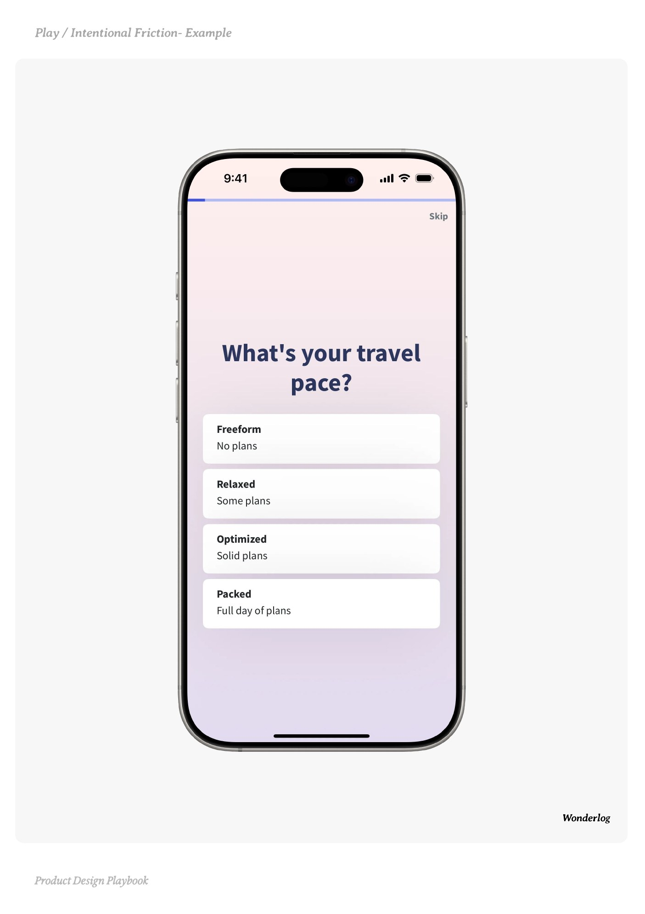
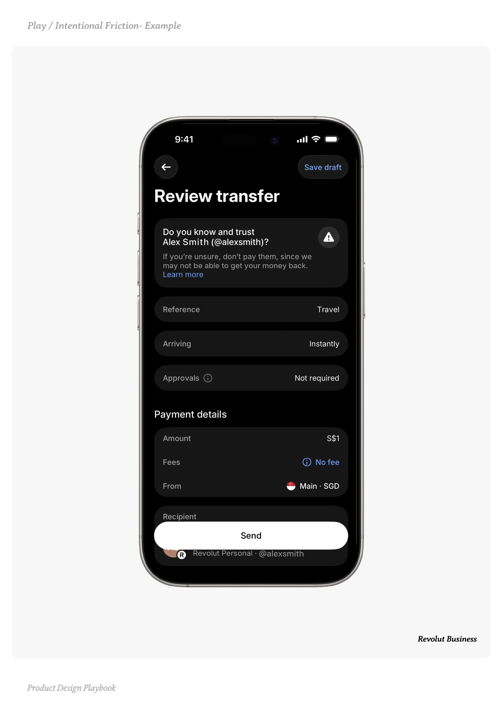

# Intentional Friction


Source-faithful grouping of PDF pages 77 through 81.


## Play overview, PDF page 77

[Open extracted page text](../source/pages/page-077.md) | [Open full-page screenshot](../screenshots/page-077.jpg)



### Extracted text

```text
􀉟

Play

Introduction of purposeful slowdown to drive clarity, confidence, or commitment.

What it is:

Strategically placed friction in a flow not to block, but to pause and think. It’s increased
effort by design. The goal isn’t to avoid moving faster, it’s to move with purpose.


Why it works:

It helps users make better decisions, prevents mistakes, and improves input quality.


When to use it:

High-stakes actions like deleting data or making purchases

Limiting features before converting users through a paywall

Requiring user input to build a personalised experiences


Do:

Time the friction by first providing context

Reveal the optimised experience once user converts

Create moments that educate, protect, or deepen commitment


Don’t:

Add unnecessary friction that doesn’t help user progress

Assume all friction is bad; context matters

Add friction without purpose or feedback


Founder Tip:

Not all friction is bad. Incorporating friction isn’t about making tasks harder it’s about
making experiences thoughtful and guided to reveal the payoff a user will value.

􀰴 Pair with:

Time to Value

| Setup Defaults |

Progressive Disclosure

|

Variable Reward

|

Fail Safe

|

Perceived Effort Delay
```

## Make it yours prompts, PDF page 78

[Open extracted page text](../source/pages/page-078.md) | [Open full-page screenshot](../screenshots/page-078.jpg)



### Extracted text

```text
Friction isn’t the enemy, confusion is. Use these prompts to slow the flow with
intention, clarity, and care.
1. To find the right moment for friction:

Where in your flow is speed causing mistakes or regret?

Are users skipping steps they should consider more carefully?

Which decision points could benefit from a pause or checkpoint?


2. To frame friction as value:

What can we teach, clarify, or reassure the user of in this moment?

How might this friction build trust, not resistance?

Could we reveal a better experience after this step to reward the effort?


3. To calibrate effort:

Does this step feel appropriately challenging or just annoying?

What would make this feel like a meaningful choice, not a roadblock?

Are we asking for effort at the right time in the journey?


4. To avoid misuse:

Are we adding steps because we want control or because users need clarity?

Could we combine two moments of friction into one smoother step?

Is this friction backed by a clear purpose or outcome?


5. To iterate and evolve:

Where are users dropping off, could friction or the lack off be to blame?

Could micro-feedback help users feel progress during the pause?

What does success look like after friction is introduced?

Product Design Playbook
```

## Example 1, PDF page 79

[Open extracted page text](../source/pages/page-079.md) | [Open full-page screenshot](../screenshots/page-079.jpg)



### Extracted text

```text
nninFicin

Finch

Product Design Playbook
```

## Example 2, PDF page 80

[Open extracted page text](../source/pages/page-080.md) | [Open full-page screenshot](../screenshots/page-080.jpg)



### Extracted text

```text
lnenonlronle

Wonderlog

Product Design Playbook
```

## Example 3, PDF page 81

[Open extracted page text](../source/pages/page-081.md) | [Open full-page screenshot](../screenshots/page-081.jpg)



### Extracted text

```text
l ntentionl ition le

Revolut Business

Product Design Playbook
```
