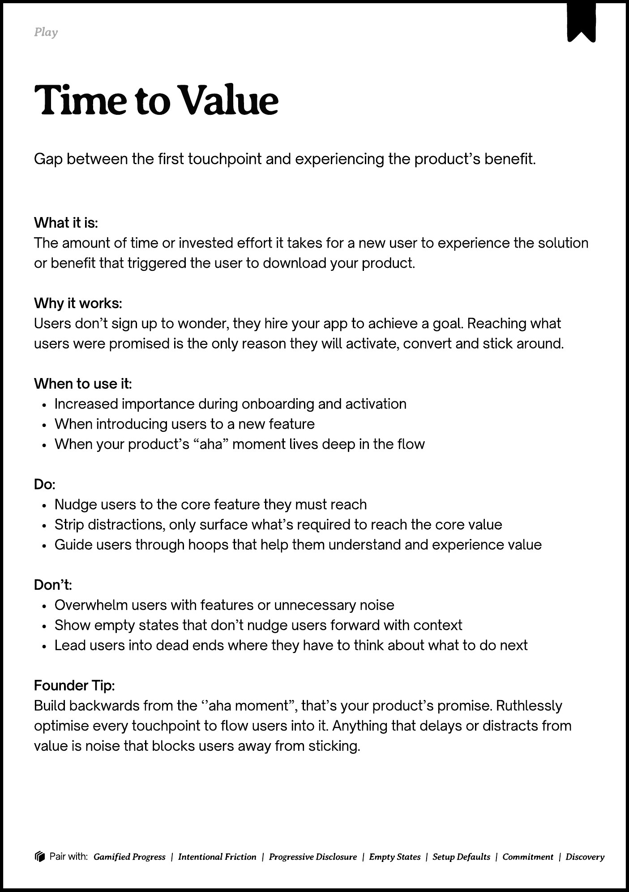
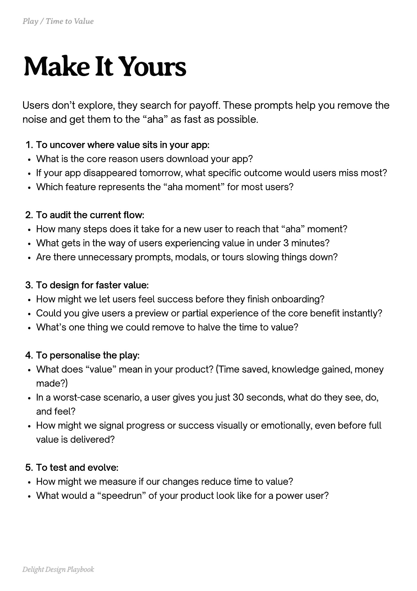
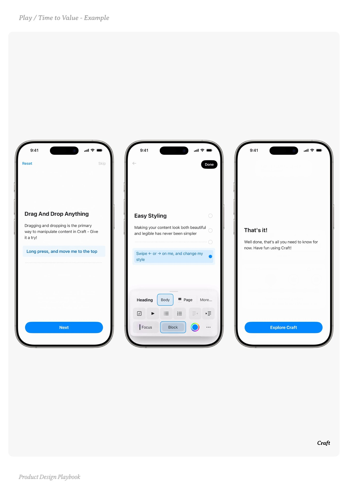
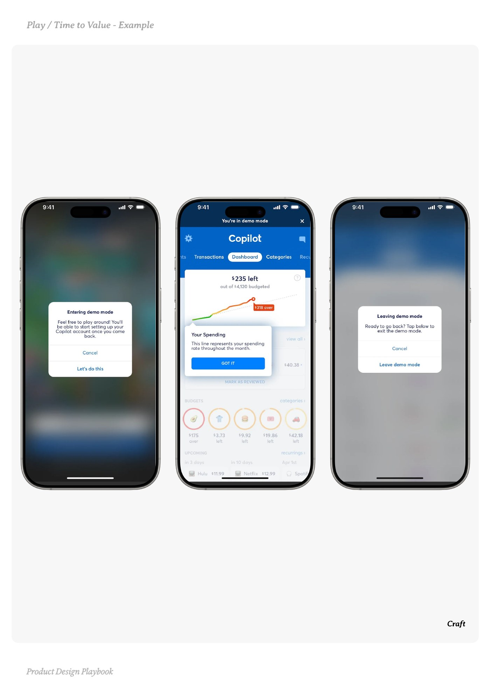
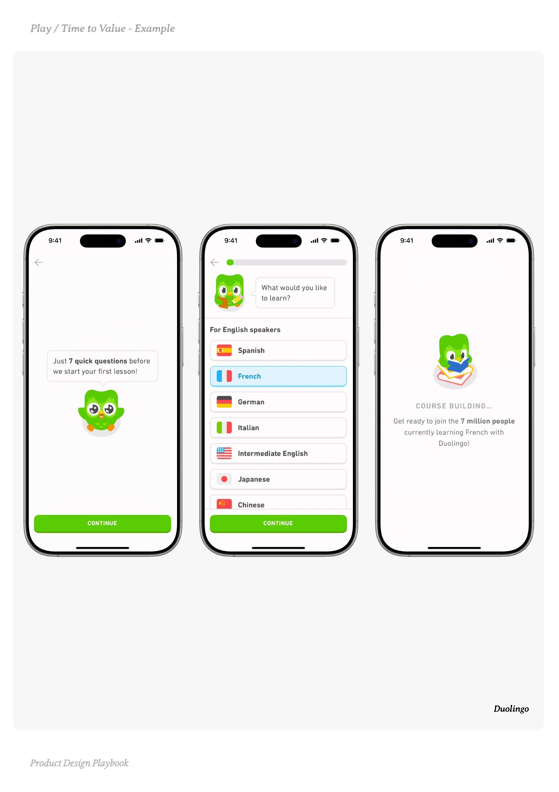

# Time to Value


Source-faithful grouping of PDF pages 82 through 86.


## Play overview, PDF page 82

[Open extracted page text](../source/pages/page-082.md) | [Open full-page screenshot](../screenshots/page-082.jpg)



### Extracted text

```text
􀉟

Play

Gap between the first touchpoint and experiencing the product’s benefit.

What it is:

The amount of time or invested effort it takes for a new user to experience the solution
or benefit that triggered the user to download your product.


Why it works:

Users don’t sign up to wonder, they hire your app to achieve a goal. Reaching what
users were promised is the only reason they will activate, convert and stick around.


When to use it:

Increased importance during onboarding and activation

When introducing users to a new feature

When your product’s “aha” moment lives deep in the flow


Do:

Nudge users to the core feature they must reach

Strip distractions, only surface what’s required to reach the core value

Guide users through hoops that help them understand and experience value


Don’t:

Overwhelm users with features or unnecessary noise

Show empty states that don’t nudge users forward with context

Lead users into dead ends where they have to think about what to do next


Founder Tip:

Build backwards from the ‘’aha moment”, that’s your product’s promise. Ruthlessly
optimise every touchpoint to flow users into it. Anything that delays or distracts from
value is noise that blocks users away from sticking.

􀰴 Pair with:

Gamified Progress

|

Intentional Friction

|

Progressive Disclosure

|

Empty States

|

Setup Defaults

|

Commitment

|

Discovery
```

## Make it yours prompts, PDF page 83

[Open extracted page text](../source/pages/page-083.md) | [Open full-page screenshot](../screenshots/page-083.jpg)



### Extracted text

```text
Users don’t explore, they search for payoff. These prompts help you remove the
noise and get them to the “aha” as fast as possible.
To uncover where value sits in your app:

What is the core reason users download your app?

If your app disappeared tomorrow, what specific outcome would users miss most?

Which feature represents the “aha moment” for most users?


To audit the current flow:

How many steps does it take for a new user to reach that “aha” moment?

What gets in the way of users experiencing value in under 3 minutes?

Are there unnecessary prompts, modals, or tours slowing things down?


To design for faster value:

How might we let users feel success before they finish onboarding?

Could you give users a preview or partial experience of the core benefit instantly?

What’s one thing we could remove to halve the time to value?


To personalise the play:

What does “value” mean in your product? (Time saved, knowledge gained, money
made?)

In a worst-case scenario, a user gives you just 30 seconds, what do they see, do,
and feel?

How might we signal progress or success visually or emotionally, even before full
value is delivered?


To test and evolve:

How might we measure if our changes reduce time to value?

What would a “speedrun” of your product look like for a power user?

Delight Design Playbook
```

## Example 1, PDF page 84

[Open extracted page text](../source/pages/page-084.md) | [Open full-page screenshot](../screenshots/page-084.jpg)



### Extracted text

```text
ataa

Craft

Product Design Playbook
```

## Example 2, PDF page 85

[Open extracted page text](../source/pages/page-085.md) | [Open full-page screenshot](../screenshots/page-085.jpg)



### Extracted text

```text
ataa

Craft

Product Design Playbook
```

## Example 3, PDF page 86

[Open extracted page text](../source/pages/page-086.md) | [Open full-page screenshot](../screenshots/page-086.jpg)



### Extracted text

```text
liolul

Duolingo

Product Design Playbook
```
