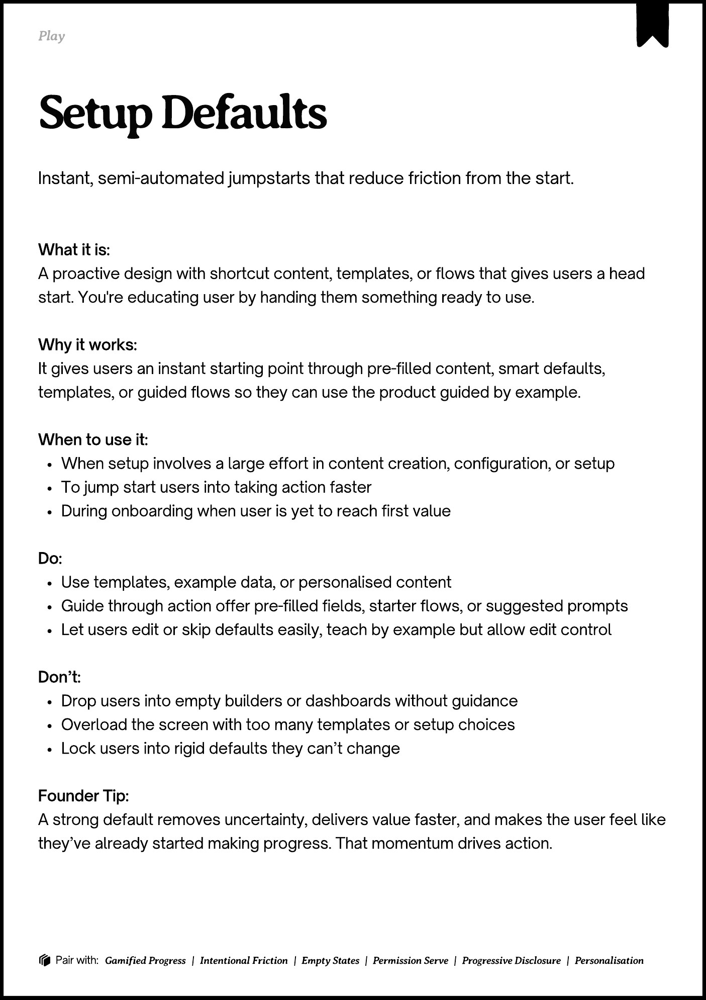
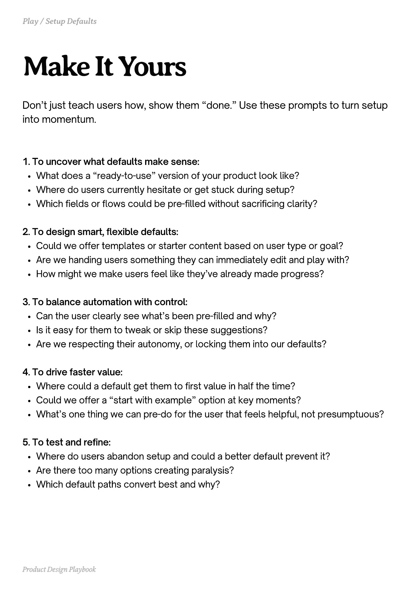
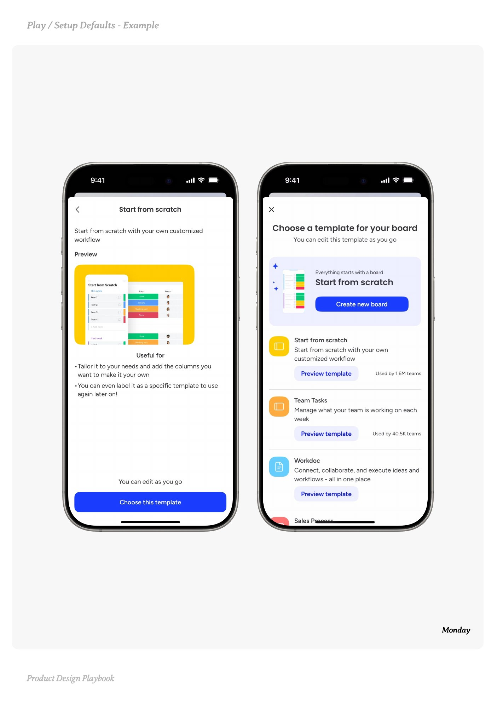
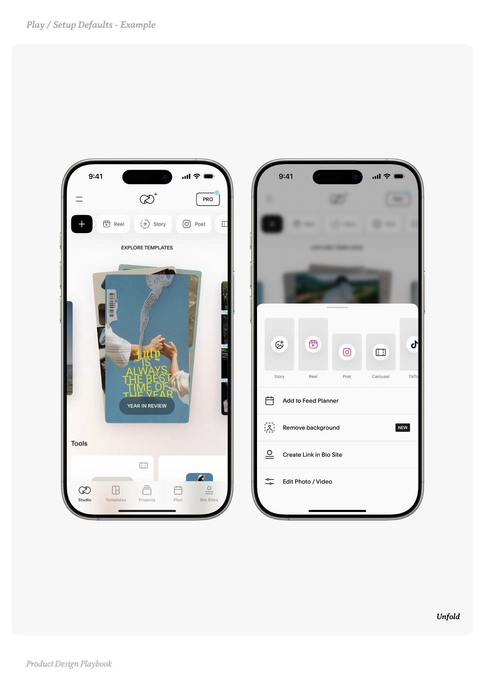
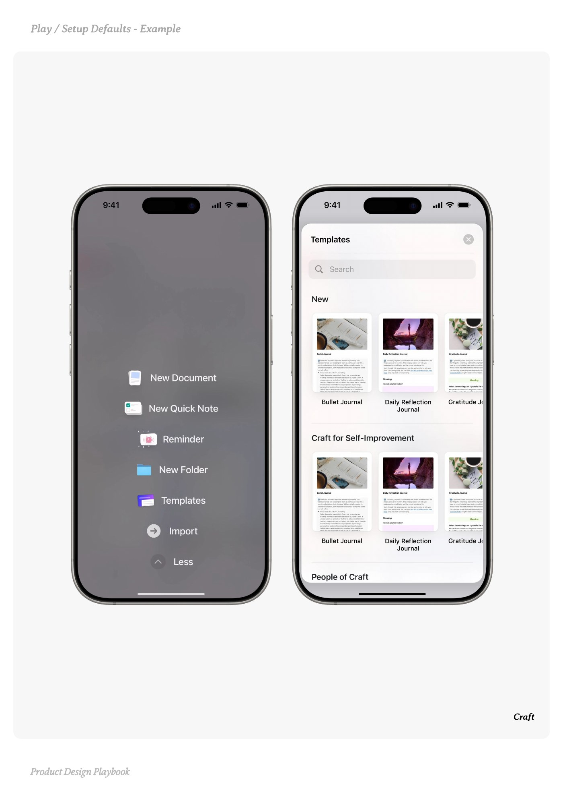

# Setup Defaults


Source-faithful grouping of PDF pages 87 through 91.


## Play overview, PDF page 87

[Open extracted page text](../source/pages/page-087.md) | [Open full-page screenshot](../screenshots/page-087.jpg)



### Extracted text

```text
Play

􀉟

Instant, semi-automated jumpstarts that reduce friction from the start.

What it is:

A proactive design with shortcut content, templates, or flows that gives users a head
start. You're educating user by handing them something ready to use.


Why it works:

It gives users an instant starting point through pre-filled content, smart defaults,
templates, or guided flows so they can use the product guided by example.


When to use it:

When setup involves a large effort in content creation, configuration, or setup

To jump start users into taking action faster

During onboarding when user is yet to reach first value


Do:

Use templates, example data, or personalised content

Guide through action offer pre-filled fields, starter flows, or suggested prompts

Let users edit or skip defaults easily, teach by example but allow edit control


Don’t:

Drop users into empty builders or dashboards without guidance

Overload the screen with too many templates or setup choices

Lock users into rigid defaults they can’t change


Founder Tip:

A strong default removes uncertainty, delivers value faster, and makes the user feel like
they’ve already started making progress. That momentum drives action.

􀰴 Pair with: Gamified Progress | Intentional Friction | Empty States | Permission Serve | Progressive Disclosure | Personalisation
```

## Make it yours prompts, PDF page 88

[Open extracted page text](../source/pages/page-088.md) | [Open full-page screenshot](../screenshots/page-088.jpg)



### Extracted text

```text
Don’t just teach users how, show them “done.” Use these prompts to turn setup
into momentum.

1. To uncover what defaults make sense:

What does a “ready-to-use” version of your product look like?

Where do users currently hesitate or get stuck during setup?

Which fields or flows could be pre-filled without sacrificing clarity?



2. To design smart, flexible defaults:

Could we offer templates or starter content based on user type or goal?

Are we handing users something they can immediately edit and play with?

How might we make users feel like they’ve already made progress?



3. To balance automation with control:

Can the user clearly see what’s been pre-filled and why?

Is it easy for them to tweak or skip these suggestions?

Are we respecting their autonomy, or locking them into our defaults?



4. To drive faster value:

Where could a default get them to first value in half the time?

Could we offer a “start with example” option at key moments?

What’s one thing we can pre-do for the user that feels helpful, not presumptuous?



5. To test and refine:

Where do users abandon setup and could a better default prevent it?

Are there too many options creating paralysis?

Which default paths convert best and why?

Product Design Playbook
```

## Example 1, PDF page 89

[Open extracted page text](../source/pages/page-089.md) | [Open full-page screenshot](../screenshots/page-089.jpg)



### Extracted text

```text
ayaa

Monday

Product Design Playbook
```

## Example 2, PDF page 90

[Open extracted page text](../source/pages/page-090.md) | [Open full-page screenshot](../screenshots/page-090.jpg)



### Extracted text

```text
lfll

Unfold

Product Design Playbook
```

## Example 3, PDF page 91

[Open extracted page text](../source/pages/page-091.md) | [Open full-page screenshot](../screenshots/page-091.jpg)



### Extracted text

```text
atfata

Craft

Product Design Playbook
```
