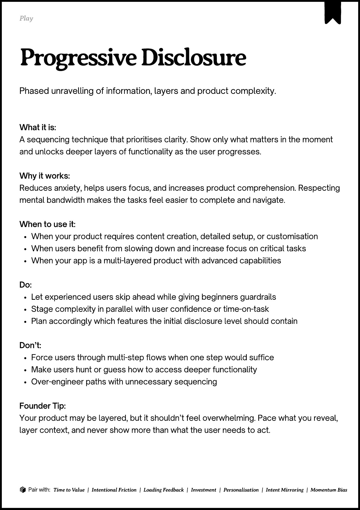
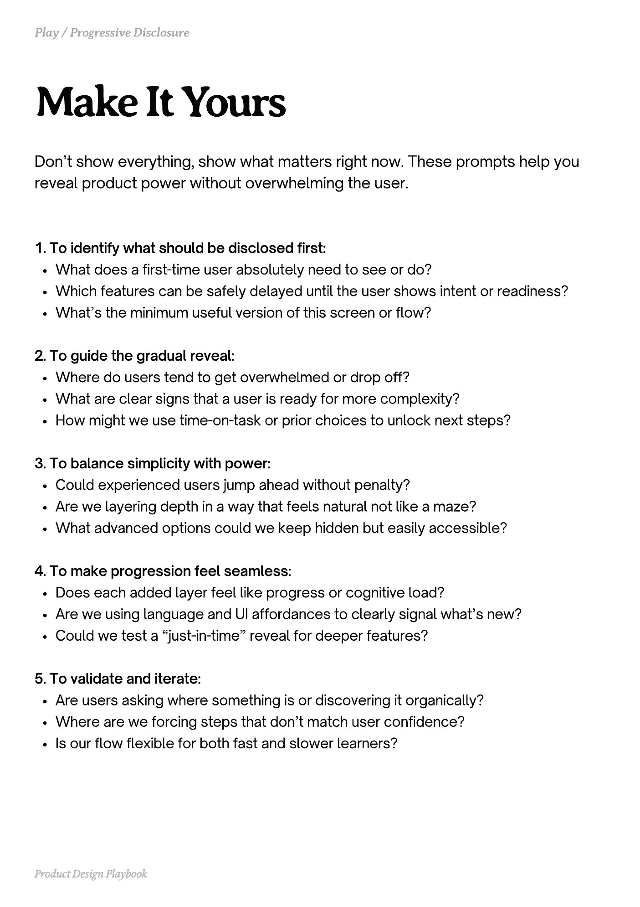
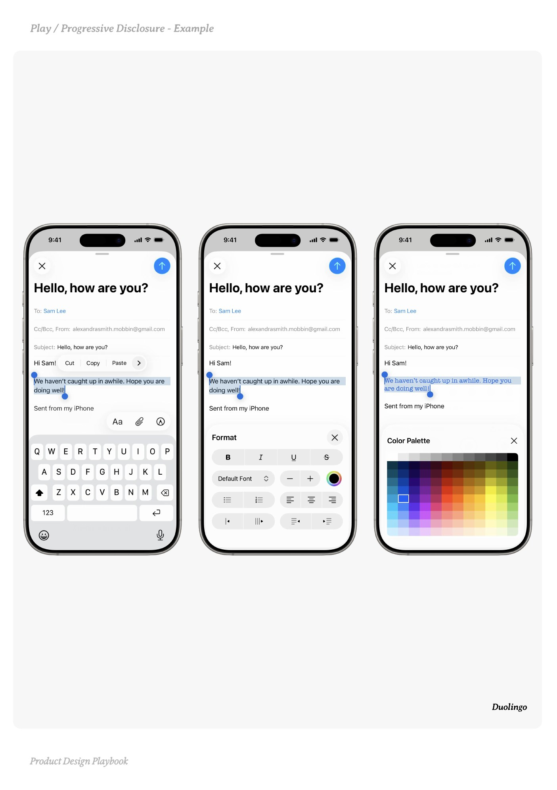
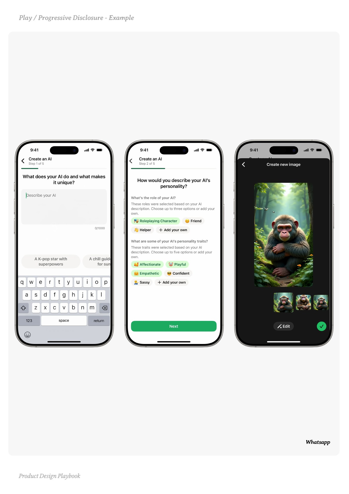
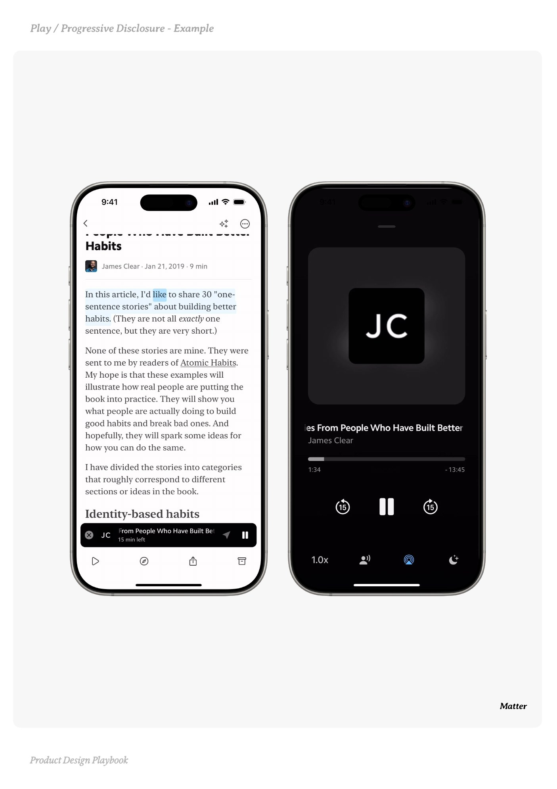

# Progressive Disclosure


Source-faithful grouping of PDF pages 92 through 96.


## Play overview, PDF page 92

[Open extracted page text](../source/pages/page-092.md) | [Open full-page screenshot](../screenshots/page-092.jpg)



### Extracted text

```text
􀉟

Pla

Phased unravelling of information, layers and product complexity.

What it is:

A sequencing technique that prioritises clarity. Show only what matters in the moment
and unlocks deeper layers of functionality as the user progresses.


Why it works:

Reduces anxiety, helps users focus, and increases product comprehension. Respecting
mental bandwidth makes the tasks feel easier to complete and navigate.


When to use it:

When your product requires content creation, detailed setup, or customisation

When users benefit from slowing down and increase focus on critical tasks

When your app is a multi-layered product with advanced capabilities


Do:

Let experienced users skip ahead while giving beginners guardrails

Stage complexity in parallel with user confidence or time-on-task

Plan accordingly which features the initial disclosure level should contain


Don’t:

Force users through multi-step flows when one step would suffice

Make users hunt or guess how to access deeper functionality

Over-engineer paths with unnecessary sequencing


Founder Tip:

Your product may be layered, but it shouldn’t feel overwhelming. Pace what you reveal,
layer context, and never show more than what the user needs to act.

􀰴 Pair with:

Time to Value

|

Intentional Friction

|

Loading Feedback

|

Investment

|

Personalisation

|

Intent Mirroring

|

Momentum Bias
```

## Make it yours prompts, PDF page 93

[Open extracted page text](../source/pages/page-093.md) | [Open full-page screenshot](../screenshots/page-093.jpg)



### Extracted text

```text
Don’t show everything, show what matters right now. These prompts help you
reveal product power without overwhelming the user.
1. To identify what should be disclosed first:

What does a first-time user absolutely need to see or do?

Which features can be safely delayed until the user shows intent or readiness?

What’s the minimum useful version of this screen or flow?


2. To guide the gradual reveal:

Where do users tend to get overwhelmed or drop off?

What are clear signs that a user is ready for more complexity?

How might we use time-on-task or prior choices to unlock next steps?


3. To balance simplicity with power:

Could experienced users jump ahead without penalty?

Are we layering depth in a way that feels natural not like a maze?

What advanced options could we keep hidden but easily accessible?


4. To make progression feel seamless:

Does each added layer feel like progress or cognitive load?

Are we using language and UI affordances to clearly signal what’s new?

Could we test a “just-in-time” reveal for deeper features?


5. To validate and iterate:

Are users asking where something is or discovering it organically?

Where are we forcing steps that don’t match user confidence?

Is our flow flexible for both fast and slower learners?

Product Design Playbook
```

## Example 1, PDF page 94

[Open extracted page text](../source/pages/page-094.md) | [Open full-page screenshot](../screenshots/page-094.jpg)



### Extracted text

```text
logiDiloul

Duolingo

Product Design Playbook
```

## Example 2, PDF page 95

[Open extracted page text](../source/pages/page-095.md) | [Open full-page screenshot](../screenshots/page-095.jpg)



### Extracted text

```text
assssap

Whatsapp

Product Design Playbook
```

## Example 3, PDF page 96

[Open extracted page text](../source/pages/page-096.md) | [Open full-page screenshot](../screenshots/page-096.jpg)



### Extracted text

```text
arreereae

Matter

Product Design Playbook
```
