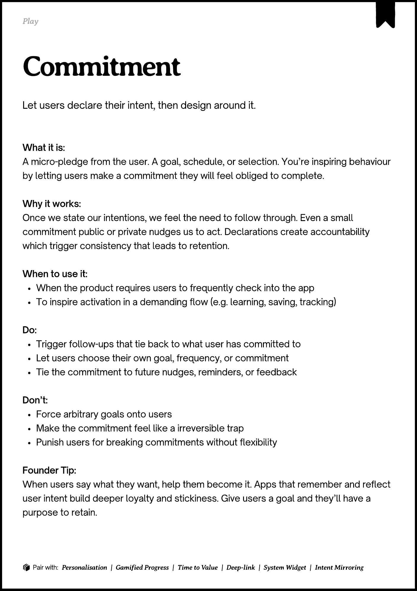
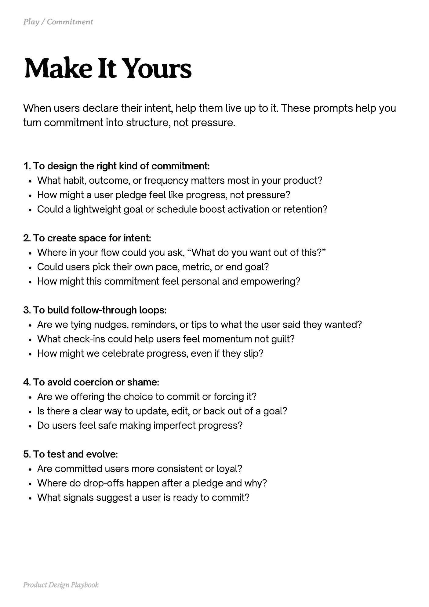
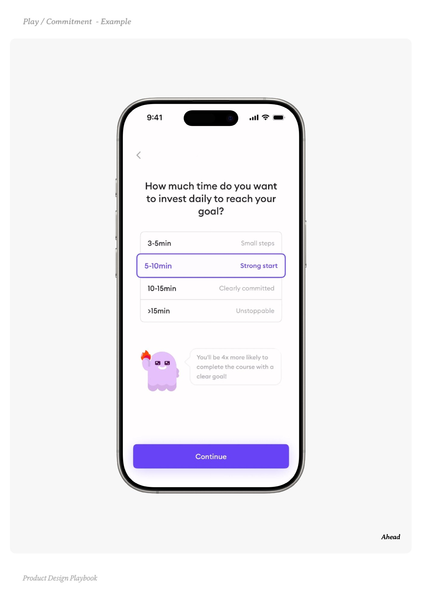
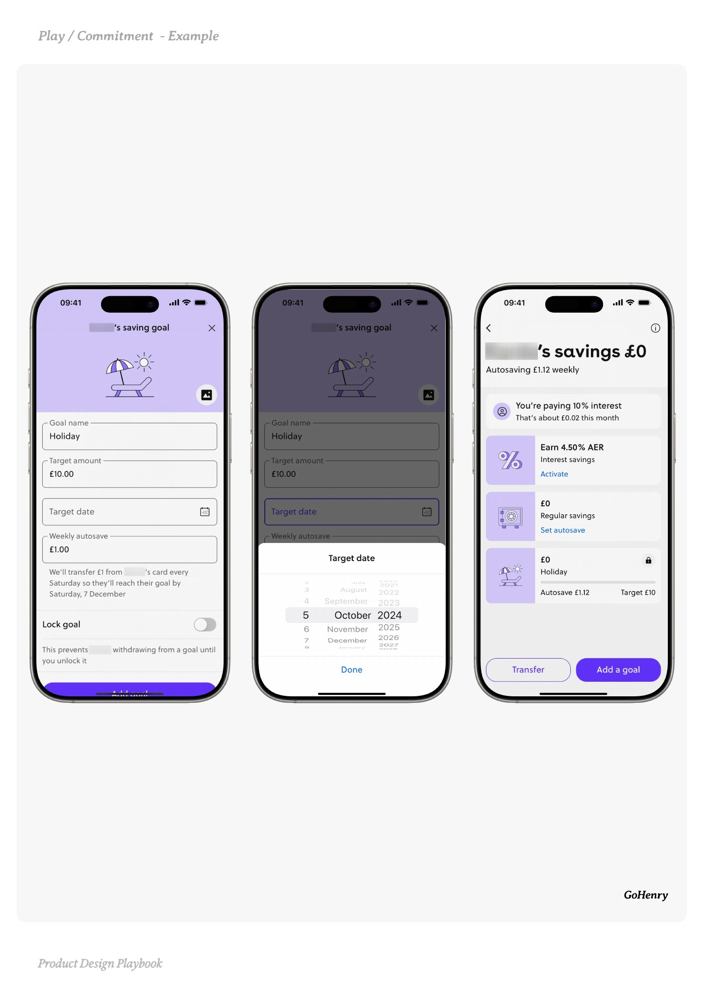
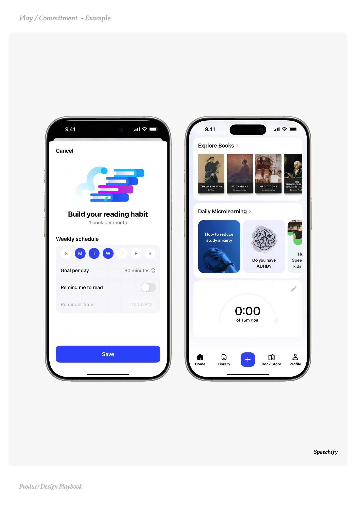

# Commitment


Source-faithful grouping of PDF pages 97 through 101.


## Play overview, PDF page 97

[Open extracted page text](../source/pages/page-097.md) | [Open full-page screenshot](../screenshots/page-097.jpg)



### Extracted text

```text
􀉟

Play

Let users declare their intent, then design around it.

What it is:

A micro-pledge from the user. A goal, schedule, or selection. You’re inspiring behaviour
by letting users make a commitment they will feel obliged to complete.


Why it works:

Once we state our intentions, we feel the need to follow through. Even a small
commitment public or private nudges us to act. Declarations create accountability
which trigger consistency that leads to retention.


When to use it:

When the product requires users to frequently check into the app

To inspire activation in a demanding flow (e.g. learning, saving, tracking)


Do:

Trigger follow-ups that tie back to what user has committed to

Let users choose their own goal, frequency, or commitment

Tie the commitment to future nudges, reminders, or feedback


Don’t:

Force arbitrary goals onto users

Make the commitment feel like a irreversible trap

Punish users for breaking commitments without flexibility


Founder Tip:

When users say what they want, help them become it. Apps that remember and reflect
user intent build deeper loyalty and stickiness. Give users a goal and they’ll have a
purpose to retain.

􀰴 Pair with:

Personalisation | Gamified Progress

|

Time to Value

| Deep-link | System Widget |

Intent Mirroring
```

## Make it yours prompts, PDF page 98

[Open extracted page text](../source/pages/page-098.md) | [Open full-page screenshot](../screenshots/page-098.jpg)



### Extracted text

```text
When users declare their intent, help them live up to it. These prompts help you
turn commitment into structure, not pressure.

1. To design the right kind of commitment:

What habit, outcome, or frequency matters most in your product?

How might a user pledge feel like progress, not pressure?

Could a lightweight goal or schedule boost activation or retention?



2. To create space for intent:

Where in your flow could you ask, “What do you want out of this?”

Could users pick their own pace, metric, or end goal?

How might this commitment feel personal and empowering?



3. To build follow-through loops:

Are we tying nudges, reminders, or tips to what the user said they wanted?

What check-ins could help users feel momentum not guilt?

How might we celebrate progress, even if they slip?



4. To avoid coercion or shame:

Are we offering the choice to commit or forcing it?

Is there a clear way to update, edit, or back out of a goal?

Do users feel safe making imperfect progress?



5. To test and evolve:

Are committed users more consistent or loyal?

Where do drop-offs happen after a pledge and why?

What signals suggest a user is ready to commit?

Product Design Playbook
```

## Example 1, PDF page 99

[Open extracted page text](../source/pages/page-099.md) | [Open full-page screenshot](../screenshots/page-099.jpg)



### Extracted text

```text
aeae

Ahead

Product Design Playbook
```

## Example 2, PDF page 100

[Open extracted page text](../source/pages/page-100.md) | [Open full-page screenshot](../screenshots/page-100.jpg)



### Extracted text

```text
yoene

GoHenry

Product Design Playbook
```

## Example 3, PDF page 101

[Open extracted page text](../source/pages/page-101.md) | [Open full-page screenshot](../screenshots/page-101.jpg)



### Extracted text

```text
yiepe

Speechify

Product Design Playbook
```
