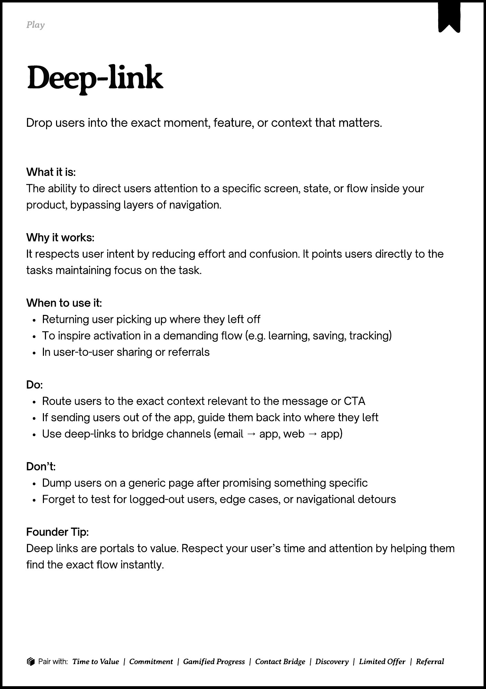
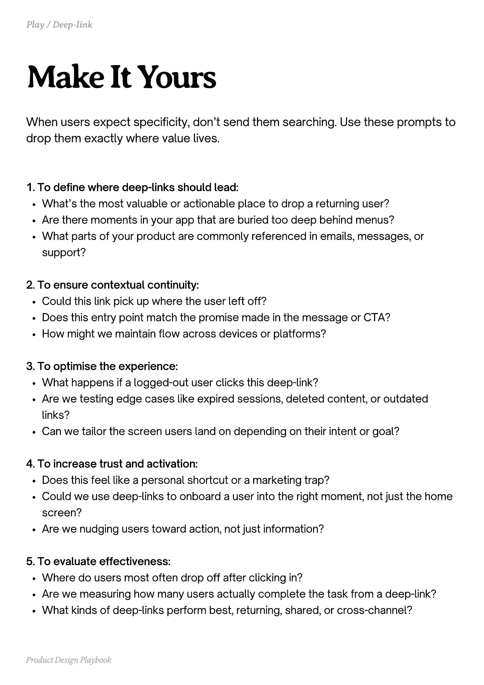
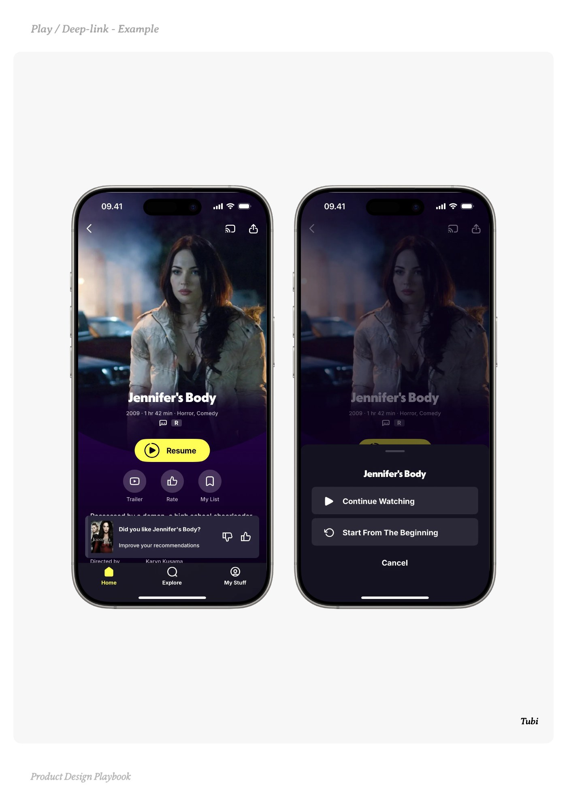
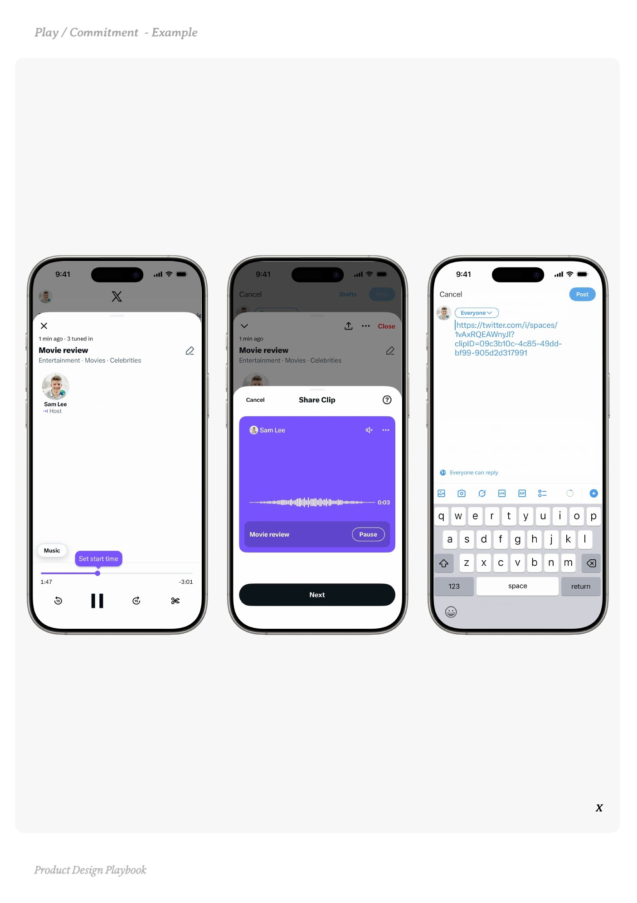
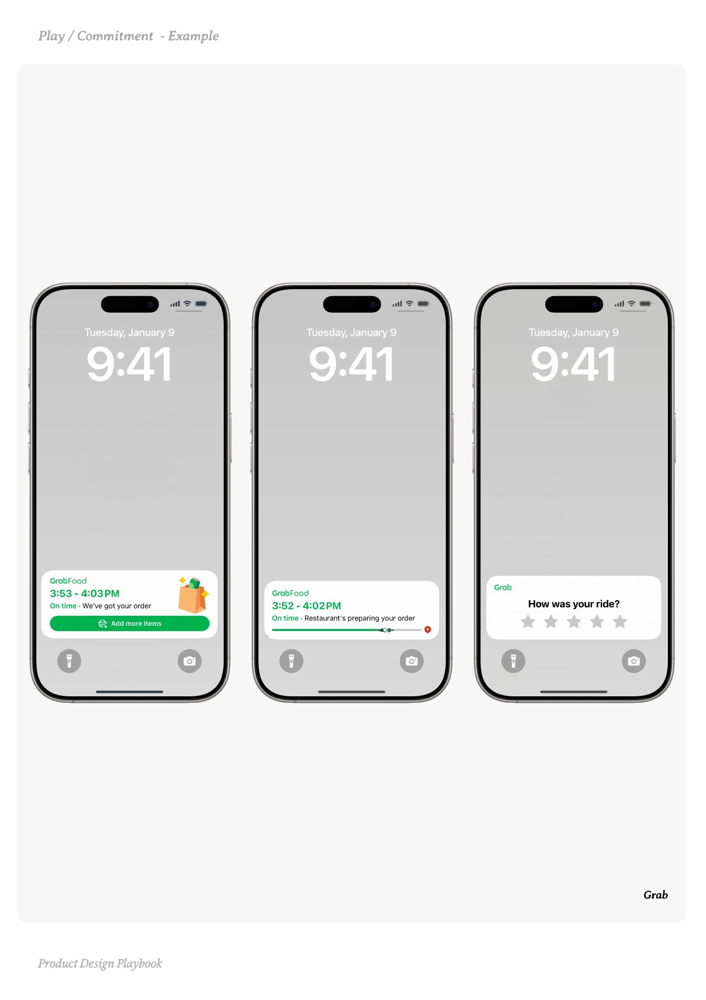

# Deep-link


Source-faithful grouping of PDF pages 102 through 106.


## Play overview, PDF page 102

[Open extracted page text](../source/pages/page-102.md) | [Open full-page screenshot](../screenshots/page-102.jpg)



### Extracted text

```text
􀉟

Play

Drop users into the exact moment, feature, or context that matters.

What it is:

The ability to direct users attention to a specific screen, state, or flow inside your
product, bypassing layers of navigation.


Why it works:

It respects user intent by reducing effort and confusion. It points users directly to the
tasks maintaining focus on the task.


When to use it:

Returning user picking up where they left off

To inspire activation in a demanding flow (e.g. learning, saving, tracking)

In user-to-user sharing or referrals


Do:

Route users to the exact context relevant to the message or CTA

If sending users out of the app, guide them back into where they left

Use deep-links to bridge channels (email → app, web → app)


Don’t:

Dump users on a generic page after promising something specific

Forget to test for logged-out users, edge cases, or navigational detours


Founder Tip:

Deep links are portals to value. Respect your user’s time and attention by helping them
find the exact flow instantly.

􀰴 Pair with:

Time to Value

| Commitment | Gamified Progress

|

Contact Bridge

| Discovery |

Limited Offer

|

Referral
```

## Make it yours prompts, PDF page 103

[Open extracted page text](../source/pages/page-103.md) | [Open full-page screenshot](../screenshots/page-103.jpg)



### Extracted text

```text
When users expect specificity, don’t send them searching. Use these prompts to
drop them exactly where value lives.

1. To define where deep-links should lead:

What’s the most valuable or actionable place to drop a returning user?

Are there moments in your app that are buried too deep behind menus?

What parts of your product are commonly referenced in emails, messages, or
support?


2. To ensure contextual continuity:

Could this link pick up where the user left off?

Does this entry point match the promise made in the message or CTA?

How might we maintain flow across devices or platforms?


3. To optimise the experience:

What happens if a logged-out user clicks this deep-link?

Are we testing edge cases like expired sessions, deleted content, or outdated
links?

Can we tailor the screen users land on depending on their intent or goal?


4. To increase trust and activation:

Does this feel like a personal shortcut or a marketing trap?

Could we use deep-links to onboard a user into the right moment, not just the home
screen?

Are we nudging users toward action, not just information?


5. To evaluate effectiveness:

Where do users most often drop off after clicking in?

Are we measuring how many users actually complete the task from a deep-link?

What kinds of deep-links perform best, returning, shared, or cross-channel?

Product Design Playbook
```

## Example 1, PDF page 104

[Open extracted page text](../source/pages/page-104.md) | [Open full-page screenshot](../screenshots/page-104.jpg)



### Extracted text

```text
i

Tubi

Product Design Playbook
```

## Example 2, PDF page 105

[Open extracted page text](../source/pages/page-105.md) | [Open full-page screenshot](../screenshots/page-105.jpg)



### Extracted text

```text
X

Product Design Playbook
```

## Example 3, PDF page 106

[Open extracted page text](../source/pages/page-106.md) | [Open full-page screenshot](../screenshots/page-106.jpg)



### Extracted text

```text
aa

Grab

Product Design Playbook
```
