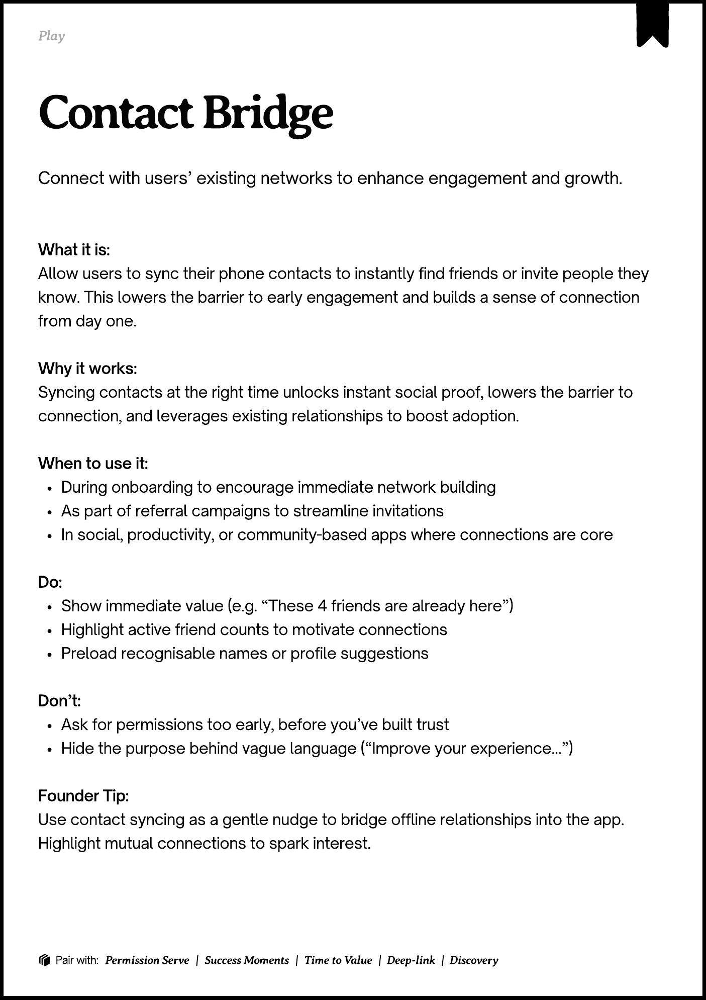
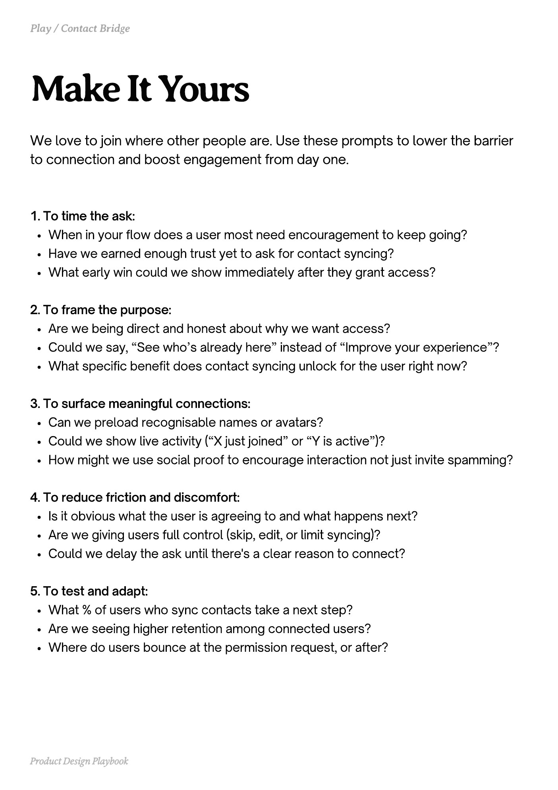
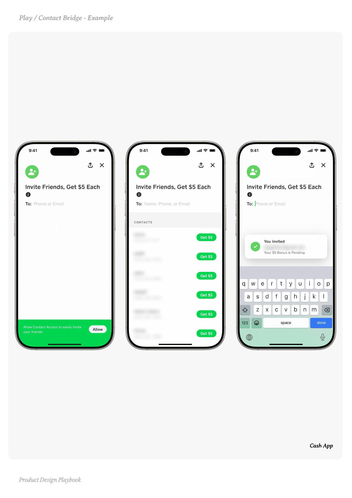
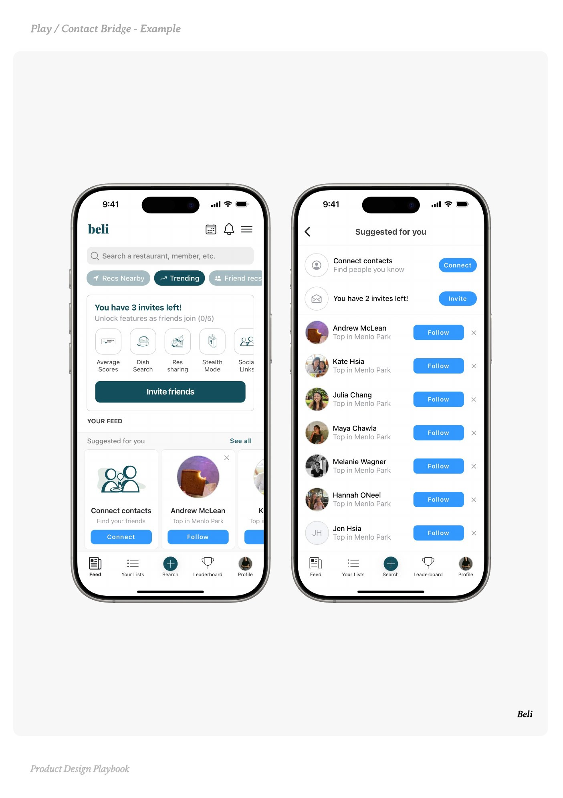
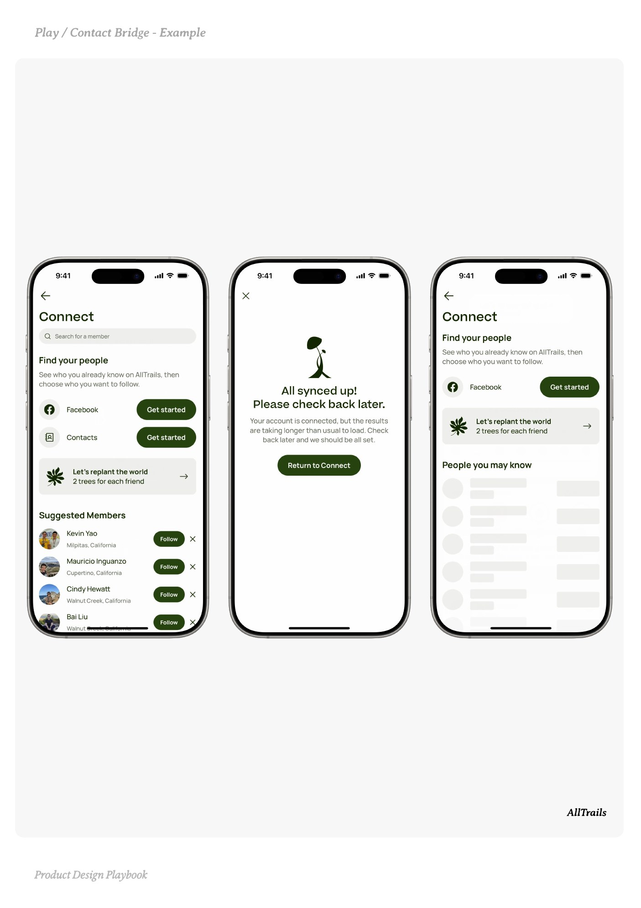

# Contact Bridge


Source-faithful grouping of PDF pages 107 through 111.


## Play overview, PDF page 107

[Open extracted page text](../source/pages/page-107.md) | [Open full-page screenshot](../screenshots/page-107.jpg)



### Extracted text

```text
􀉟

Play

Connect with users’ existing networks to enhance engagement and growth.

What it is:

Allow users to sync their phone contacts to instantly find friends or invite people they
know. This lowers the barrier to early engagement and builds a sense of connection
from day one.


Why it works:

Syncing contacts at the right time unlocks instant social proof, lowers the barrier to
connection, and leverages existing relationships to boost adoption.


When to use it:

During onboarding to encourage immediate network building

As part of referral campaigns to streamline invitations

In social, productivity, or community-based apps where connections are core


Do:

Show immediate value (e.g. “These 4 friends are already here”)

Highlight active friend counts to motivate connections

Preload recognisable names or profile suggestions


Don’t:

Ask for permissions too early, before you’ve built trust

Hide the purpose behind vague language (“Improve your experience…”)


Founder Tip:

Use contact syncing as a gentle nudge to bridge offline relationships into the app.
Highlight mutual connections to spark interest.

􀰴 Pair with:

Permission Serve

|

Success Moments

|

Time to Value

| Deep-link | Discovery
```

## Make it yours prompts, PDF page 108

[Open extracted page text](../source/pages/page-108.md) | [Open full-page screenshot](../screenshots/page-108.jpg)



### Extracted text

```text
We love to join where other people are. Use these prompts to lower the barrier
to connection and boost engagement from day one.

1. To time the ask:

When in your flow does a user most need encouragement to keep going?

Have we earned enough trust yet to ask for contact syncing?

What early win could we show immediately after they grant access?



2. To frame the purpose:

Are we being direct and honest about why we want access?

Could we say, “See who’s already here” instead of “Improve your experience”?

What specific benefit does contact syncing unlock for the user right now?



3. To surface meaningful connections:

Can we preload recognisable names or avatars?

Could we show live activity (“X just joined” or “Y is active”)?

How might we use social proof to encourage interaction not just invite spamming?



4. To reduce friction and discomfort:

Is it obvious what the user is agreeing to and what happens next?

Are we giving users full control (skip, edit, or limit syncing)?

Could we delay the ask until there's a clear reason to connect?



5. To test and adapt:

What % of users who sync contacts take a next step?

Are we seeing higher retention among connected users?

Where do users bounce at the permission request, or after?

Product Design Playbook
```

## Example 1, PDF page 109

[Open extracted page text](../source/pages/page-109.md) | [Open full-page screenshot](../screenshots/page-109.jpg)



### Extracted text

```text
a Ca ap

Cash App

Product Design Playbook
```

## Example 2, PDF page 110

[Open extracted page text](../source/pages/page-110.md) | [Open full-page screenshot](../screenshots/page-110.jpg)



### Extracted text

```text
lBiele

Beli

Product Design Playbook
```

## Example 3, PDF page 111

[Open extracted page text](../source/pages/page-111.md) | [Open full-page screenshot](../screenshots/page-111.jpg)



### Extracted text

```text
laarial

AllTrails

Product Design Playbook
```
