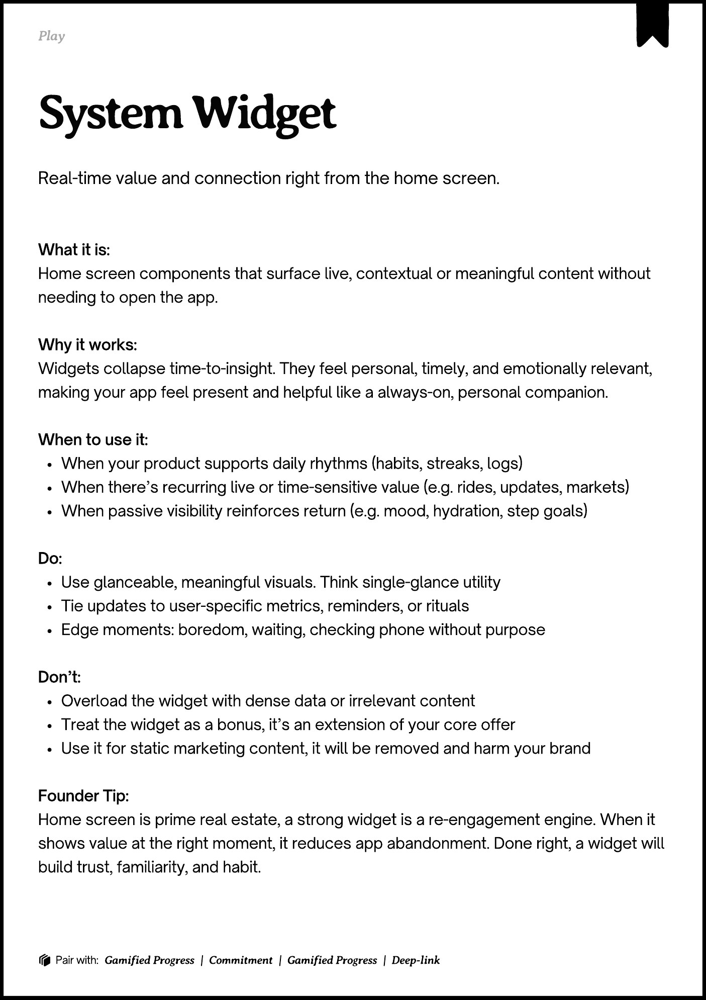
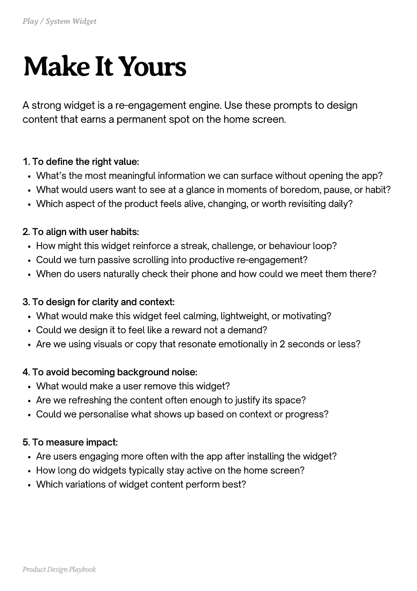
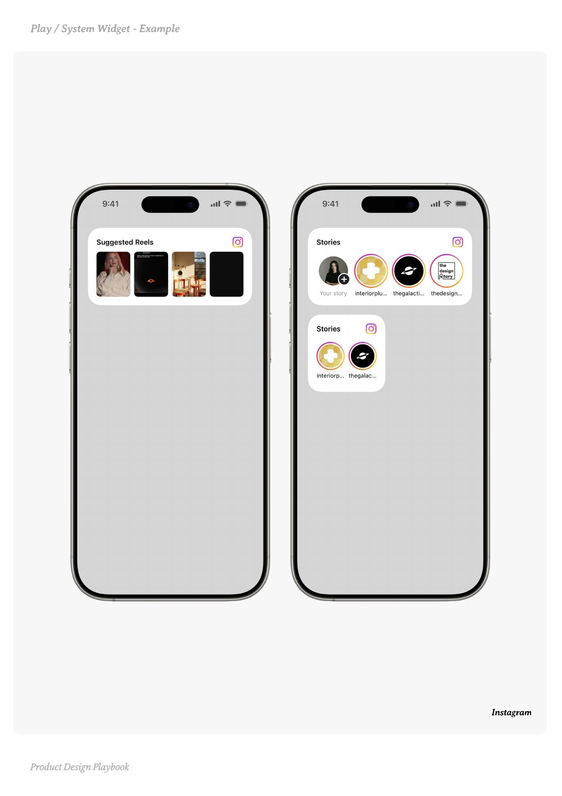
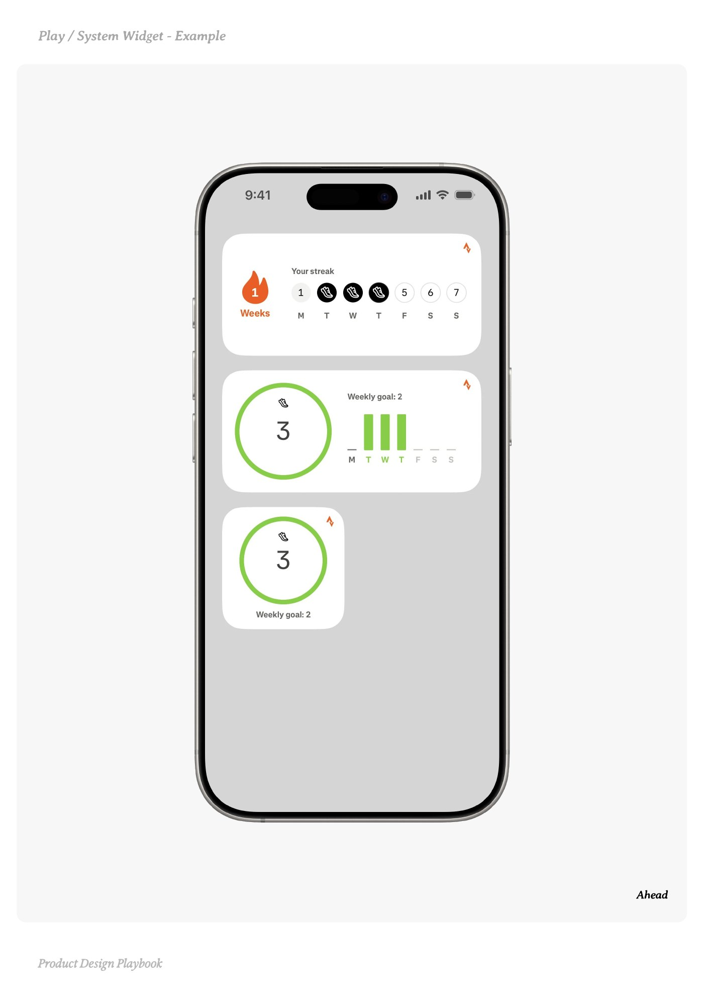
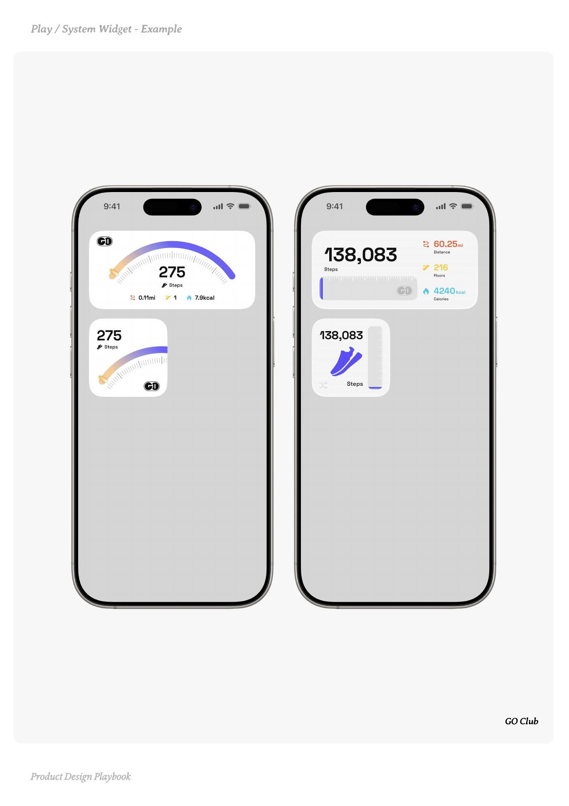

# System Widget


Source-faithful grouping of PDF pages 112 through 116.


## Play overview, PDF page 112

[Open extracted page text](../source/pages/page-112.md) | [Open full-page screenshot](../screenshots/page-112.jpg)



### Extracted text

```text
􀉟

Pla

Real-time value and connection right from the home screen.

What it is:

Home screen components that surface live, contextual or meaningful content without
needing to open the app.


Why it works:

Widgets collapse time-to-insight. They feel personal, timely, and emotionally relevant,
making your app feel present and helpful like a always-on, personal companion.


When to use it:

When your product supports daily rhythms (habits, streaks, logs)

When there’s recurring live or time-sensitive value (e.g. rides, updates, markets)

When passive visibility reinforces return (e.g. mood, hydration, step goals)


Do:

Use glanceable, meaningful visuals. Think single-glance utility

Tie updates to user-specific metrics, reminders, or rituals

Edge moments: boredom, waiting, checking phone without purpose


Don’t:

Overload the widget with dense data or irrelevant content

Treat the widget as a bonus, it’s an extension of your core offer

Use it for static marketing content, it will be removed and harm your brand


Founder Tip:

Home screen is prime real estate, a strong widget is a re-engagement engine. When it
shows value at the right moment, it reduces app abandonment. Done right, a widget will
build trust, familiarity, and habit.

􀰴 Pair with: Gamified Progress | Commitment | Gamified Progress | Deep-link
```

## Make it yours prompts, PDF page 113

[Open extracted page text](../source/pages/page-113.md) | [Open full-page screenshot](../screenshots/page-113.jpg)



### Extracted text

```text
A strong widget is a re-engagement engine. Use these prompts to design
content that earns a permanent spot on the home screen.
1. To define the right value:

What’s the most meaningful information we can surface without opening the app?

What would users want to see at a glance in moments of boredom, pause, or habit?

Which aspect of the product feels alive, changing, or worth revisiting daily?


2. To align with user habits:

How might this widget reinforce a streak, challenge, or behaviour loop?

Could we turn passive scrolling into productive re-engagement?

When do users naturally check their phone and how could we meet them there?


3. To design for clarity and context:

What would make this widget feel calming, lightweight, or motivating?

Could we design it to feel like a reward not a demand?

Are we using visuals or copy that resonate emotionally in 2 seconds or less?


4. To avoid becoming background noise:

What would make a user remove this widget?

Are we refreshing the content often enough to justify its space?

Could we personalise what shows up based on context or progress?


5. To measure impact:

Are users engaging more often with the app after installing the widget?

How long do widgets typically stay active on the home screen?

Which variations of widget content perform best?

Product Design Playbook
```

## Example 1, PDF page 114

[Open extracted page text](../source/pages/page-114.md) | [Open full-page screenshot](../screenshots/page-114.jpg)



### Extracted text

```text
astmgtam

Instagram

Product Design Playbook
```

## Example 2, PDF page 115

[Open extracted page text](../source/pages/page-115.md) | [Open full-page screenshot](../screenshots/page-115.jpg)



### Extracted text

```text
aedeae

Ahead

Product Design Playbook
```

## Example 3, PDF page 116

[Open extracted page text](../source/pages/page-116.md) | [Open full-page screenshot](../screenshots/page-116.jpg)



### Extracted text

```text
l

l

GO Club

Product Design Playbook
```
