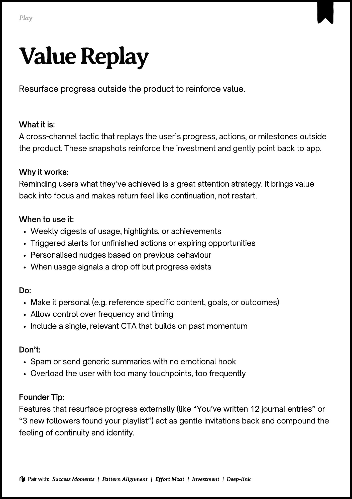
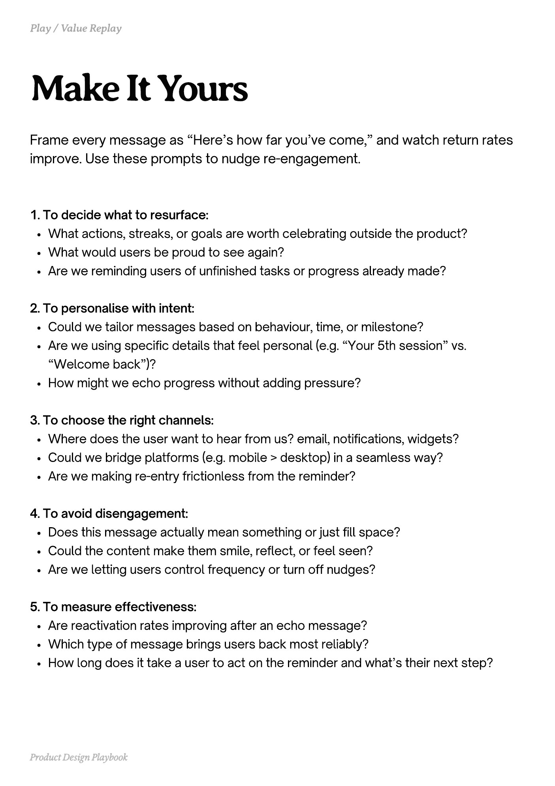
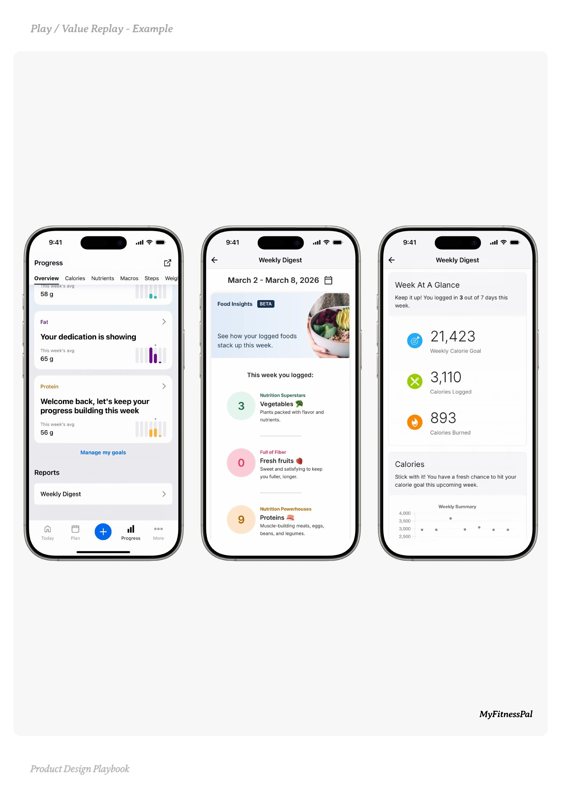
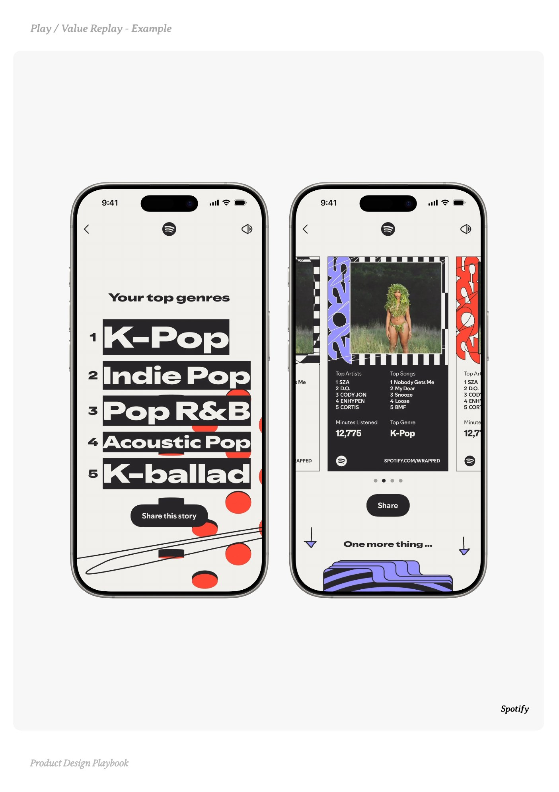
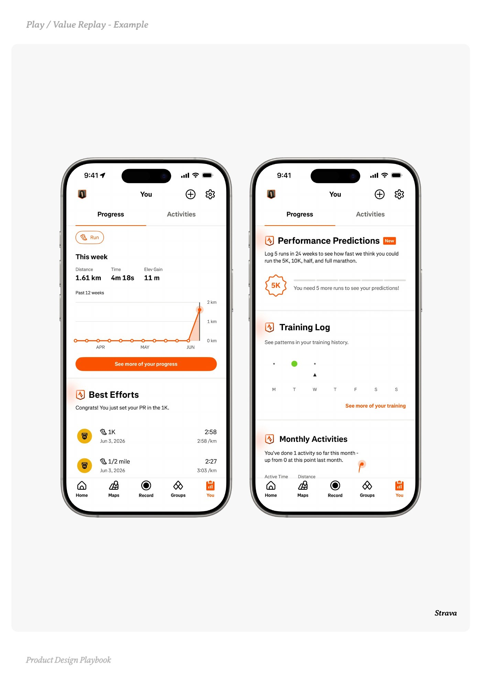

# Value Replay


Source-faithful grouping of PDF pages 117 through 121.


## Play overview, PDF page 117

[Open extracted page text](../source/pages/page-117.md) | [Open full-page screenshot](../screenshots/page-117.jpg)



### Extracted text

```text
􀉟

Pla

Resurface progress outside the product to reinforce value.

What it is:

A cross-channel tactic that replays the user’s progress, actions, or milestones outside
the product. These snapshots reinforce the investment and gently point back to app.


Why it works:

Reminding users what they’ve achieved is a great attention strategy. It brings value
back into focus and makes return feel like continuation, not restart.


When to use it:

Weekly digests of usage, highlights, or achievements

Triggered alerts for unfinished actions or expiring opportunities

Personalised nudges based on previous behaviour

When usage signals a drop off but progress exists


Do:

Make it personal (e.g. reference specific content, goals, or outcomes)

Allow control over frequency and timing

Include a single, relevant CTA that builds on past momentum


Don’t:

Spam or send generic summaries with no emotional hook

Overload the user with too many touchpoints, too frequently


Founder Tip:

Features that resurface progress externally (like “You’ve written 12 journal entries” or
“3 new followers found your playlist”) act as gentle invitations back and compound the
feeling of continuity and identity.

􀰴 Pair with:

Success Moments

|

Pattern Alignment

|

Effort Moat

|

Investment

| Deep-link
```

## Make it yours prompts, PDF page 118

[Open extracted page text](../source/pages/page-118.md) | [Open full-page screenshot](../screenshots/page-118.jpg)



### Extracted text

```text
Frame every message as “Here’s how far you’ve come,” and watch return rates
improve. Use these prompts to nudge re-engagement.
1. To decide what to resurface:

What actions, streaks, or goals are worth celebrating outside the product?

What would users be proud to see again?

Are we reminding users of unfinished tasks or progress already made?


2. To personalise with intent:

Could we tailor messages based on behaviour, time, or milestone?

Are we using specific details that feel personal (e.g. “Your 5th session” vs.
“Welcome back”)?

How might we echo progress without adding pressure?


3. To choose the right channels:

Where does the user want to hear from us? email, notifications, widgets?

Could we bridge platforms (e.g. mobile > desktop) in a seamless way?

Are we making re-entry frictionless from the reminder?


4. To avoid disengagement:

Does this message actually mean something or just fill space?

Could the content make them smile, reflect, or feel seen?

Are we letting users control frequency or turn off nudges?


5. To measure effectiveness:

Are reactivation rates improving after an echo message?

Which type of message brings users back most reliably?

How long does it take a user to act on the reminder and what’s their next step?

Product Design Playbook
```

## Example 1, PDF page 119

[Open extracted page text](../source/pages/page-119.md) | [Open full-page screenshot](../screenshots/page-119.jpg)



### Extracted text

```text
Playaleelayale

MyFitnessPal

Product Design Playbook
```

## Example 2, PDF page 120

[Open extracted page text](../source/pages/page-120.md) | [Open full-page screenshot](../screenshots/page-120.jpg)



### Extracted text

```text
ypyp

Spotify

Product Design Playbook
```

## Example 3, PDF page 121

[Open extracted page text](../source/pages/page-121.md) | [Open full-page screenshot](../screenshots/page-121.jpg)



### Extracted text

```text
aaaa

Strava

Product Design Playbook
```
