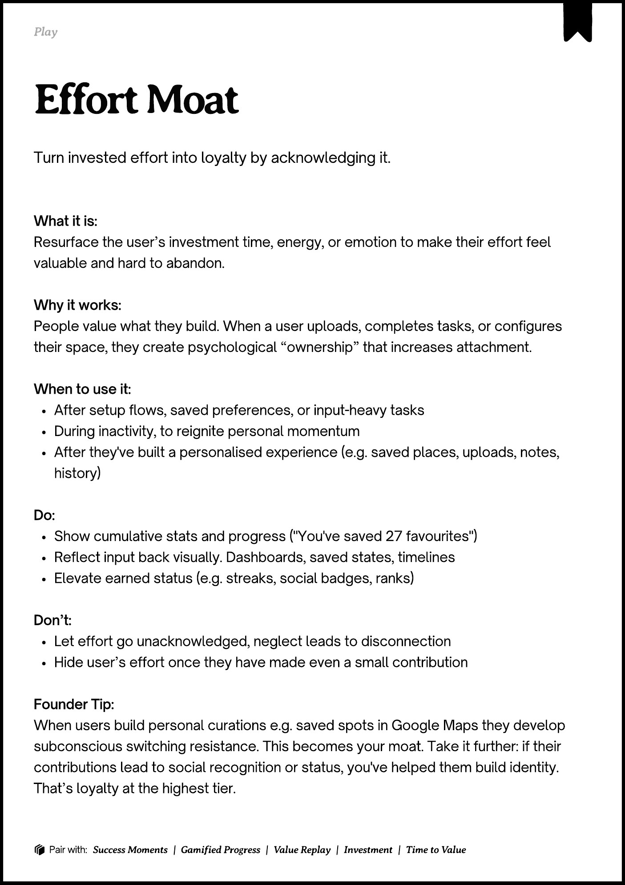
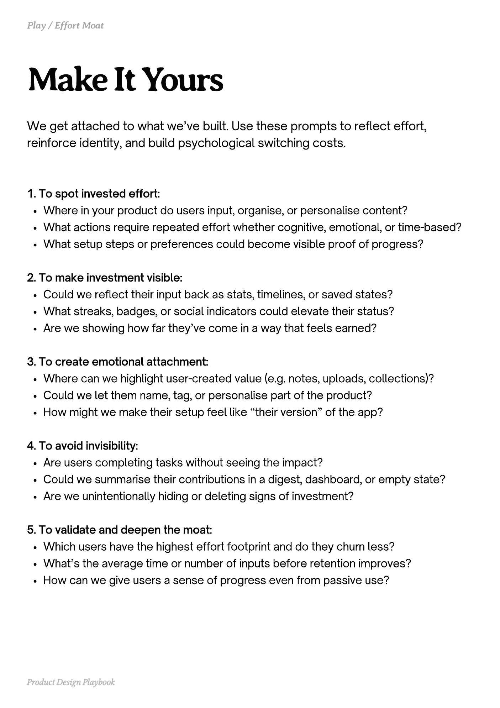
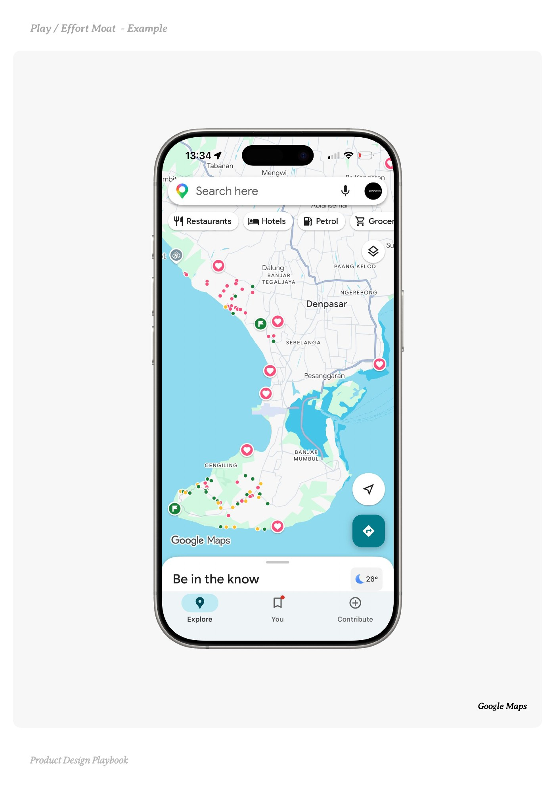
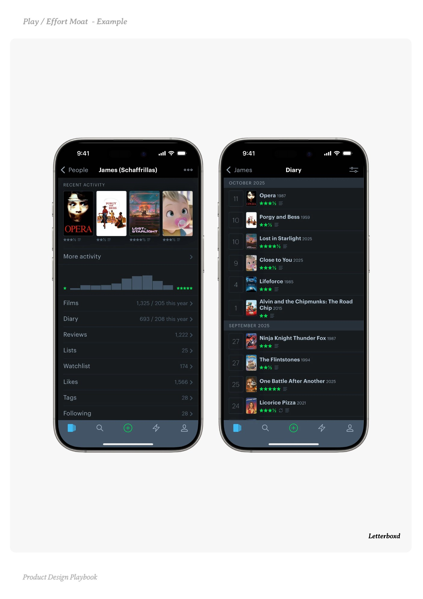
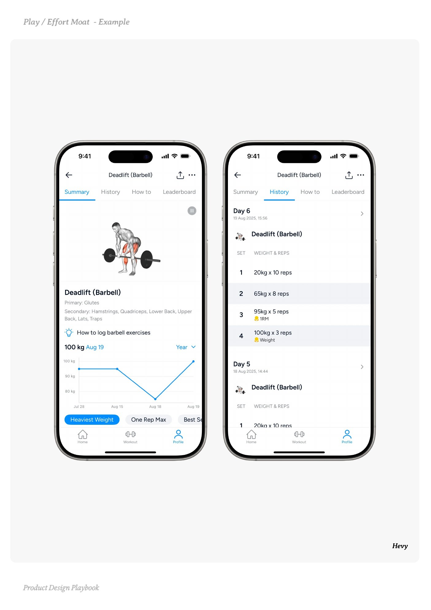

# Effort Moat


Source-faithful grouping of PDF pages 122 through 126.


## Play overview, PDF page 122

[Open extracted page text](../source/pages/page-122.md) | [Open full-page screenshot](../screenshots/page-122.jpg)



### Extracted text

```text
􀉟

Play

Turn invested effort into loyalty by acknowledging it.

What it is:

Resurface the user’s investment time, energy, or emotion to make their effort feel
valuable and hard to abandon.


Why it works:

People value what they build. When a user uploads, completes tasks, or configures
their space, they create psychological “ownership” that increases attachment.


When to use it:

After setup flows, saved preferences, or input-heavy tasks

During inactivity, to reignite personal momentum

After they've built a personalised experience (e.g. saved places, uploads, notes,
history)


Do:

Show cumulative stats and progress ("You've saved 27 favourites")

Reflect input back visually. Dashboards, saved states, timelines

Elevate earned status (e.g. streaks, social badges, ranks)


Don’t:

Let effort go unacknowledged, neglect leads to disconnection

Hide user’s effort once they have made even a small contribution


Founder Tip:

When users build personal curations e.g. saved spots in Google Maps they develop
subconscious switching resistance. This becomes your moat. Take it further: if their
contributions lead to social recognition or status, you've helped them build identity.
That’s loyalty at the highest tier.

􀰴 Pair with:

Success Moments

| Gamified Progress

|

Value Replay

|

Investment

|

Time to Value
```

## Make it yours prompts, PDF page 123

[Open extracted page text](../source/pages/page-123.md) | [Open full-page screenshot](../screenshots/page-123.jpg)



### Extracted text

```text
We get attached to what we’ve built. Use these prompts to reflect effort,
reinforce identity, and build psychological switching costs.

1. To spot invested effort:

Where in your product do users input, organise, or personalise content?

What actions require repeated effort whether cognitive, emotional, or time-based?

What setup steps or preferences could become visible proof of progress?



2. To make investment visible:

Could we reflect their input back as stats, timelines, or saved states?

What streaks, badges, or social indicators could elevate their status?

Are we showing how far they’ve come in a way that feels earned?



3. To create emotional attachment:

Where can we highlight user-created value (e.g. notes, uploads, collections)?

Could we let them name, tag, or personalise part of the product?

How might we make their setup feel like “their version” of the app?



4. To avoid invisibility:

Are users completing tasks without seeing the impact?

Could we summarise their contributions in a digest, dashboard, or empty state?

Are we unintentionally hiding or deleting signs of investment?



5. To validate and deepen the moat:

Which users have the highest effort footprint and do they churn less?

What’s the average time or number of inputs before retention improves?

How can we give users a sense of progress even from passive use?

Product Design Playbook
```

## Example 1, PDF page 124

[Open extracted page text](../source/pages/page-124.md) | [Open full-page screenshot](../screenshots/page-124.jpg)



### Extracted text

```text
la o Moa aple

Google Maps

Product Design Playbook
```

## Example 2, PDF page 125

[Open extracted page text](../source/pages/page-125.md) | [Open full-page screenshot](../screenshots/page-125.jpg)



### Extracted text

```text
ortotxe

Letterboxd

Product Design Playbook
```

## Example 3, PDF page 126

[Open extracted page text](../source/pages/page-126.md) | [Open full-page screenshot](../screenshots/page-126.jpg)



### Extracted text

```text
ye

Hevy

Product Design Playbook
```
