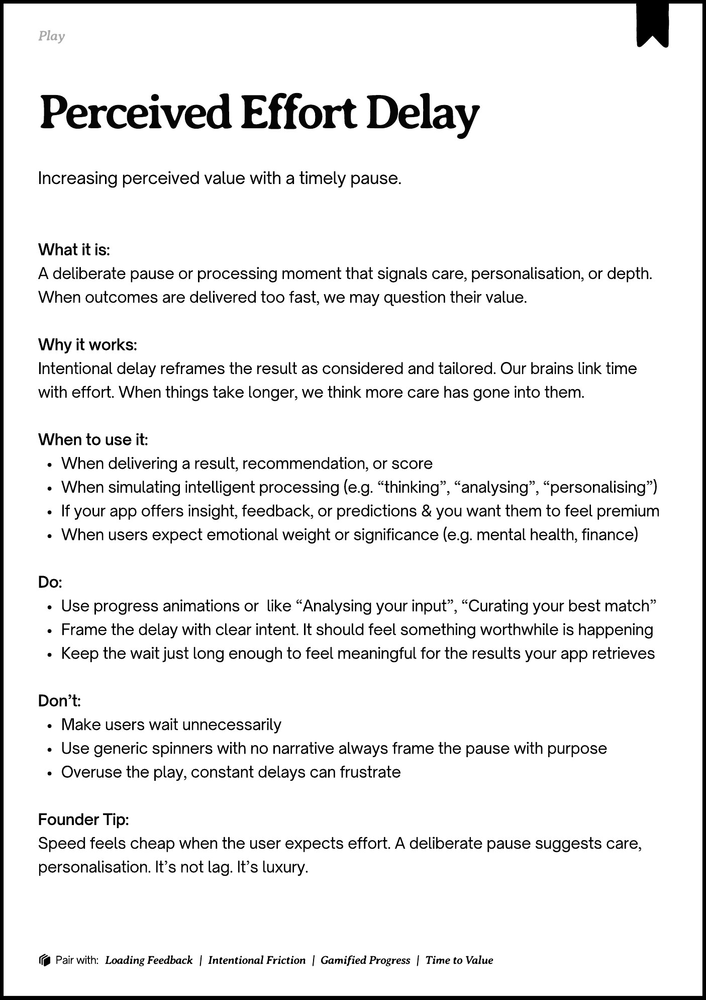
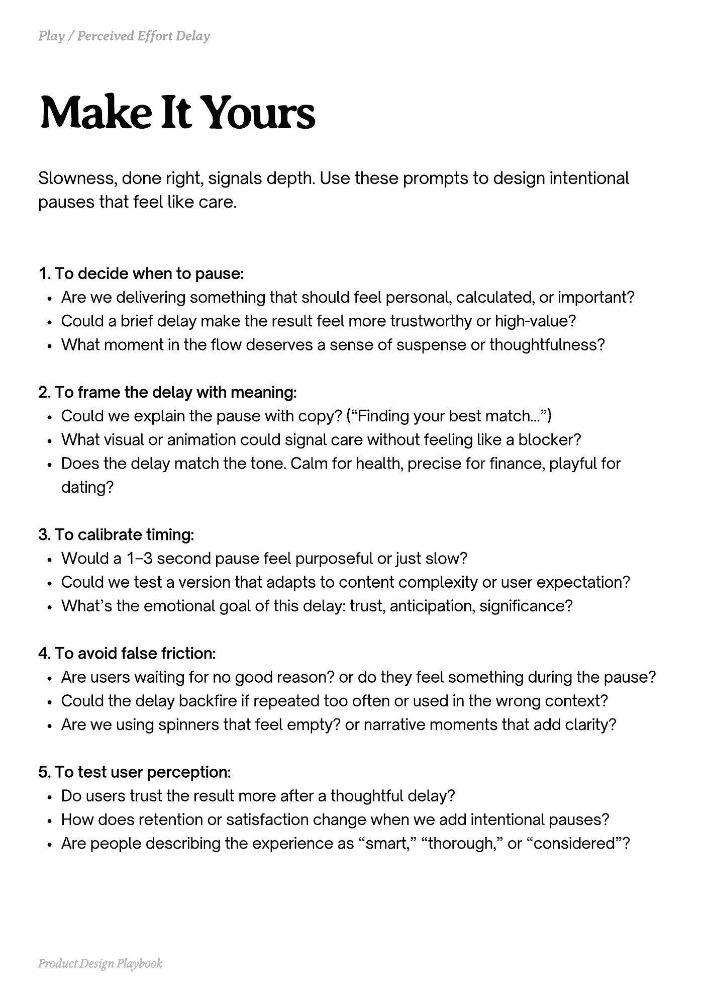
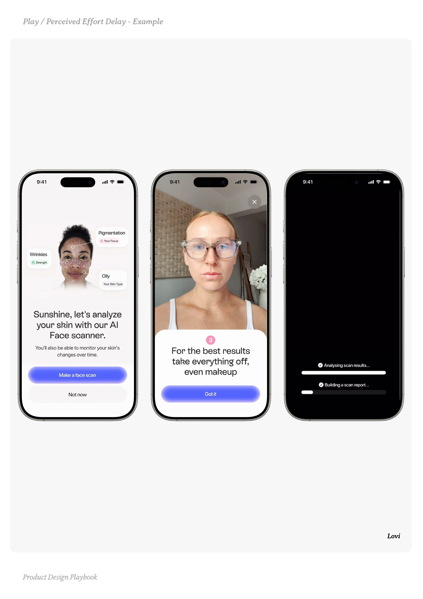
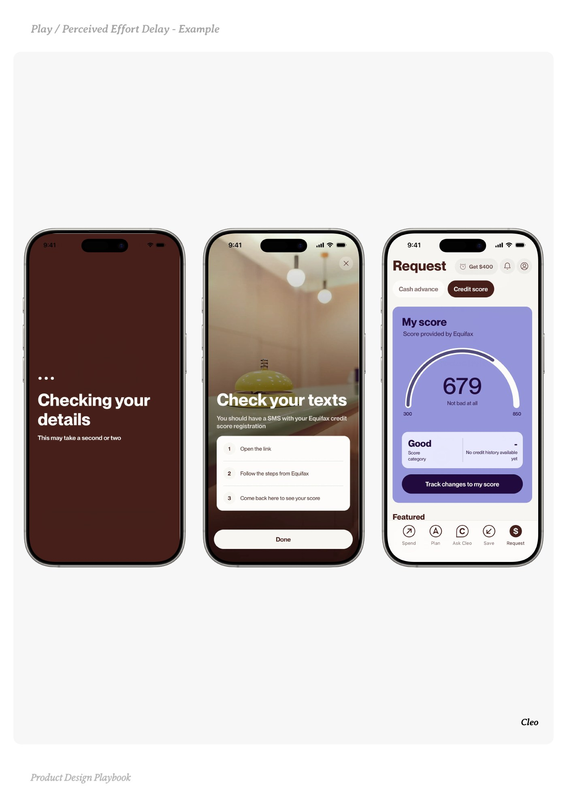
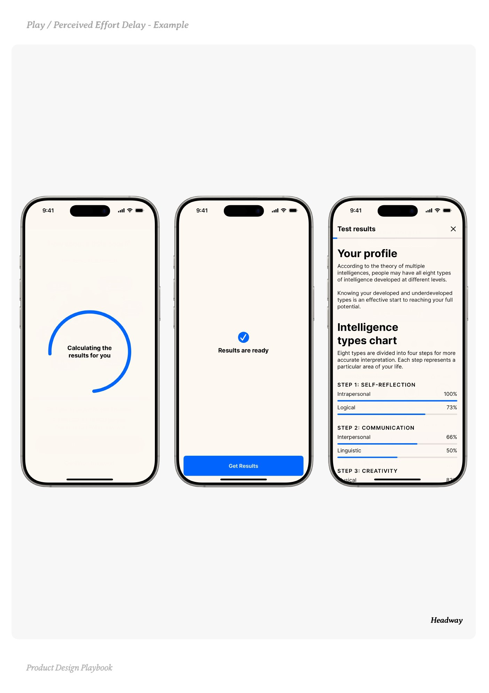

# Perceived Effort Delay


Source-faithful grouping of PDF pages 127 through 131.


## Play overview, PDF page 127

[Open extracted page text](../source/pages/page-127.md) | [Open full-page screenshot](../screenshots/page-127.jpg)



### Extracted text

```text
􀉟

Pla

Increasing perceived value with a timely pause.

What it is:

A deliberate pause or processing moment that signals care, personalisation, or depth.
When outcomes are delivered too fast, we may question their value.


Why it works:

Intentional delay reframes the result as considered and tailored. Our brains link time
with effort. When things take longer, we think more care has gone into them.


When to use it:

When delivering a result, recommendation, or score

When simulating intelligent processing (e.g. “thinking”, “analysing”, “personalising”)

If your app offers insight, feedback, or predictions & you want them to feel premium

When users expect emotional weight or significance (e.g. mental health, finance)


Do:

Use progress animations or

like “Analysing your input”, “Curating your best match”


Frame the delay with clear intent. It should feel something worthwhile is happening

Keep the wait just long enough to feel meaningful for the results your app retrieves


Don’t:

Make users wait unnecessarily

Use generic spinners with no narrative always frame the pause with purpose

Overuse the play, constant delays can frustrate


Founder Tip:

Speed feels cheap when the user expects effort. A deliberate pause suggests care,
personalisation. It’s not lag. It’s luxury.

􀰴 Pair with:

Loading Feedback

|

Intentional Friction

| Gamified Progress

|

Time to Value
```

## Make it yours prompts, PDF page 128

[Open extracted page text](../source/pages/page-128.md) | [Open full-page screenshot](../screenshots/page-128.jpg)



### Extracted text

```text
Slowness, done right, signals depth. Use these prompts to design intentional
pauses that feel like care.
1. To decide when to pause:

Are we delivering something that should feel personal, calculated, or important?

Could a brief delay make the result feel more trustworthy or high-value?

What moment in the flow deserves a sense of suspense or thoughtfulness?


2. To frame the delay with meaning:

Could we explain the pause with copy? (“Finding your best match...”)

What visual or animation could signal care without feeling like a blocker?

Does the delay match the tone. Calm for health, precise for finance, playful for
dating?


3. To calibrate timing:

Would a 1-3 second pause feel purposeful or just slow?

Could we test a version that adapts to content complexity or user expectation?

What’s the emotional goal of this delay: trust, anticipation, significance?


4. To avoid false friction:

Are users waiting for no good reason? or do they feel something during the pause?

Could the delay backfire if repeated too often or used in the wrong context?

Are we using spinners that feel empty? or narrative moments that add clarity?


5. To test user perception:

Do users trust the result more after a thoughtful delay?

How does retention or satisfaction change when we add intentional pauses?

Are people describing the experience as “smart,” “thorough,” or “considered”?

Product Design Playbook
```

## Example 1, PDF page 129

[Open extracted page text](../source/pages/page-129.md) | [Open full-page screenshot](../screenshots/page-129.jpg)



### Extracted text

```text
ivo

Lovi

Product Design Playbook
```

## Example 2, PDF page 130

[Open extracted page text](../source/pages/page-130.md) | [Open full-page screenshot](../screenshots/page-130.jpg)



### Extracted text

```text
leeeoelle

Cleo

Product Design Playbook
```

## Example 3, PDF page 131

[Open extracted page text](../source/pages/page-131.md) | [Open full-page screenshot](../screenshots/page-131.jpg)



### Extracted text

```text
ayeeedeayae

Headway

Product Design Playbook
```
