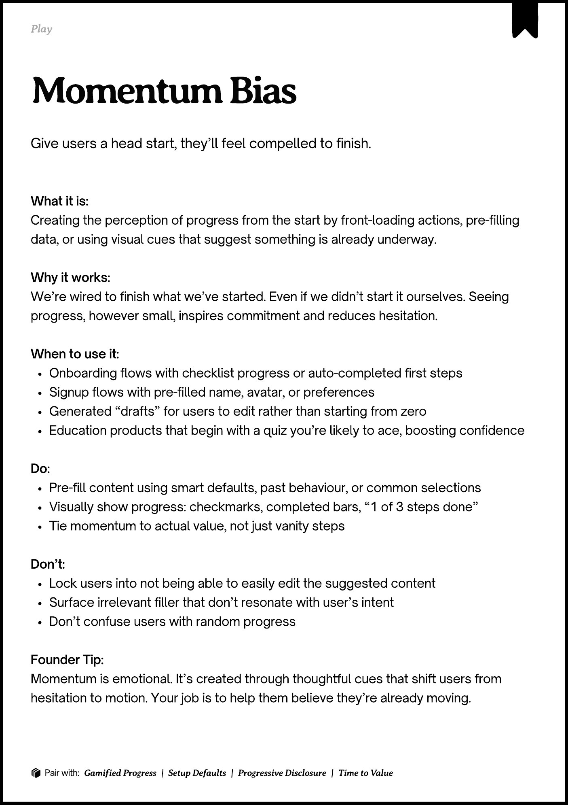
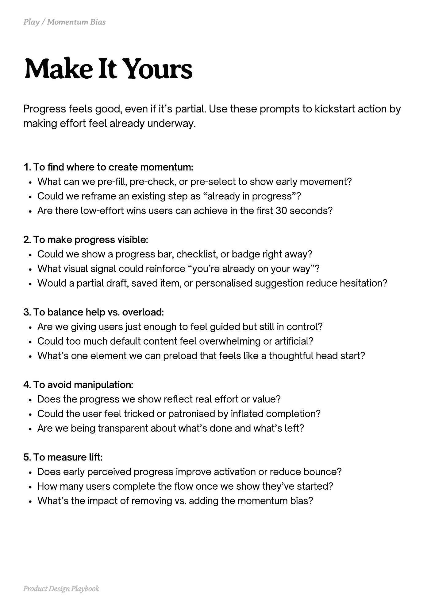
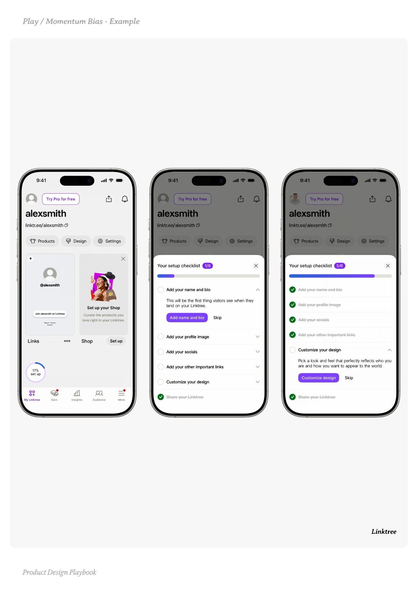
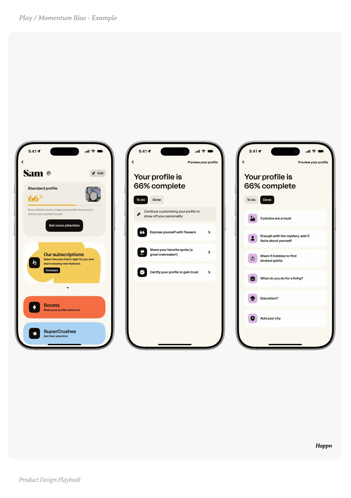
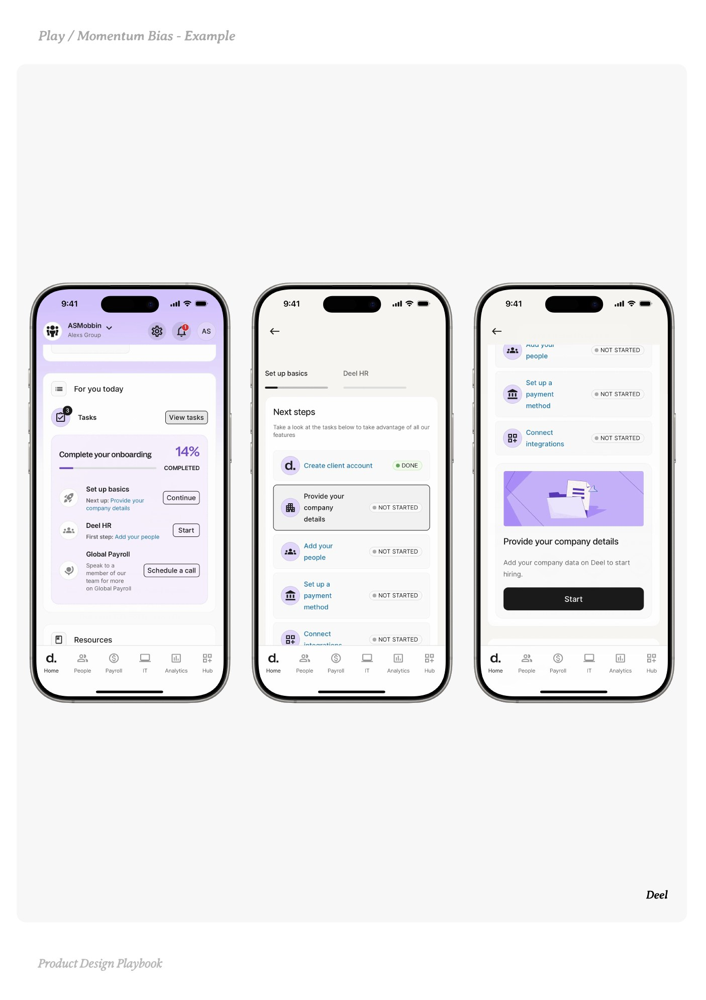

# Momentum Bias


Source-faithful grouping of PDF pages 132 through 136.


## Play overview, PDF page 132

[Open extracted page text](../source/pages/page-132.md) | [Open full-page screenshot](../screenshots/page-132.jpg)



### Extracted text

```text
􀉟

Pla

Give users a head start, they’ll feel compelled to finish.

What it is:

Creating the perception of progress from the start by front-loading actions, pre-filling
data, or using visual cues that suggest something is already underway.


Why it works:

We’re wired to finish what we’ve started. Even if we didn’t start it ourselves. Seeing
progress, however small, inspires commitment and reduces hesitation.


When to use it:

Onboarding flows with checklist progress or auto-completed first steps

Signup flows with pre-filled name, avatar, or preferences

Generated “drafts” for users to edit rather than starting from zero

Education products that begin with a quiz you’re likely to ace, boosting confidence


Do:

Pre-fill content using smart defaults, past behaviour, or common selections

Visually show progress: checkmarks, completed bars, “1 of 3 steps done”

Tie momentum to actual value, not just vanity steps


Don’t:

Lock users into not being able to easily edit the suggested content

Surface irrelevant filler that don’t resonate with user’s intent

Don’t confuse users with random progress


Founder Tip:

Momentum is emotional. It’s created through thoughtful cues that shift users from
hesitation to motion. Your job is to help them believe they’re already moving.

􀰴 Pair with:

Gamified Progress

| Setup Defaults |

Progressive Disclosure

|

Time to Value
```

## Make it yours prompts, PDF page 133

[Open extracted page text](../source/pages/page-133.md) | [Open full-page screenshot](../screenshots/page-133.jpg)



### Extracted text

```text
Progress feels good, even if it’s partial. Use these prompts to kickstart action by
making effort feel already underway.
1. To find where to create momentum:

What can we pre-fill, pre-check, or pre-select to show early movement?

Could we reframe an existing step as “already in progress”?

Are there low-effort wins users can achieve in the first 30 seconds?


2. To make progress visible:

Could we show a progress bar, checklist, or badge right away?

What visual signal could reinforce “you’re already on your way”?

Would a partial draft, saved item, or personalised suggestion reduce hesitation?


3. To balance help vs. overload:

Are we giving users just enough to feel guided but still in control?

Could too much default content feel overwhelming or artificial?

What’s one element we can preload that feels like a thoughtful head start?


4. To avoid manipulation:

Does the progress we show reflect real effort or value?

Could the user feel tricked or patronised by inflated completion?

Are we being transparent about what’s done and what’s left?


5. To measure lift:

Does early perceived progress improve activation or reduce bounce?

How many users complete the flow once we show they’ve started?

What’s the impact of removing vs. adding the momentum bias?

Product Design Playbook
```

## Example 1, PDF page 134

[Open extracted page text](../source/pages/page-134.md) | [Open full-page screenshot](../screenshots/page-134.jpg)



### Extracted text

```text
entie

Linktree

Product Design Playbook
```

## Example 2, PDF page 135

[Open extracted page text](../source/pages/page-135.md) | [Open full-page screenshot](../screenshots/page-135.jpg)



### Extracted text

```text
anaap

Happn

Product Design Playbook
```

## Example 3, PDF page 136

[Open extracted page text](../source/pages/page-136.md) | [Open full-page screenshot](../screenshots/page-136.jpg)



### Extracted text

```text
lele

Deel

Product Design Playbook
```
