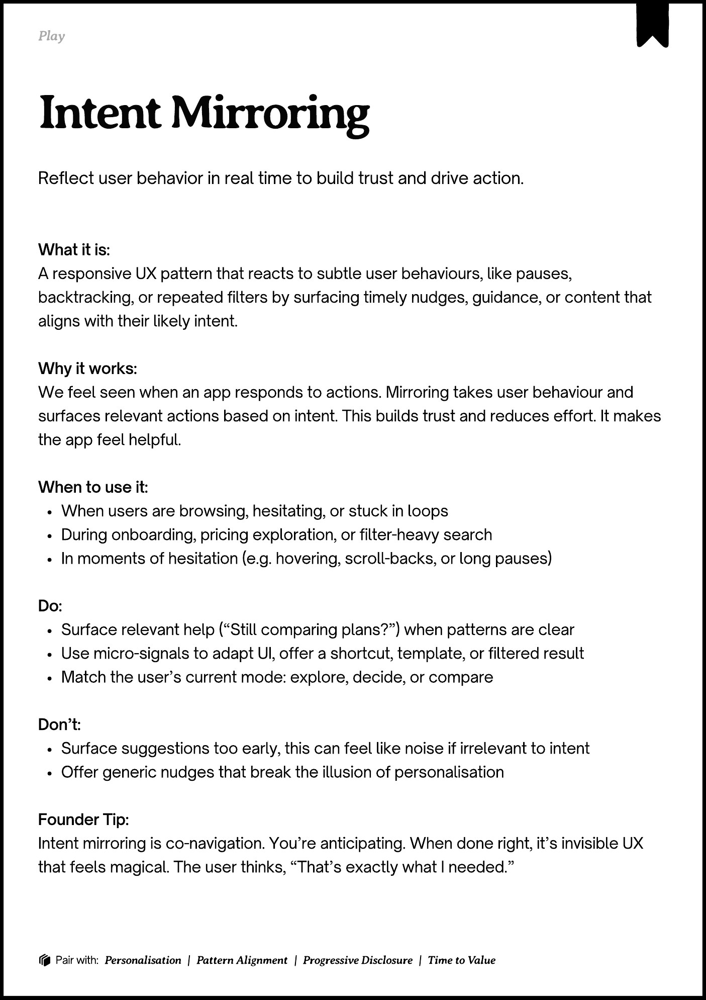
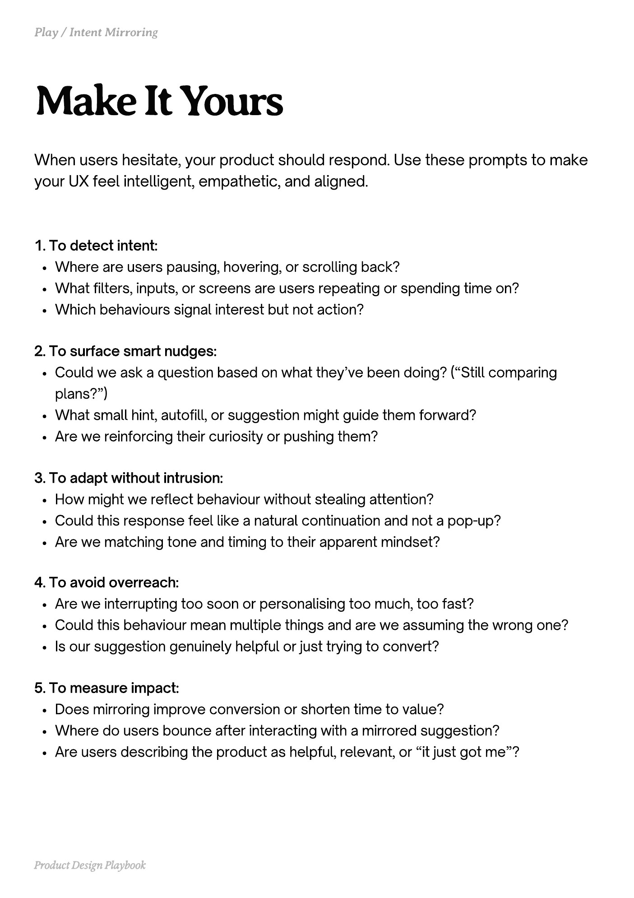
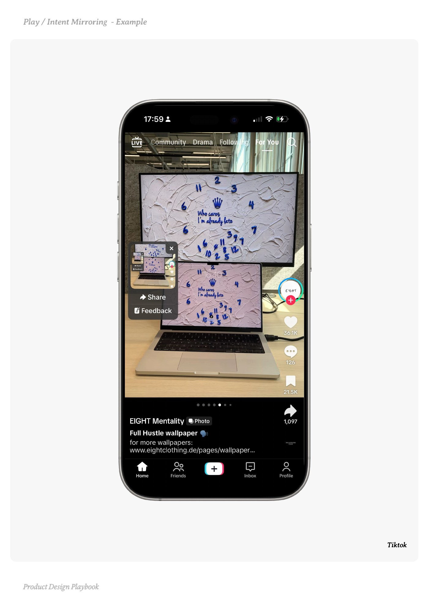
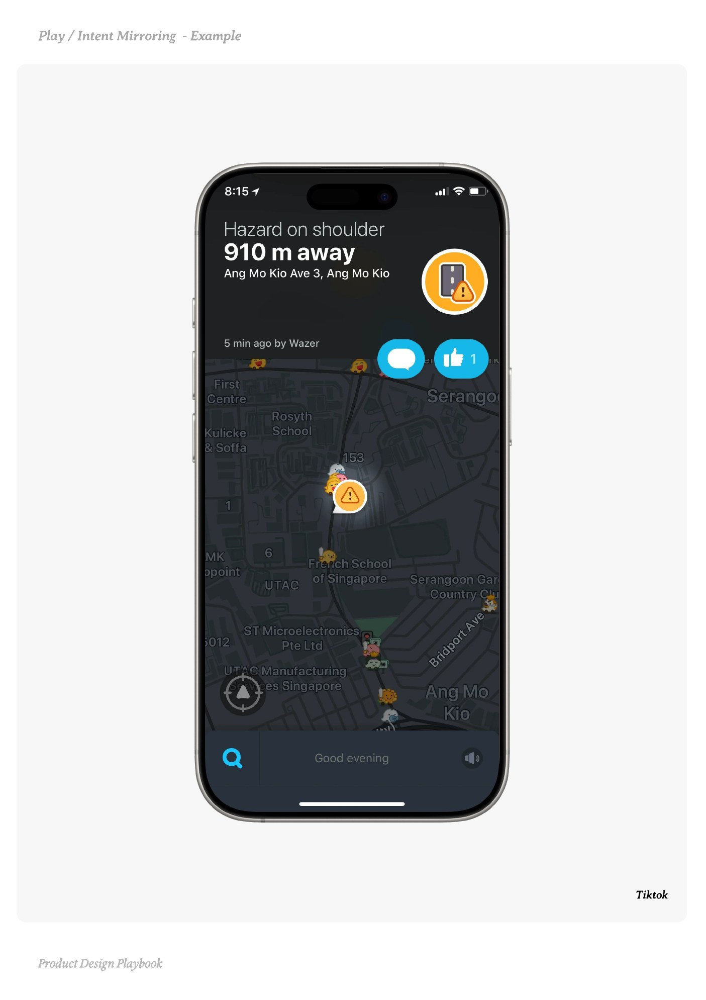
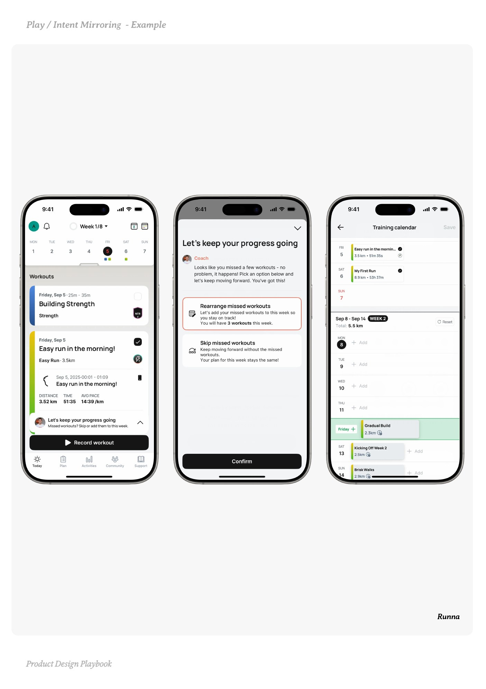

# Intent Mirroring


Source-faithful grouping of PDF pages 137 through 141.


## Play overview, PDF page 137

[Open extracted page text](../source/pages/page-137.md) | [Open full-page screenshot](../screenshots/page-137.jpg)



### Extracted text

```text
􀉟

Pla

Reflect user behavior in real time to build trust and drive action.

What it is:

A responsive UX pattern that reacts to subtle user behaviours, like pauses,
backtracking, or repeated filters by surfacing timely nudges, guidance, or content that
aligns with their likely intent.


Why it works:

We feel seen when an app responds to actions. Mirroring takes user behaviour and
surfaces relevant actions based on intent. This builds trust and reduces effort. It makes
the app feel helpful.


When to use it:

When users are browsing, hesitating, or stuck in loops

During onboarding, pricing exploration, or filter-heavy search

In moments of hesitation (e.g. hovering, scroll-backs, or long pauses)


Do:

Surface relevant help (“Still comparing plans?”) when patterns are clear

Use micro-signals to adapt UI, offer a shortcut, template, or filtered result

Match the user’s current mode: explore, decide, or compare


Don’t:

Surface suggestions too early, this can feel like noise if irrelevant to intent

Offer generic nudges that break the illusion of personalisation


Founder Tip:

Intent mirroring is co-navigation. You’re anticipating. When done right, it’s invisible UX
that feels magical. The user thinks, “That’s exactly what I needed.”

􀰴 Pair with:

Personalisation |

Pattern Alignment

|

Progressive Disclosure

|

Time to Value
```

## Make it yours prompts, PDF page 138

[Open extracted page text](../source/pages/page-138.md) | [Open full-page screenshot](../screenshots/page-138.jpg)



### Extracted text

```text
When users hesitate, your product should respond. Use these prompts to make
your UX feel intelligent, empathetic, and aligned.
1. To detect intent:

Where are users pausing, hovering, or scrolling back?

What filters, inputs, or screens are users repeating or spending time on?

Which behaviours signal interest but not action?


2. To surface smart nudges:

Could we ask a question based on what they’ve been doing? (“Still comparing
plans?”)

What small hint, autofill, or suggestion might guide them forward?

Are we reinforcing their curiosity or pushing them?


3. To adapt without intrusion:

How might we reflect behaviour without stealing attention?

Could this response feel like a natural continuation and not a pop-up?

Are we matching tone and timing to their apparent mindset?


4. To avoid overreach:

Are we interrupting too soon or personalising too much, too fast?

Could this behaviour mean multiple things and are we assuming the wrong one?

Is our suggestion genuinely helpful or just trying to convert?


5. To measure impact:

Does mirroring improve conversion or shorten time to value?

Where do users bounce after interacting with a mirrored suggestion?

Are users describing the product as helpful, relevant, or “it just got me”?

Product Design Playbook
```

## Example 1, PDF page 139

[Open extracted page text](../source/pages/page-139.md) | [Open full-page screenshot](../screenshots/page-139.jpg)



### Extracted text

```text
ttioi

Tiktok

Product Design Playbook
```

## Example 2, PDF page 140

[Open extracted page text](../source/pages/page-140.md) | [Open full-page screenshot](../screenshots/page-140.jpg)



### Extracted text

```text
ttioi

Tiktok

Product Design Playbook
```

## Example 3, PDF page 141

[Open extracted page text](../source/pages/page-141.md) | [Open full-page screenshot](../screenshots/page-141.jpg)



### Extracted text

```text
annna

Runna

Product Design Playbook
```
