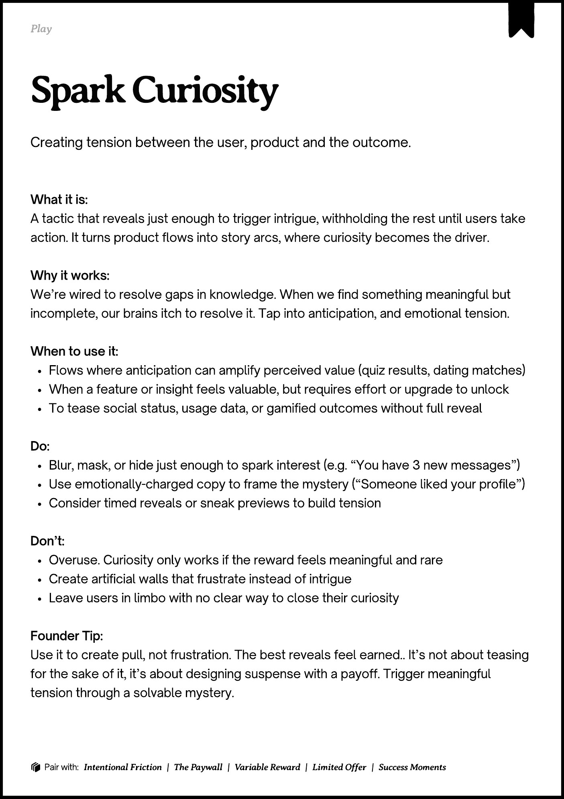
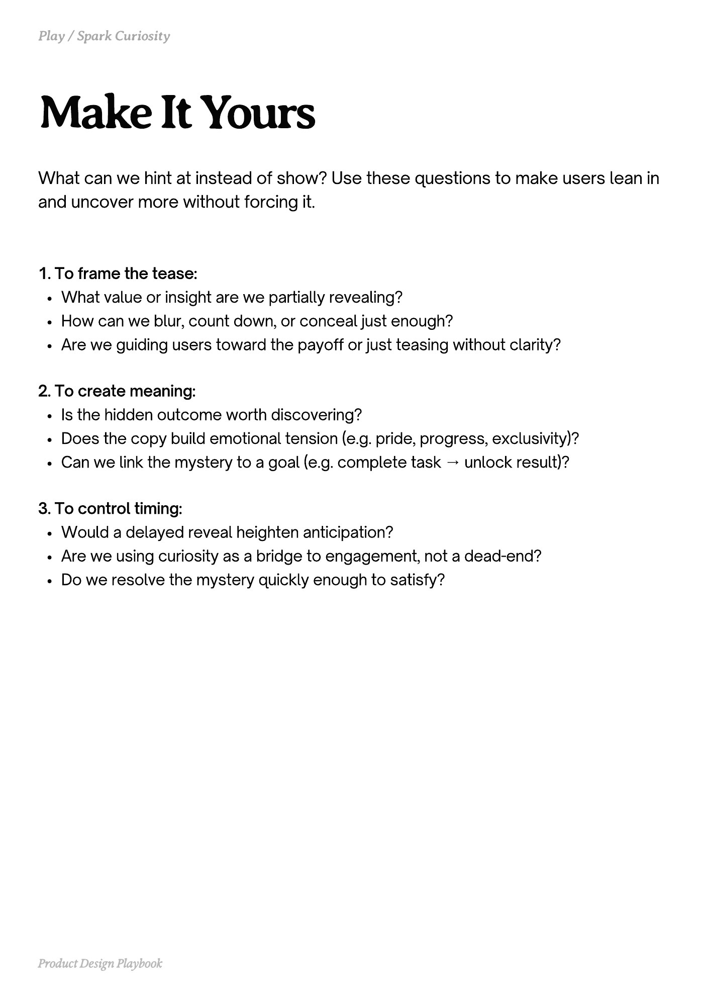
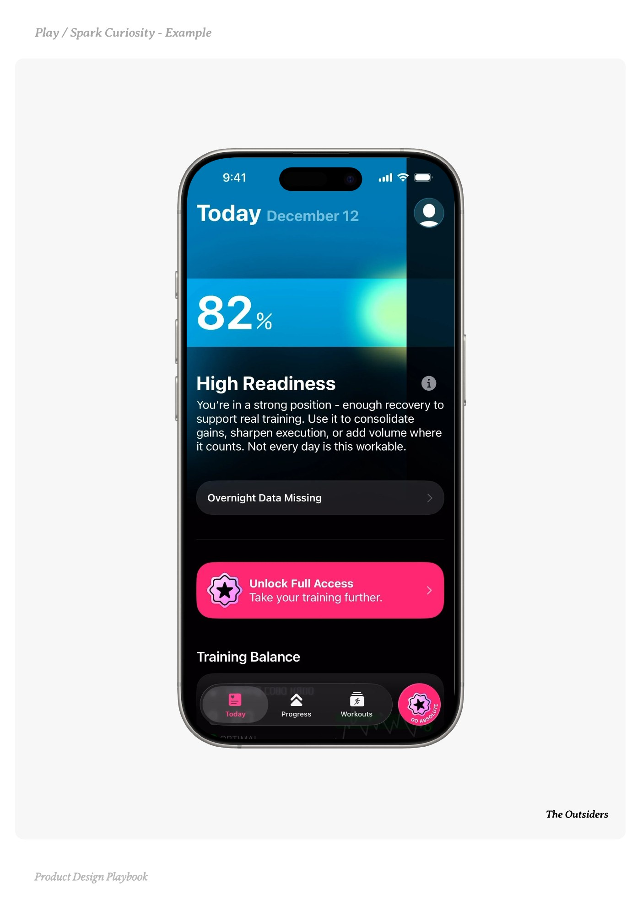
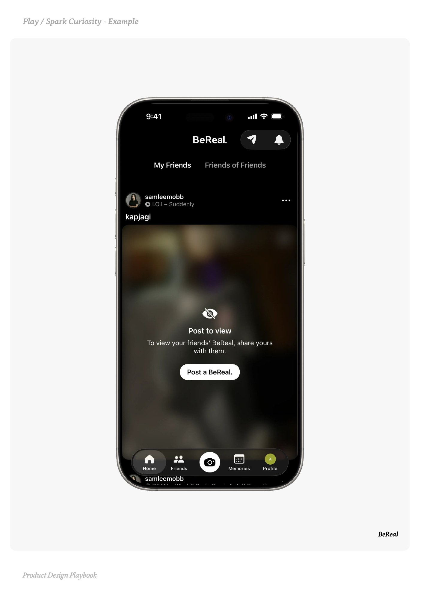
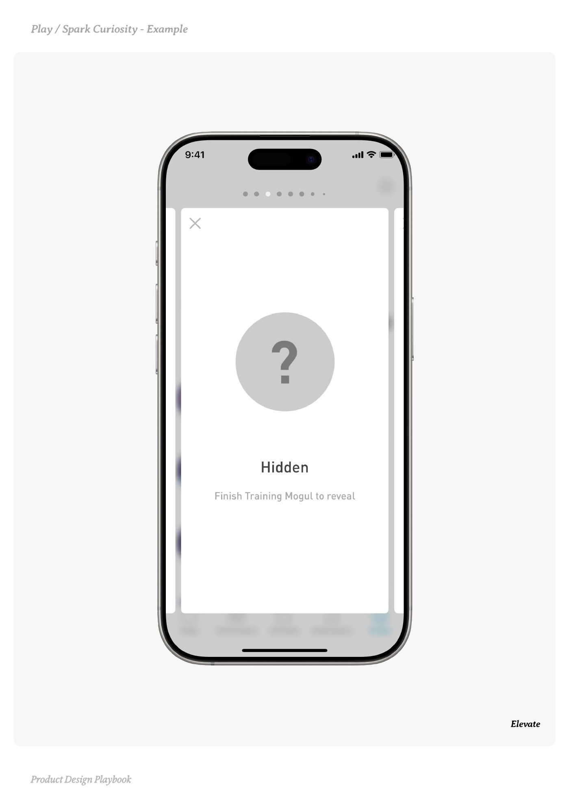

# Spark Curiosity


Source-faithful grouping of PDF pages 142 through 146.


## Play overview, PDF page 142

[Open extracted page text](../source/pages/page-142.md) | [Open full-page screenshot](../screenshots/page-142.jpg)



### Extracted text

```text
􀉟

Play

Creating tension between the user, product and the outcome.

What it is:

A tactic that reveals just enough to trigger intrigue, withholding the rest until users take
action. It turns product flows into story arcs, where curiosity becomes the driver.


Why it works:

We’re wired to resolve gaps in knowledge. When we find something meaningful but
incomplete, our brains itch to resolve it. Tap into anticipation, and emotional tension.


When to use it:

Flows where anticipation can amplify perceived value (quiz results, dating matches)

When a feature or insight feels valuable, but requires effort or upgrade to unlock

To tease social status, usage data, or gamified outcomes without full reveal


Do:

Blur, mask, or hide just enough to spark interest (e.g. “You have 3 new messages”)

Use emotionally-charged copy to frame the mystery (“Someone liked your profile”)

Consider timed reveals or sneak previews to build tension


Don’t:

Overuse. Curiosity only works if the reward feels meaningful and rare

Create artificial walls that frustrate instead of intrigue

Leave users in limbo with no clear way to close their curiosity


Founder Tip:

Use it to create pull, not frustration. The best reveals feel earned.. It’s not about teasing
for the sake of it, it’s about designing suspense with a payoff. Trigger meaningful
tension through a solvable mystery.

􀰴 Pair with:

Intentional Friction

|

The Paywall

|

Variable Reward

|

Limited Offer

|

Success Moments
```

## Make it yours prompts, PDF page 143

[Open extracted page text](../source/pages/page-143.md) | [Open full-page screenshot](../screenshots/page-143.jpg)



### Extracted text

```text
What can we hint at instead of show? Use these questions to make users lean in
and uncover more without forcing it.
1. To frame the tease:

What value or insight are we partially revealing?

How can we blur, count down, or conceal just enough?

Are we guiding users toward the payoff or just teasing without clarity?


2. To create meaning:

Is the hidden outcome worth discovering?

Does the copy build emotional tension (e.g. pride, progress, exclusivity)?

Can we link the mystery to a goal (e.g. complete task → unlock result)?


3. To control timing:

Would a delayed reveal heighten anticipation?

Are we using curiosity as a bridge to engagement, not a dead-end?

Do we resolve the mystery quickly enough to satisfy?

Product Design Playbook
```

## Example 1, PDF page 144

[Open extracted page text](../source/pages/page-144.md) | [Open full-page screenshot](../screenshots/page-144.jpg)



### Extracted text

```text
r urisit e

The Outsiders

Product Design Playbook
```

## Example 2, PDF page 145

[Open extracted page text](../source/pages/page-145.md) | [Open full-page screenshot](../screenshots/page-145.jpg)



### Extracted text

```text
laaale

BeReal

Product Design Playbook
```

## Example 3, PDF page 146

[Open extracted page text](../source/pages/page-146.md) | [Open full-page screenshot](../screenshots/page-146.jpg)



### Extracted text

```text
laatEale

Elevate

Product Design Playbook
```
