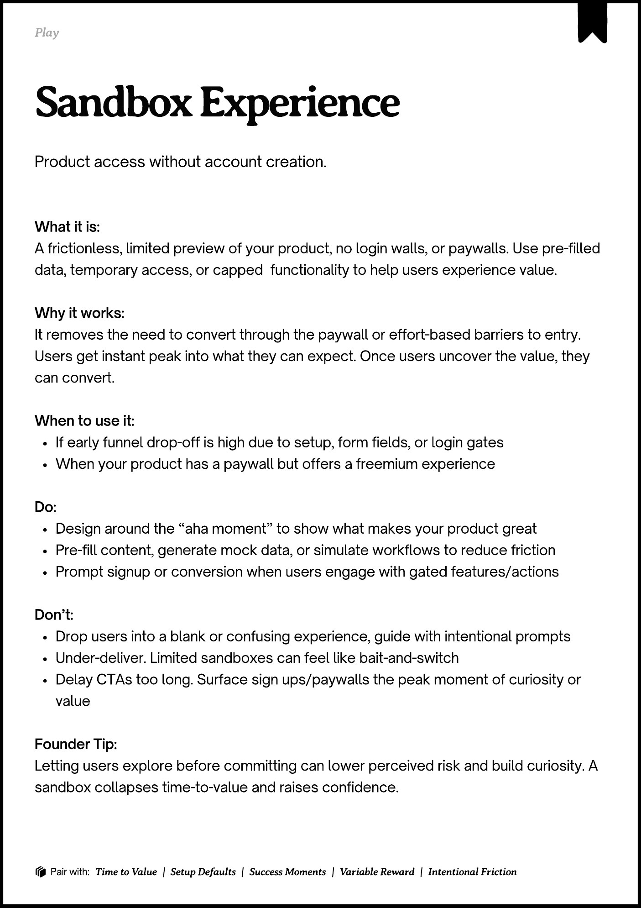
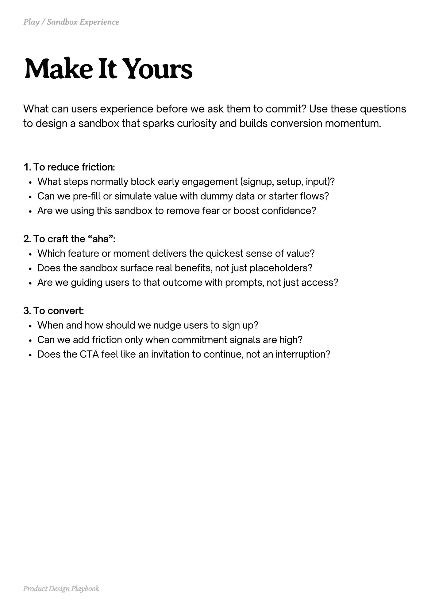
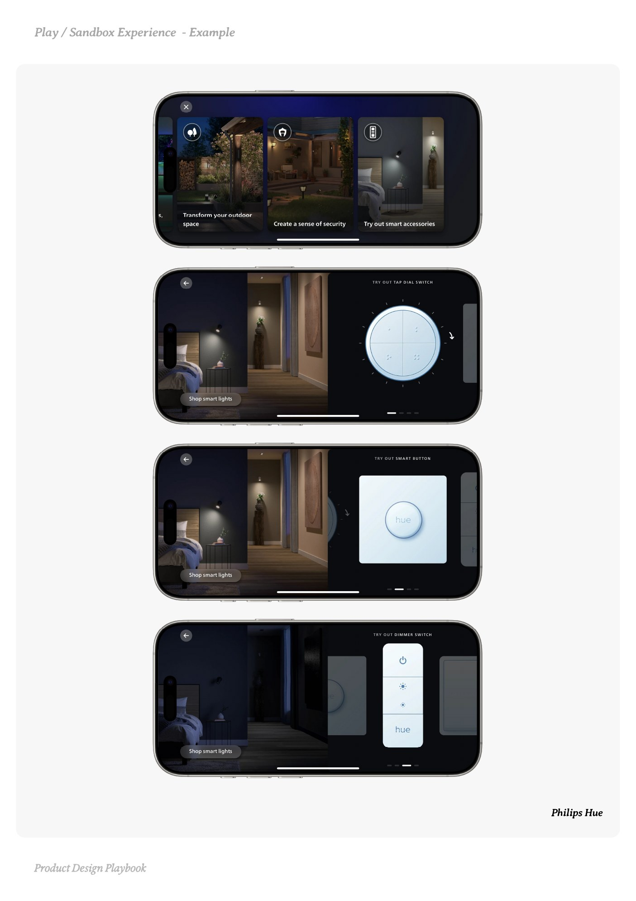
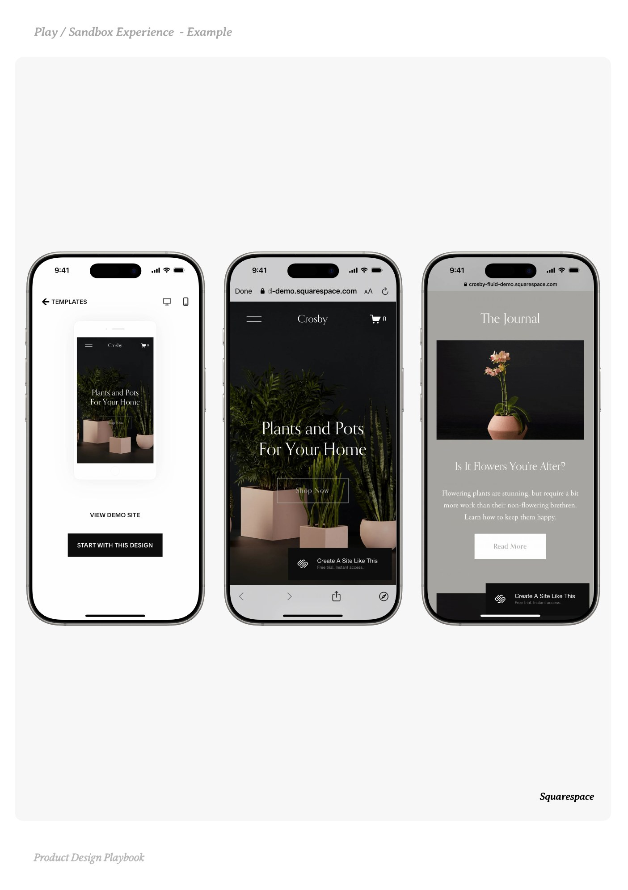
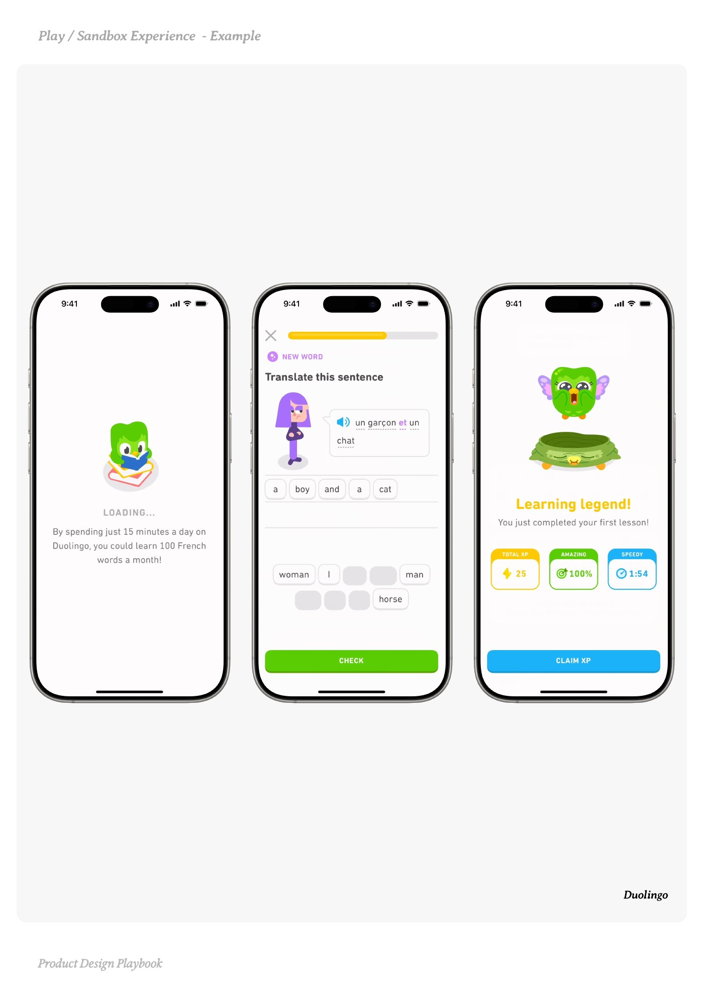

# Sandbox Experience


Source-faithful grouping of PDF pages 147 through 151.


## Play overview, PDF page 147

[Open extracted page text](../source/pages/page-147.md) | [Open full-page screenshot](../screenshots/page-147.jpg)



### Extracted text

```text
􀉟

la

Product access without account creation.

What it is:

A frictionless, limited preview of your product, no login walls, or paywalls. Use pre-filled
data, temporary access, or capped

functionality to help users experience value.


Why it works:

It removes the need to convert through the paywall or effort-based barriers to entry.
Users get instant peak into what they can expect. Once users uncover the value, they
can convert.


When to use it:

If early funnel drop-off is high due to setup, form fields, or login gates

When your product has a paywall but offers a freemium experience 


Do:

Design around the “aha moment” to show what makes your product great

Pre-fill content, generate mock data, or simulate workflows to reduce friction

Prompt signup or conversion when users engage with gated features/actions


Don’t:

Drop users into a blank or confusing experience, guide with intentional prompts

Under-deliver. Limited sandboxes can feel like bait-and-switch

Delay CTAs too long. Surface sign ups/paywalls the peak moment of curiosity or
value


Founder Tip:

Letting users explore before committing can lower perceived risk and build curiosity. A
sandbox collapses time-to-value and raises confidence.

􀰴 Pair with:

Time to Value

| Setup Defaults |

Success Moments

|

Variable Reward

|

Intentional Friction
```

## Make it yours prompts, PDF page 148

[Open extracted page text](../source/pages/page-148.md) | [Open full-page screenshot](../screenshots/page-148.jpg)



### Extracted text

```text
What can users experience before we ask them to commit? Use these questions
to design a sandbox that sparks curiosity and builds conversion momentum.

1. To reduce friction:

What steps normally block early engagement (signup, setup, input)?

Can we pre-fill or simulate value with dummy data or starter flows?

Are we using this sandbox to remove fear or boost confidence?


2. To craft the “aha”:

Which feature or moment delivers the quickest sense of value?

Does the sandbox surface real benefits, not just placeholders?

Are we guiding users to that outcome with prompts, not just access?


3. To convert:

When and how should we nudge users to sign up?

Can we add friction only when commitment signals are high?

Does the CTA feel like an invitation to continue, not an interruption?

Product Design Playbook
```

## Example 1, PDF page 149

[Open extracted page text](../source/pages/page-149.md) | [Open full-page screenshot](../screenshots/page-149.jpg)



### Extracted text

```text
Pl peiee ple

Philips Hue

Product Design Playbook
```

## Example 2, PDF page 150

[Open extracted page text](../source/pages/page-150.md) | [Open full-page screenshot](../screenshots/page-150.jpg)



### Extracted text

```text
aSapereceape

Squarespace

Product Design Playbook
```

## Example 3, PDF page 151

[Open extracted page text](../source/pages/page-151.md) | [Open full-page screenshot](../screenshots/page-151.jpg)



### Extracted text

```text
lnoinl

Duolingo

Product Design Playbook
```
