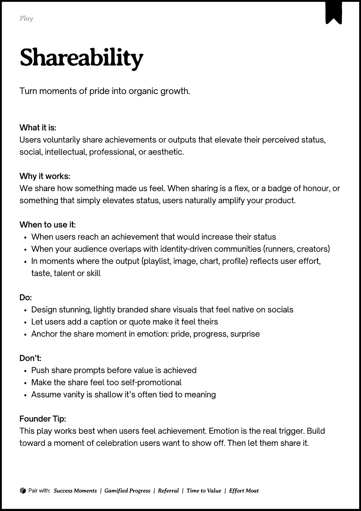
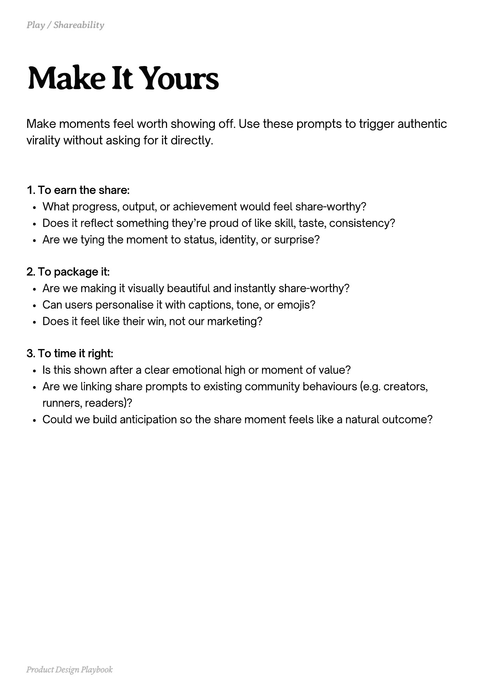
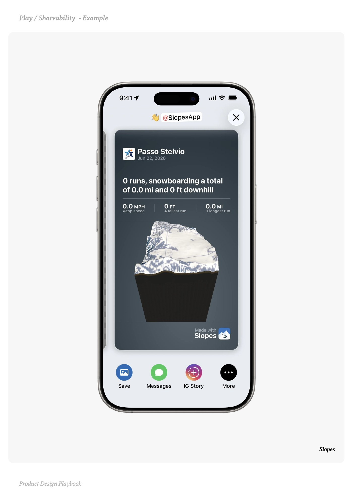
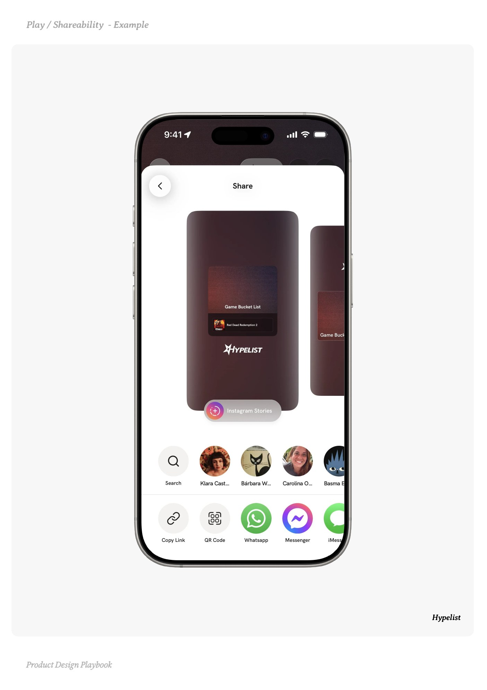
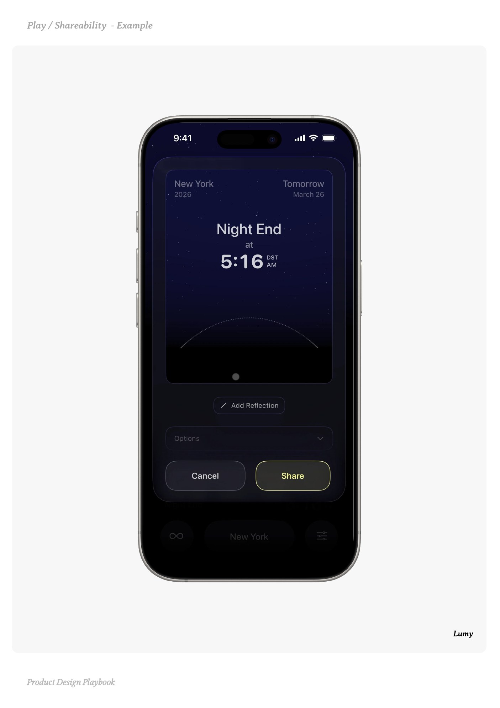

# Shareability


Source-faithful grouping of PDF pages 152 through 156.


## Play overview, PDF page 152

[Open extracted page text](../source/pages/page-152.md) | [Open full-page screenshot](../screenshots/page-152.jpg)



### Extracted text

```text
􀉟

Pla

Turn moments of pride into organic growth.

What it is:

Users voluntarily share achievements or outputs that elevate their perceived status,
social, intellectual, professional, or aesthetic. 


Why it works:

We share how something made us feel. When sharing is a flex, or a badge of honour, or
something that simply elevates status, users naturally amplify your product.


When to use it:

When users reach an achievement that would increase their status

When your audience overlaps with identity-driven communities (runners, creators)

In moments where the output (playlist, image, chart, profile) reflects user effort,
taste, talent or skill


Do:

Design stunning, lightly branded share visuals that feel native on socials

Let users add a caption or quote make it feel theirs

Anchor the share moment in emotion: pride, progress, surprise


Don’t:

Push share prompts before value is achieved

Make the share feel too self-promotional

Assume vanity is shallow it’s often tied to meaning


Founder Tip:

This play works best when users feel achievement. Emotion is the real trigger. Build
toward a moment of celebration users want to show off. Then let them share it.

􀰴 Pair with:

Success Moments

| Gamified Progress

|

Referral

|

Time to Value

|

Effort Moat
```

## Make it yours prompts, PDF page 153

[Open extracted page text](../source/pages/page-153.md) | [Open full-page screenshot](../screenshots/page-153.jpg)



### Extracted text

```text
Make moments feel worth showing off. Use these prompts to trigger authentic
virality without asking for it directly.
1. To earn the share:

What progress, output, or achievement would feel share-worthy?

Does it reflect something they’re proud of like skill, taste, consistency?

Are we tying the moment to status, identity, or surprise?


2. To package it:

Are we making it visually beautiful and instantly share-worthy?

Can users personalise it with captions, tone, or emojis?

Does it feel like their win, not our marketing?


3. To time it right:

Is this shown after a clear emotional high or moment of value?

Are we linking share prompts to existing community behaviours (e.g. creators,
runners, readers)?

Could we build anticipation so the share moment feels like a natural outcome?

Product Design Playbook
```

## Example 1, PDF page 154

[Open extracted page text](../source/pages/page-154.md) | [Open full-page screenshot](../screenshots/page-154.jpg)



### Extracted text

```text
lSelple

Slopes

Product Design Playbook
```

## Example 2, PDF page 155

[Open extracted page text](../source/pages/page-155.md) | [Open full-page screenshot](../screenshots/page-155.jpg)



### Extracted text

```text
lyeilityple

Hypelist

Product Design Playbook
```

## Example 3, PDF page 156

[Open extracted page text](../source/pages/page-156.md) | [Open full-page screenshot](../screenshots/page-156.jpg)



### Extracted text

```text
yym

Lumy

Product Design Playbook
```
