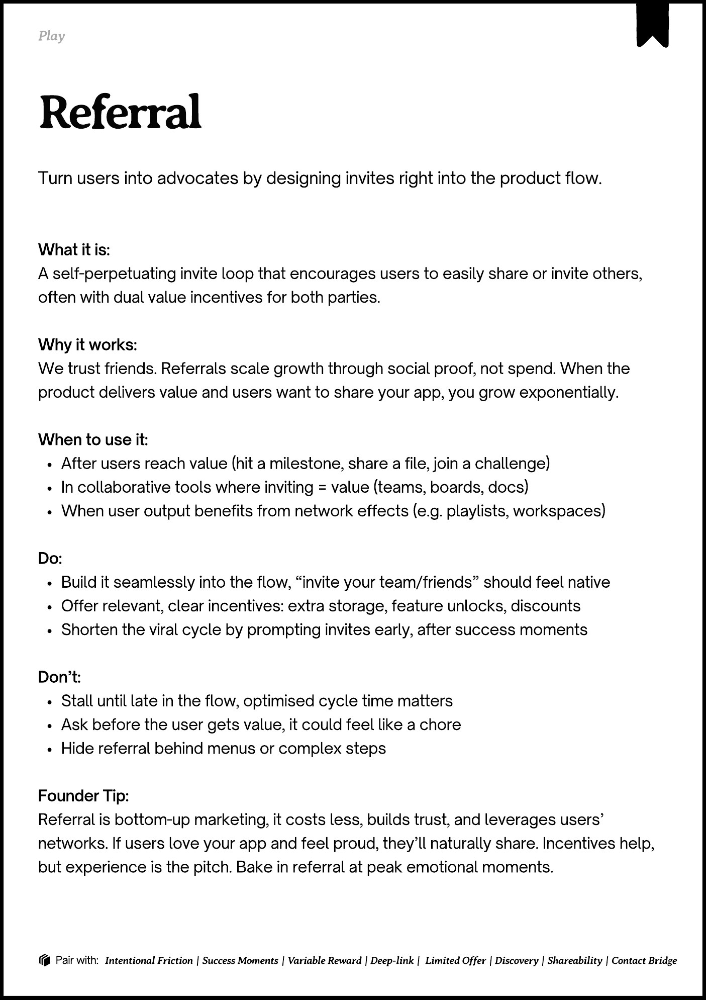
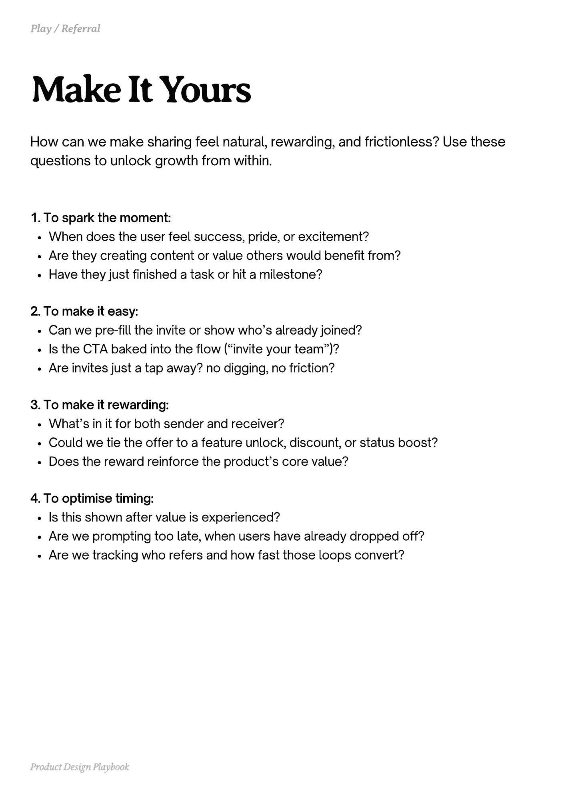
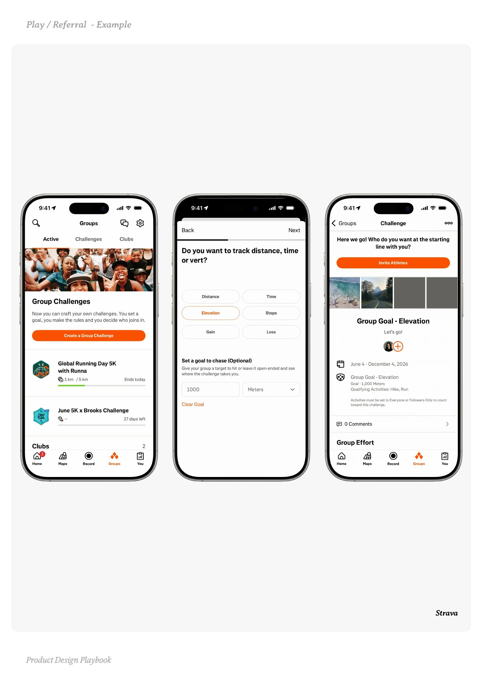
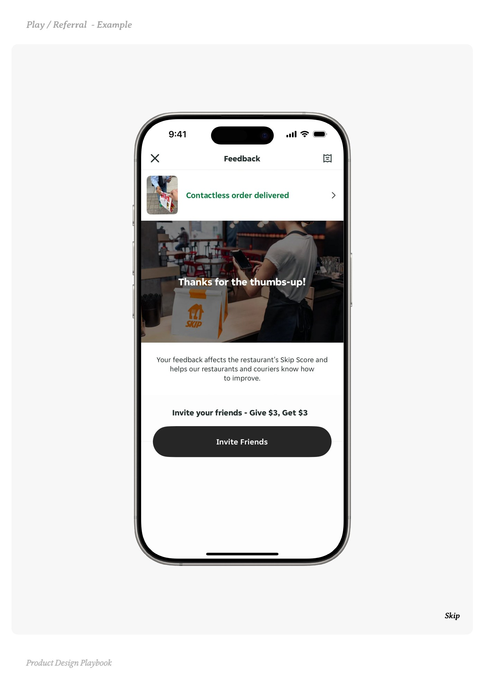
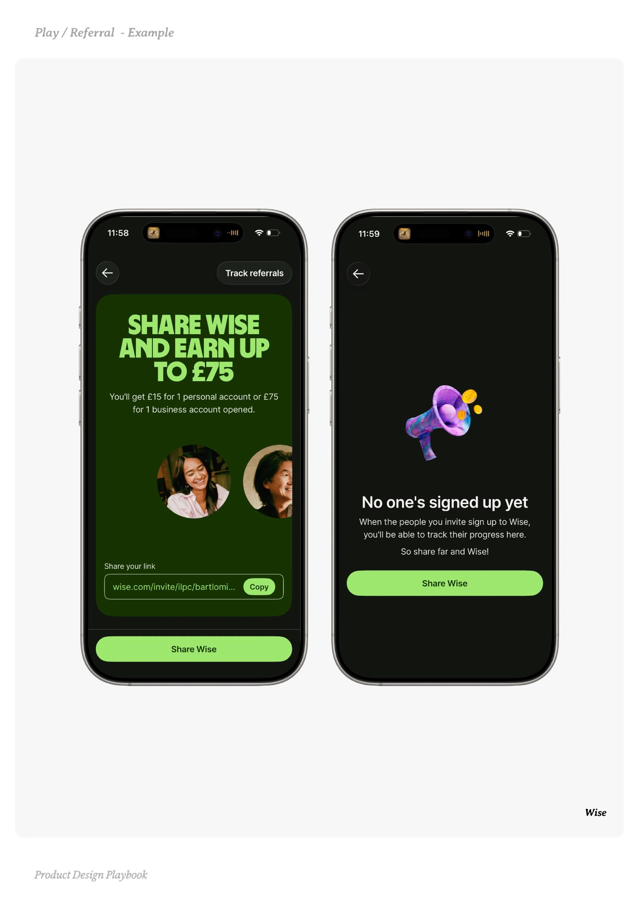

# Referral


Source-faithful grouping of PDF pages 157 through 161.


## Play overview, PDF page 157

[Open extracted page text](../source/pages/page-157.md) | [Open full-page screenshot](../screenshots/page-157.jpg)



### Extracted text

```text
􀉟

lay

Turn users into advocates by designing invites right into the product flow.

What it is:

A self-perpetuating invite loop that encourages users to easily share or invite others,
often with dual value incentives for both parties.


Why it works:

We trust friends. Referrals scale growth through social proof, not spend. When the
product delivers value and users want to share your app, you grow exponentially. 


When to use it:

After users reach value (hit a milestone, share a file, join a challenge)

In collaborative tools where inviting = value (teams, boards, docs)

When user output benefits from network effects (e.g. playlists, workspaces)


Do:

Build it seamlessly into the flow, “invite your team/friends” should feel native

Offer relevant, clear incentives: extra storage, feature unlocks, discounts

Shorten the viral cycle by prompting invites early, after success moments


Don’t:

Stall until late in the flow, optimised cycle time matters

Ask before the user gets value, it could feel like a chore

Hide referral behind menus or complex steps


Founder Tip:

Referral is bottom-up marketing, it costs less, builds trust, and leverages users’
networks. If users love your app and feel proud, they’ll naturally share. Incentives help,
but experience is the pitch. Bake in referral at peak emotional moments.

􀰴 Pair with:

Intentional Friction | Success Moments | Variable Reward | Deep-link |

Limited Offer | Discovery | Shareability | Contact Bridge
```

## Make it yours prompts, PDF page 158

[Open extracted page text](../source/pages/page-158.md) | [Open full-page screenshot](../screenshots/page-158.jpg)



### Extracted text

```text
How can we make sharing feel natural, rewarding, and frictionless? Use these
questions to unlock growth from within.
1. To spark the moment:

When does the user feel success, pride, or excitement?

Are they creating content or value others would benefit from?

Have they just finished a task or hit a milestone?


2. To make it easy:

Can we pre-fill the invite or show who’s already joined?

Is the CTA baked into the flow (“invite your team”)?

Are invites just a tap away? no digging, no friction?


3. To make it rewarding:

What’s in it for both sender and receiver?

Could we tie the offer to a feature unlock, discount, or status boost?

Does the reward reinforce the product’s core value?


4. To optimise timing:

Is this shown after value is experienced?

Are we prompting too late, when users have already dropped off?

Are we tracking who refers and how fast those loops convert?

Product Design Playbook
```

## Example 1, PDF page 159

[Open extracted page text](../source/pages/page-159.md) | [Open full-page screenshot](../screenshots/page-159.jpg)



### Extracted text

```text
arraa

Strava

Product Design Playbook
```

## Example 2, PDF page 160

[Open extracted page text](../source/pages/page-160.md) | [Open full-page screenshot](../screenshots/page-160.jpg)



### Extracted text

```text
p

Skip

Product Design Playbook
```

## Example 3, PDF page 161

[Open extracted page text](../source/pages/page-161.md) | [Open full-page screenshot](../screenshots/page-161.jpg)



### Extracted text

```text
eee

Wise

Product Design Playbook
```
