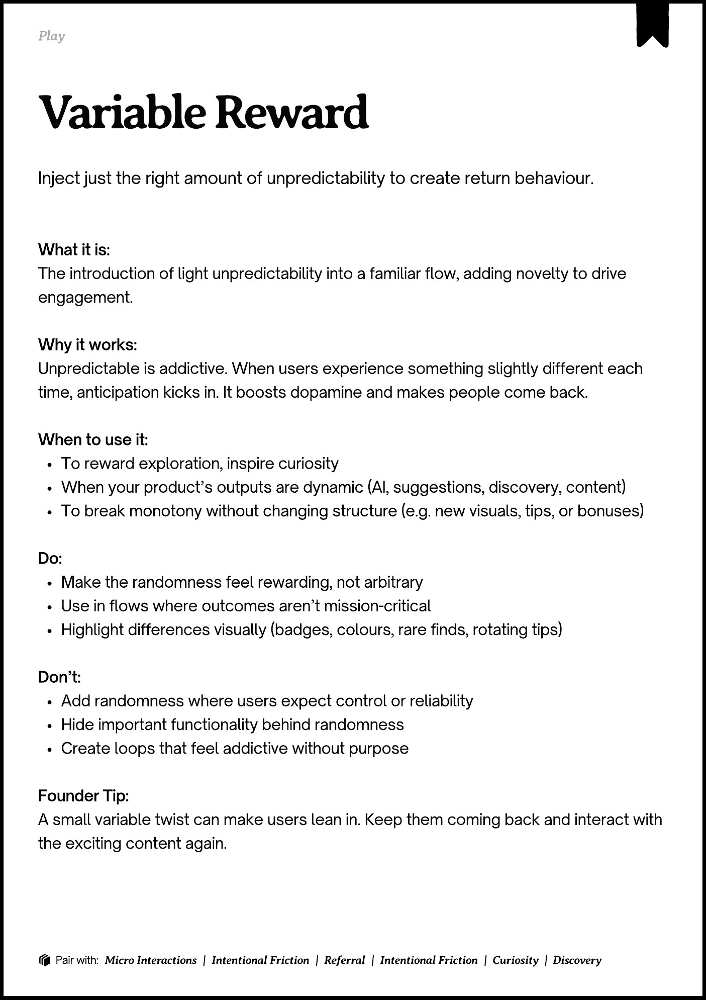
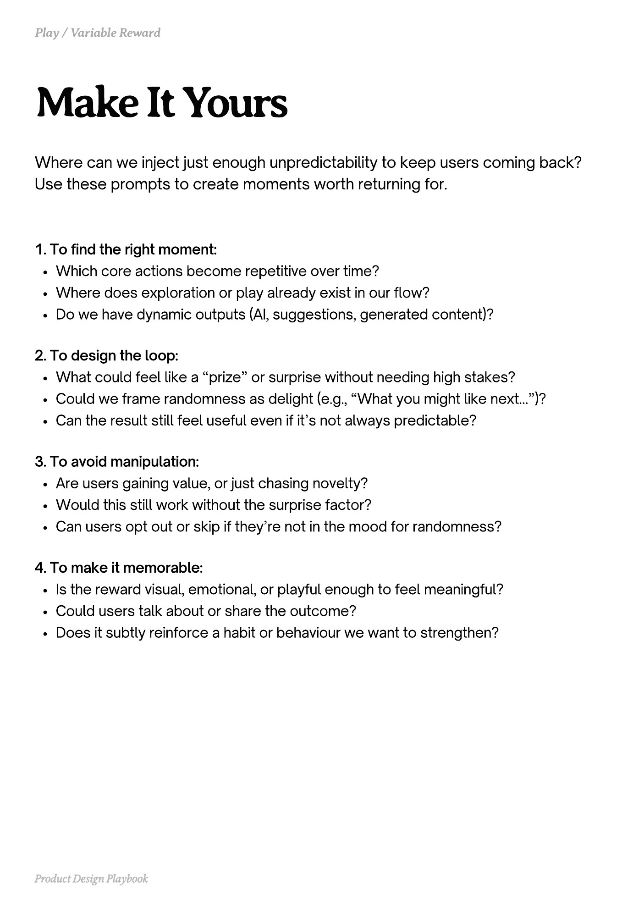
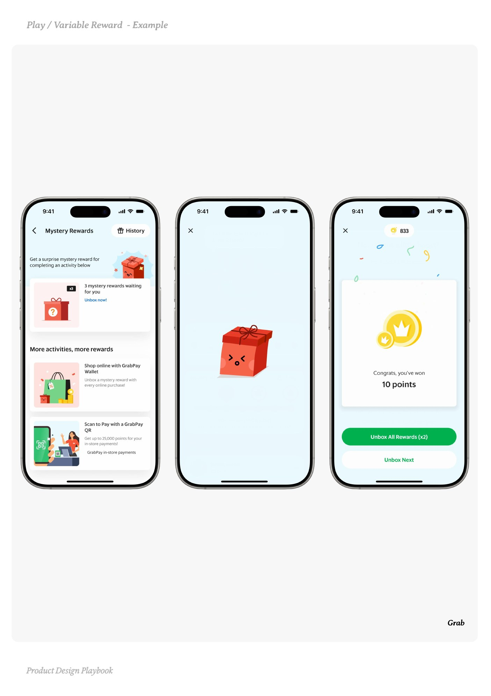
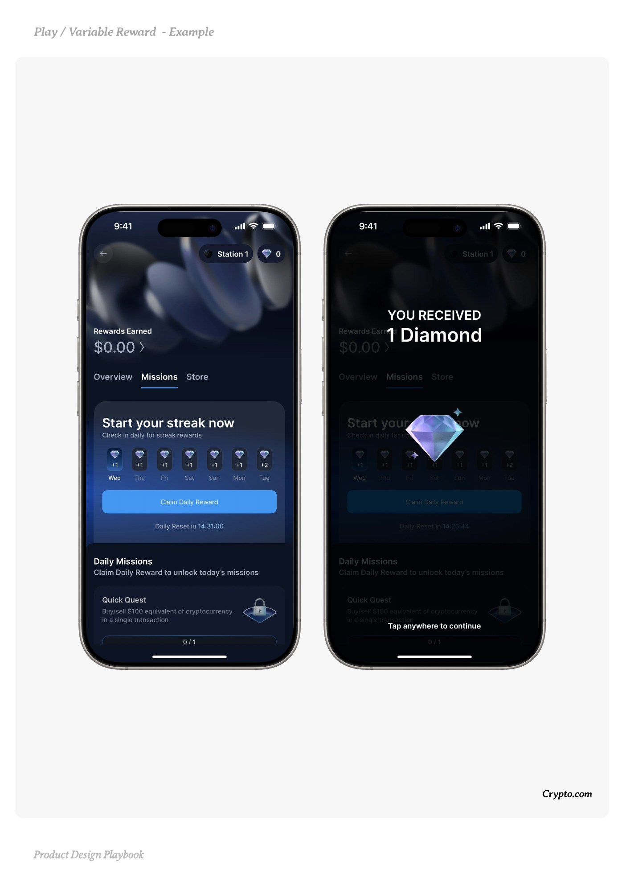
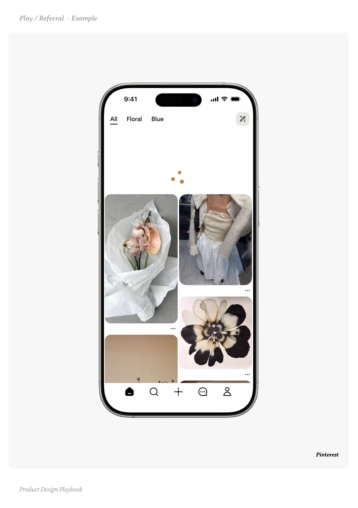

# Variable Reward


Source-faithful grouping of PDF pages 162 through 166.


## Play overview, PDF page 162

[Open extracted page text](../source/pages/page-162.md) | [Open full-page screenshot](../screenshots/page-162.jpg)



### Extracted text

```text
􀉟

lay

Inject just the right amount of unpredictability to create return behaviour.

What it is:

The introduction of light unpredictability into a familiar flow, adding novelty to drive
engagement.


Why it works:

Unpredictable is addictive. When users experience something slightly different each
time, anticipation kicks in. It boosts dopamine and makes people come back.


When to use it:

To reward exploration, inspire curiosity

When your product’s outputs are dynamic (AI, suggestions, discovery, content)

To break monotony without changing structure (e.g. new visuals, tips, or bonuses)


Do:

Make the randomness feel rewarding, not arbitrary

Use in flows where outcomes aren’t mission-critical

Highlight differences visually (badges, colours, rare finds, rotating tips)


Don’t:

Add randomness where users expect control or reliability

Hide important functionality behind randomness

Create loops that feel addictive without purpose


Founder Tip:

A small variable twist can make users lean in. Keep them coming back and interact with
the exciting content again.

􀰴 Pair with:

Micro Interactions

|

Intentional Friction

|

Referral

|

Intentional Friction

| Curiosity | Discovery
```

## Make it yours prompts, PDF page 163

[Open extracted page text](../source/pages/page-163.md) | [Open full-page screenshot](../screenshots/page-163.jpg)



### Extracted text

```text
Where can we inject just enough unpredictability to keep users coming back?
Use these prompts to create moments worth returning for.

1. To find the right moment:

Which core actions become repetitive over time?

Where does exploration or play already exist in our flow?

Do we have dynamic outputs (AI, suggestions, generated content)?



2. To design the loop:

What could feel like a “prize” or surprise without needing high stakes?

Could we frame randomness as delight (e.g., “What you might like next…”)?

Can the result still feel useful even if it’s not always predictable?



3. To avoid manipulation:

Are users gaining value, or just chasing novelty?

Would this still work without the surprise factor?

Can users opt out or skip if they’re not in the mood for randomness?



4. To make it memorable:

Is the reward visual, emotional, or playful enough to feel meaningful?

Could users talk about or share the outcome?

Does it subtly reinforce a habit or behaviour we want to strengthen?

Product Design Playbook
```

## Example 1, PDF page 164

[Open extracted page text](../source/pages/page-164.md) | [Open full-page screenshot](../screenshots/page-164.jpg)



### Extracted text

```text
aarabara

Grab

Product Design Playbook
```

## Example 2, PDF page 165

[Open extracted page text](../source/pages/page-165.md) | [Open full-page screenshot](../screenshots/page-165.jpg)



### Extracted text

```text
yrrmp

Crypto.com

Product Design Playbook
```

## Example 3, PDF page 166

[Open extracted page text](../source/pages/page-166.md) | [Open full-page screenshot](../screenshots/page-166.jpg)



### Extracted text

```text
Peerre

Pinterest

Product Design Playbook
```
