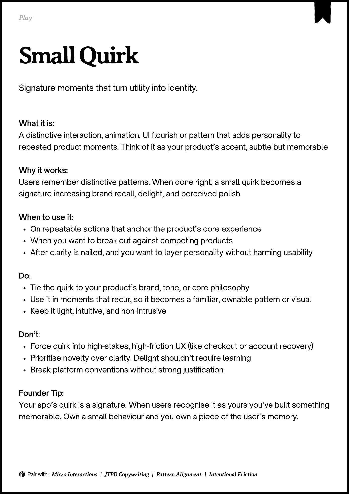
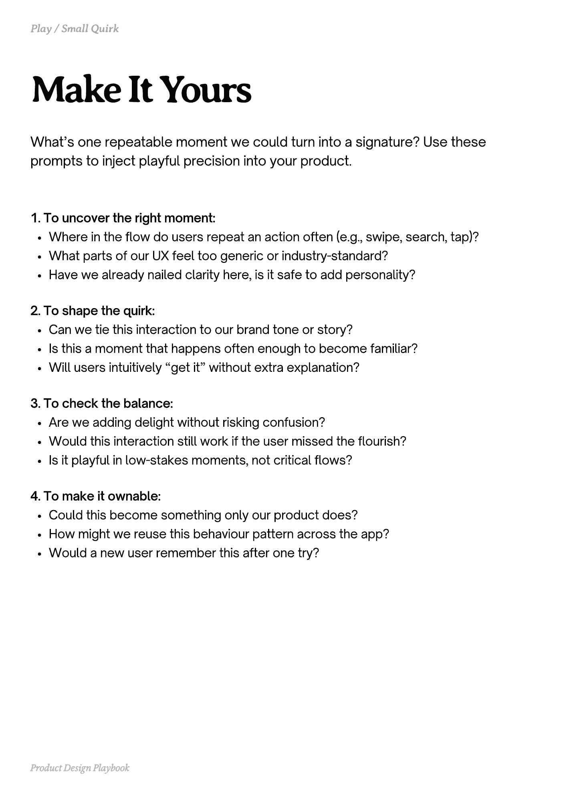
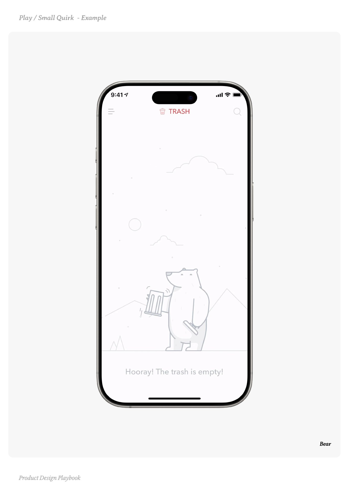
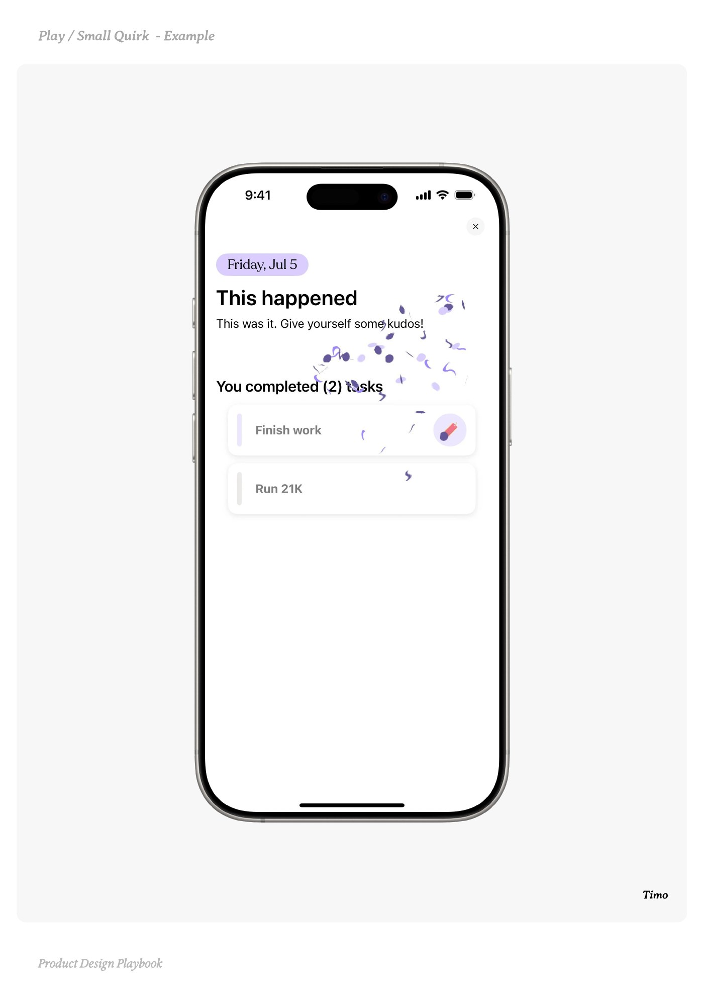
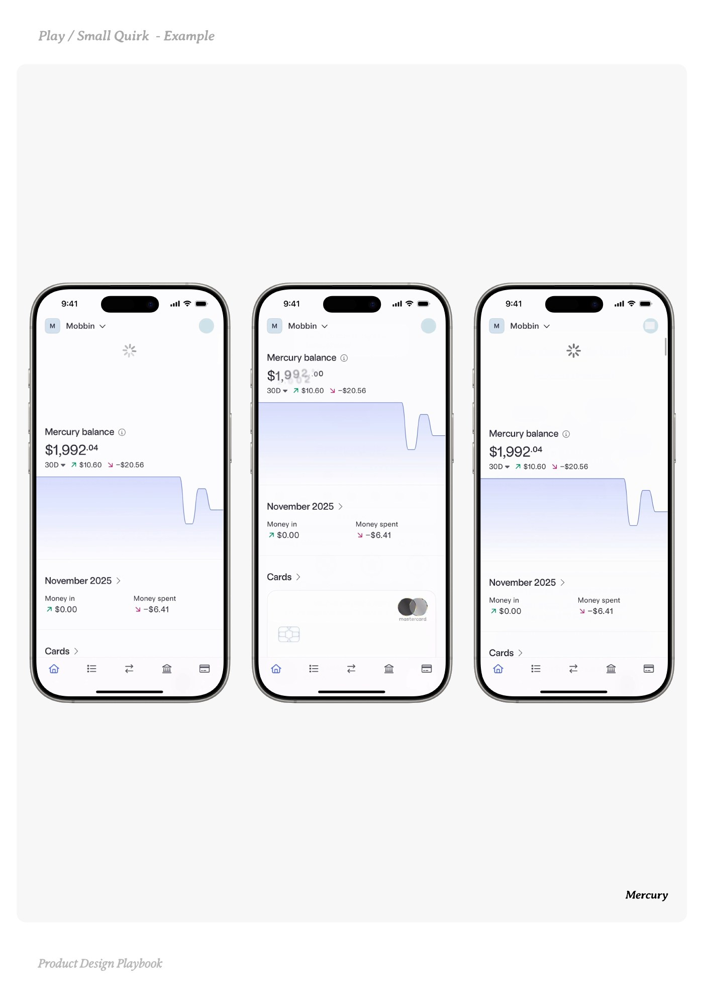

# Small Quirk


Source-faithful grouping of PDF pages 167 through 171.


## Play overview, PDF page 167

[Open extracted page text](../source/pages/page-167.md) | [Open full-page screenshot](../screenshots/page-167.jpg)



### Extracted text

```text
􀉟

Play

Signature moments that turn utility into identity.

What it is:

A distinctive interaction, animation, UI flourish or pattern that adds personality to
repeated product moments. Think of it as your product’s accent, subtle but memorable


Why it works:

Users remember distinctive patterns. When done right, a small quirk becomes a
signature increasing brand recall, delight, and perceived polish.


When to use it:

On repeatable actions that anchor the product’s core experience

When you want to break out against competing products

After clarity is nailed, and you want to layer personality without harming usability


Do:

Tie the quirk to your product’s brand, tone, or core philosophy

Use it in moments that recur, so it becomes a familiar, ownable pattern or visual

Keep it light, intuitive, and non-intrusive


Don’t:

Force quirk into high-stakes, high-friction UX (like checkout or account recovery)

Prioritise novelty over clarity. Delight shouldn’t require learning

Break platform conventions without strong justification


Founder Tip:

Your app’s quirk is a signature. When users recognise it as yours you’ve built something
memorable. Own a small behaviour and you own a piece of the user’s memory.

􀰴 Pair with:

Micro Interactions

|

JTBD Copywriting

|

Pattern Alignment

|

Intentional Friction
```

## Make it yours prompts, PDF page 168

[Open extracted page text](../source/pages/page-168.md) | [Open full-page screenshot](../screenshots/page-168.jpg)



### Extracted text

```text
What’s one repeatable moment we could turn into a signature? Use these
prompts to inject playful precision into your product.

1. To uncover the right moment:

Where in the flow do users repeat an action often (e.g., swipe, search, tap)?

What parts of our UX feel too generic or industry-standard?

Have we already nailed clarity here, is it safe to add personality?



2. To shape the quirk:

Can we tie this interaction to our brand tone or story?

Is this a moment that happens often enough to become familiar?

Will users intuitively “get it” without extra explanation?



3. To check the balance:

Are we adding delight without risking confusion?

Would this interaction still work if the user missed the flourish?

Is it playful in low-stakes moments, not critical flows?



4. To make it ownable:

Could this become something only our product does?

How might we reuse this behaviour pattern across the app?

Would a new user remember this after one try?

Product Design Playbook
```

## Example 1, PDF page 169

[Open extracted page text](../source/pages/page-169.md) | [Open full-page screenshot](../screenshots/page-169.jpg)



### Extracted text

```text
aarae

Bear

Product Design Playbook
```

## Example 2, PDF page 170

[Open extracted page text](../source/pages/page-170.md) | [Open full-page screenshot](../screenshots/page-170.jpg)



### Extracted text

```text
mim

Timo

Product Design Playbook
```

## Example 3, PDF page 171

[Open extracted page text](../source/pages/page-171.md) | [Open full-page screenshot](../screenshots/page-171.jpg)



### Extracted text

```text
yure

Mercury

Product Design Playbook
```
