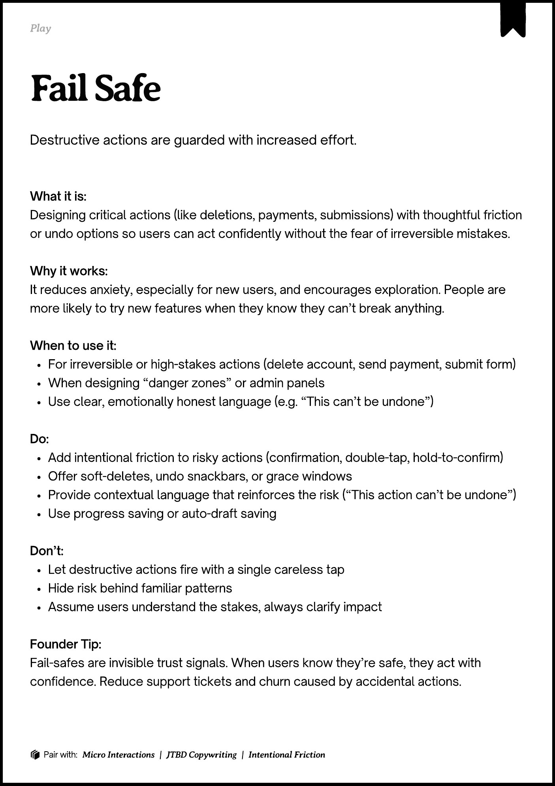
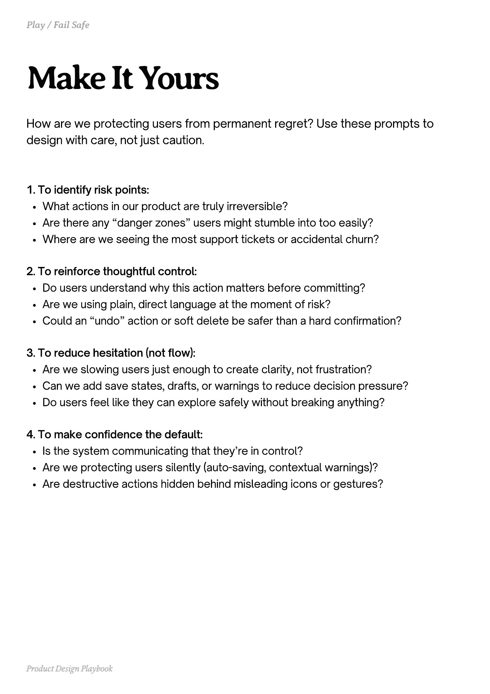
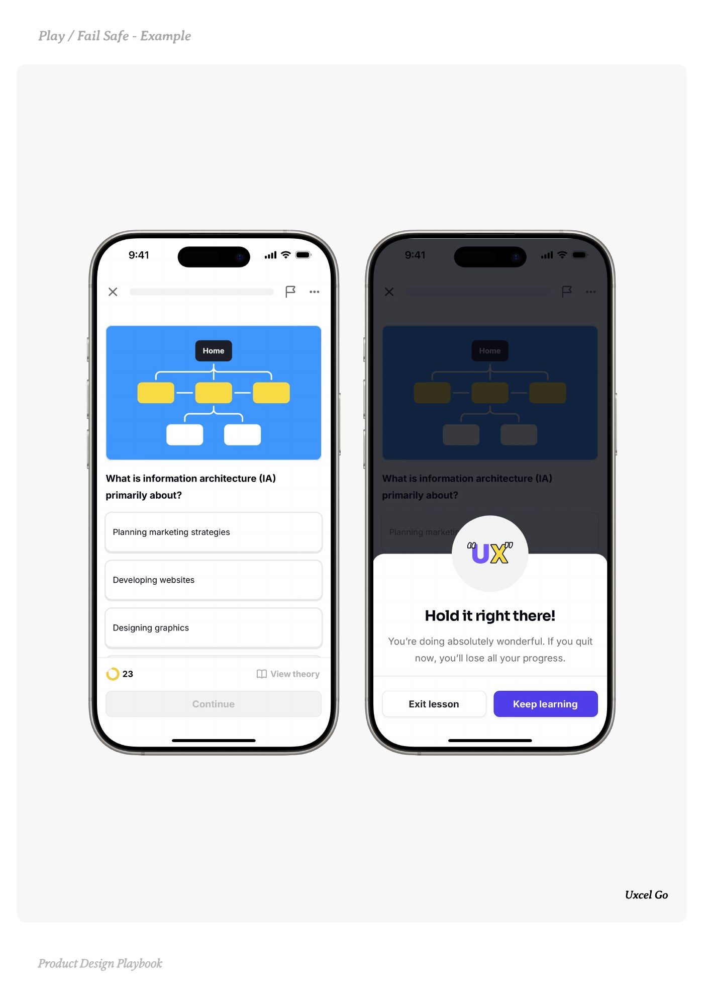
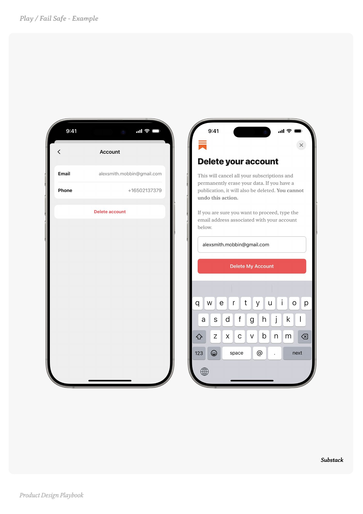
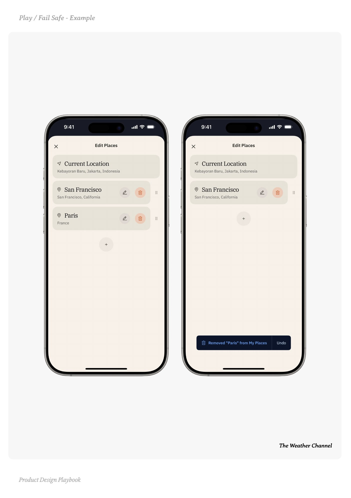

# Fail Safe


Source-faithful grouping of PDF pages 172 through 176.


## Play overview, PDF page 172

[Open extracted page text](../source/pages/page-172.md) | [Open full-page screenshot](../screenshots/page-172.jpg)



### Extracted text

```text
􀉟

lay

Destructive actions are guarded with increased effort.

What it is:

Designing critical actions (like deletions, payments, submissions) with thoughtful friction
or undo options so users can act confidently without the fear of irreversible mistakes.


Why it works:

It reduces anxiety, especially for new users, and encourages exploration. People are
more likely to try new features when they know they can’t break anything.


When to use it:

For irreversible or high-stakes actions (delete account, send payment, submit form)

When designing “danger zones” or admin panels

Use clear, emotionally honest language (e.g. “This can’t be undone”)


Do:

Add intentional friction to risky actions (confirmation, double-tap, hold-to-confirm)

Offer soft-deletes, undo snackbars, or grace windows

Provide contextual language that reinforces the risk (“This action can’t be undone”)

Use progress saving or auto-draft saving


Don’t:

Let destructive actions fire with a single careless tap

Hide risk behind familiar patterns

Assume users understand the stakes, always clarify impact


Founder Tip:

Fail-safes are invisible trust signals. When users know they’re safe, they act with
confidence. Reduce support tickets and churn caused by accidental actions.

􀰴 Pair with:

Micro Interactions

|

JTBD Copywriting

|

Intentional Friction
```

## Make it yours prompts, PDF page 173

[Open extracted page text](../source/pages/page-173.md) | [Open full-page screenshot](../screenshots/page-173.jpg)



### Extracted text

```text
How are we protecting users from permanent regret? Use these prompts to
design with care, not just caution.

1. To identify risk points:

What actions in our product are truly irreversible?

Are there any “danger zones” users might stumble into too easily?

Where are we seeing the most support tickets or accidental churn?



2. To reinforce thoughtful control:

Do users understand why this action matters before committing?

Are we using plain, direct language at the moment of risk?

Could an “undo” action or soft delete be safer than a hard confirmation?


3. To reduce hesitation (not flow):

Are we slowing users just enough to create clarity, not frustration?

Can we add save states, drafts, or warnings to reduce decision pressure?

Do users feel like they can explore safely without breaking anything?



4. To make confidence the default:

Is the system communicating that they’re in control?

Are we protecting users silently (auto-saving, contextual warnings)?

Are destructive actions hidden behind misleading icons or gestures?

Product Design Playbook
```

## Example 1, PDF page 174

[Open extracted page text](../source/pages/page-174.md) | [Open full-page screenshot](../screenshots/page-174.jpg)



### Extracted text

```text
l l e xle

Uxcel Go

Product Design Playbook
```

## Example 2, PDF page 175

[Open extracted page text](../source/pages/page-175.md) | [Open full-page screenshot](../screenshots/page-175.jpg)



### Extracted text

```text
aaSaa

Substack

Product Design Playbook
```

## Example 3, PDF page 176

[Open extracted page text](../source/pages/page-176.md) | [Open full-page screenshot](../screenshots/page-176.jpg)



### Extracted text

```text
la al ae ale

The Weather Channel

Product Design Playbook
```
