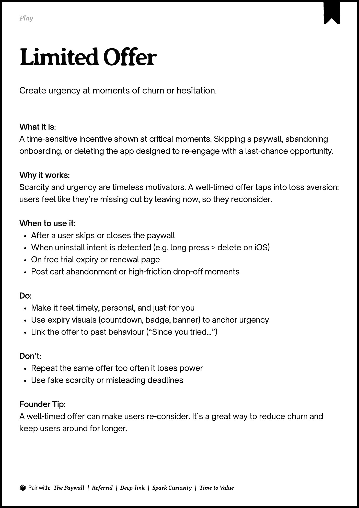
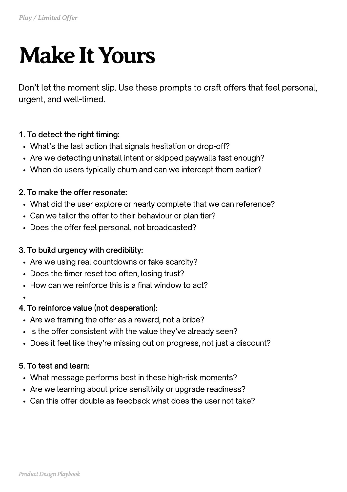
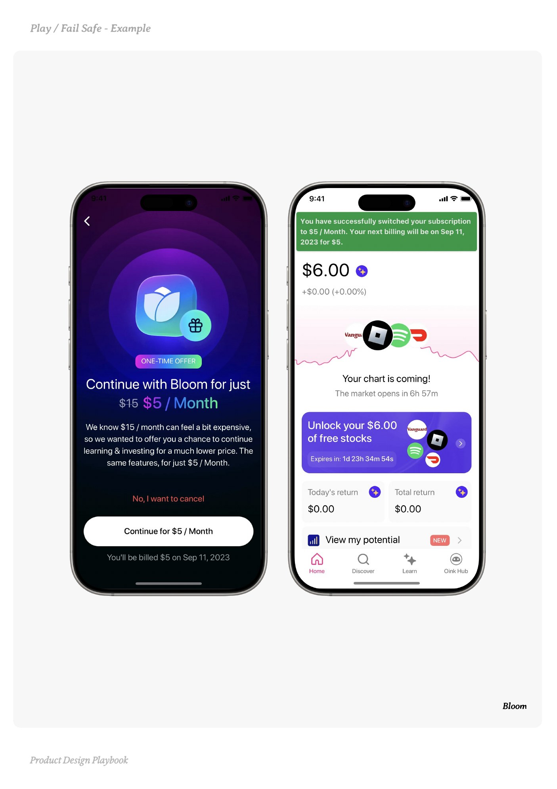
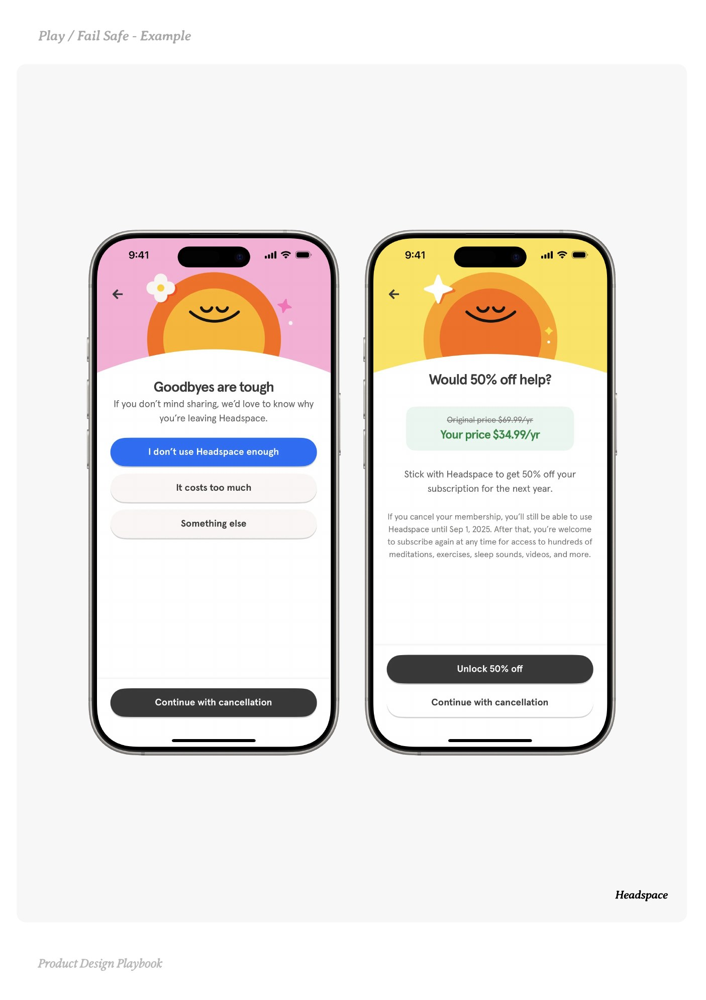
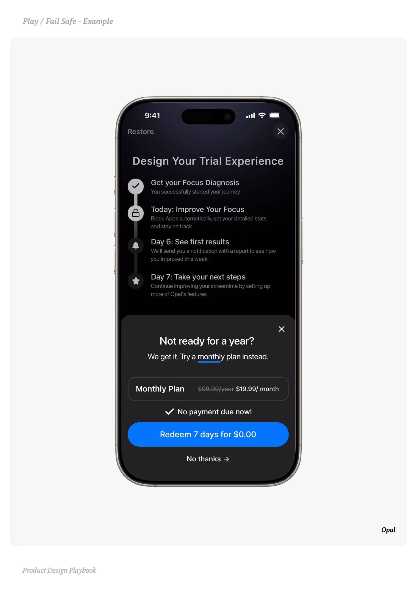

# Limited Offer


Source-faithful grouping of PDF pages 177 through 181.


## Play overview, PDF page 177

[Open extracted page text](../source/pages/page-177.md) | [Open full-page screenshot](../screenshots/page-177.jpg)



### Extracted text

```text
􀉟

Play

Create urgency at moments of churn or hesitation.

What it is:

A time-sensitive incentive shown at critical moments. Skipping a paywall, abandoning
onboarding, or deleting the app designed to re-engage with a last-chance opportunity.


Why it works:

Scarcity and urgency are timeless motivators. A well-timed offer taps into loss aversion:
users feel like they’re missing out by leaving now, so they reconsider.


When to use it:

After a user skips or closes the paywall

When uninstall intent is detected (e.g. long press > delete on iOS)

On free trial expiry or renewal page

Post cart abandonment or high-friction drop-off moments


Do:

Make it feel timely, personal, and just-for-you

Use expiry visuals (countdown, badge, banner) to anchor urgency

Link the offer to past behaviour (“Since you tried...”)


Don’t:

Repeat the same offer too often it loses power

Use fake scarcity or misleading deadlines


Founder Tip:

A well-timed offer can make users re-consider. It’s a great way to reduce churn and
keep users around for longer.

􀰴 Pair with:

The Paywall

|

Referral

| Deep-link |

Spark Curiosity

|

Time to Value
```

## Make it yours prompts, PDF page 178

[Open extracted page text](../source/pages/page-178.md) | [Open full-page screenshot](../screenshots/page-178.jpg)



### Extracted text

```text
Don’t let the moment slip. Use these prompts to craft offers that feel personal,
urgent, and well-timed.

1. To detect the right timing:

What’s the last action that signals hesitation or drop-off?

Are we detecting uninstall intent or skipped paywalls fast enough?

When do users typically churn and can we intercept them earlier?



2. To make the offer resonate:

What did the user explore or nearly complete that we can reference?

Can we tailor the offer to their behaviour or plan tier?

Does the offer feel personal, not broadcasted?



3. To build urgency with credibility:

Are we using real countdowns or fake scarcity?

Does the timer reset too often, losing trust?

How can we reinforce this is a final window to act?


4. To reinforce value (not desperation):

Are we framing the offer as a reward, not a bribe?

Is the offer consistent with the value they’ve already seen?

Does it feel like they’re missing out on progress, not just a discount?



5. To test and learn:

What message performs best in these high-risk moments?

Are we learning about price sensitivity or upgrade readiness?

Can this offer double as feedback what does the user not take?

Product Design Playbook
```

## Example 1, PDF page 179

[Open extracted page text](../source/pages/page-179.md) | [Open full-page screenshot](../screenshots/page-179.jpg)



### Extracted text

```text
llml

Bloom

Product Design Playbook
```

## Example 2, PDF page 180

[Open extracted page text](../source/pages/page-180.md) | [Open full-page screenshot](../screenshots/page-180.jpg)



### Extracted text

```text
aaaeape

Headspace

Product Design Playbook
```

## Example 3, PDF page 181

[Open extracted page text](../source/pages/page-181.md) | [Open full-page screenshot](../screenshots/page-181.jpg)



### Extracted text

```text
laalaapl

Opal

Product Design Playbook
```
