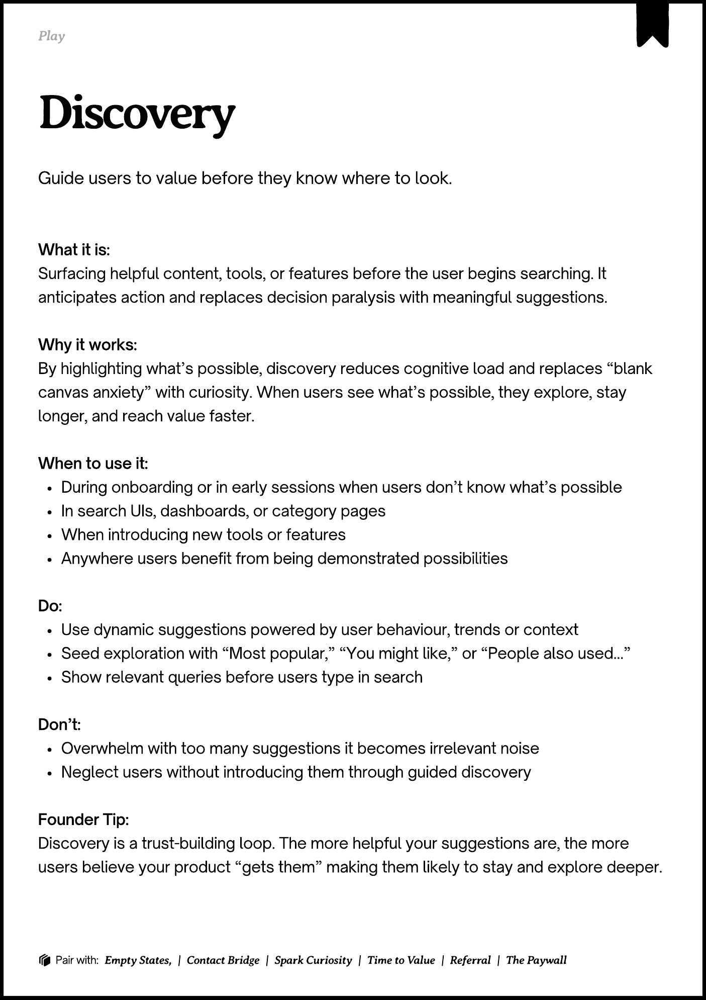
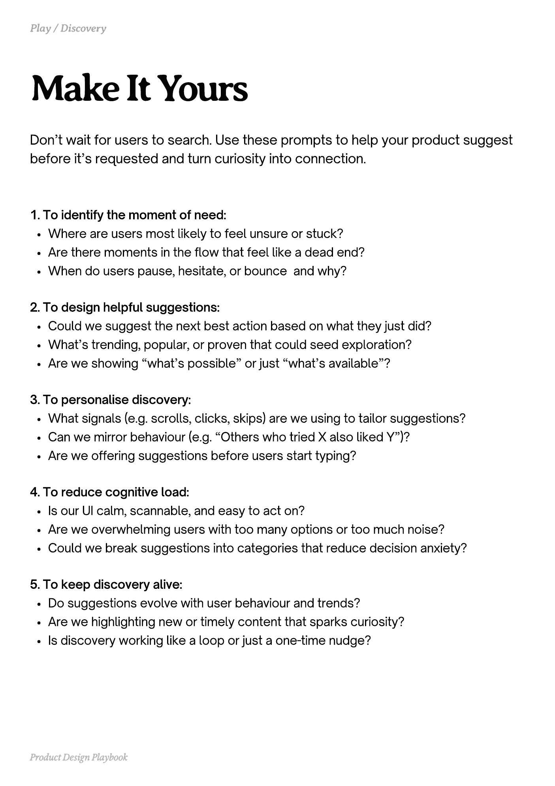
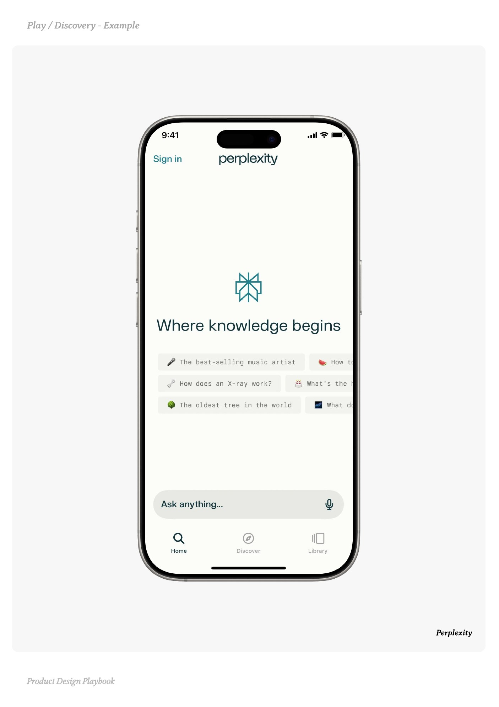
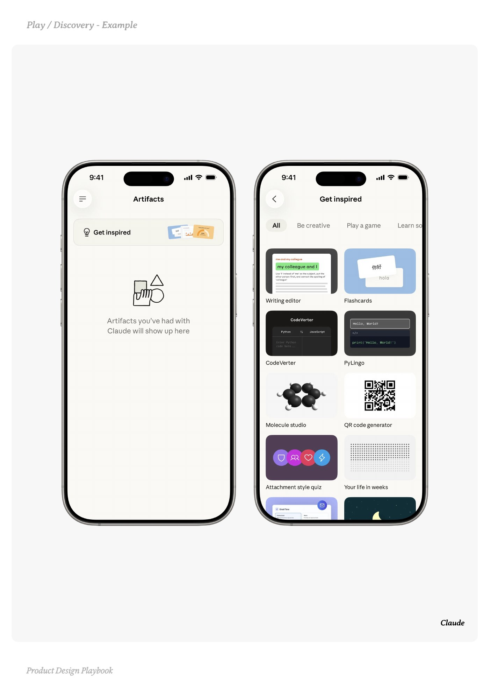
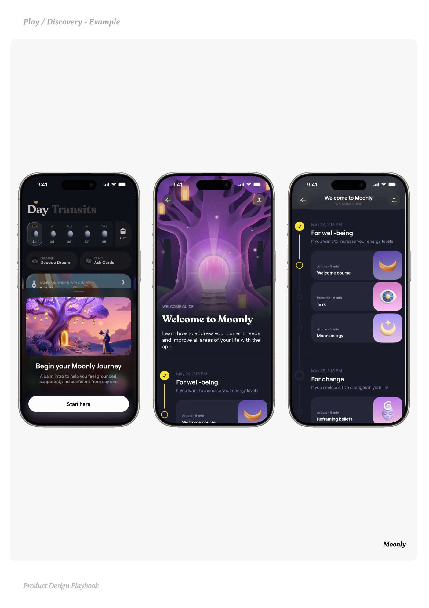

# Discovery


Source-faithful grouping of PDF pages 182 through 186.


## Play overview, PDF page 182

[Open extracted page text](../source/pages/page-182.md) | [Open full-page screenshot](../screenshots/page-182.jpg)



### Extracted text

```text
􀉟

Play

Guide users to value before they know where to look.

What it is:

Surfacing helpful content, tools, or features before the user begins searching. It
anticipates action and replaces decision paralysis with meaningful suggestions.


Why it works:

By highlighting what’s possible, discovery reduces cognitive load and replaces “blank
canvas anxiety” with curiosity. When users see what’s possible, they explore, stay
longer, and reach value faster.


When to use it:

During onboarding or in early sessions when users don’t know what’s possible

In search UIs, dashboards, or category pages

When introducing new tools or features

Anywhere users benefit from being demonstrated possibilities


Do:

Use dynamic suggestions powered by user behaviour, trends or context

Seed exploration with “Most popular,” “You might like,” or “People also used…”

Show relevant queries before users type in search


Don’t:

Overwhelm with too many suggestions it becomes irrelevant noise

Neglect users without introducing them through guided discovery 


Founder Tip:

Discovery is a trust-building loop. The more helpful your suggestions are, the more
users believe your product “gets them” making them likely to stay and explore deeper.

􀰴 Pair with:

Empty States, |

Contact Bridge

|

Spark Curiosity

|

Time to Value

|

Referral

|

The Paywall
```

## Make it yours prompts, PDF page 183

[Open extracted page text](../source/pages/page-183.md) | [Open full-page screenshot](../screenshots/page-183.jpg)



### Extracted text

```text
Don’t wait for users to search. Use these prompts to help your product suggest
before it’s requested and turn curiosity into connection.
1. To identify the moment of need:

Where are users most likely to feel unsure or stuck?

Are there moments in the flow that feel like a dead end?

When do users pause, hesitate, or bounce and why?


2. To design helpful suggestions:

Could we suggest the next best action based on what they just did?

What’s trending, popular, or proven that could seed exploration?

Are we showing “what’s possible” or just “what’s available”?


3. To personalise discovery:

What signals (e.g. scrolls, clicks, skips) are we using to tailor suggestions?

Can we mirror behaviour (e.g. “Others who tried X also liked Y”)?

Are we offering suggestions before users start typing?


4. To reduce cognitive load:

Is our UI calm, scannable, and easy to act on?

Are we overwhelming users with too many options or too much noise?

Could we break suggestions into categories that reduce decision anxiety?


5. To keep discovery alive:

Do suggestions evolve with user behaviour and trends?

Are we highlighting new or timely content that sparks curiosity?

Is discovery working like a loop or just a one-time nudge?

Product Design Playbook
```

## Example 1, PDF page 184

[Open extracted page text](../source/pages/page-184.md) | [Open full-page screenshot](../screenshots/page-184.jpg)



### Extracted text

```text
Plyieryxple

Perplexity

Product Design Playbook
```

## Example 2, PDF page 185

[Open extracted page text](../source/pages/page-185.md) | [Open full-page screenshot](../screenshots/page-185.jpg)



### Extracted text

```text
laeale

Claude

Product Design Playbook
```

## Example 3, PDF page 186

[Open extracted page text](../source/pages/page-186.md) | [Open full-page screenshot](../screenshots/page-186.jpg)



### Extracted text

```text
lyoyl

Moonly

Product Design Playbook
```
