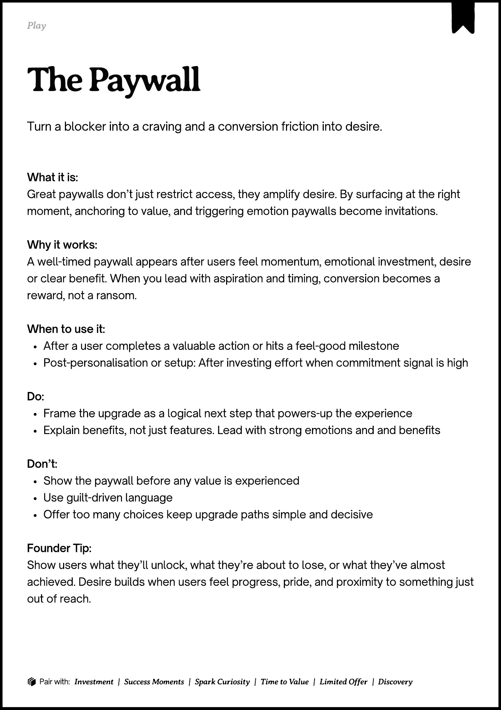
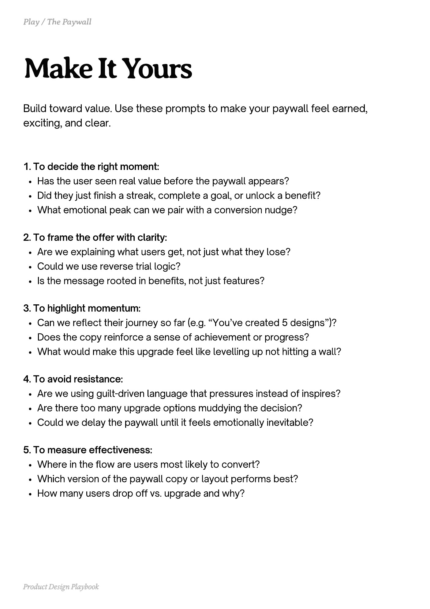
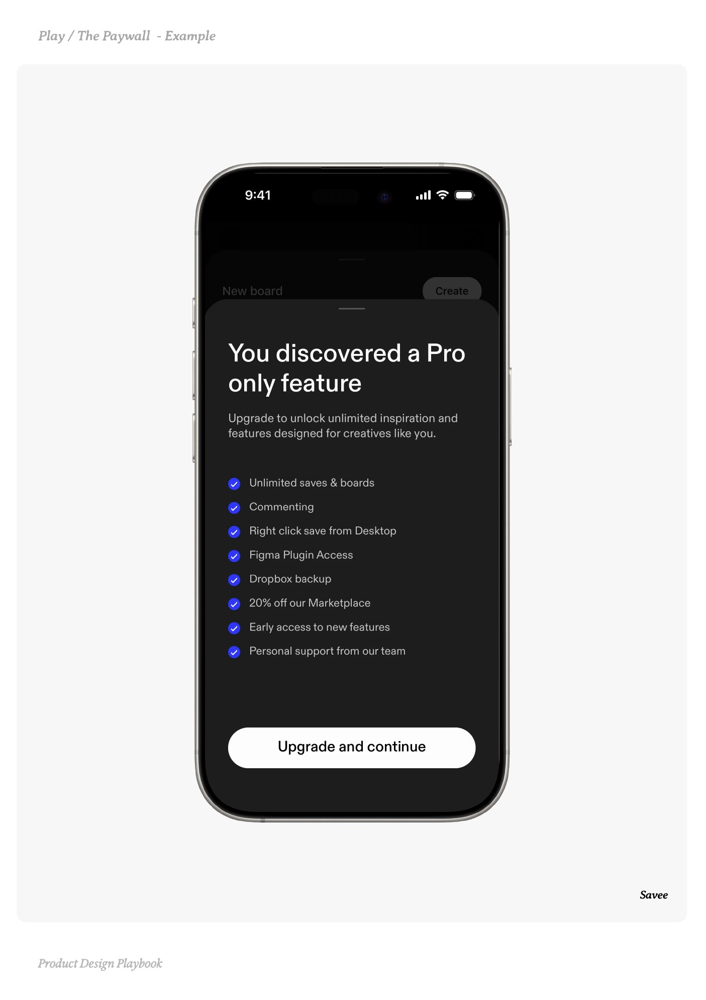
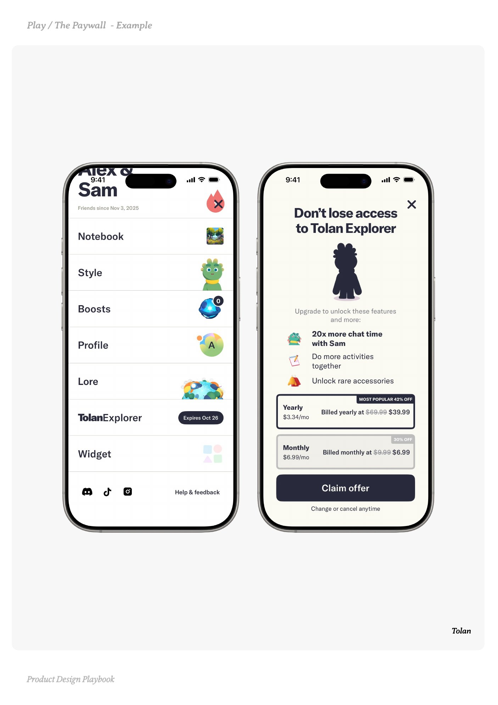
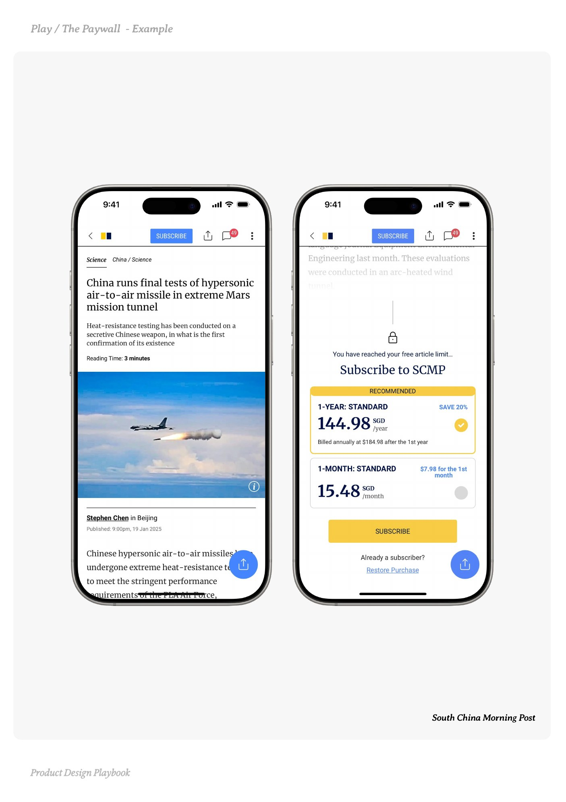

# The Paywall


Source-faithful grouping of PDF pages 187 through 191.


## Play overview, PDF page 187

[Open extracted page text](../source/pages/page-187.md) | [Open full-page screenshot](../screenshots/page-187.jpg)



### Extracted text

```text
􀉟

lay

Turn a blocker into a craving and a conversion friction into desire.

What it is:

Great paywalls don’t just restrict access, they amplify desire. By surfacing at the right
moment, anchoring to value, and triggering emotion paywalls become invitations.


Why it works:

A well-timed paywall appears after users feel momentum, emotional investment, desire
or clear benefit. When you lead with aspiration and timing, conversion becomes a
reward, not a ransom.


When to use it:

After a user completes a valuable action or hits a feel-good milestone

Post-personalisation or setup: After investing effort when commitment signal is high



Do:

Frame the upgrade as a logical next step that powers-up the experience 

Explain benefits, not just features. Lead with strong emotions and and benefits


Don’t:

Show the paywall before any value is experienced

Use guilt-driven language

Offer too many choices keep upgrade paths simple and decisive


Founder Tip:

Show users what they’ll unlock, what they’re about to lose, or what they’ve almost
achieved. Desire builds when users feel progress, pride, and proximity to something just
out of reach.

􀰴 Pair with:

Investment

|

Success Moments

|

Spark Curiosity

|

Time to Value

|

Limited Offer

| Discovery
```

## Make it yours prompts, PDF page 188

[Open extracted page text](../source/pages/page-188.md) | [Open full-page screenshot](../screenshots/page-188.jpg)



### Extracted text

```text
Build toward value. Use these prompts to make your paywall feel earned,
exciting, and clear.
1. To decide the right moment:

Has the user seen real value before the paywall appears?

Did they just finish a streak, complete a goal, or unlock a benefit?

What emotional peak can we pair with a conversion nudge?


2. To frame the offer with clarity:

Are we explaining what users get, not just what they lose?

Could we use reverse trial logic?

Is the message rooted in benefits, not just features?


3. To highlight momentum:

Can we reflect their journey so far (e.g. “You’ve created 5 designs”)?

Does the copy reinforce a sense of achievement or progress?

What would make this upgrade feel like levelling up not hitting a wall?


4. To avoid resistance:

Are we using guilt-driven language that pressures instead of inspires?

Are there too many upgrade options muddying the decision?

Could we delay the paywall until it feels emotionally inevitable?


5. To measure effectiveness:

Where in the flow are users most likely to convert?

Which version of the paywall copy or layout performs best?

How many users drop off vs. upgrade and why?

Product Design Playbook
```

## Example 1, PDF page 189

[Open extracted page text](../source/pages/page-189.md) | [Open full-page screenshot](../screenshots/page-189.jpg)



### Extracted text

```text
aeaaae

Savee

Product Design Playbook
```

## Example 2, PDF page 190

[Open extracted page text](../source/pages/page-190.md) | [Open full-page screenshot](../screenshots/page-190.jpg)



### Extracted text

```text
laTaallal

Tolan

Product Design Playbook
```

## Example 3, PDF page 191

[Open extracted page text](../source/pages/page-191.md) | [Open full-page screenshot](../screenshots/page-191.jpg)



### Extracted text

```text
Pa h Paa a

South China Morning Post

Product Design Playbook
```
