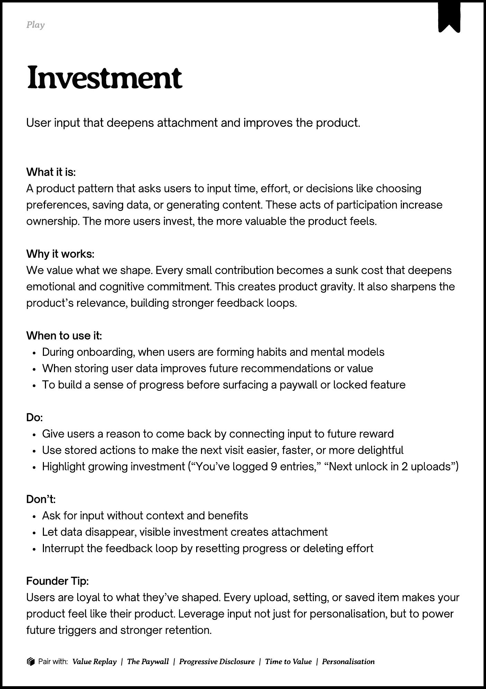
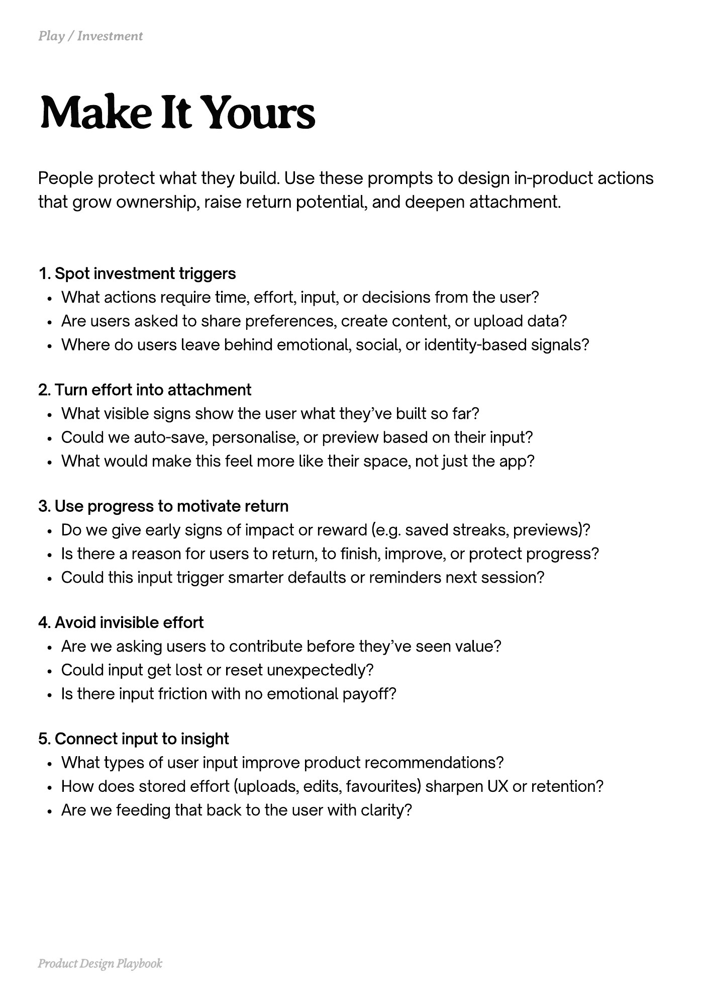
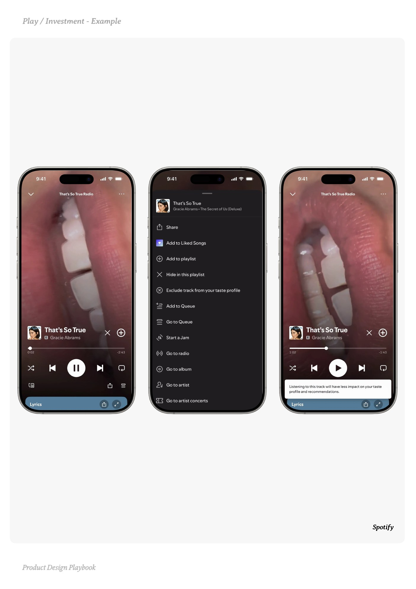
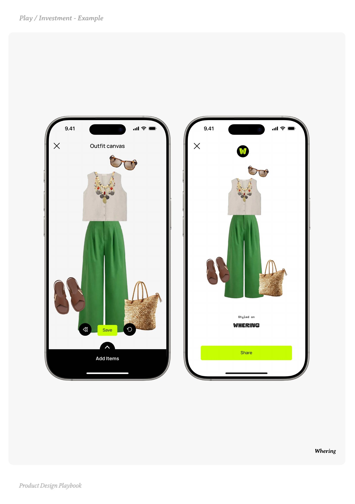
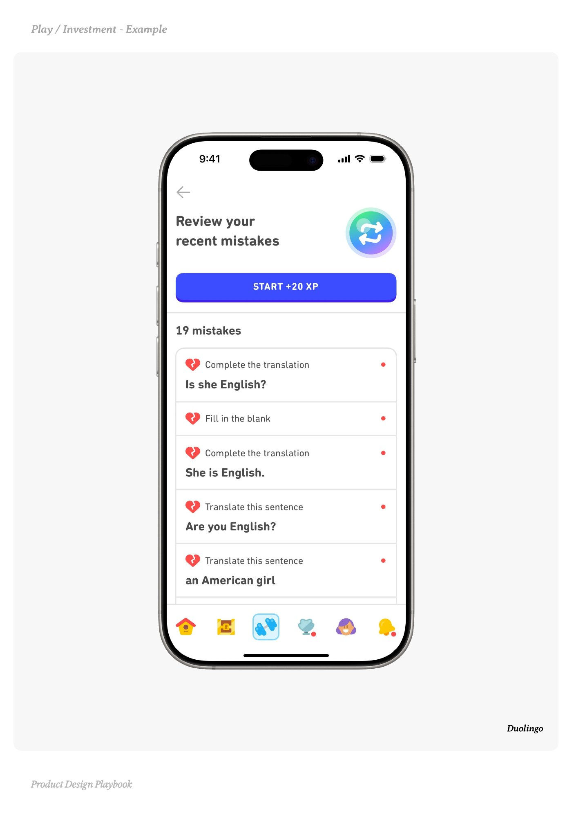

# Investment


Source-faithful grouping of PDF pages 192 through 196.


## Play overview, PDF page 192

[Open extracted page text](../source/pages/page-192.md) | [Open full-page screenshot](../screenshots/page-192.jpg)



### Extracted text

```text
􀉟

Play

User input that deepens attachment and improves the product.

What it is:

A product pattern that asks users to input time, effort, or decisions like choosing
preferences, saving data, or generating content. These acts of participation increase
ownership. The more users invest, the more valuable the product feels.


Why it works:

We value what we shape. Every small contribution becomes a sunk cost that deepens
emotional and cognitive commitment. This creates product gravity. It also sharpens the
product’s relevance, building stronger feedback loops.


When to use it:

During onboarding, when users are forming habits and mental models

When storing user data improves future recommendations or value

To build a sense of progress before surfacing a paywall or locked feature


Do:

Give users a reason to come back by connecting input to future reward

Use stored actions to make the next visit easier, faster, or more delightful

Highlight growing investment (“You’ve logged 9 entries,” “Next unlock in 2 uploads”)


Don’t:

Ask for input without context and benefits

Let data disappear, visible investment creates attachment

Interrupt the feedback loop by resetting progress or deleting effort


Founder Tip:

Users are loyal to what they’ve shaped. Every upload, setting, or saved item makes your
product feel like their product. Leverage input not just for personalisation, but to power
future triggers and stronger retention.

􀰴 Pair with:

Value Replay

|

The Paywall

|

Progressive Disclosure

|

Time to Value

| Personalisation
```

## Make it yours prompts, PDF page 193

[Open extracted page text](../source/pages/page-193.md) | [Open full-page screenshot](../screenshots/page-193.jpg)



### Extracted text

```text
People protect what they build. Use these prompts to design in-product actions
that grow ownership, raise return potential, and deepen attachment.

1. Spot investment triggers

What actions require time, effort, input, or decisions from the user?

Are users asked to share preferences, create content, or upload data?

Where do users leave behind emotional, social, or identity-based signals?



2. Turn effort into attachment

What visible signs show the user what they’ve built so far?

Could we auto-save, personalise, or preview based on their input?

What would make this feel more like their space, not just the app?



3. Use progress to motivate return

Do we give early signs of impact or reward (e.g. saved streaks, previews)?

Is there a reason for users to return, to finish, improve, or protect progress?

Could this input trigger smarter defaults or reminders next session?



4. Avoid invisible effort

Are we asking users to contribute before they’ve seen value?

Could input get lost or reset unexpectedly?

Is there input friction with no emotional payoff?



5. Connect input to insight

What types of user input improve product recommendations?

How does stored effort (uploads, edits, favourites) sharpen UX or retention?

Are we feeding that back to the user with clarity?

Product Design Playbook
```

## Example 1, PDF page 194

[Open extracted page text](../source/pages/page-194.md) | [Open full-page screenshot](../screenshots/page-194.jpg)



### Extracted text

```text
yttp

Spotify

Product Design Playbook
```

## Example 2, PDF page 195

[Open extracted page text](../source/pages/page-195.md) | [Open full-page screenshot](../screenshots/page-195.jpg)



### Extracted text

```text
neene

Whering

Product Design Playbook
```

## Example 3, PDF page 196

[Open extracted page text](../source/pages/page-196.md) | [Open full-page screenshot](../screenshots/page-196.jpg)



### Extracted text

```text
lnnl

Duolingo

Product Design Playbook
```
