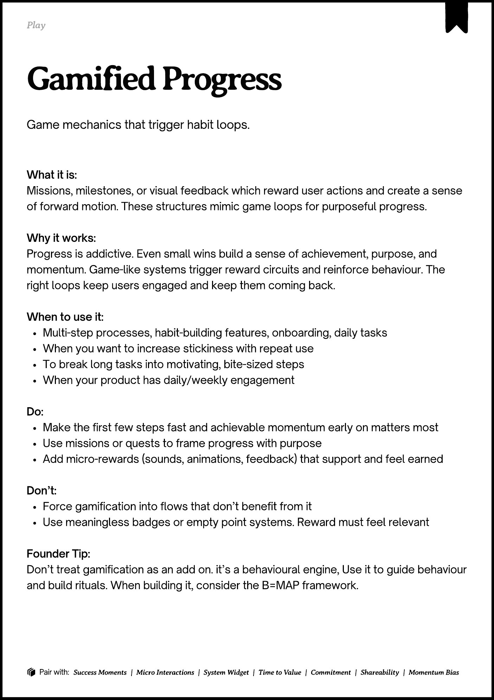
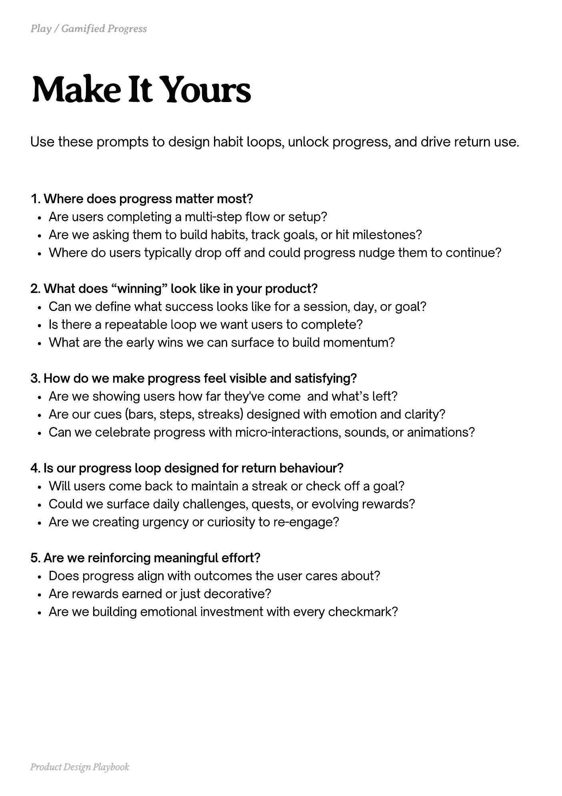
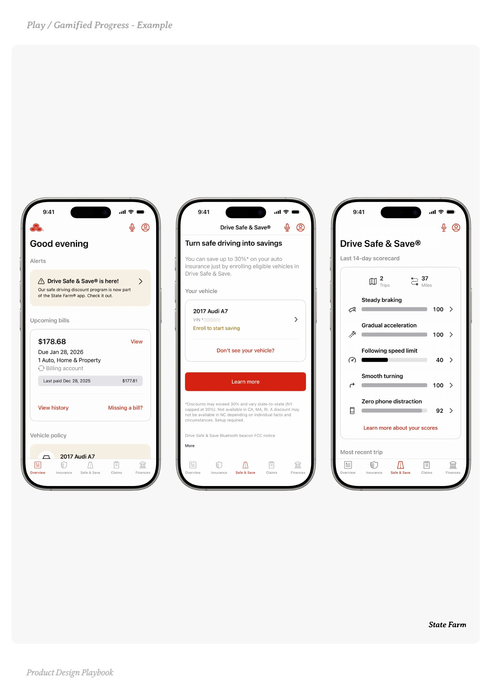
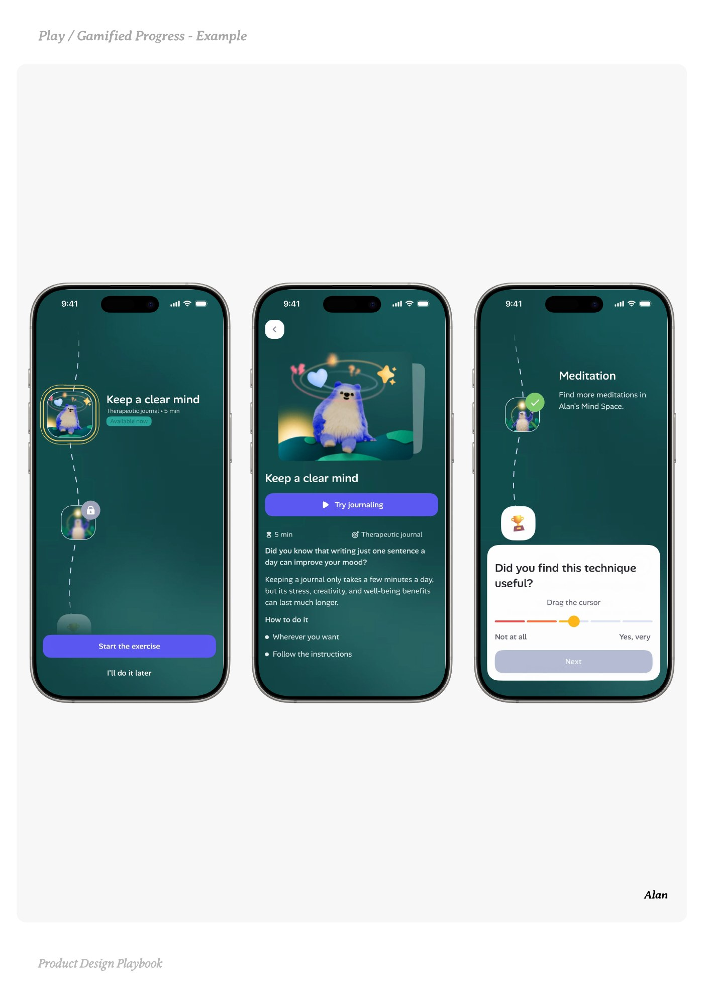
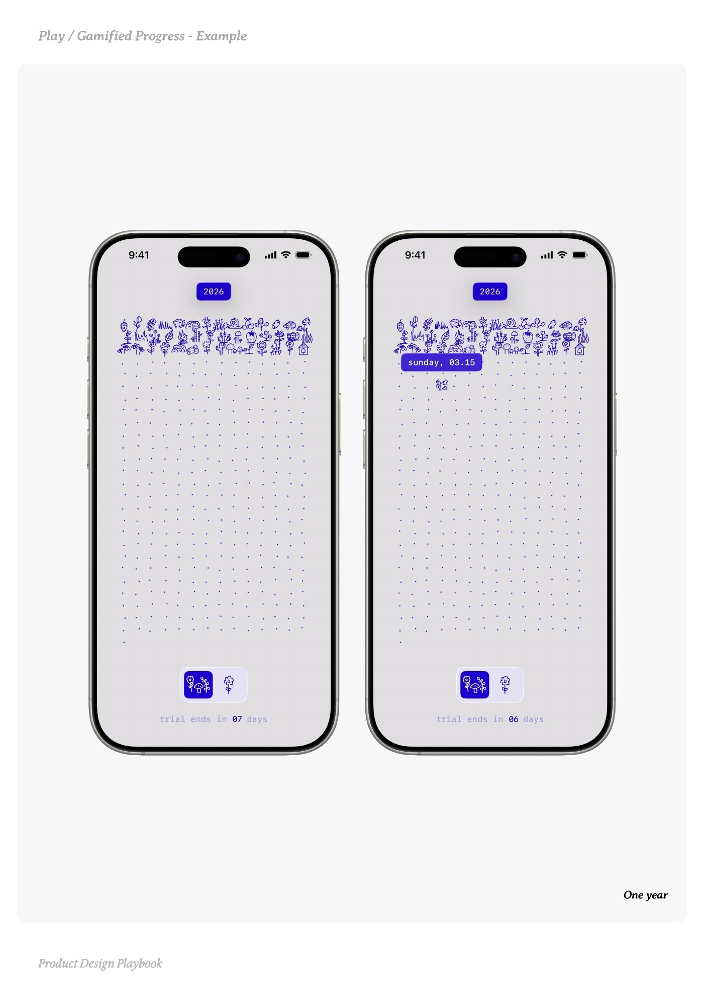

# Gamified Progress


Source-faithful grouping of PDF pages 197 through 201.


## Play overview, PDF page 197

[Open extracted page text](../source/pages/page-197.md) | [Open full-page screenshot](../screenshots/page-197.jpg)



### Extracted text

```text
􀉟

lay

Game mechanics that trigger habit loops.

What it is:

Missions, milestones, or visual feedback which reward user actions and create a sense
of forward motion. These structures mimic game loops for purposeful progress.


Why it works:

Progress is addictive. Even small wins build a sense of achievement, purpose, and
momentum. Game-like systems trigger reward circuits and reinforce behaviour. The
right loops keep users engaged and keep them coming back.


When to use it:

Multi-step processes, habit-building features, onboarding, daily tasks

When you want to increase stickiness with repeat use

To break long tasks into motivating, bite-sized steps

When your product has daily/weekly engagement


Do:

Make the first few steps fast and achievable momentum early on matters most

Use missions or quests to frame progress with purpose

Add micro-rewards (sounds, animations, feedback) that support and feel earned


Don’t:

Force gamification into flows that don’t benefit from it

Use meaningless badges or empty point systems. Reward must feel relevant


Founder Tip:

Don’t treat gamification as an add on. it’s a behavioural engine, Use it to guide behaviour
and build rituals. When building it, consider the B=MAP framework.

􀰴 Pair with:

Success Moments

|

Micro Interactions

|

System Widget

|

Time to Value

|

Commitment

|

Shareability

|

Momentum Bias
```

## Make it yours prompts, PDF page 198

[Open extracted page text](../source/pages/page-198.md) | [Open full-page screenshot](../screenshots/page-198.jpg)



### Extracted text

```text
Use these prompts to design habit loops, unlock progress, and drive return use.

1. Where does progress matter most?

Are users completing a multi-step flow or setup?

Are we asking them to build habits, track goals, or hit milestones?

Where do users typically drop off and could progress nudge them to continue?



2. What does “winning” look like in your product?

Can we define what success looks like for a session, day, or goal?

Is there a repeatable loop we want users to complete?

What are the early wins we can surface to build momentum?



3. How do we make progress feel visible and satisfying?

Are we showing users how far they've come

and what’s left?


Are our cues (bars, steps, streaks) designed with emotion and clarity?

Can we celebrate progress with micro-interactions, sounds, or animations?



4. Is our progress loop designed for return behaviour?

Will users come back to maintain a streak or check off a goal?

Could we surface daily challenges, quests, or evolving rewards?

Are we creating urgency or curiosity to re-engage?



5. Are we reinforcing meaningful effort?

Does progress align with outcomes the user cares about?

Are rewards earned or just decorative?

Are we building emotional investment with every checkmark?

Product Design Playbook
```

## Example 1, PDF page 199

[Open extracted page text](../source/pages/page-199.md) | [Open full-page screenshot](../screenshots/page-199.jpg)



### Extracted text

```text
a ame rre ame

State Farm

Product Design Playbook
```

## Example 2, PDF page 200

[Open extracted page text](../source/pages/page-200.md) | [Open full-page screenshot](../screenshots/page-200.jpg)



### Extracted text

```text
laaal

Alan

Product Design Playbook
```

## Example 3, PDF page 201

[Open extracted page text](../source/pages/page-201.md) | [Open full-page screenshot](../screenshots/page-201.jpg)



### Extracted text

```text
ay ae rre ae

One year

Product Design Playbook
```
