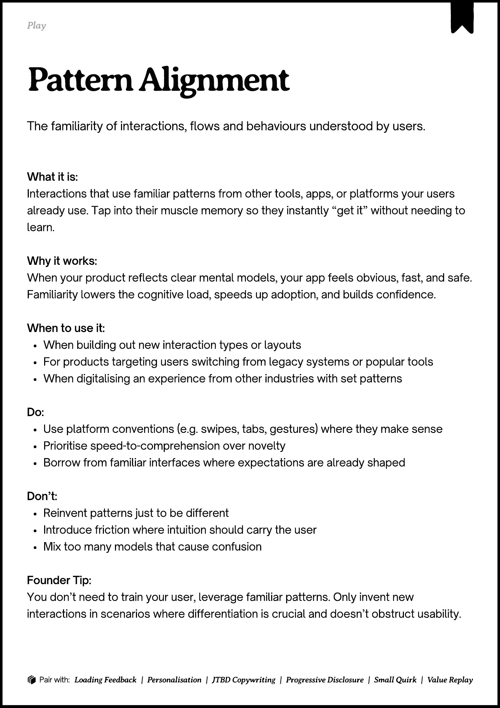
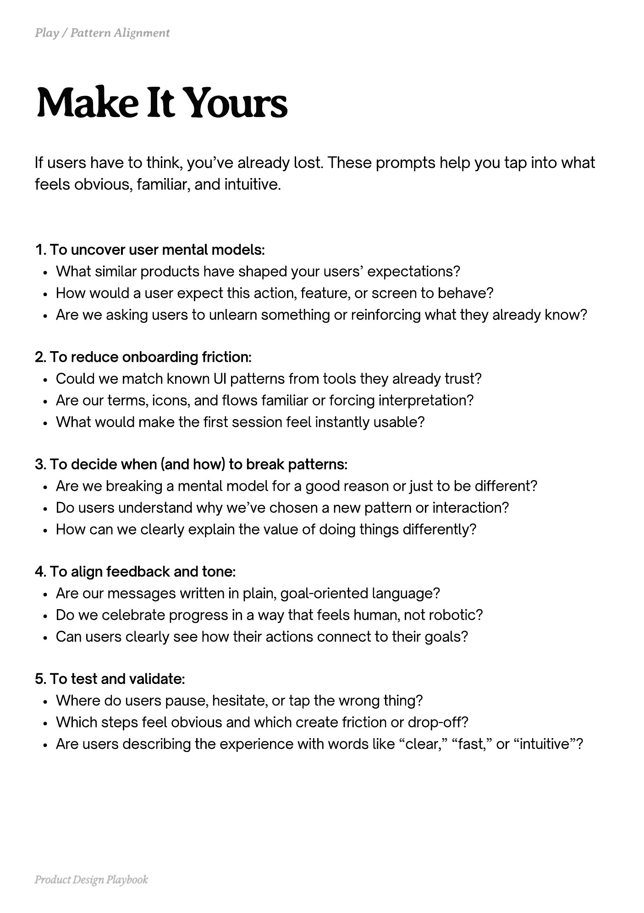
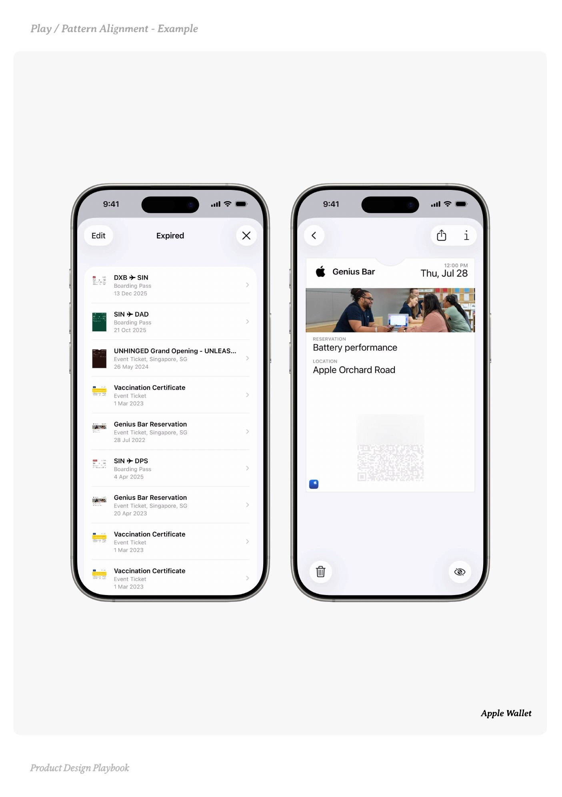
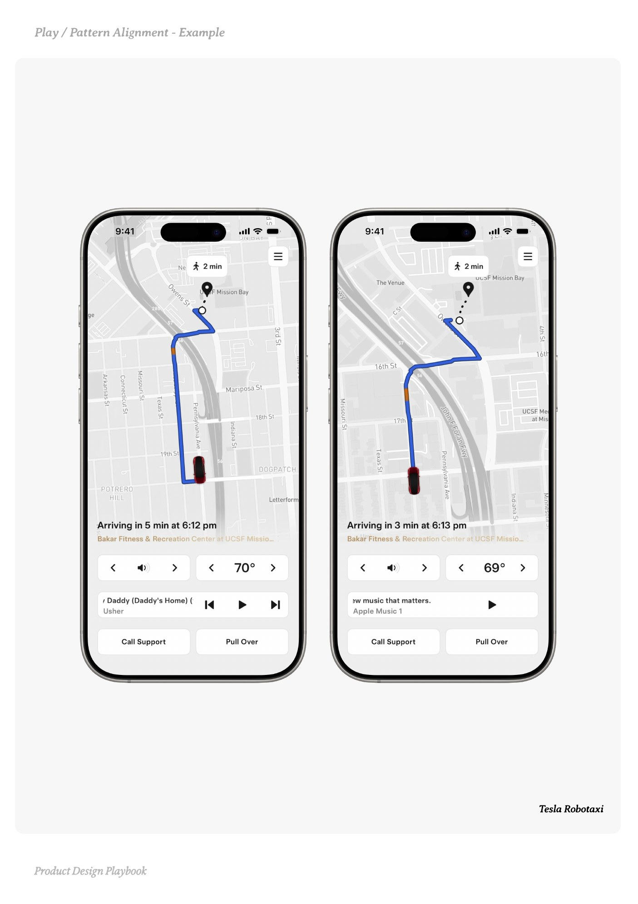
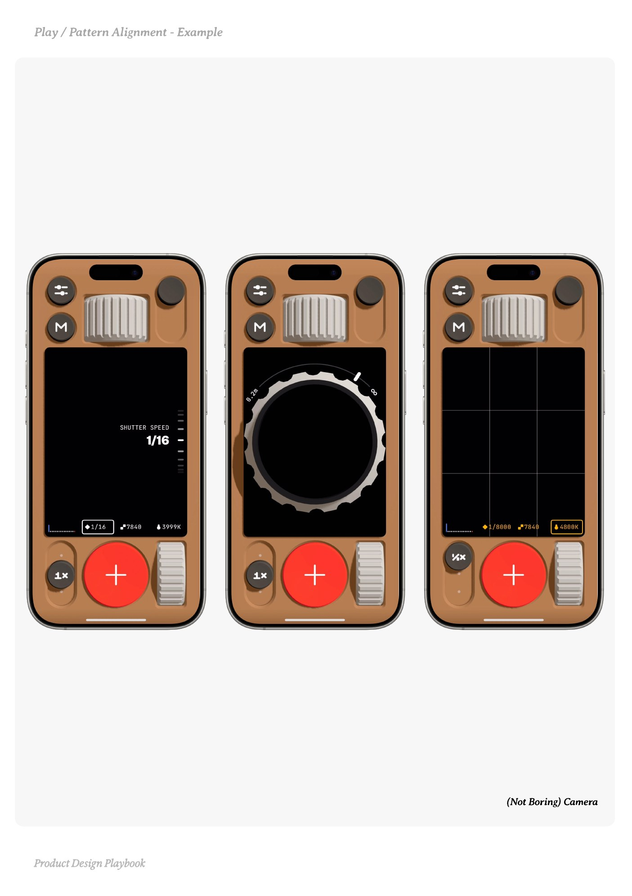

# Pattern Alignment


Source-faithful grouping of PDF pages 202 through 206.


## Play overview, PDF page 202

[Open extracted page text](../source/pages/page-202.md) | [Open full-page screenshot](../screenshots/page-202.jpg)



### Extracted text

```text
􀉟

Play

The familiarity of interactions, flows and behaviours understood by users.

What it is:

Interactions that use familiar patterns from other tools, apps, or platforms your users
already use. Tap into their muscle memory so they instantly “get it” without needing to
learn.


Why it works:

When your product reflects clear mental models, your app feels obvious, fast, and safe.
Familiarity lowers the cognitive load, speeds up adoption, and builds confidence.


When to use it:

When building out new interaction types or layouts

For products targeting users switching from legacy systems or popular tools

When digitalising an experience from other industries with set patterns


Do:

Use platform conventions (e.g. swipes, tabs, gestures) where they make sense

Prioritise speed-to-comprehension over novelty

Borrow from familiar interfaces where expectations are already shaped


Don’t:

Reinvent patterns just to be different

Introduce friction where intuition should carry the user

Mix too many models that cause confusion


Founder Tip:

You don’t need to train your user, leverage familiar patterns. Only invent new
interactions in scenarios where differentiation is crucial and doesn’t obstruct usability.

􀰴 Pair with:

Loading Feedback

| Personalisation |

JTBD Copywriting

|

Progressive Disclosure

| Small Quirk |

Value Replay
```

## Make it yours prompts, PDF page 203

[Open extracted page text](../source/pages/page-203.md) | [Open full-page screenshot](../screenshots/page-203.jpg)



### Extracted text

```text
If users have to think, you’ve already lost. These prompts help you tap into what
feels obvious, familiar, and intuitive.
1. To uncover user mental models:

What similar products have shaped your users’ expectations?

How would a user expect this action, feature, or screen to behave?

Are we asking users to unlearn something or reinforcing what they already know?


2. To reduce onboarding friction:

Could we match known UI patterns from tools they already trust?

Are our terms, icons, and flows familiar or forcing interpretation?

What would make the first session feel instantly usable?


3. To decide when (and how) to break patterns:

Are we breaking a mental model for a good reason or just to be different?

Do users understand why we’ve chosen a new pattern or interaction?

How can we clearly explain the value of doing things differently?


4. To align feedback and tone:

Are our messages written in plain, goal-oriented language?

Do we celebrate progress in a way that feels human, not robotic?

Can users clearly see how their actions connect to their goals?


5. To test and validate:

Where do users pause, hesitate, or tap the wrong thing?

Which steps feel obvious and which create friction or drop-off?

Are users describing the experience with words like “clear,” “fast,” or “intuitive”?

Product Design Playbook
```

## Example 1, PDF page 204

[Open extracted page text](../source/pages/page-204.md) | [Open full-page screenshot](../screenshots/page-204.jpg)



### Extracted text

```text
la atte Alet aple

Apple Wallet

Product Design Playbook
```

## Example 2, PDF page 205

[Open extracted page text](../source/pages/page-205.md) | [Open full-page screenshot](../screenshots/page-205.jpg)



### Extracted text

```text
la atte liet xale

Tesla Robotaxi

Product Design Playbook
```

## Example 3, PDF page 206

[Open extracted page text](../source/pages/page-206.md) | [Open full-page screenshot](../screenshots/page-206.jpg)



### Extracted text

```text
a attern ignment ame

(Not Boring) Camera

Product Design Playbook
```
