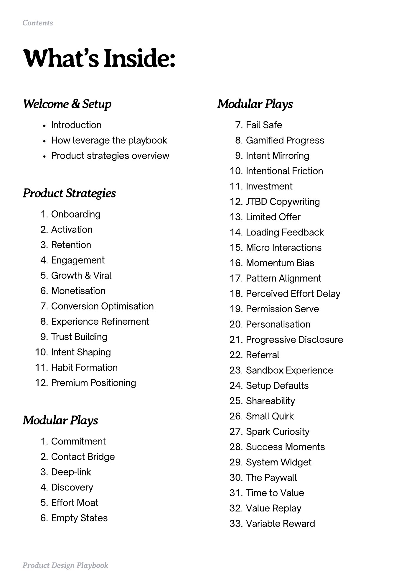

# PDF page 002

Source: `docs/ProductDesignPlaybook_V2.0.pdf`, page 2 of 206.

[Open the full-page screenshot](../../screenshots/page-002.jpg)



## Extracted text

```text
Contents

What’s Inside:
Welcome & Setup
Introduction


Modular Plays
Fail Safe


How leverage the playbook


Gamified Progress


Product strategies overview

Intent Mirroring

Intentional Friction


Product Strategies
Onboarding

Activation

Retention

Engagement

Growth & Viral

Monetisation

Conversion Optimisation

Experience Refinement

Trust Building

Intent Shaping

Habit Formation

Premium Positioning

Investment

JTBD Copywriting

Limited Offer

Loading Feedback

Micro Interactions

Momentum Bias

Pattern Alignment

Perceived Effort Delay

Permission Serve

Personalisation

Progressive Disclosure

Referral

Sandbox Experience

Setup Defaults

Shareability


Modular Plays

Small Quirk

Spark Curiosity


Commitment

Contact Bridge

Deep-link

Discovery

Effort Moat

Empty States

Product Design Playbook

Success Moments

System Widget

The Paywall

Time to Value

Value Replay

Variable Reward
```
