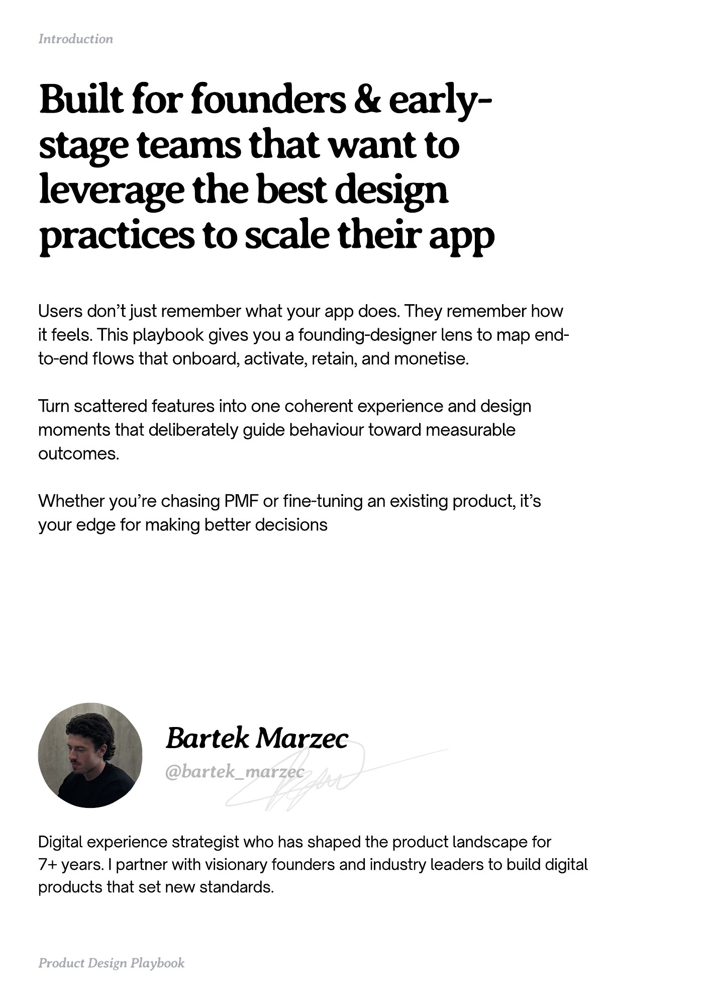

# PDF page 003

Source: `docs/ProductDesignPlaybook_V2.0.pdf`, page 3 of 206.

[Open the full-page screenshot](../../screenshots/page-003.jpg)



## Extracted text

```text
Introduction

Built for founders & earlystage teams that want to
leverage the best design
practices to scale their app
Users don’t just remember what your app does. They remember how
it feels. This playbook gives you a founding-designer lens to map endto-end flows that onboard, activate, retain, and monetise. 


Turn scattered features into one coherent experience and design
moments that deliberately guide behaviour toward measurable
outcomes. 


Whether you’re chasing PMF or fine-tuning an existing product, it’s
your edge for making better decisions

Bartek Marzec
@bartek_marzec

Digital experience strategist who has shaped the product landscape for 

7+ years. I partner with visionary founders and industry leaders to build digital
products that set new standards.

Product Design Playbook
```
