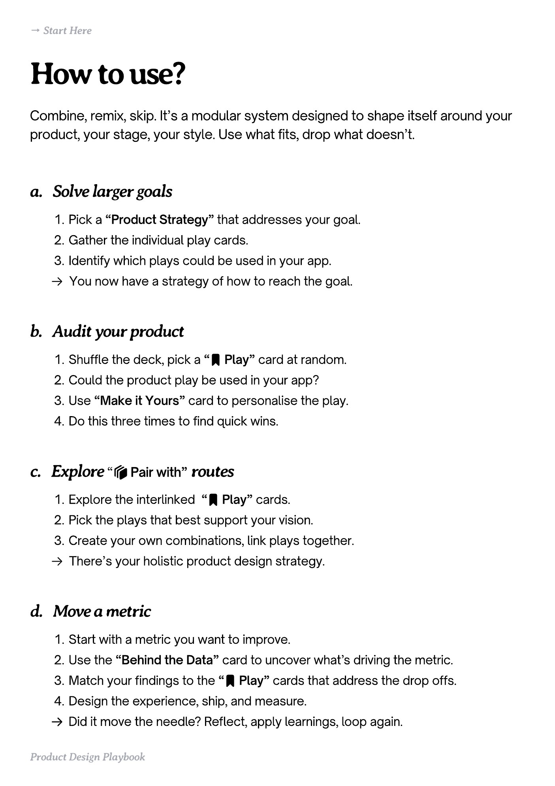

# PDF page 004

Source: `docs/ProductDesignPlaybook_V2.0.pdf`, page 4 of 206.

[Open the full-page screenshot](../../screenshots/page-004.jpg)



## Extracted text

```text
→ Start Here

How to use?
Combine, remix, skip. It’s a modular system designed to shape itself around your
product, your stage, your style. Use what fits, drop what doesn’t.

a. Solve larger goals
Pick a “Product Strategy” that addresses your goal.

Gather the individual play cards.

Identify which plays could be used in your app.

􀰑 You now have a strategy of how to reach the goal.

b. Audit your product
Shuffle the deck, pick a “􀉟 Play” card at random.

Could the product play be used in your app?

Use “Make it Yours” card to personalise the play.

Do this three times to find quick wins.

c. Explore “􀰴 Pair with” routes
Explore the interlinked “􀉟 Play” cards.

Pick the plays that best support your vision.

Create your own combinations, link plays together.

􀰑 There’s your holistic product design strategy.

d. Move a metric
Start with a metric you want to improve.

Use the “Behind the Data” card to uncover what’s driving the metric.

Match your findings to the “􀉟 Play” cards that address the drop offs.

Design the experience, ship, and measure.

􀰑 Did it move the needle? Reflect, apply learnings, loop again.
Product Design Playbook
```
